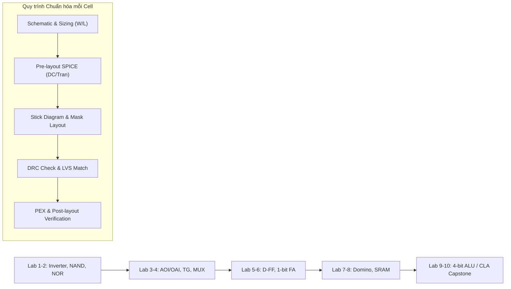
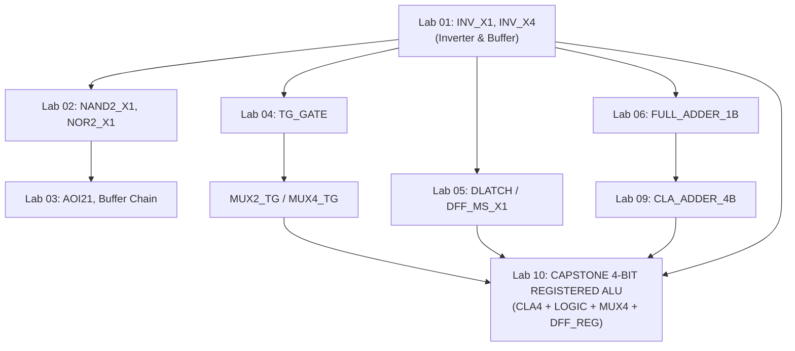

# ĐỀ CƯƠNG CHI TIẾT HỌC PHẦN
# THỰC HÀNH THIẾT KẾ VLSI (VLSI DESIGN LABORATORY)

---
**Bộ môn:** Điện tử - Viễn thông | **Khoa:** Điện - Điện tử  
**Trường:** Đại học Sư phạm Kỹ thuật – Đại học Đà Nẵng  
**Chương trình đào tạo:** Kỹ sư Thiết kế Vi mạch Bán dẫn (Mã chuyên ngành: `5054125V`)  
**Khóa áp dụng:** Tuyển sinh 2024, 2025, 2026 trở đi  
---

## I. THÔNG TIN TỔNG QUÁT

- **Tên học phần (tiếng Việt):** Thực hành Thiết kế VLSI
- **Tên học phần (tiếng Anh):** VLSI Design Laboratory
- **Mã số học phần:** `5505382`
- **Số tín chỉ:** 2 tín chỉ thực hành (0 tín chỉ lý thuyết + 2 tín chỉ thực hành = 60 tiết thực hành tại phòng Lab vi tính chuyên ngành)
- **Phân bổ thời gian:** 12 buổi × 5 tiết/buổi = 60 tiết
- **Thuộc khối kiến thức:** Chuyên ngành bắt buộc
- **Học phần tiên quyết / Học trước:**
  - *Thiết kế VLSI* (`5505370` - Học phần lý thuyết đi kèm, học trước hoặc song hành)
  - *Linh kiện điện tử & Công nghệ bán dẫn*
  - *Kỹ thuật xung số & Thiết kế vi mạch số*
- **Địa điểm thực hành:** Phòng máy tính chuyên ngành Thiết kế Vi mạch.

---

## II. ĐỊNH VỊ VÀ ĐIỀU CHỈNH TRỤC SƯ PHẠM (PEDAGOGICAL ALIGNMENT)

> [!IMPORTANT]
> **Hiệu đính căn bản so với bản thảo CTĐT cũ:**  
> Trong một số bản thảo CTĐT sơ khởi trước đây, học phần `5505382` bị nhầm lẫn mô tả sang *"thực hành ngôn ngữ VHDL trên FPGA"*. Đây là lỗi kế thừa sao chép từ học phần *Thực hành Thiết kế Vi mạch số / FPGA*.  
> 
> Trong cấu trúc chuẩn quốc tế (IEEE/ABET) và CTĐT Vi mạch 2026:
> 1. **Mức Hệ thống & RTL:** Đã được đảm nhiệm độc lập bởi học phần *Thực hành Thiết kế Vi mạch số / FPGA* (Verilog HDL trên kit FPGA DE25-Standard).
> 2. **Mức Transistor & Vật lý (Học phần này):** Bắt buộc phải là **Full-Custom CMOS IC Design Flow** (từ sơ đồ nguyên lý Schematic, mô phỏng SPICE DC/AC/Transient, thiết kế mặt nạ vật lý Mask Layout, kiểm tra luật hình học DRC, đối chiếu sơ đồ LVS, đến trích xuất ký sinh PEX và mô phỏng sau đóng gói Post-layout).
> 
> Việc đưa sinh viên xuống mức transistor giúp sinh viên nhìn thấy rõ: tại sao có trễ truyền lan, tại sao dòng rò tăng khi thu nhỏ kích thước, hiện tượng ký sinh RC của dây kim loại ảnh hưởng thế nào đến tần số làm việc – những điều mà mô phỏng RTL hoặc nạp FPGA hoàn toàn che khuất.

---

## III. MỤC TIÊU VÀ CHUẨN ĐẦU RA HỌC PHẦN (COURSE LEARNING OUTCOMES - CLO)

### 1. Mục tiêu học phần (Course Goals)
Học phần trang bị cho người học năng lực thực hiện quy trình thiết kế vi mạch tích hợp CMOS cỡ lớn (VLSI) ở mức vật lý và mức transistor; sử dụng thành thạo các công cụ tự động hóa thiết kế điện tử (EDA tools) chuẩn công nghiệp (Electric VLSI Design System, LTspice / ngspice); có khả năng phân tích, đo đạc đặc tính điện động học, tối ưu diện tích – công suất – tốc độ (PPA), và thiết kế thư viện tế bào chuẩn (Standard Cell Library) tích hợp thành một hệ thống con hoàn chỉnh (Sub-system / Datapath).

### 2. Chuẩn đầu ra học phần (CLOs) và Ma trận Ánh xạ PLO

| Mã CLO | Mô tả Chuẩn đầu ra (Người học có khả năng:) | Mức độ Bloom | Ánh xạ PLO (CTĐT 2026) |
| :---: | :--- | :---: | :---: |
| **CLO1** | **Phân tích và mô phỏng đặc tính transistor & cổng logic:** Sử dụng SPICE để mô phỏng DC, AC, Transient; trích xuất các tham số ngưỡng $V_{th}$, dòng bão hòa $I_{dsat}$, đường cong truyền đạt điện áp (VTC), lề nhiễu ($NM_L, NM_H$) và thời gian trễ ($t_{pHL}, t_{pLH}, t_r, t_f$). | C4 (Phân tích) | **PLO1, PLO2** |
| **CLO2** | **Thiết kế hình học và đóng gói Layout vi mạch:** Thực hiện sơ đồ que (Stick Diagram), thiết kế mặt nạ Layout (Poly, Active, Well, Contact, Metal 1-3) cho các tế bào logic tổ hợp và tuần tự theo bộ luật thiết kế hình học khả năng sản xuất (DRC MOSIS SCMOS). | C5 (Thiết kế/Sáng tạo) | **PLO2, PLO4** |
| **CLO3** | **Kiểm chứng xác thực vật lý (Physical Verification):** Thực hiện quy trình đối chiếu sơ đồ nguyên lý với mặt nạ (LVS - Layout vs. Schematic), trích xuất điện trở và điện dung ký sinh (PEX), đánh giá độ suy giảm hiệu năng giữa mô phỏng Pre-layout và Post-layout. | C4, C5 | **PLO2, PLO5** |
| **CLO4** | **Tích hợp hệ thống con và làm việc chuyên nghiệp:** Thiết kế, tích hợp thư viện tế bào chuẩn thành khối đường dữ liệu 4-bit (ALU/Adder/SRAM) hoàn chỉnh; lập tài liệu kỹ thuật datasheet (Cell Datasheet), báo cáo nghiệm thu và tuân thủ đạo đức nghề nghiệp thiết kế vi mạch. | C5, A3 | **PLO4, PLO5** |

---

## IV. BỘ CÔNG CỤ VÀ NGUYÊN NẮC VẬN HÀNH

- **Phần mềm EDA lõi:**
  - **Electric VLSI Design System (v9.07+):** Công cụ CAD mã nguồn mở mạnh mẽ hỗ trợ thiết kế Schematic, Layout, DRC tích hợp, LVS tích hợp, và PEX (Parasitic Extraction).
  - **LTspice XVII / LTspice 2025 (hoặc ngspice):** Trình mô phỏng mạch tương tự/số SPICE độ chính xác cao mức công nghiệp.
- **Công nghệ chế tạo tham chiếu (PDK):**
  - **MOSIS SCMOS Submicron (C5N 0.5µm n-well process):** $\lambda = 0.30\,\mu\text{m}$, 3 lớp kim loại (Metal 1, Metal 2, Metal 3), 1 lớp Poly, nguồn cấp chuẩn $V_{DD} = 5.0\,\text{V}$ (hoặc kiểm tra ở $3.3\,\text{V}$). Thư viện mô hình `C5_models.txt` chuẩn Level 3 / BSIM3.
  - Hỗ trợ module mở rộng đối sánh: Tiến trình PDK mã nguồn mở SkyWater 130nm ($V_{DD} = 1.8\,\text{V}$) ở các bài lab nâng cao.
- **Sản phẩm xuyên suốt (Capstone Project):**
  - **Xây dựng Thư viện Tế bào Chuẩn (Standard Cell Library) & Thiết kế Vi mạch Full-Custom Khối Xử lý Dữ liệu 4-bit (4-bit Registered Datapath ALU / CLA Adder)**.



---

## V. KẾ HOẠCH BÀI THỰC HÀNH CHI TIẾT (12 BUỔI = 60 TIẾT)

Mỗi buổi thực hành được cấu trúc nghiêm ngặt theo **3 pha**:
1. **Pre-lab (Ở nhà):** Tính toán thông số lý thuyết tay ($W/L$, điện dung, trễ $RC$), vẽ Stick Diagram trước vào vở thí nghiệm. Giảng viên kiểm tra đầu giờ; không đạt Pre-lab không được vào máy.
2. **In-lab (5 tiết trên lớp):**
   - **Ex1 – Ex3 (Cốt lõi, bắt buộc):** Dựng Schematic, tính toán kích thước, chạy mô phỏng SPICE tiền thiết kế (Pre-layout) và kiểm chứng chức năng logic.
   - **Ex4 (Tiêu chuẩn):** Thiết kế Layout vật lý, chạy kiểm tra luật DRC và đối chiếu LVS đạt kết quả trùng khớp hoàn hảo (LVS Matched).
   - **Ex5 (Thử thách nâng cao):** Trích xuất điện trở/điện dung ký sinh (PEX), chạy mô phỏng Post-layout, đo đạc độ lệch thời gian trễ và công suất tiêu tán.
3. **Post-lab (Báo cáo tổng kết):** Hoàn thiện đồ thị VTC, bảng đối chiếu 3 cột: **[Lý thuyết tính tay] vs [SPICE Pre-layout] vs [Đo đạc Post-layout]**, phân tích và giải thích nguyên nhân vật lý.

---

### BẢNG TIẾN TRÌNH 12 BUỔI THỰC HÀNH

| Buổi | Tên bài Lab | Trọng tâm Kỹ thuật Mức Transistor | Sản phẩm / IP bàn giao | CLO |
| :---: | :--- | :--- | :--- | :---: |
| **01** | **Lab 00: Nhập môn Mô phỏng Mạch với SPICE và LTspice** | Cú pháp SPICE Netlist, bảng phím tắt, bảng đơn vị quy ước (bẫy m vs Meg), 4 chế độ mô phỏng (.OP, .DC, .TRAN, .AC), câu lệnh đo lường tự động .MEAS, và liên kết thư viện mô hình bán dẫn ngoài (C5_models.txt). | Kỹ năng Netlist & Đo lường tự động SPICE. | CLO1 |
| **02** | **Lab 01: Đặc tính I-V của MOSFET & Phân tích CMOS Inverter** | Đo kiểm $I_{DS}-V_{GS}$ ($V_{th}, K_n, K_p$), $I_{DS}-V_{DS}$ (bão hòa, $\lambda$); Thiết kế Inverter đối xứng $V_M = V_{DD}/2$, đo lề nhiễu $NM_L, NM_H$, trễ $t_{pHL}, t_{pLH}$; Layout Inverter, DRC & LVS. | IP `INV_X1`, Cell Icon, Datasheet VTC, Layout không lỗi DRC/LVS. | CLO1, CLO2, CLO3 |
| **03** | **Lab 02: Thiết kế Cổng Logic Tĩnh NAND2 & NOR2 CMOS** | Tính toán tỉ lệ $(W/L)$ theo phương pháp điện trở tương đương $R_{on}$; vẽ Stick Diagram tối ưu đường khuếch tán (Euler Path); Layout chia sẻ cực má/cực nguồn; DRC & LVS. | IP `NAND2_X1`, `NOR2_X1`, Bảng so sánh PPA giữa NAND và NOR. | CLO1, CLO2, CLO3 |
| **04** | **Lab 03: Cổng Phức hợp (AOI/OAI) & Tối ưu Trễ theo Phương pháp Logical Effort** | Thiết kế cổng AOI21, AOI22; xác định Logical Effort $g$, Electrical Effort $h$, trễ ký sinh $p$; định kích thước tối ưu chuỗi cổng tải nặng (Buffer Chain). | IP `AOI21_X1`, Chuỗi đệm Inverter đạt trễ cực tiểu lý thuyết. | CLO1, CLO2 |
| **05** | **Lab 04: Cổng Truyền (Transmission Gate) & Bộ Dồn kênh MUX Mức Transistor** | Khảo sát truyền mức logic '1'/'0' qua NMOS/PMOS riêng lẻ (suy giảm điện áp ngưỡng); thiết kế CMOS TG dẫn toàn dải; cấu trúc MUX 2:1 và MUX 4:1 dùng TG. | IP `TG_GATE`, `MUX2_TG`, `MUX4_TG`; So sánh diện tích/trễ với MUX cổng tĩnh. | CLO1, CLO2, CLO3 |
| **06** | **Lab 05: Mạch Tuần tự Mức Transistor: D-Latch & D-Flip-Flop C²MOS/TSPC** | Thiết kế D-Latch tích cực mức cao/thấp; D-FF Master-Slave dùng Transmission Gate và C²MOS; khảo sát thời gian thiết lập ($t_{setup}$), thời gian giữ ($t_{hold}$), và trễ $t_{c-q}$. | IP `DLATCH_X1`, `DFF_MS_X1`; Đồ thị xác định $t_{setup}$ và $t_{hold}$ qua mô phỏng quét quét trễ. | CLO1, CLO2, CLO3 |
| **07** | **Lab 06: Thiết kế Mạch Cộng Toàn phần 1-bit (1-bit Full Adder)** | Khảo sát 2 kiến trúc: 28-transistor Mirror Adder và 16-transistor Transmission Gate Adder; tối ưu đường trễ Carry Propagation; Layout và PEX. | IP `FULL_ADDER_1B`; So sánh diện tích Layout và trễ trích xuất Post-layout. | CLO1, CLO2, CLO3 |
| **08** | **Lab 07: Kỹ thuật Logic Động (Dynamic CMOS Logic)** | Mạch Domino Logic (Precharge - Evaluate Phase); nghiên cứu hiện tượng mất điện tích (Charge Sharing), rò dòng kênh phụ thuộc và giải pháp Keeper Transistor. | Mạch 4-input Domino OR/AND kèm Keeper; Bảng đánh giá lề nhiễu động. | CLO1, CLO3 |
| **09** | **Lab 08: Thiết kế Ô Nhớ Bán dẫn Tĩnh (6T SRAM Cell & Read/Write Circuitry)** | Phân tích tỉ lệ Cell Ratio ($\beta_1/\beta_5$) và Pull-up Ratio ($\beta_4/\beta_6$); mô phỏng Static Noise Margin (SNM) dạng bướm; mạch Precharge, Write Driver và Sense Amplifier. | Khối SRAM 1-bit hoàn chỉnh; Đường cong SNM mô phỏng chế độ Đọc/Ghi. | CLO1, CLO2, CLO4 |
| **10** | **Lab 09: Thiết kế Đường Dữ liệu Khối Cộng Nhanh 4-bit (4-bit CLA Adder)** | Ghép nối phân cấp các tế bào chuẩn thành bộ cộng tràn sớm CLA 4-bit (Generate $G_i$, Propagate $P_i$); định tuyến Metal 1/Metal 2; kiểm tra DRC/LVS toàn hệ thống. | IP `CLA_ADDER_4B` hoàn thiện Layout mức khối; Đạt đồng bộ LVS 100%. | CLO2, CLO3, CLO4 |
| **11** | **Lab 10: Capstone Project: Tích hợp Vi mạch 4-bit Registered ALU & Xác thực Vật lý Toàn diện** | Tích hợp CLA 4-bit + Khối Logic (AND, OR, XOR) + MUX 4:1 + D-FF ngõ ra; Tạo vòng cấp nguồn (Power Ring VDD/GND); Chạy DRC cấp chip, LVS cấp chip, trích xuất PEX đo tần số cực đại $f_{max}$. | Vi mạch hoàn chỉnh sẵn sàng đóng gói (Top-level Layout); File trích xuất ký sinh; Cell Datasheet hoàn chỉnh. | CLO1 đến CLO4 |
| **12** | **Buổi 12: Báo cáo Nghiệm thu Capstone, Vấn đáp Bảo vệ & Đánh giá Kỹ năng Thực hành** | Sinh viên trình bày báo cáo vi mạch, bảo vệ các quyết định sizing $(W/L)$, phương án đi dây Layout; thực hiện bài thi thao tác nhanh tại máy (đo $V_{th}$ hoặc sửa lỗi DRC/LVS bất kỳ). | Điểm tổng kết thực hành; Biên bản đánh giá theo chuẩn Rubric OBE. | CLO1 đến CLO4 |

---

## VI. MA TRẬN KẾ THỪA IP XUYÊN SUỐT KHÓA HỌC



```text
Sơ đồ dạng phân cấp văn bản thuần:
Lab 01 (INV_X1, INV_X4)
  |--+--> Lab 02 (NAND2_X1, NOR2_X1)
  |  |     |--+--> Lab 03 (AOI21, Buffer Chain)
  |--+--> Lab 04 (TG_GATE) ---> MUX2_TG / MUX4_TG ------------+
  |--+--> Lab 05 (DLATCH, DFF_MS_X1) -------------------------+
  |--+--> Lab 06 (FULL_ADDER_1B) ---> Lab 09 (CLA_ADDER_4B) --+
  |                                                           |
  +-----------------------------------------------------------+--> Lab 10 (CAPSTONE 4-BIT ALU)
```

---

## VII. HỆ THỐNG ĐÁNH GIÁ VÀ TIÊU CHÍ RUBRIC CHUẨN OBE

### 1. Phân bổ điểm thành phần
- **Điểm chuyên cần & Chuẩn bị Pre-lab (20%):** Kiểm tra bài tính toán tay, stick diagram trước giờ thực hành (5 điểm × 10 bài / 50 quy đổi).
- **Điểm Thao tác In-lab & Nghiệm thu tại bàn (40%):** Hoàn thành Ex1–Ex3 (tối đa 7 điểm/bài), Ex4 (tối đa 8.5 điểm/bài), Ex5 (tối đa 10 điểm/bài); LVS báo Matched tại lớp.
- **Điểm Báo cáo Post-lab & Tài liệu Datasheet (15%):** Báo cáo so sánh lý thuyết - SPICE - PEX đúng format kỹ thuật vi mạch.
- **Điểm Đồ án Capstone & Thi Vấn đáp Cuối kỳ (25%):** Đánh giá tính toàn vẹn của layout vi mạch 4-bit ALU, kết quả LVS/PEX sạch, và năng lực trả lời vấn đáp phân tích mạch mức transistor.

### 2. Tiêu chí Rubric Đánh giá Nghiệm thu Mỗi Bài Lab (Thang 10)

| Tiêu chí | Trọng số | Mức 1: Xuất sắc (8.5 – 10) | Mức 2: Khá (7.0 – 8.4) | Mức 3: Đạt (5.0 – 6.9) | Mức 4: Không đạt (< 5.0) |
| :--- | :---: | :--- | :--- | :--- | :--- |
| **1. Chuẩn bị Pre-lab** | 20% | Tính toán tay đầy đủ $W/L$, $V_M$, trễ $RC$; Stick diagram chuẩn xác, tối ưu đường Euler; trả lời lưu loát câu hỏi lý thuyết. | Tính toán đúng các công thức chính; Stick diagram đúng nguyên lý nhưng chưa tối ưu diện tích. | Có làm tính toán nhưng còn sai lệch số học; Stick diagram vẽ sơ sài. | Không làm bài chuẩn bị hoặc sao chép bài của người khác. |
| **2. Schematic & SPICE Pre-layout (Ex1–Ex3)** | 30% | Dựng Schematic chuẩn netlist; Chạy đủ DC Sweep, Transient; Đo đạc chính xác $V_{th}, V_M, t_{pHL}, t_{pLH}$; đồ thị trực quan, ghi chú rõ ràng. | Dựng Schematic đúng; Chạy được SPICE nhưng đo đạc thông số trễ còn thao tác lúng túng. | Mạch mô phỏng được nhưng thông số kích thước $(W/L)$ chưa tối ưu theo yêu cầu. | Không hoàn thành mạch hoặc mô phỏng SPICE báo lỗi không hội tụ (Convergence Error). |
| **3. Physical Layout, DRC & LVS (Ex4)** | 30% | Layout chặt chẽ, tối ưu diện tích; 0 lỗi DRC; Đối chiếu LVS báo **"Netlists Match Perfectly"** độc lập không cần can thiệp. | Layout đạt chuẩn, 0 lỗi DRC; LVS match sau 1–2 lần sửa chữa nhỏ về chân/tên port. | Layout còn cồng kềnh, vi phạm một vài lỗi DRC đơn giản nhưng tự sửa được; LVS match. | Không hoàn thành Layout, hoặc vi phạm nhiều lỗi DRC nghiêm trọng, LVS không match. |
| **4. PEX & Phân tích Post-layout (Ex5)** | 10% | Trích xuất PEX thành công; Mô phỏng Post-layout; Phân tích sâu sắc sự thay đổi trễ do điện dung ký sinh dây dẫn và mối nối. | Trích xuất PEX thành công; Chạy được mô phỏng Post-layout nhưng phần giải thích nguyên nhân còn mờ nhạt. | Có thực hiện lệnh trích xuất PEX nhưng chưa liên hệ được với thông số trễ. | Không thực hiện được bước trích xuất ký sinh PEX. |
| **5. Thái độ & Tác phong Kỹ sư** | 10% | Tuân thủ tuyệt đối quy định phòng lab, tự giác thực hành, lưu trữ dữ liệu khoa học, trung thực với số liệu đo đạc. | Đi học đúng giờ, chấp hành tốt nội quy; hoàn thành bài đúng thời hạn. | Còn để nhắc nhở về tác phong phòng lab hoặc nộp bài muộn. | Vi phạm quy chế thi cử, sao chép dữ liệu đo đạc của bạn. |

---

## VIII. DANH MỤC TÀI LIỆU HỌC TẬP THAM KHẢO

1. **Giáo trình chính:**  
   - R. Jacob Baker, *CMOS: Circuit Design, Layout, and Simulation*, 4th Edition, IEEE Press / Wiley, 2019. (Tài liệu chuẩn mực hướng dẫn Electric VLSI và LTspice).
   - Neil H.E. Weste, David Money Harris, *CMOS VLSI Design: A Circuits and Systems Perspective*, 4th Edition, Addison-Wesley, 2011.
2. **Tài liệu tham khảo chuyên sâu:**  
   - Sung-Mo Kang, Yusuf Leblebici, *CMOS Digital Integrated Circuits: Analysis and Design*, 4th Edition, McGraw-Hill, 2014.
   - Jan M. Rabaey, Anantha Chandrakasan, Borivoje Nikolic, *Digital Integrated Circuits: A Design Perspective*, 2nd Edition, Prentice Hall, 2003.
3. **Tài liệu công cụ & Phần mềm:**  
   - *Hướng dẫn cài đặt Electric & LTSpice* - VERON Labs / Bộ môn Điện tử Viễn thông.
   - Steven M. Rubin, *Electric VLSI Design System User's Manual*, Static Free Software.
