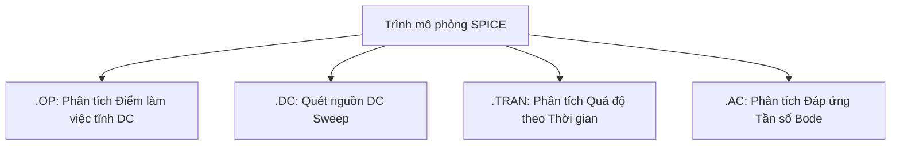

# THỰC HÀNH THIẾT KẾ VLSI — BÀI 0
# NHẬP MÔN MÔ PHỎNG MẠCH VỚI SPICE VÀ LTSPICE

---
**Bộ môn:** Điện tử - Viễn thông | **Khoa:** Điện - Điện tử  
**Trường:** Đại học Sư phạm Kỹ thuật – Đại học Đà Nẵng  
**Thời lượng:** 5 tiết thực hành tại phòng máy (kết hợp tự học Pre-lab & hoàn thiện Post-lab)  
**Công cụ sử dụng:** LTspice XVII / LTspice 2025 (hoặc ngspice)  
**Tài liệu tham khảo:** *LTspice User's Guide* (Analog Devices) & *Hướng dẫn thực hành Điện tử tương tự* (ĐH KHTN ĐHQG-HCM)  
---

## I. MỤC TIÊU

Sau khi hoàn thành bài thực hành này, sinh viên có khả năng:
1. **Hiểu rõ bản chất phần mềm SPICE:** Phân biệt được sự khác biệt giữa giao diện đồ họa vẽ sơ đồ nguyên lý (Schematic GUI) và tệp văn bản mô tả kết nối mạch (SPICE Netlist).
2. **Thành thạo thao tác môi trường LTspice:** Sử dụng trơn tru hệ thống phím tắt để vẽ, xoay, đặt nhãn (Label/Net), cấu hình giá trị và quản lý cửa sổ hiển thị đồ thị (Waveform Viewer).
3. **Nắm vững quy ước đơn vị và cú pháp SPICE:** Sử dụng chính xác các tiền tố đơn vị chuẩn của SPICE; phân biệt triệt để bẫy nhầm lẫn kinh điển giữa `m` (milli) và `Meg` (mega).
4. **Làm chủ 4 chế độ mô phỏng kinh điển:**
   - **`.OP` (Operating Point):** Phân tích điểm làm việc tĩnh DC, điện áp các nút và dòng điện nhánh.
   - **`.DC` (DC Sweep):** Quét điện áp/dòng điện một chiều để khảo sát đặc tuyến truyền đạt.
   - **`.TRAN` (Transient Analysis):** Mô phỏng quá độ đáp ứng theo thời gian thực (Time-domain).
   - **`.AC` (AC Analysis):** Phân tích đáp ứng tần số, vẽ biểu đồ Bode biên độ (dB) và pha.
5. **Khai thác câu lệnh đo lường tự động (`.MEASURE` / `.MEAS`):** Sử dụng câu lệnh đo lường tự động của SPICE để xuất thông số hằng số thời gian $\tau$, thời gian tăng/giảm, tần số cắt $f_{-3\text{dB}}$ trực tiếp từ nhật ký `SPICE Error Log` mà không cần chấm thủ công bằng mắt.
6. **Khai báo mô hình ngoài (Third-party Models):** Biết cách gọi tệp mô hình bán dẫn bên ngoài (`.include C5_models.txt`) để chuẩn bị cho các bài thiết kế vi mạch CMOS từ Bài 1 trở đi.

---

## II. CÔNG CỤ VÀ THƯ VIỆN MÔ HÌNH

1. **Phần mềm:**
   - **LTspice XVII** hoặc **LTspice 2025** (bản quyền miễn phí không giới hạn node từ Analog Devices).
   - Trình soạn thảo văn bản thuần (Notepad++, VS Code) để đọc và chỉnh sửa file SPICE Netlist.
2. **Thư viện mô hình:**
   - Tệp thư viện tham chiếu: `04 - Models_and_Libraries/C5_models.txt`.

---

## III. CƠ SỞ LÝ THUYẾT VÀ NGUYÊN LÝ MÔ PHỎNG

### 1. Bản chất của SPICE và SPICE Netlist
**SPICE** (*Simulation Program with Integrated Circuit Emphasis*) là công cụ mô phỏng mạch điện tử chuẩn công nghiệp được phát triển đầu tiên tại Đại học California, Berkeley. Lõi tính toán của SPICE chỉ đọc và giải các hệ phương trình vi phân đại số được mô tả dưới dạng văn bản thuần gọi là **SPICE Netlist**. 

Mỗi dòng trong tệp Netlist mô tả một phần tử mạch theo cú pháp:
```
<Tên_phần_tử> <Nút_cực_dương> <Nút_cực_âm> [Nút_điều_khiển...] <Giá_trị_hoặc_Model>
```
- Dòng đầu tiên trong file Netlist luôn được coi là **Tiêu đề (Title)** và bị bỏ qua trong tính toán.
- Ký tự dấu hoa thị `*` ở đầu dòng biểu thị dòng chú thích (Comment).
- Ký tự dấu cộng `+` ở đầu dòng biểu thị dòng nối tiếp của câu lệnh trước đó.
- Lệnh `.end` bắt buộc phải nằm ở cuối tệp để báo hiệu kết thúc Netlist.
- Nút đất chuẩn (Ground/GND) trong SPICE luôn có tên cố định là số **`0`**.

---

### 2. Bảng Phím tắt Thao tác Nhanh trong LTspice Schematic

| Phím tắt | Lệnh / Chức năng | Phím tắt | Lệnh / Chức năng |
| :---: | :--- | :---: | :--- |
| **`F2`** | Mở thư viện chọn linh kiện (Component Library) | **`R`** | Đặt điện trở (Resistor) |
| **`F3`** | Vẽ đường dây kết nối (Wire) | **`C`** | Đặt tụ điện (Capacitor) |
| **`F4`** | Đặt tên nhãn cho đường dây (Net Label) | **`L`** | Đặt cuộn cảm (Inductor) |
| **`F5`** | Xóa phần tử hoặc đường dây (Cut / Delete) | **`D`** | Đặt Diode |
| **`F6`** | Sao chép linh kiện (Copy / Duplicate) | **`G`** | Đặt điểm nối đất (Ground - Node 0) |
| **`F7`** | Di chuyển linh kiện (Move - ngắt kết nối dây) | **`S`** | Mở khung gõ lệnh SPICE Directive |
| **`F8`** | Kéo trượt linh kiện (Drag - giữ nguyên kết nối dây) | **`T`** | Chèn chữ ghi chú (Plain Text) |
| **`F9`** | Hoàn tác thao tác (Undo) | **`Ctrl + R`** | Xoay linh kiện 90 độ (Rotate) |
| **`Shift + F9`**| Làm lại thao tác (Redo) | **`Ctrl + E`** | Lấy đối xứng linh kiện qua gương (Mirror) |
| **`Space`** | Phóng to toàn màn hình sơ đồ mạch (Zoom to Fit) | **`ESC`** | Thoát khỏi lệnh hiện hành |

---

### 3. Quy ước Ký hiệu Đơn vị trong SPICE

> [!CAUTION]
> **Bẫy đơn vị nguy hiểm nhất trong SPICE:**  
> SPICE **không phân biệt chữ hoa và chữ thường** (`m` giống hệt `M`).  
> - Chữ **`m`** hoặc **`M`** trong SPICE luôn hiểu là **milli ($10^{-3}$)**.  
> - Để biểu diễn **Mega ($10^6$)**, bắt buộc phải viết là **`MEG`** hoặc **`Meg`**.  
> - Nếu bạn ghi điện trở $1\,\text{M}\Omega$ là `1M`, SPICE sẽ hiểu là $1\,\text{m}\Omega$ ($0.001\,\Omega$)!

| Ký hiệu trong SPICE | Giá trị toán học | Tên tiền tố chuẩn | Ví dụ sử dụng trong mạch |
| :---: | :---: | :--- | :--- |
| **`T`** hoặc **`t`** | $10^{12}$ | Tera | `1T` = $10^{12}$ |
| **`G`** hoặc **`g`** | $10^9$ | Giga | `2.4G` = $2.4 \times 10^9\,\text{Hz}$ |
| **`MEG`** hoặc **`meg`** | $10^6$ | Mega | `1Meg` = $1\,000\,000\,\Omega$ |
| **`K`** hoặc **`k`** | $10^3$ | Kilo | `10k` = $10\,000\,\Omega$ |
| *(không ghi)* | $10^0 = 1$ | Đơn vị chuẩn | `100` = $100\,\Omega$ hoặc $100\,\text{V}$ |
| **`M`** hoặc **`m`** | $10^{-3}$ | **Milli** | `10m` = $0.01\,\text{s}$ hoặc $10\,\text{mV}$ |
| **`U`** hoặc **`u`** | $10^{-6}$ | Micro | `10u` = $10\,\mu\text{F}$ |
| **`N`** hoặc **`n`** | $10^{-9}$ | Nano | `5n` = $5\,\text{ns}$ |
| **`P`** hoặc **`p`** | $10^{-12}$ | Pico | `20p` = $20\,\text{pF}$ |
| **`F`** hoặc **`f`** | $10^{-15}$ | Femto | `50f` = $50\,\text{fF}$ (rất phổ biến trong vi mạch) |

---

### 4. Cú pháp Khai báo Phần tử và Nguồn Kích thích

#### a. Khai báo phần tử thụ động
```spice
R1 in out 10k        ; Điện trở R1 nối giữa nút 'in' và 'out', giá trị 10 kOhm
C1 out 0 50fF        ; Tụ điện C1 nối giữa nút 'out' và GND (0), giá trị 50 fF
L1 in n1 100uH       ; Cuộn cảm L1 nối giữa nút 'in' và n1, giá trị 100 uH
```

#### b. Khai báo các loại nguồn điện áp
- **Nguồn một chiều DC thuần:**
  ```spice
  Vdd vdd 0 DC 5.0    ; Nguồn 5V DC nối vdd với 0
  ```
- **Nguồn hình sin (Sine Wave):**
  Cú pháp: `SINE(Voffset Vamplitude Freq [Tdelay] [Theta] [Phi])`
  ```spice
  Vin in 0 SINE(0 1.0 1k)  ; Sóng sin: Offset = 0V, Biên độ đỉnh = 1V, Tần số = 1 kHz
  ```
- **Nguồn xung vuông/tam giác (Pulse Wave):**
  Cú pháp: `PULSE(V1 V2 Tdelay Trise Tfall Ton Tperiod [Ncycles])`
  ```spice
  * Xung vuông 0V lên 5V, độ trễ 0s, sườn lên/xuống 100ps, độ rộng xung 10ns, chu kỳ 20ns
  Vclk clk 0 PULSE(0 5.0 0 100p 100p 9.9n 20n)
  ```
- **Nguồn phân tích xoay chiều AC (dùng cho đáp ứng tần số Bode):**
  ```spice
  Vin in 0 AC 1.0 0       ; Biên độ AC = 1V (để Vout/Vin trực tiếp bằng độ lợi Av), Pha = 0 độ
  ```

---

### 5. Bốn Chế độ Mô phỏng Cốt lõi của SPICE



1. **`.OP` (DC Operating Point):**
   - Bỏ qua tụ điện (coi như hở mạch: $Z_C = \infty$), cuộn cảm (coi như ngắn mạch: $Z_L = 0$).
   - Giải bài toán tĩnh để in bảng điện áp toàn bộ các nút và dòng điện tĩnh qua các nhánh.
2. **`.DC` (DC Sweep):**
   - Cú pháp: `.dc <Tên_nguồn> <Giá_trị_đầu> <Giá_trị_cuối> <Bước_nhảy>`
   - Ví dụ: `.dc Vin 0 5 0.01` (Quét nguồn Vin từ 0V đến 5V, mỗi bước 10 mV).
3. **`.TRAN` (Transient Analysis):**
   - Cú pháp: `.tran <Tstep_max> <Tstop> [Tstart] [Tmax_step]`
   - Ví dụ: `.tran 1p 50n` (Mô phỏng quá độ từ 0 đến $50\,\text{ns}$, bước tính toán nội suy tối đa $1\,\text{ps}$).
4. **`.AC` (AC Frequency Response):**
   - Cú pháp: `.ac <Kiểu_quét> <Số_điểm> <Tần_số_đầu> <Tần_số_cuối>`
   - Kiểu quét: `dec` (Decade - thang thập phân), `oct` (Octave), `lin` (Tuyến tính).
   - Ví dụ: `.ac dec 20 1 100Meg` (Quét thang Decade, 20 điểm mỗi thập phân, từ $1\,\text{Hz}$ đến $100\,\text{MHz}$).

---

### 6. Cú pháp Câu lệnh Đo lường Tự động (.MEASURE)
Lệnh `.MEAS` cho phép trích xuất tự động các tham số đặc trưng của mạch vào tệp `SPICE Error Log` (`Ctrl + L`):
```spice
* 1. Tìm giá trị cực đại trong mô phỏng TRAN:
.MEAS TRAN Vmax MAX V(out)

* 2. Tìm thời điểm tín hiệu đạt một mức điện áp cụ thể (Trigger và Target):
.MEAS TRAN t_delay TRIG V(in)=2.5 RISE=1 TARG V(out)=2.5 FALL=1

* 3. Đo độ lợi cực đại trong phân tích AC:
.MEAS AC Av_max MAX mag(V(out)/V(in))

* 4. Tìm tần số cắt f_3dB (điểm suy giảm 3dB so với cực đại):
.MEAS AC f_3db WHEN mag(V(out)/V(in))=(Av_max/sqrt(2)) FALL=1
```

---

## IV. CHUẨN BỊ TRƯỚC THỰC HÀNH (PRE-LAB - Ở NHÀ)

> [!IMPORTANT]
> Toàn bộ phần chuẩn bị phải được sinh viên hoàn thành vào **Mục VI.a (Phần chuẩn bị)** trong Phiếu báo cáo trước khi vào phòng thực hành.

### 1. Phân biệt tiền tố đơn vị trong SPICE
Hãy cho biết giá trị thực tế bằng số của các đại lượng sau khi nhập vào SPICE:
- `R1 = 10M` $\to$ Giá trị SPICE hiểu: ....................................... $\Omega$
- `R2 = 10Meg` $\to$ Giá trị SPICE hiểu: .................................... $\Omega$
- `C1 = 100u` $\to$ Giá trị SPICE hiểu: ..................................... F
- `C2 = 50f` $\to$ Giá trị SPICE hiểu: ....................................... F

---

### 2. Tính toán lý thuyết Mạch Cầu Phân áp DC (Hình 1)

Cho mạch cầu phân áp gồm nguồn $V_{in} = 5.0\,\text{V}$, hai điện trở $R_1 = 30\,\text{k}\Omega$ và $R_2 = 20\,\text{k}\Omega$ mắc nối tiếp xuống đất ($GND$):

```
          Vin (5.0V)
              │
             ┌┴┐
             │ │ R1 = 30k
             └┬┘
              ├────── Vout
             ┌┴┐
             │ │ R2 = 20k
             └┬┘
              │
             GND (0)
```

1. Tính điện áp ngõ ra lý thuyết $V_{out}$:
   $$V_{out} = V_{in} \times \frac{R_2}{R_1 + R_2} = ....................................................$$
2. Tính dòng điện $I_{in}$ chảy qua mạch và tổng công suất tiêu tán $P_{total}$:
   $$I_{in} = \frac{V_{in}}{R_1 + R_2} = ............................, \quad P_{total} = V_{in} \times I_{in} = ............................$$

---

### 3. Tính toán lý thuyết Mạch Lọc Thông Thấp RC (Hình 2)

Cho mạch lọc thông thấp $RC$ gồm điện trở $R = 10\,\text{k}\Omega$ và tụ điện $C = 10\,\text{nF}$ mắc như hình:

```
          Vin ───[ R = 10k ]───┬─── Vout
                               │
                              ─── C = 10nF
                              ───
                               │
                              GND (0)
```

1. **Hằng số thời gian $\tau$ (Tau):**
   $$\tau = R \times C = 10\,\text{k}\Omega \times 10\,\text{nF} = ........................................ \quad (\mu\text{s})$$
2. **Quá trình nạp quá độ:** Giả sử ngõ vào là bước nhảy điện áp từ $0\,\text{V}$ lên $V_0 = 5.0\,\text{V}$. Phương trình nạp của tụ điện:
   $$V_{out}(t) = V_0 \left(1 - e^{-t/\tau}\right)$$
   Tính giá trị điện áp $V_{out}$ tại các thời điểm:
   - Tại $t = \tau$: $V_{out}(\tau) = 5.0 \times (1 - e^{-1}) = ......................................\,\text{V}$ ($63.2\% V_0$)
   - Tại $t = 2.2\tau$ (thời gian tăng từ $10\%$ lên $90\%$): $V_{out}(2.2\tau) = ......................................\,\text{V}$
   - Tại $t = 5\tau$: $V_{out}(5\tau) = 5.0 \times (1 - e^{-5}) = ......................................\,\text{V}$ ($99.3\% V_0$, coi như nạp đầy)
3. **Tần số cắt $f_{-3\text{dB}}$ (Cut-off Frequency):**
   Hàm truyền miền tần số: $H(s) = \frac{1}{1 + sRC} = \frac{1}{1 + j\omega RC}$.
   $$f_{-3\text{dB}} = \frac{1}{2\pi RC} = \frac{1}{2\pi \times 10\,\text{k}\Omega \times 10\,\text{nF}} = ........................................ \quad (\text{Hz})$$

---

### 4. Soạn thảo mã Netlist SPICE cho Mạch Lọc RC
Dựa trên kiến thức cú pháp ở mục III, viết tệp Netlist SPICE hoàn chỉnh mô phỏng mạch RC với nguồn xung vuông $0-5\text{V}$, chu kỳ $200\,\mu\text{s}$, thời gian mô phỏng $500\,\mu\text{s}$. Điền vào Mục VI.a.4 trong Phiếu báo cáo.

---

## V. THỰC HÀNH TẠI PHÒNG LAB (IN-LAB)

### 1. Bài tập 1: Khảo sát Phân tích Điểm làm việc tĩnh `.OP` và Quét `.DC` trên Mạch Phân áp
1. Khởi động LTspice. Tạo sơ đồ mới: **File $\to$ New Schematic** (phím tắt `Ctrl + N`).
2. Nhấn `R` để đặt 2 điện trở $R_1$ và $R_2$. Nhấn `Ctrl + R` nếu muốn xoay dọc linh kiện.
3. Nhấp chuột phải vào linh kiện:
   - Sửa giá trị $R_1$ thành `30k`.
   - Sửa giá trị $R_2$ thành `20k`.
4. Nhấn `F2`, gõ `voltage` để lấy nguồn độc lập đặt vào mạch. Nhấp chuột phải vào nguồn, đặt giá trị DC: `5`.
5. Nhấn `G` để đặt cọc tiếp đất $GND$ tại cực âm nguồn và cực dưới của $R_2$.
6. Nhấn `F3` để đi dây nối mạch kín. Nhấn `F4`, đặt tên nhãn (Net Label) cho nút giữa hai điện trở là `Vout`.
7. **Chạy phân tích điểm làm việc `.OP`:**
   - Vào menu **Simulate $\to$ Edit Simulation Cmd**, chọn thẻ **DC op pnt** (`.op`). Nhấn **OK**, đặt dòng chữ `.op` lên bản vẽ.
   - Nhấn nút **Run** (biểu tượng người chạy).
   - Cửa sổ bảng thông báo hiện ra hiển thị điện áp các nút: ghi lại giá trị `V(vout)` và dòng điện `I(R1)`.
8. **Chạy phân tích quét DC (`.DC Sweep`):**
   - Nhấp chuột phải vào chữ `.op` trên sơ đồ (hoặc vào lại *Edit Simulation Cmd*), chuyển sang thẻ **DC Sweep**.
   - Thiết lập thông số:
     * *Name of 1st Source to sweep:* `V1`
     * *Type of sweep:* `Linear`
     * *Start value:* `0`
     * *Stop value:* `10`
     * *Increment:* `0.1`
   - Nhấn **Run**. Đưa que đo (biểu tượng que đo màu đỏ) nhấp vào nút `Vout`.
   - Quan sát đường đặc tuyến ngõ ra tăng tuyến tính từ $0\,\text{V}$ lên $4\,\text{V}$ khi $V_1$ tăng từ $0\,\text{V}$ lên $10\,\text{V}$. Kiểm tra tỉ số dốc $\frac{\Delta V_{out}}{\Delta V_{in}} = \frac{20}{50} = 0.4$.

---

### 2. Bài tập 2: Khảo sát Đáp ứng Quá độ `.TRAN` và Đo Hằng số Thời gian $\tau$ của Mạch RC
1. Thay đổi sơ đồ mạch: Giữ nguyên nguồn $V_1$ và điện trở $R_1 = 10\,\text{k}\Omega$. Thay $R_2$ bằng tụ điện $C_1 = 10\,\text{nF}$ (nhấn phím `C`).
2. Nhấp chuột phải vào nguồn $V_1$, chọn nút **Advanced**:
   - Chọn hàm tạo sóng **PULSE**.
   - Thiết lập các giá trị:
     * `Vinitial [V]`: `0`
     * `Von [V]`: `5`
     * `Tdelay [s]`: `0`
     * `Trise [s]`: `1n`
     * `Tfall [s]`: `1n`
     * `Ton [s]`: `100u`
     * `Tperiod [s]`: `200u`
3. Cấu hình mô phỏng thời gian thực (`.TRAN`):
   - Vào *Edit Simulation Cmd*, chọn thẻ **Transient**:
     * `Stop time`: `500u`
     * `Time to start saving data`: `0`
     * `Maximum Timestep`: `0.1u`
4. Chèn câu lệnh SPICE Directive (nhấn phím `S`) để đo tự động hằng số thời gian $\tau$ (thời điểm điện áp ngõ ra đạt $63.2\%$ của $5\text{V}$, tức $3.16\,\text{V}$):
   ```spice
   .meas TRAN tau TRIG V(in)=2.5 RISE=1 TARG V(out)=3.16 RISE=1
   ```
5. Nhấn **Run**. Nhấp que đo vào nút `in` và `out`.
6. Nhấn `Ctrl + L` mở **SPICE Error Log**, đọc giá trị đo `tau`. So sánh với giá trị tính toán lý thuyết $\tau = 100\,\mu\text{s}$.

---

### 3. Bài tập 3: Khảo sát Đáp ứng Tần số `.AC` và Biểu đồ Bode của Mạch Lọc RC
1. Nhấp chuột phải vào nguồn $V_1$, trong ô **Small Signal AC Analysis (AC)**:
   - Điền `AC Amplitude`: `1`
   - Điền `AC Phase`: `0`
2. Cấu hình mô phỏng đáp ứng tần số:
   - Vào *Edit Simulation Cmd*, chọn thẻ **AC Analysis**:
     * *Type of sweep:* `Decade`
     * *Number of points per decade:* `20`
     * *Start frequency:* `10` (10 Hz)
     * *Stop frequency:* `1Meg` (1 MHz)
3. Chèn câu lệnh `.MEAS` tự động trích xuất độ lợi cực đại và tần số cắt $-3\,\text{dB}$:
   ```spice
   .meas AC Av_max MAX mag(V(out)/V(in))
   .meas AC f_cut WHEN mag(V(out)/V(in))=(Av_max/sqrt(2)) FALL=1
   ```
4. Nhấn **Run**. Nhấp que đo vào nút `Vout`.
5. Cửa sổ hiển thị biểu đồ Bode xuất hiện:
   - Đường nét liền biểu thị đáp ứng biên độ tính theo decibel (dB, trục bên trái).
   - Đường nét đứt biểu thị đáp ứng góc pha tính theo độ (degree, trục bên phải).
6. Nhấn `Ctrl + L` để đọc giá trị tần số cắt `f_cut`. Kiểm tra xem tại tần số cắt này góc pha có đạt xấp xỉ $-45^\circ$ không.

---

### 4. Bài tập 4: Liên kết Thư viện Mô hình Bán dẫn Ngoài (`.include C5_models.txt`)
1. Tạo một Schematic mới.
2. Nhấn `F2`, chọn transistor `nmos4`.
3. Đặt kích thước: Nhấp chuột phải vào transistor, đặt `Model name` là `N` (khớp với tên `.MODEL N NMOS` trong tệp `C5_models.txt`), `L=0.6u`, `W=1.2u`.
4. Nhấn phím `S`, nhập lệnh gọi tệp mô hình:
   ```spice
   .include C5_models.txt
   ```
   *(Nếu tệp mô hình nằm ở thư mục khác, dẫn đường dẫn tương đối hoặc tuyệt đối, ví dụ: `.include ../04 - Models_and_Libraries/C5_models.txt`)*.
5. Cấp nguồn $V_{DS} = 5\,\text{V}$ và $V_{GS} = 5\,\text{V}$. Chạy lệnh `.op` để kiểm tra: Nếu SPICE không báo lỗi "Model N not found" và tính toán được dòng $I_D \approx 1.2-1.5\,\text{mA}$ là quy trình liên kết mô hình đã thành công 100%.
6. **Xem Netlist SPICE tự động:** Vào menu **View $\to$ SPICE Netlist**. Quan sát cách LTspice biên dịch sơ đồ mạch thành văn bản Netlist.

---

## VI. BÁO CÁO THỰC HÀNH (MẪU PHIẾU ĐIỀN KHUYẾT CHO SINH VIÊN)

```
========================================================================================
                          BÁO CÁO THỰC HÀNH: BÀI 0
                NHẬP MÔN MÔ PHỎNG MẠCH VỚI SPICE VÀ LTSPICE
Họ và Tên: ..................................................... MSSV: .................
Lớp: ....................................... Nhóm/Bàn: ......... Ngày: .................
Chữ ký Giảng viên / Điểm nghiệm thu tại bàn: ............................................
========================================================================================
```

### a. Phần Chuẩn bị (Pre-lab)

1. **Phân biệt tiền tố đơn vị trong SPICE:**
   - Khi viết `R = 4.7M`, SPICE hiểu giá trị là: ................................................... $\Omega$
   - Để biểu diễn $4.7\,\text{M}\Omega$, cách viết đúng trong SPICE là: ...................................................
   - Khi viết `C = 100p`, SPICE hiểu giá trị là: ................................................... F
   - Khi viết `C = 50f`, SPICE hiểu giá trị là: ................................................... F

2. **Tính toán lý thuyết Mạch Cầu Phân áp DC:**
   - Điện áp ngõ ra lý thuyết: $V_{out} = 5.0 \times \frac{20\text{k}}{30\text{k} + 20\text{k}} =$ ........................................ V
   - Dòng điện qua mạch: $I_{in} =$ ........................................ mA
   - Tổng công suất tiêu tán: $P_{total} =$ ........................................ mW

3. **Tính toán lý thuyết Mạch Lọc Thông Thấp RC ($R = 10\,\text{k}\Omega, C = 10\,\text{nF}$):**
   - Hằng số thời gian: $\tau = R \times C =$ ........................................ $\mu\text{s}$
   - Điện áp tại thời điểm $t = \tau$: $V_{out}(\tau) =$ ........................................ V
   - Điện áp tại thời điểm $t = 5\tau$: $V_{out}(5\tau) =$ ........................................ V
   - Tần số cắt lý thuyết: $f_{-3\text{dB}} = \frac{1}{2\pi RC} =$ ........................................ Hz (hay .................... kHz)

4. **Bản thảo Netlist SPICE viết tay cho Mạch Lọc RC (Nguồn xung PULSE):**
   ```spice
   * Netlist mach loc RC
   ......................................................................................
   ......................................................................................
   ......................................................................................
   ......................................................................................
   ......................................................................................
   .end
   ```

---

### b. Phần Thực hành (In-lab)

1. **Kết quả Phân tích Điểm làm việc tĩnh `.OP` (Mạch phân áp $R_1-R_2$):**
   - Điện áp ngõ ra mô phỏng: $V(vout) =$ ........................................ V
   - Dòng điện qua điện trở $R_1$: $I(R1) =$ ........................................ mA
   - *So sánh với lý thuyết tính tay:* Sai số điện áp = .................... % ; Sai số dòng điện = .................... %

2. **Kết quả Quét `.DC Sweep` (Mạch phân áp $V_{in} = 0 \to 10\,\text{V}$):**
   - Điện áp $V_{out}$ khi $V_{in} = 5.0\,\text{V}$: ........................................ V
   - Điện áp $V_{out}$ khi $V_{in} = 10.0\,\text{V}$: ........................................ V
   - Độ dốc đường đặc tuyến đo được: $\frac{\Delta V_{out}}{\Delta V_{in}} =$ ........................................

3. **Kết quả Phân tích Quá độ `.TRAN` và Đo Hằng số Thời gian $\tau$:**
   - Giá trị `tau` đo tự động từ lệnh `.MEAS`: ........................................ $\mu\text{s}$
   - Độ lệch so với lý thuyết $\tau = 100\,\mu\text{s}$: ........................................ %
   - *Vẽ hoặc dán dạng sóng quá độ nạp-xả của tụ điện vào khung dưới đây:*
   ```
   ┌──────────────────────────────────────────────────────────────────────────────────┐
   │                                                                                  │
   │                                                                                  │
   │                                                                                  │
   │                                                                                  │
   └──────────────────────────────────────────────────────────────────────────────────┘
   ```

4. **Kết quả Phân tích Đáp ứng Tần số `.AC` (Biểu đồ Bode):**
   - Độ lợi dải thông (tại tần số thấp $10\,\text{Hz}$): $A_{V,0} =$ .................... dB (hoặc .................... lần)
   - Tần số cắt `f_cut` đo tự động từ lệnh `.MEAS`: ........................................ kHz
   - Độ lệch so với tần số cắt lý thuyết: ........................................ %
   - Góc pha đo được tại tần số cắt: ........................................ độ (So sánh với $-45^\circ$)
   - *Vẽ hoặc dán biểu đồ Bode (biên độ và pha) vào khung dưới đây:*
   ```
   ┌──────────────────────────────────────────────────────────────────────────────────┐
   │                                                                                  │
   │                                                                                  │
   │                                                                                  │
   │                                                                                  │
   └──────────────────────────────────────────────────────────────────────────────────┘
   ```

5. **Kết quả Thử nghiệm Mô hình MOSFET (`C5_models.txt`):**
   - Dòng bão hòa $I_D$ của NMOS ($W=1.2\mu\text{m}, L=0.6\mu\text{m}, V_{GS}=V_{DS}=5\text{V}$) đo được: .................... mA
   - Trạng thái gọi thư viện thành công (Ghi lại thông báo trong SPICE Error Log nếu có):  
     ................................................................................................................................................

6. **Câu hỏi Phân tích & Trả lời ngắn:**
   - *Câu hỏi 1: Nếu trong mô phỏng quá độ `.TRAN`, ta không khai báo `Maximum Timestep` mà để mặc định, dạng sóng ở những đoạn chuyển mạch xung dốc đứng sẽ gặp hiện tượng gì?*  
     ................................................................................................................................................  
     ................................................................................................................................................
   - *Câu hỏi 2: Tại sao khi phân tích đáp ứng tần số `.AC`, ta thường đặt biên độ nguồn AC là `1` (AC 1)? Nếu đặt biên độ là `10` thì đồ thị biên độ có bị thay đổi không?*  
     ................................................................................................................................................  
     ................................................................................................................................................

---

## VII. RUBRIC ĐÁNH GIÁ (THANG ĐIỂM 10)

| Tiêu chí | Trọng số | Mức Xuất sắc (8.5 – 10) | Mức Khá (7.0 – 8.4) | Mức Đạt (5.0 – 6.9) | Mức Không đạt (< 5.0) |
| :--- | :---: | :--- | :--- | :--- | :--- |
| **1. Chuẩn bị Pre-lab (Mục VI.a)** | **20%** | Phân biệt đúng toàn bộ tiền tố đơn vị; Tính đúng 100% các giá trị $V_{out}, I, \tau, f_{-3\text{dB}}$; Netlist viết tay chuẩn cú pháp. | Phân biệt đúng đơn vị; Tính đúng các thông số chính nhưng còn nhầm lẫn nhỏ; Netlist đúng. | Tính toán còn sai sót số học; Chưa viết xong khung Netlist SPICE. | Không làm bài chuẩn bị hoặc sao chép bài của người khác. |
| **2. Phân tích .OP và .DC Sweep** | **20%** | Dựng Schematic chuẩn; Thiết lập thành thạo phân tích `.OP` và `.DC`; Đo đạc và đọc số liệu chính xác; Tự giải thích được độ dốc. | Dựng Schematic đúng; Chạy được `.OP` và `.DC` nhưng thao tác đặt tên nhãn dây còn chậm. | Dựng được mạch nhưng cấu hình nguồn hoặc thông số quét còn lúng túng. | Không vẽ được mạch hoặc mô phỏng báo lỗi không tìm thấy node. |
| **3. Mô phỏng Transient & Lệnh .MEAS** | **25%** | Cấu hình nguồn xung `PULSE` chuẩn xác; Sử dụng thành thạo câu lệnh `.MEAS` đo tự động $\tau$; Sai số so với lý thuyết $< 2\%$. | Chạy được quá độ; Đo được $\tau$ bằng `.MEAS` nhưng cần hướng dẫn cú pháp `TRIG/TARG`. | Chạy được quá độ nhưng đo $\tau$ thủ công bằng con trỏ do chưa gõ được `.MEAS`. | Không cấu hình được nguồn xung hoặc không đo được hằng số thời gian. |
| **4. Phân tích AC & Biểu đồ Bode** | **25%** | Thiết lập nguồn `AC 1` đúng; Biểu đồ Bode rõ nét; Trích xuất đúng tần số cắt $f_{-3\text{dB}}$ và góc pha $-45^\circ$ bằng `.MEAS AC`. | Chạy được mô phỏng AC; Đo được tần số cắt nhưng thao tác chọn đơn vị dB/Phase còn lúng túng. | Đồ thị Bode hiển thị được nhưng chưa xác định được tần số cắt $-3\,\text{dB}$. | Không chạy được phân tích `.AC`. |
| **5. Liên kết Thư viện & Báo cáo** | **10%** | Gọi thành công `C5_models.txt`; Hoàn thiện đầy đủ phiếu báo cáo; Trả lời sắc bén các câu hỏi phân tích bản chất. | Gọi được mô hình ngoài; Điền đủ phiếu báo cáo; Trả lời đúng các câu hỏi lý thuyết. | Gọi được mô hình nhưng báo cáo còn để trống một số kết luận. | Không gọi được thư viện ngoài hoặc nộp báo cáo sơ sài. |
