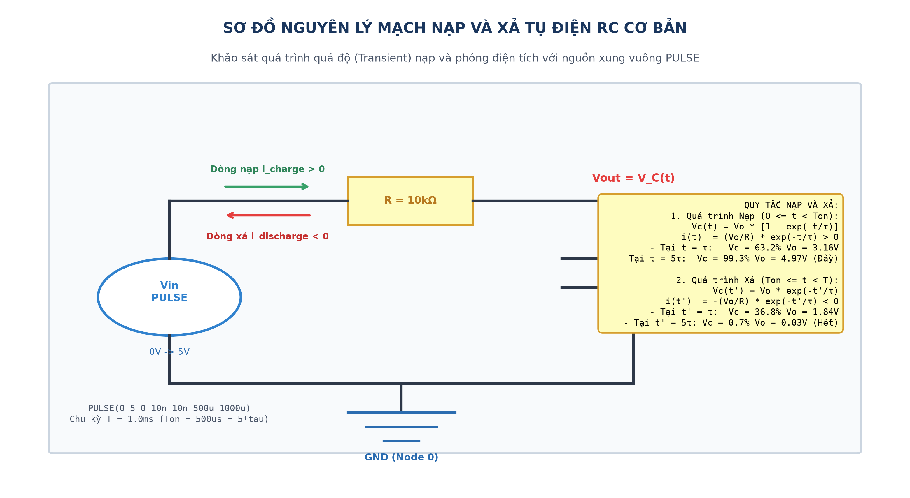
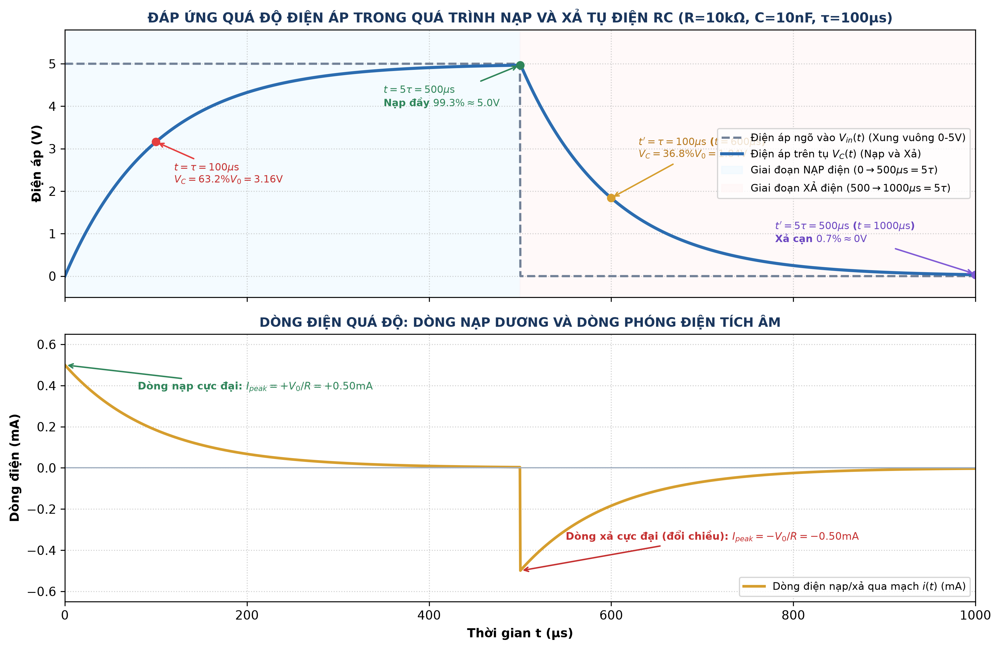

# THỰC HÀNH THIẾT KẾ VLSI — BÀI 0
# LÀM QUEN MÔ PHỎNG SPICE VỚI LTSPICE

---
**Học phần:** Thực hành Thiết kế VLSI (Mã học phần: `5505382`)  
**Bộ môn:** Điện tử - Viễn thông | **Khoa:** Điện - Điện tử | **Trường:** Đại học Sư phạm Kỹ thuật – Đại học Đà Nẵng  
**Liên hệ giáo trình:** Chương 1 (Quy trình thiết kế vi mạch Full-Custom), Chương 3 (Mô hình trễ RC và điện trở kênh dẫn)  
**Công cụ sử dụng:** LTspice (phiên bản XVII hoặc LTspice 2025 trở lên)  
**Thời lượng:** Pre-lab khoảng 1,5 giờ ở nhà; In-lab 1 buổi (3 tiết tại phòng máy); Post-lab khoảng 1 giờ  
---

## 1. MỤC TIÊU (ĐO ĐƯỢC)

Sau khi hoàn thành bài thực hành này, sinh viên có khả năng:
1. Đọc và viết được tệp Netlist SPICE ngắn gồm điện trở, tụ điện, nguồn DC, nguồn PULSE và nguồn AC với tiền tố đơn vị đúng chuẩn (phân biệt triệt để bẫy `m` và `Meg`).
2. Khởi chạy thành thạo bốn phân tích cơ bản `.op`, `.dc`, `.tran`, `.ac` và trích xuất số liệu chuẩn xác từ cửa sổ đồ thị (Waveform Viewer) và nhật ký lỗi `SPICE Error Log`.
3. Khai thác câu lệnh đo lường tự động `.meas` để trích xuất độ trễ truyền lan 50% ($t_{pd}$), thời gian tăng 10%–90% ($t_r$), thời gian giảm ($t_f$) và tần số cắt $f_{-3\text{dB}}$; so sánh đối chiếu với nghiệm giải tích lý thuyết bằng công thức sai lệch tương đối ($\le 2\%$).
4. Sử dụng thành thạo chỉ thị `.param` và quét tham số `.step` để khảo sát biến thiên giá trị $R$, từ đó vẽ đường thực nghiệm và chứng minh hệ số của mô hình trễ Elmore: $t_{pd} \approx 0.69 \cdot R \cdot C = \ln(2) \cdot R \cdot C$.
5. Liên kết tệp thư viện mô hình bán dẫn bên ngoài bằng lệnh `.include`, kiểm tra phân cực DC bằng `.op`, và đọc hiểu cú pháp tệp Netlist do LTspice tự động biên dịch từ sơ đồ nguyên lý Schematic.

---

## 2. KẾ THỪA VÀ SẢN PHẨM

| Thành phần | Chi tiết chuyển giao |
| :--- | :--- |
| **Dùng lại từ lab trước** | Không có (đây là bài Lab nền tảng đầu tiên của học phần). |
| **Sinh ra cho lab sau** | - Thư mục dự án `lab_vlsi/` chứa tệp mô hình công nghệ `C5_models.txt` (dùng xuyên suốt từ Lab 1 đến Lab 10).<br>- Mẫu netlist chuẩn `rc_delay.cir` và khối câu lệnh `.meas` đo trễ tự động dùng lại ở các bài đo tế bào logic CMOS.<br>- Bảng ước lượng trễ $R \cdot C$ cơ sở để làm mốc đối chuẩn với độ trễ cổng Inverter tại Lab 1. |

---

## 3. CƠ SỞ NGẮN GỌN

### 3.1. SPICE và Netlist
SPICE (*Simulation Program with Integrated Circuit Emphasis*) giải hệ phương trình vi phân đại số phi tuyến của mạng điện bằng phương pháp điện áp nút cải biên (MNA). Dữ liệu đầu vào của SPICE là một tệp văn bản thuần gọi là **Netlist**.

Mỗi dòng trong Netlist mô tả một phần tử theo cú pháp:
```
<Tên> <Nút +> <Nút -> [Nút điều khiển...] <Giá trị hoặc Model>
```
- **Dòng đầu tiên** của tệp Netlist thuần văn bản luôn là tiêu đề (Title) và không được tính vào mạch.
- Dòng bắt đầu bằng dấu hoa thị `*` là dòng chú thích (Comment); dòng bắt đầu bằng dấu cộng `+` là dòng nối tiếp của câu lệnh trước.
- **Nút đất** luôn có tên cố định là số **`0`**. Mạch không có nút `0` sẽ không thể giải được (báo lỗi *Floating node* hoặc *Singular matrix*).
- Khi vẽ sơ đồ trong LTspice, chương trình tự động sinh Netlist; sinh viên có thể xem trực tiếp bằng menu **View $\to$ SPICE Netlist**.

### 3.2. Đơn vị: Bẫy `m` và `Meg`
Trình biên dịch SPICE **hoàn toàn không phân biệt chữ hoa và chữ thường**. Do đó, cả `m` và `M` đều được hiểu là **milli** ($10^{-3}$).

| Ký hiệu trong SPICE | Hệ số toán học | Ví dụ nhập liệu | Giá trị thực tế |
| :---: | :---: | :--- | :--- |
| **`T`**, **`G`** | $10^{12}$, $10^9$ | `2.4G` | $2.4 \times 10^9\,\text{Hz}$ |
| **`Meg`** | $10^6$ | `1Meg` | $1\,000\,000\,\Omega$ ($1\,\text{M}\Omega$) |
| **`k`** | $10^3$ | `10k` | $10\,000\,\Omega$ |
| **`m`** (hoặc **`M`**) | $10^{-3}$ | `10m` | $0.01$ ($10\,\text{m}\Omega$ hoặc $10\,\text{ms}$) |
| **`u`** | $10^{-6}$ | `10u` | $10\,\mu\text{F}$ |
| **`n`**, **`p`**, **`f`** | $10^{-9}$, $10^{-12}$, $10^{-15}$ | `50f` | $50\,\text{fF} = 50 \times 10^{-15}\,\text{F}$ |

> [!CAUTION]
> **Cảnh báo sư phạm:** `10M` là $10\,\text{milli}$, **không phải** $10\,\text{mega}$. Chữ cái đứng sau tiền tố bị bỏ qua, nên `10nF` vẫn là $10\,\text{nF}$. Tuy nhiên, `1F` sẽ bị SPICE hiểu là $1\,\text{femto}$ ($10^{-15}$), không phải $1\,\text{farad}$. Đối với tụ điện, nên viết `1` (không kèm đơn vị) hoặc `1f` với chủ ý rõ ràng.

### 3.3. Nguồn kích thích
Các cú pháp nguồn điện áp thông dụng:
```spice
V1 vdd 0 DC 5.0                             ; Nguồn 5 V DC thuần
V2 in  0 SINE(0 1.0 1k)                     ; Offset 0V, Biên độ đỉnh 1V, Tần số 1 kHz
V3 clk 0 PULSE(0 5.0 0 100p 100p 9.9n 20n)  ; V1 V2 Tdelay Trise Tfall Ton Tperiod
V4 in  0 AC 1.0 0                           ; Biên độ AC 1 V, Pha 0 độ
```

> [!TIP]
> **Mẹo cấu hình nguồn tích hợp:** Một nguồn có thể mang đồng thời cả đặc tính PULSE và AC:
> ```spice
> Vin in 0 PULSE(0 5.0 0 10n 10n 500u 1000u) AC 1
> ```
> Nhờ đó, cùng một sơ đồ mạch có thể chạy được cả phân tích quá độ `.tran` lẫn phân tích tần số `.ac` mà không cần sửa nguồn.

### 3.4. Bốn phân tích cơ bản

| Lệnh phân tích | Bản chất tính toán | Ví dụ cú pháp |
| :--- | :--- | :--- |
| **`.op`** | Giải điểm làm việc DC tĩnh (tụ hở mạch, cuộn dây ngắn mạch). | `.op` |
| **`.dc`** | Quét giá trị một hoặc nhiều nguồn DC. | `.dc V1 0 10 0.1` |
| **`.tran`** | Giải hệ vi phân mô phỏng đáp ứng miền thời gian. | `.tran 0 1m 0 0.1u` |
| **`.ac`** | Tuyến tính hóa mạch quanh điểm tĩnh và quét đáp ứng tần số. | `.ac dec 20 10 1Meg` |

Cú pháp lệnh `.tran` trong LTspice: `.tran <Tstep> <Tstop> [Tstart [dTmax]]`.  
Đặt `Tstep = 0` để chương trình tự chọn bước thuật toán, và bắt buộc đặt `dTmax` nhỏ (ví dụ `0.1u`) để đồ thị trơn mịn và câu lệnh `.meas` bắt chính xác các sườn xung dốc.

### 3.5. Đo tự động bằng `.meas`
Cú pháp trích xuất tự động tham số từ kết quả mô phỏng:
```spice
.meas TRAN Vmax MAX V(out)
.meas TRAN t_pd TRIG V(in)=2.5 RISE=1 TARG V(out)=2.5 RISE=1
.meas AC   Av_max MAX mag(V(out)/V(in))
.meas AC   f_c WHEN mag(V(out)/V(in))=Av_max/sqrt(2) FALL=1
```
Kết quả hiển thị trong cửa sổ **View $\to$ SPICE Error Log** (phím tắt `Ctrl + L`). Khi có lệnh quét `.step`, mỗi bước sẽ xuất một dòng kết quả tương ứng.

### 3.6. Chỉ thị `.param` và `.step`
Cho phép gán tham số và quét tự động các giá trị linh kiện:
```spice
.param Rval=20k
R1 in out {Rval}
.step param Rval list 5k 10k 20k 40k
```
Tên tham số gán cho linh kiện trong sơ đồ bắt buộc phải đặt trong cặp ngoặc nhọn `{}`. Quên ngoặc nhọn là lỗi phổ biến nhất khiến các bước quét cho ra kết quả y hệt nhau.

### 3.7. Mạch RC và trễ của cổng logic
Mọi cổng logic CMOS khi chuyển mạch đều nạp hoặc xả điện dung tải ký sinh qua điện trở hiệu dụng của kênh dẫn MOSFET ($R_{on}$). Do đó, mạch $RC$ bậc nhất là mô hình vật lý nền tảng để giải thích độ trễ trong vi mạch.



**Hình 0.1a:** Sơ đồ mạch nạp và xả tụ điện RC cơ bản kích thích bởi nguồn xung PULSE.

Với điện áp bước nhảy $V_0$ cấp vào mạch $R$ nối tiếp $C$ (tụ nối đất), hằng số thời gian $\tau = R \cdot C$:
- **Phương trình điện áp nạp ($0 \le t < T_{on}$):**

  $$v_C(t) = V_0 \left(1 - e^{-\frac{t}{\tau}}\right)$$

- **Phương trình điện áp xả ($T_{on} \le t < T_{period}$, đặt $t' = t - T_{on}$):**

  $$v_C(t') = V_0 e^{-\frac{t'}{\tau}}$$

- **Dòng điện tức thời cực đại:** Tại thời điểm đổi mức xung ($t=0$ và $t=T_{on}$), dòng điện đạt đỉnh tức thời $I_{peak} = \pm \frac{V_0}{R}$.
- **Trễ truyền lan 50%:** $t_{50} = t_{pd} = \tau \ln(2) \approx 0.693 \cdot \tau$.
- **Thời gian sườn lên 10%–90%:** $t_r = \tau \ln(9) \approx 2.197 \cdot \tau \approx 2.2 \cdot \tau$.
- **Thời gian sườn xuống 90%–10%:** $t_f \approx 2.2 \cdot \tau$.
- **Tần số cắt $-3\,\text{dB}$:** $f_{-3\text{dB}} = \frac{1}{2\pi \tau}$; tại tần số này góc pha của hàm truyền đạt là $-45^\circ$.



**Hình 0.1b:** Dạng sóng quá độ điện áp và dòng điện của mạch RC qua các mốc $\tau$, $t_{50}$, $t_r$, $t_f$.

> [!TIP]
> **Mẹo kết nối VLSI:** Hệ số $0.69$ trong công thức trễ kinh điển $t_{pd} \approx 0.69 \cdot R_{on} \cdot C_L$ của CMOS Inverter ở Lab 1 chính là $\ln(2)$ trên đây. Sinh viên sẽ kiểm chứng trực tiếp hệ số này qua thực nghiệm quét `.step` ở bài tập Ex0.4.

> [!IMPORTANT]
> **Nguyên tắc cấu hình xung:** Để quan sát trọn vẹn một chu kỳ nạp đầy và xả cạn, bắt buộc phải chọn độ rộng xung $T_{on} \ge 5\tau$ và chu kỳ $T_{period} \ge 10\tau$. Nếu đặt $T_{on} < 5\tau$, tụ chưa kịp nạp no đã bị xả, điện áp đỉnh thấp hơn $V_0$ và các phép đo $t_r, t_f$ sẽ sai lệch hoàn toàn.

### 3.8. Phím tắt thường dùng trong sơ đồ LTspice

| Phím tắt | Chức năng | Phím tắt | Chức năng |
| :---: | :--- | :---: | :--- |
| **`F2`** | Chọn linh kiện từ thư viện | **`R`**, **`C`**, **`L`** | Đặt điện trở, tụ điện, cuộn cảm |
| **`F3`** | Vẽ đường dây nối (Wire) | **`G`** | Đặt nút đất (Ground - Node 0) |
| **`F4`** | Đặt nhãn tên cho nút (Net Label) | **`S`** | Nhập lệnh SPICE Directive |
| **`F5`** | Xóa phần tử (Cut/Delete) | **`T`** | Chèn chữ ghi chú (Text) |
| **`F6`** | Sao chép linh kiện (Duplicate) | **`Ctrl + R`** | Xoay linh kiện 90 độ |
| **`F7` / `F8`** | Di chuyển linh kiện / Kéo giữ dây | **`Ctrl + E`** | Lấy đối xứng qua gương (Mirror) |
| **`F9`** | Hoàn tác thao tác (Undo) | **`Space`** | Thu phóng vừa vặn toàn màn hình |

---

## 4. PRE-LAB (LÀM Ở NHÀ, NỘP TRƯỚC GIỜ LAB)

### P1. Quy ước đơn vị
Ghi giá trị thực tế mà SPICE hiểu theo chuẩn đơn vị đo lường SI:
- `2.2M` = ...................................................
- `2.2Meg` = ...................................................
- `47n` = ...................................................
- `30f` = ...................................................

### P2. Mạch cầu phân áp DC
Cho nguồn điện áp $V_{in} = 5.0\,\text{V}$ cấp vào mạch gồm $R_1 = 12\,\text{k}\Omega$ nối tiếp với $R_2 = 18\,\text{k}\Omega$ xuống đất; điện áp $V_{out}$ lấy tại nút giữa $R_1$ và $R_2$.

1. Tính điện áp ngõ ra: $V_{out} = V_{in} \cdot \frac{R_2}{R_1 + R_2} =$ ........................................ V
2. Tính dòng điện qua mạch: $I = \frac{V_{in}}{R_1 + R_2} =$ ........................................ mA
3. Tính tổng công suất tiêu tán: $P_{total} = V_{in} \cdot I =$ ........................................ mW

### P3. Mạch RC nạp - xả
Cho mạch RC với $R = 20\,\text{k}\Omega$, $C = 5\,\text{nF}$, ngõ vào là bước nhảy điện áp $0 \to 5.0\,\text{V}$. Điền các giá trị tính toán lý thuyết vào bảng sau:

| Đại lượng | Biểu thức giải tích | Giá trị tính toán | Đơn vị |
| :--- | :--- | :---: | :---: |
| Hằng số thời gian $\tau$ | $R \cdot C$ | .................... | $\mu\text{s}$ |
| Điện áp tụ $v_C$ tại $t = \tau$ | $V_0 (1 - e^{-1})$ | .................... | V |
| Độ trễ 50% ($t_{50}$) | $\ln(2) \cdot \tau$ | .................... | $\mu\text{s}$ |
| Thời gian tăng $t_r$ ($10\% \to 90\%$) | $\ln(9) \cdot \tau \approx 2.2\tau$ | .................... | $\mu\text{s}$ |
| Tần số cắt $-3\,\text{dB}$ ($f_{-3\text{dB}}$) | $\frac{1}{2\pi \cdot R \cdot C}$ | .................... | kHz |
| Đỉnh dòng nạp cực đại ($I_{peak}$) | $V_0 / R$ | .................... | mA |

*Dự đoán:* Nếu thay tụ $C$ bằng $2C$ ($10\,\text{nF}$) thì trễ $t_{50}$ và tần số cắt $f_{-3\text{dB}}$ thay đổi thế nào? Giải thích ngắn gọn bằng 1 câu:  
....................................................................................................................................................

### P4. Hoàn thành khung Netlist SPICE
Hoàn thành khung Netlist SPICE dưới đây cho mạch ở mục P3 (nguồn xung $0 \to 5.0\,\text{V}$, $T_{on} = 5\tau$, $T_{period} = 10\tau$, thời gian mô phỏng đúng 1 chu kỳ). Điền vào các chỗ `____`:
```spice
* Lab0 RC Circuit Transient Netlist
V1 in 0 PULSE(____ ____ 0 10n 10n ____ ____)
R1 in out ____
C1 out 0 ____
.tran 0 ____ 0 0.1u
.meas TRAN t_pd TRIG V(in)=____ RISE=1 TARG V(out)=____ RISE=1
.end
```

### P5. Mối liên hệ thực tiễn với Thiết kế VLSI
Một cổng đảo CMOS Inverter trong chip có điện trở kênh dẫn hiệu dụng $R_{on} = 1\,\text{k}\Omega$ kéo tải dung ký sinh ngõ ra $C_L = 50\,\text{fF}$.  
Ước lượng độ trễ truyền lan 50%: $t_{50} = 0.69 \cdot R_{on} \cdot C_L$. Ghi kết quả tính được (đơn vị picosecond - ps) để đối chiếu trực tiếp với số đo tại Lab 1:  
$t_{50} =$ .................... ps.

> [!IMPORTANT]
> **Cổng kiểm tra đầu buổi:** Giảng viên/Trợ giảng kiểm tra nhanh P1, P3 và P4 trước khi cấp quyền đăng nhập máy tính phòng Lab. Sinh viên chưa hoàn thành P3 hoặc P4 bắt buộc phải hoàn thiện tại bàn viết trước khi vào máy.

---

## 5. THỰC HÀNH TẠI PHÒNG LAB (IN-LAB)

> [!TIP]
> **Thao tác chuẩn hóa:** Sinh viên tạo thư mục làm việc `D:\lab_vlsi\`, tải tệp mô hình `C5_models.txt` vào thư mục này và lưu toàn bộ các tệp sơ đồ `.asc`, tệp netlist `.cir`/`.sp` trong cùng thư mục để tránh lỗi đường dẫn khi dùng `.include`.

### Ex0.1 (Bắt buộc): Phân tích `.op` và `.dc` trên mạch cầu phân áp
1. Chọn **File $\to$ New Schematic** (`Ctrl + N`).
2. Đặt $R_1 = 12\,\text{k}\Omega$, $R_2 = 18\,\text{k}\Omega$, nguồn điện áp $V_1 = 5.0\,\text{V}$ (phím `F2`, gõ `voltage`), cọc đất `G`, đặt nhãn cho nút giữa là `vout` (phím `F4`).
3. Nhấn phím `S`, nhập lệnh `.op`, nhấn **Run** (biểu tượng người chạy). Ghi nhận điện áp `V(vout)` và dòng điện `I(R1)`.
4. Nhấp chuột phải vào chữ `.op` trên bản vẽ, đổi thành lệnh quét DC: `.dc V1 0 10 0.1`. Nhấn **Run**, dùng que đo nhấp vào nút `vout` để vẽ đường đặc tuyến $V_{out} = f(V_{in})$.
- **Sản phẩm nghiệm thu:** Ảnh chụp sơ đồ, ảnh chụp đồ thị và 2 số đo DC.
- **Câu hỏi kiểm tra tại bàn:** Độ dốc $\frac{\Delta V_{out}}{\Delta V_{in}}$ của đường thẳng trên đồ thị bằng bao nhiêu, và tương ứng với biểu thức nào theo $R_1, R_2$?

### Ex0.2 (Bắt buộc): Mô phỏng quá độ nạp và xả của mạch RC
1. Dựng mạch với $R = 20\,\text{k}\Omega, C = 5\,\text{nF}$, đặt nhãn ngõ vào là `in`, ngõ ra trên tụ là `out`. Cấu hình nguồn xung `PULSE` theo kết quả chuẩn bị tại mục P4: `PULSE(0 5.0 0 10n 10n 500u 1000u)`.
2. Thiết lập mô phỏng quá độ: `.tran 0 1m 0 0.1u`.
3. Nhấn phím `S`, nhập các câu lệnh `.meas` để trích xuất tự động:
   ```spice
   .meas TRAN t_pd TRIG V(in)=2.5 RISE=1 TARG V(out)=2.5 RISE=1
   .meas TRAN t_r  TRIG V(out)=0.5 RISE=1 TARG V(out)=4.5 RISE=1
   .meas TRAN t_f  TRIG V(out)=4.5 FALL=1 TARG V(out)=0.5 FALL=1
   .meas TRAN I_peak_chg MAX I(C1)
   .meas TRAN I_peak_dis MIN I(C1)
   ```
4. Nhấn **Run**, mở **View $\to$ SPICE Error Log** (`Ctrl + L`) để đọc trực tiếp các giá trị đo được. Nhấp chuột phải vào đồ thị chọn **Add Plot Pane**, đưa que đo vào thân tụ $C_1$ để quan sát dạng sóng dòng điện nạp/xả $i(t)$.
- **Sản phẩm nghiệm thu:** Bảng so sánh 3 cột: [Lý thuyết] vs [Đo đạc SPICE] vs [Sai lệch tương đối %] cho các tham số $t_{pd}, t_r, t_f$ và đỉnh dòng.
- **Câu hỏi kiểm tra:** Vì sao sai lệch đo rất nhỏ khi đặt `dTmax = 0.1u`? Sai lệch sẽ tăng vọt như thế nào nếu xóa bỏ và để `dTmax = 20u`?

### Ex0.3 (Bắt buộc): Phân tích đáp ứng tần số `.ac` và biểu đồ Bode
1. Nhấp chuột phải vào nguồn $V_1$, trong ô **Small Signal AC Analysis (AC)**, nhập biên độ `1` (tương đương cú pháp `Vin in 0 PULSE(...) AC 1`).
2. Thiết lập lệnh phân tích tần số: `.ac dec 20 10 1Meg`.
3. Chèn câu lệnh đo độ lợi cực đại và tần số cắt $-3\,\text{dB}$:
   ```spice
   .meas AC Av_max MAX mag(V(out)/V(in))
   .meas AC f_c WHEN mag(V(out)/V(in))=Av_max/sqrt(2) FALL=1
   ```
4. Nhấn **Run**, đưa que đo nhấp vào nút `out`. Dùng con trỏ chuột (Cursor) đặt tại vị trí biên độ giảm $3\,\text{dB}$ để đọc góc pha trên trục bên phải.
- **Sản phẩm nghiệm thu:** Ảnh chụp biểu đồ Bode (biên độ dB và pha độ); Bảng đối chiếu lý thuyết và thực nghiệm của tần số cắt $f_{-3\text{dB}}$ cùng góc pha tương ứng.

### Ex0.4 (Tiêu chuẩn): Quét tham số linh kiện với `.param` và `.step`
1. Thay giá trị điện trở $R$ trên sơ đồ bằng biến `{Rval}` (có ngoặc nhọn).
2. Nhấn phím `S`, thêm các chỉ thị tham số:
   ```spice
   .param Rval=20k
   .step param Rval list 5k 10k 20k 40k
   ```
3. Chạy mô phỏng `.tran 0 1m 0 0.1u` với câu lệnh đo trễ `t_pd`.
4. Mở **SPICE Error Log** (`Ctrl + L`), ghi lại giá trị $t_{pd}$ tương ứng với 4 bước giá trị $R$. Nhấp chuột phải vào Error Log chọn **Plot .step'ed .meas data** để vẽ đồ thị hàm trễ $t_{pd}$ theo điện trở $R$.
- **Sản phẩm nghiệm thu:** Bảng dữ liệu 4 điểm đo, đồ thị $t_{pd}$ theo $R$, tính độ dốc thực nghiệm $\frac{\Delta t_{pd}}{\Delta R}$ và so sánh với giá trị lý thuyết $\ln(2) \cdot C$.
- **Câu hỏi kiểm tra:** Độ dốc của đường này sẽ thay đổi như thế nào nếu mạch có tải dung nhỏ mức vi mạch $C = 50\,\text{fF}$?

### Ex0.5 (Thử thách nâng cao): Liên kết tệp mô hình MOSFET công nghệ C5N
1. Tạo một sơ đồ mới. Nhấn `F2`, chọn phần tử transistor `nmos4`.
2. Nhấp chuột phải vào linh kiện: đặt tên model là **`N`** (khớp chính xác với tên trong tệp mô hình), chiều dài kênh $L = 0.6\,\mu\text{m}$ (`0.6u`), chiều rộng kênh $W = 1.2\,\mu\text{m}$ (`1.2u`).
3. Nhấn phím `S`, chèn lệnh liên kết: `.include C5_models.txt`.
4. Nối nguồn điện áp cố định $V_{DS} = 5.0\,\text{V}$ vào cực má (Drain), $V_{GS} = 5.0\,\text{V}$ vào cực cổng (Gate); cực nguồn (Source) và cực đế (Bulk) nối chung xuống đất `GND`.
5. Đặt lệnh `.op`, nhấn **Run**. Ghi lại dòng điện cực má $I_D$.
6. Mở tệp `C5_models.txt`, tìm các tham số ngưỡng $V_{TO}$ (hoặc `VTH0`) và độ dẫn suất $K'$ (hoặc tích $\mu_0 C_{ox}$). Tính ước lượng dòng bão hòa theo mô hình bậc hai kinh điển:

   $$I_D \approx \frac{1}{2} K_n' \left(\frac{W}{L}\right) (V_{GS} - V_{TH})^2$$

7. Mở menu **View $\to$ SPICE Netlist**, chỉ ra dòng khai báo transistor `M1` và dòng lệnh `.include`.
- **Sản phẩm nghiệm thu:** Ảnh chụp sơ đồ, giá trị dòng $I_D$ đo từ SPICE và giá trị tính ước lượng bậc hai; Nêu 2 nguyên nhân vật lý gây ra sự chênh lệch (chuẩn bị giả thuyết để kiểm chứng tại Lab 1).

---

## 6. TIÊU CHÍ KIỂM CHỨNG KỸ THUẬT

Mỗi kết quả đo tự động bằng `.meas` phải được kiểm chứng bằng công thức **sai lệch tương đối**:

$$\text{Error (\%)} = \frac{|\text{SPICE} - \text{Theory}|}{\text{Theory}} \times 100\%$$

- **Chỉ tiêu chất lượng của Lab 0:** Sai lệch tương đối $\le 2.0\%$ đối với các đại lượng $t_{pd}, t_r, t_f$ và $f_{-3\text{dB}}$ ở các bài tập Ex0.2, Ex0.3, Ex0.4.
- Nếu sai lệch vượt quá $2\%$, sinh viên phải tự rà soát các nguyên nhân kỹ thuật:
  * Bước thời gian `dTmax` có bị quá thô không?
  * Ngưỡng đo trong lệnh `.meas` ($2.5\,\text{V}$ cho $50\%$; $0.5\,\text{V}$ và $4.5\,\text{V}$ cho $10\%-90\%$) đã đúng chưa?
  * Tiền tố đơn vị của $R$ và $C$ có bị nhầm lẫn không?

---

## 7. POST-LAB (CÂU HỎI BÁO CÁO TỔNG KẾT)

1. *Tại sao khi mô phỏng nạp - xả tụ điện, bắt buộc phải chọn $T_{on} \ge 5\tau$? Nếu chọn $T_{on} = 2\tau$ thì điện áp đỉnh cực đại trên tụ đạt bao nhiêu vôn so với $V_0 = 5.0\,\text{V}$?*
2. *Tại sao thời gian trễ 50% lại có biểu thức $t_{50} = \ln(2) \cdot \tau$? Hãy viết 2 dòng suy diễn toán học từ phương trình nạp $v_C(t) = V_0(1 - e^{-t/\tau})$ khi $v_C(t) = 0.5 V_0$.*
3. *Điền giá trị ước lượng trễ của Inverter ở mục P5 vào bảng "Dự báo trễ VLSI" của nhóm; nêu nhận xét khi so sánh với trễ mô phỏng thực tế tại Lab 1.*
4. *Nêu 2 lỗi kỹ thuật hoặc cảnh báo bạn đã gặp phải trong buổi thực hành, giải thích rõ nguyên nhân bản chất và giải pháp bạn đã xử lý.*

---

## 8. CÁC LỖI KỸ THUẬT THƯỜNG GẶP (PEDAGOGICAL TRAPS)

1. **Nhầm lẫn tiền tố `10M` thành $10\,\text{M}\Omega$:** SPICE hiểu là $10\,\text{m}\Omega$ ($0.01\,\Omega$), gây sụt áp sai hoàn toàn. Khắc phục: viết `10Meg`.
2. **Quên đặt nút đất `0` (GND):** SPICE báo lỗi ma trận suy biến (*Singular Matrix*) hoặc nút lơ lửng (*Node is floating*).
3. **Thời gian dừng `Tstop` quá ngắn trong `.tran`:** Không quan sát được giai đoạn xả điện tích của tụ điện.
4. **Dùng `.step` mà quên đặt ngoặc nhọn `{Rval}`:** LTspice bỏ qua biến quét, khiến kết quả 4 bước đo ra các đường trùng khít nhau.
5. **Đường dẫn thư viện `.include` chứa khoảng trắng:** Khi đường dẫn có khoảng trắng (ví dụ `D:\Bai tap\C5_models.txt`), bắt buộc phải bọc trong dấu ngoặc kép: `.include "D:\Bai tap\C5_models.txt"`.
6. **Báo lỗi "Unknown subcircuit / Model not found":** Tên model khai báo trên biểu tượng transistor không khớp chính xác từng ký tự với tên model trong tệp thư viện (ví dụ gõ `NMOS` thay vì `N`).
7. **Dấu của dòng điện $I(C1)$ bị ngược:** Chiều dòng điện quy ước trong LTspice đi từ cực dương sang cực âm của linh kiện. Nếu đặt tụ điện bị đảo chiều, đỉnh dòng nạp sẽ mang dấu âm; khắc phục bằng cách xoay linh kiện `Ctrl + R` hai lần.

---

## 9. KHẢ NĂNG TÁI SỬ DỤNG (REUSABILITY CHECKLIST)

- [ ] Thư mục làm việc `lab_vlsi/` chứa sẵn tệp `C5_models.txt` và các mẫu netlist `.cir`.
- [ ] Khối câu lệnh `.meas` của bài Ex0.2 đã được lưu thành tệp mẫu để import nhanh cho các bài Lab đo cổng logic từ Lab 1 đến Lab 10.
- [ ] Toàn bộ các giá trị linh kiện then chốt đã được tham số hóa qua `.param`, không khai báo cứng rải rác trong mạch.

---

## 10. RUBRIC ĐÁNH GIÁ (THANG ĐIỂM 10)
*(Ánh xạ vào Tiêu chí 1 "Bài tập cá nhân & Thao tác Lab" theo Chuẩn đầu ra CLO1 của Đề cương chi tiết học phần)*

| Hạng mục đánh giá | Điểm tối đa | Tiêu chí đạt mức tối đa |
| :--- | :---: | :--- |
| **Chuẩn bị Pre-lab (P1–P5)** | **2.0 điểm** | Hoàn thành đầy đủ P1 đến P5 trước giờ lab; tính toán đúng 100% số học; viết netlist P4 chạy được ngay. |
| **Thực hành Ex0.1 – Ex0.3** | **4.0 điểm** | Dựng mạch chuẩn; chạy đủ 3 chế độ `.op`, `.tran`, `.ac`; bảng số liệu đầy đủ với sai lệch tương đối $\le 2\%$. |
| **Quét tham số Ex0.4** | **1.5 điểm** | Hoàn thành bảng 4 bước quét; vẽ được đồ thị $t_{pd}$ theo $R$; xác định chính xác độ dốc thực nghiệm. |
| **Thử nghiệm MOSFET Ex0.5** | **1.0 điểm** | Gọi thư viện `C5_models.txt` thành công; trích xuất đúng dòng $I_D$; nêu được giả thuyết sai lệch bậc hai. |
| **Báo cáo & Câu hỏi Post-lab** | **1.5 điểm** | Trả lời sắc bén 4 câu hỏi Post-lab; ghi chép trung thực 2 lỗi kỹ thuật và cách khắc phục; nộp đủ tệp `.asc`/`.cir`. |

---

## 11. TÀI LIỆU THAM KHẢO

1. Analog Devices, *LTspice User's Guide & Help System*, Online Documentation.
2. R. Jacob Baker, *CMOS: Circuit Design, Layout, and Simulation*, 4th Edition, IEEE Press / Wiley, 2019 (Chương 1 & Chương 3).
3. H. Giles, *SPICE3 Version 3f5 User's Manual*, University of California, Berkeley.
