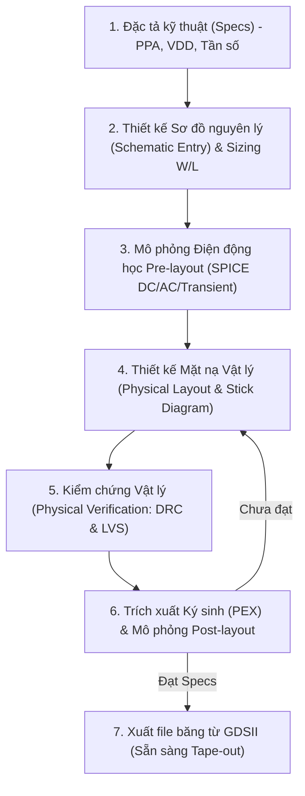

# BÀI THỰC HÀNH 00: TỔNG QUAN QUY TRÌNH THIẾT KẾ VI MẠCH FULL-CUSTOM VÀ THIẾT LẬP MÔI TRƯỜNG ELECTRIC – LTSPICE

---
**Học phần:** Thực hành Thiết kế VLSI (`5505382`)  
**Bộ môn:** Điện tử - Viễn thông, Khoa Điện - Điện tử, Trường ĐH Sư phạm Kỹ thuật – ĐHĐN  
**Thời lượng:** 5 tiết thực hành tại phòng máy  
**Mục tiêu:** Nắm vững quy trình thiết kế vi mạch tùy biến (Full-Custom IC Design Flow), làm quen giao diện phần mềm Electric VLSI Design System, cấu hình liên kết trình mô phỏng SPICE (LTspice / ngspice), và thực hiện quy trình kiểm tra thiết kế (DRC, LVS, SPICE) trên mạch thử nghiệm đầu tiên.  
---

## 1. QUY TRÌNH THIẾT KẾ VI MẠCH FULL-CUSTOM (FULL-CUSTOM IC FLOW)

Quy trình thiết kế vi mạch tùy biến hoàn toàn (Full-Custom) là quy trình trong đó kỹ sư vi mạch can thiệp trực tiếp đến từng transistor và từng lớp mặt nạ hình học vật lý (Mask Layer). Quy trình chuẩn gồm 6 bước khép kín:



1. **Schematic Entry (Soạn thảo nguyên lý):** Vẽ sơ đồ mạch ở mức transistor (NMOS, PMOS) và định kích thước chiều rộng kênh $W$, chiều dài kênh $L$.
2. **Pre-layout Simulation:** Chạy SPICE (DC Sweep, Transient) để kiểm tra chức năng logic và đặc tính trễ lý tưởng (chưa tính ký sinh).
3. **Physical Layout:** Vẽ các lớp hình học vật lý (N-Well, Active, Polysilicon, Metal 1-3, Contact) tuân thủ tỉ lệ $\lambda$.
4. **DRC (Design Rule Check):** Quét kiểm tra vi phạm khoảng cách hình học, độ rộng dải kim loại, độ vươn poly theo bộ luật chế tạo của nhà máy bán dẫn (Foundry).
5. **LVS (Layout Versus Schematic):** Đối chiếu bảng kết nối (Netlist) trích xuất từ Layout với Schematic gốc. Bắt buộc phải trùng khớp 100%.
6. **PEX (Parasitic Extraction) & Post-layout Simulation:** Trích xuất các điện trở ($R$) và điện dung ($C$) ký sinh của dây dẫn kim loại và tiếp giáp bán dẫn để mô phỏng lại trên SPICE. Đây là kết quả thực tế phản ánh chính xác nhất vi mạch khi xuất xưởng.

---

## 2. THIẾT LẬP MÔI TRƯỜNG PHẦN MỀM ELECTRIC VÀ LTSPICE

### Bước 1: Khởi động Electric VLSI và cấu hình công nghệ
1. Khởi động Electric (chạy tệp `electric.jar` hoặc biểu tượng trên Desktop).
2. Vào menu **File $\to$ Preferences** (hoặc nhấn phím tắt `Ctrl + Q`):
   - Chọn mục **Technology**:
     * Chọn công nghệ hiện hành: **`mocmos`** (MOSIS CMOS Submicron).
     * Đơn vị cơ sở: $\lambda = 0.30\,\mu\text{m}$ (tương ứng công nghệ $0.5\,\mu\text{m}$).
     * Số lớp kim loại: $3$ (Metal 1, Metal 2, Metal 3).

### Bước 2: Liên kết Electric với trình mô phỏng LTspice
1. Vẫn trong cửa sổ **Preferences**, điều hướng tới: **Tools $\to$ Spice/CDL**.
2. Cấu hình các mục chính xác như sau:
   - **Spice engine:** Chọn `Spice 3`.
   - **Spice level:** Chọn `3`.
   - **After writing deck:** Chọn `Run, Report Output`.
   - **Run program:** Trỏ đường dẫn đến tệp thực thi của LTspice (Ví dụ: `C:\Program Files\ADI\LTspice\LTspice.exe` hoặc `C:\Program Files\LTC\LTspiceXVII\XVIIx64.exe`).
   - **With args:** Nhập nguyên văn cú pháp:
     ```
     -i ${FILENAME}
     ```
   - Nhấn **Apply** và **OK**.

> [!TIP]
> Nếu máy tính sử dụng `ngspice`, tại mục **Run program** trỏ đến đường dẫn `ngspice.exe` và mục **With args** để `-b ${FILENAME}`.

---

## 3. BÀI TẬP IN-LAB: THIẾT KẾ VÀ KIỂM CHỨNG MẠCH TEST PHÂN ÁP NMOS

### Mục tiêu
Tạo thư viện làm việc đầu tiên `lab0_intro.jelib`, dựng mạch khuếch đại nguồn chung đơn giản (Common-Source NMOS với tải điện trở $R$), chạy mô phỏng quét DC trên LTspice và kiểm tra DRC.

### Các bước thực hiện
1. **Tạo Thư viện mới:**
   - Vào menu **File $\to$ New Library...**
   - Đặt tên: `lab0_intro`.
2. **Tạo Cell Schematic:**
   - Vào **Cell $\to$ New Cell...**
   - Cell name: `nmos_test`, View: `schematic`.
3. **Vẽ sơ đồ nguyên lý:**
   - Đặt 1 transistor NMOS từ thanh công cụ bên trái. Nhấp đúp chuột, đặt kích thước: $W = 4\lambda = 1.2\,\mu\text{m}$, $L = 2\lambda = 0.6\,\mu\text{m}$.
   - Đặt 1 điện trở $R = 50\,\text{k}\Omega$ nối giữa cực Drain và nguồn $V_{DD}$.
   - Tạo các chân Export:
     * Cực Gate: Export tên `vin` (Port type: `Input`).
     * Cực Drain: Export tên `vout` (Port type: `Output`).
     * Đỉnh điện trở: Export tên `vdd` (Port type: `Power`).
     * Cực Source và Bulk: Export tên `gnd` (Port type: `Ground`).
4. **Kiểm tra kết nối và xuất Netlist:**
   - Nhấn `F5` để kiểm tra lỗi kết nối (Schematic Check).
   - Vào menu **Tools $\to$ Simulation (Spice) $\to$ Write Spice Deck**.
5. **Chạy mô phỏng trên LTspice:**
   - Cửa sổ LTspice tự động bật lên kèm theo file Netlist `.sp`.
   - Bổ sung lệnh gọi mô hình: `.include C5_models.txt` (hoặc dẫn đường dẫn tuyệt đối đến thư mục `04 - Models_and_Libraries/C5_models.txt`).
   - Bổ sung nguồn cấp và lệnh quét:
     ```spice
     Vdd vdd 0 DC 5.0
     Vin vin 0 DC 0
     .dc Vin 0 5 0.01
     ```
   - Nhấn nút **Run** (hình người chạy), thêm trace `V(vout)`.
   - Quan sát đáp ứng điện áp ngõ ra giảm dần từ $5\,\text{V}$ về gần $0\,\text{V}$ khi $V_{in}$ tăng từ $0\,\text{V}$ lên $5\,\text{V}$.
6. **Báo cáo nghiệm thu tại bàn:**
   - Xuất trình màn hình Electric và đồ thị LTspice cho Giảng viên/Trợ giảng ký nhận hoàn thành bài Lab 00.
