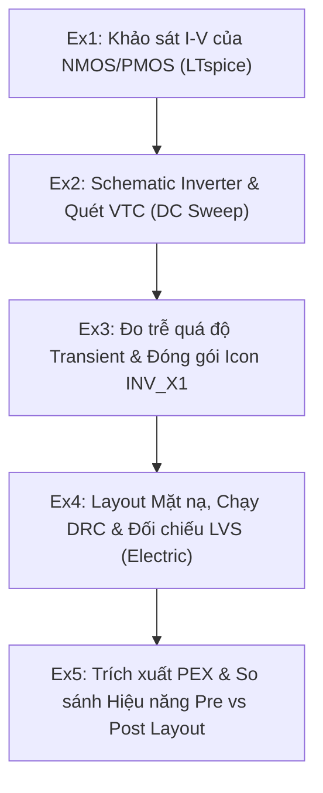

# BÀI THỰC HÀNH 01: ĐẶC TÍNH I-V CỦA MOSFET VÀ THIẾT KẾ CMOS INVERTER

---
**Học phần:** Thực hành Thiết kế VLSI (`5505382`)  
**Bộ môn:** Điện tử - Viễn thông, Khoa Điện - Điện tử, Trường ĐH Sư phạm Kỹ thuật – ĐHĐN  
**Thời lượng:** 5 tiết thực hành tại phòng máy (kết hợp tự học Pre-lab & Post-lab)  
**Công cụ sử dụng:** Electric VLSI Design System (v9.07+), LTspice XVII / LTspice 2025  
**Công nghệ chế tạo tham chiếu:** MOSIS SCMOS SUBMICRON C5N 0.5µm ($\lambda = 0.30\,\mu\text{m}$, $V_{DD} = 5.0\,\text{V}$)  
---

## MỤC TIÊU BÀI THỰC HÀNH

Sau khi hoàn thành bài thực hành này, người học có khả năng:
1. **Trích xuất tham số vật lý:** Khảo sát thực nghiệm trên mô phỏng SPICE đặc tuyến $I_{DS}-V_{GS}$ và $I_{DS}-V_{DS}$ của NMOS và PMOS; trích xuất chính xác điện áp ngưỡng ($V_{thn}, V_{thp}$), độ dốc truyền dẫn transconductance ($g_m$), và hệ số điều chế chiều dài kênh ($\lambda$).
2. **Thiết kế & Tối ưu Schematic Inverter:** Xây dựng sơ đồ nguyên lý CMOS Inverter, xác định tỉ số định kích thước $(W/L)_p / (W/L)_n \approx 3/1$ để cân bằng thời gian chuyển mạch và đạt điện áp ngưỡng chuyển mạch đối xứng $V_M = V_{DD}/2 = 2.50\,\text{V}$.
3. **Phân tích VTC & Đo đạc Lề nhiễu:** Mô phỏng đường cong truyền đạt điện áp (VTC - Voltage Transfer Curve); xác định các điểm dốc đơn vị $dV_{out}/dV_{in} = -1$ để tính các điện áp vào logic $V_{IL}, V_{IH}$ và lề nhiễu logic $NM_L, NM_H$.
4. **Đo đạc Động học Quá độ (Transient):** Khảo sát thời gian tăng ($t_r$), thời gian giảm ($t_f$) và trễ truyền lan trung bình ($t_{pd} = (t_{pHL} + t_{pLH})/2$) dưới các mức tải dung khác nhau ($C_L = 10\,\text{fF}, 50\,\text{fF}, 100\,\text{fF}$).
5. **Thiết kế Mặt nạ Vật lý (Physical Layout):** Vẽ mặt nạ Layout cho Inverter theo luật thiết kế khả thi chế tạo MOSIS SCMOS; thực hiện kiểm tra luật hình học DRC đạt 0 lỗi và đối chiếu LVS đạt trùng khớp sơ đồ 100%.
6. **Trích xuất Ký sinh (PEX) & Phân tích Post-layout:** Trích xuất tụ ký sinh tiếp giáp ($C_{db}, C_{sb}$) và ký sinh dây dẫn kim loại; đối chiếu dạng sóng và độ trễ giữa Pre-layout và Post-layout.
7. **Đóng gói IP:** Tạo tế bào chuẩn `INV_X1` kèm Icon View để tái sử dụng làm thư viện chuẩn trong các bài Lab tiếp theo.

---

## MA TRẬN KẾ THỪA IP

- **Đầu vào kế thừa:** Bài Lab 00 (Quy trình thiết lập công nghệ `mocmos` trong Electric và liên kết đường dẫn LTspice).
- **Đầu ra sinh ra (Bàn giao):** Tế bào chuẩn `INV_X1` (Schematic, Icon, Layout, Datasheet VTC/Delay) bàn giao cho Lab 02 (Cổng logic NAND/NOR), Lab 03 (Chuỗi đệm Inverter) và Lab 04 (Bộ tạo xung điều khiển bù cho Transmission Gate).

---

## 1. PRE-LAB (CHUẨN BỊ LÝ THUYẾT Ở NHÀ - BẮT BUỘC)

> [!IMPORTANT]
> Sinh viên phải hoàn thành toàn bộ phần tính toán và vẽ sơ đồ que (Stick Diagram) vào Vở thí nghiệm trước khi vào lớp. Giảng viên kiểm tra và ký xác nhận ở đầu buổi học. Sinh viên không có bài chuẩn bị sẽ không được cấp quyền thực hành trên máy tính.

### 1.1. Tham số công nghệ tham chiếu (MOSIS C5N 0.5µm)
Cho các thông số vật lý của tiến trình C5N ($V_{DD} = 5.0\,\text{V}, T = 27^\circ\text{C}$):
- Chiều dài kênh tối thiểu: $L_{min} = 2\lambda = 0.60\,\mu\text{m}$.
- NMOS: Điện áp ngưỡng $V_{thn0} = +0.70\,\text{V}$; Hệ số dẫn suất $K_n' = \mu_n C_{ox} = 120\,\mu\text{A/V}^2$.
- PMOS: Điện áp ngưỡng $V_{thp0} = -0.80\,\text{V}$; Hệ số dẫn suất $K_p' = \mu_p C_{ox} = 40\,\mu\text{A/V}^2$.

### 1.2. Nhiệm vụ tính toán lý thuyết
1. **Tính tỉ số kích thước cân bằng $(W_p/W_n)$:**
   Để điện áp chuyển mạch đối xứng $V_M = V_{DD}/2 = 2.50\,\text{V}$, hãy chứng minh từ điều kiện dòng $I_{D,sat(n)} = I_{D,sat(p)}$ và tính tỉ số:
   $$\frac{\beta_p}{\beta_n} = \frac{K_p' (W/L)_p}{K_n' (W/L)_n} \approx 1 \implies \frac{(W/L)_p}{(W/L)_n} = \frac{\mu_n}{\mu_p} \approx \frac{120}{40} = 3.0$$
   Nếu chọn $L_n = L_p = 0.60\,\mu\text{m}$ ($2\lambda$) và $W_n = 1.20\,\mu\text{m}$ ($4\lambda$), hãy xác định $W_p$.
2. **Ước lượng điện trở tương đương $R_{on}$ của Transistor:**
   Sử dụng công thức xấp xỉ điện trở dẫn hiệu dụng trung bình:
   $$R_{on,n} \approx \frac{1}{K_n' (W/L)_n (V_{DD} - V_{thn})}, \quad R_{on,p} \approx \frac{1}{K_p' (W/L)_p (V_{DD} - |V_{thp}|)}$$
   Hãy tính giá trị $R_{on,n}$ và $R_{on,p}$ tương ứng với kích thước đã chọn ở trên.
3. **Ước lượng trễ truyền lan lý thuyết với tải dung $C_L = 50\,\text{fF}$:**
   Tính trễ cạnh xuống $t_{pHL} \approx 0.69 \times R_{on,n} \times C_L$ và trễ cạnh lên $t_{pLH} \approx 0.69 \times R_{on,p} \times C_L$. Nhận xét về tính đối xứng của hai thời gian trễ này.
4. **Vẽ Stick Diagram (Sơ đồ que):**
   Vẽ sơ đồ que của CMOS Inverter lên giấy kẻ ô ly:
   - Hai đường ray nguồn nằm ngang: Đường ray $V_{DD}$ ở phía trên (Metal 1), đường ray $GND$ ở phía dưới (Metal 1).
   - Vùng khuếch tán p-diffusion (Active P) bên trên nạp vào N-Well; vùng n-diffusion (Active N) bên dưới trên P-substrate.
   - Dải Polysilicon liên tục chạy dọc từ trên xuống dưới đóng vai trò cực cổng (Gate) chung nối với ngõ vào $V_{in}$.
   - Cực má (Drain) của PMOS và NMOS nối chung bằng Metal 1 ra ngõ xuất $V_{out}$.
   - Đánh dấu đầy đủ các vị trí đặt lỗ tiếp xúc (Contact) nối Metal 1 với Diffusion và Metal 1 với Poly.

---

## 2. NỘI DUNG THỰC HÀNH TẠI PHÒNG LAB (IN-LAB: EX1 – EX5)



---

### Ex1 (Cốt lõi): Đo đạc Đặc tính I-V của NMOS và PMOS trên LTspice

#### A. Mục tiêu
Thiết lập mạch thử nghiệm SPICE thuần túy để vẽ họ đặc tuyến $I_{DS}-V_{DS}$ và $I_{DS}-V_{GS}$ của MOSFET tiến trình MOSIS C5N; trích xuất thực nghiệm các tham số $V_{th}$, $K'$, và điện áp Early/hệ số điều chế chiều dài kênh $\lambda$.

#### B. Các bước thực hiện
1. Mở LTspice, tạo mạch mô phỏng transistor NMOS đơn lẻ (`nmos_iv.asc` hoặc viết file `.sp` theo hướng dẫn):
   - Transistor NMOS: $L = 0.60\,\mu\text{m}$, $W = 1.20\,\mu\text{m}$.
   - Nguồn áp $V_{DS}$ nối vào cực Drain, nguồn áp $V_{GS}$ nối vào cực Gate; Source và Bulk nối đất ($GND$).
   - Thêm lệnh gọi thư viện mô hình: `.include C5_models.txt`.
2. **Khảo sát họ đặc tuyến ra $I_{DS}-V_{DS}$:**
   - Cấu hình mô phỏng quét DC kép (Nested DC Sweep):
     ```spice
     .dc VDS 0 5 0.01 VGS 1 5 1
     ```
   - Nhấn **Run**, thêm trace đo dòng $I(M1)$.
   - Quan sát 5 đường đặc tuyến tương ứng $V_{GS} = 1\text{V}, 2\text{V}, 3\text{V}, 4\text{V}, 5\text{V}$.
   - Xác định ranh giới giữa miền tuyến tính (Triode) và miền bão hòa (Saturation) theo điều kiện $V_{DS,sat} = V_{GS} - V_{thn}$.
   - Từ độ dốc của đoạn bão hòa tại $V_{GS} = 5\,\text{V}$, tính toán hệ số điều chế kênh $\lambda$:
     $$\lambda = \frac{1}{I_{DS0}} \frac{\Delta I_{DS}}{\Delta V_{DS}}$$
3. **Khảo sát đặc tuyến truyền dẫn $I_{DS}-V_{GS}$ và trích xuất điện áp ngưỡng $V_{thn}$:**
   - Đặt cố định $V_{DS} = 5.0\,\text{V}$ (ép transistor luôn ở miền bão hòa).
   - Quét $V_{GS}$ từ $0\,\text{V}$ đến $5.0\,\text{V}$ với bước $10\,\text{mV}$:
     ```spice
     .dc VGS 0 5 0.01
     ```
   - Thêm trace hiển thị căn bậc hai của dòng: $\sqrt{I(M1)}$.
   - Tìm đoạn tuyến tính của đường $\sqrt{I_{DS}}$, kẻ đường tiếp tuyến ngoại suy cắt trục hoành $V_{GS}$ tại điểm nào thì điểm đó chính là điện áp ngưỡng $V_{thn}$. So sánh với tham số `VTO = 0.70V` trong file mô hình.
4. Lặp lại tương tự cho PMOS ($W = 3.60\,\mu\text{m}, L = 0.60\,\mu\text{m}$), xác định $V_{thp}$ và so sánh.

---

### Ex2 (Cốt lõi): Thiết kế Schematic CMOS Inverter và Phân tích VTC

#### A. Mục tiêu
Thiết kế sơ đồ nguyên lý CMOS Inverter hoàn chỉnh trên Electric VLSI; xuất SPICE Netlist sang LTspice để quét đường cong truyền đạt điện áp (VTC - Voltage Transfer Characteristic); xác định điểm chuyển mạch đối xứng $V_M$ và các lề nhiễu logic.

#### B. Sơ đồ mạch nguyên lý
- PMOS: $W_p = 3.60\,\mu\text{m} = 12\lambda$, $L_p = 0.60\,\mu\text{m} = 2\lambda$ (Source nối $V_{DD}$, Drain nối $V_{out}$, Gate nối $V_{in}$, Bulk nối $V_{DD}$).
- NMOS: $W_n = 1.20\,\mu\text{m} = 4\lambda$, $L_n = 0.60\,\mu\text{m} = 2\lambda$ (Source nối $GND$, Drain nối $V_{out}$, Gate nối $V_{in}$, Bulk nối $GND$).

```
        VDD (5V)
         │
     ┌───┴───┐
     │  PMOS │ (W=3.6u, L=0.6u)
In ──┤       ├───┬─── Out
     └───┬───┘   │
         │       │
     ┌───┴───┐   │
     │  NMOS │   │
In ──┤       ├───┘ (W=1.2u, L=0.6u)
     └───┬───┘
         │
        GND
```

#### C. Các bước thực hiện
1. Trong Electric VLSI, mở thư viện `tutorial.jelib` (hoặc tạo thư viện mới `vlsi_standard_cells.jelib`).
2. Tạo Cell mới: **Name:** `inv_x1`, **View:** `schematic`.
3. Đặt các linh kiện từ bảng Components:
   - 1 transistor NMOS, 1 transistor PMOS.
   - Nhấp đúp vào linh kiện, cài đặt kích thước: NMOS ($W=4, L=2$ theo đơn vị $\lambda$), PMOS ($W=12, L=2$).
   - Kết nối dây (Wire), gán chân (Export Port):
     - Chân ngõ vào `in`: gán Port Type là `Input`.
     - Chân ngõ ra `out`: gán Port Type là `Output`.
     - Chân nguồn `vdd`: gán Port Type là `Power`.
     - Chân đất `gnd`: gán Port Type là `Ground`.
4. Xuất Netlist và chạy mô phỏng quét DC trên LTspice:
   - Câu lệnh SPICE:
     ```spice
     .dc Vin 0 5 0.005
     ```
   - Đo đạc đường cong $V_{out} = f(V_{in})$.
   - Đặt con trỏ đo (Cursor) xác định điện áp chuyển mạch $V_M$ tại vị trí $V_{out} = V_{in}$. Kiểm tra xem $V_M$ có nằm trong dải dung sai mục tiêu $[2.45\,\text{V} - 2.55\,\text{V}]$ không.
5. **Đo lề nhiễu logic:**
   - Trong cửa sổ đồ thị LTspice, thêm trace đạo hàm: `d(V(out))/d(V(in))`.
   - Tìm tọa độ điểm mà độ dốc bằng $-1.00$:
     - Điểm thứ nhất tại điện thế thấp: xác định điện áp ngõ vào mức thấp cực đại $V_{IL}$.
     - Điểm thứ hai tại điện thế cao: xác định điện áp ngõ vào mức cao cực tiểu $V_{IH}$.
   - Tính toán lề nhiễu logic mức thấp và mức cao:
     $$NM_L = V_{IL} - V_{OL} = V_{IL} - 0\,\text{V} = V_{IL}$$
     $$NM_H = V_{OH} - V_{IH} = 5\,\text{V} - V_{IH}$$
   - Đánh giá khả năng chống nhiễu của tế bào `INV_X1`.

---

### Ex3 (Trọng tâm bắt buộc): Đo đạc Động học Quá độ (Transient) & Đóng gói Icon

#### A. Mục tiêu
Khảo sát đáp ứng thời gian thực của Inverter khi có tín hiệu xung vuông kích thích ở đầu vào; đo thời gian tăng $t_r$, thời gian giảm $t_f$, và trễ lan truyền $t_{pHL}, t_{pLH}$ dưới tải dung; đóng gói Cell Icon chuẩn hóa.

#### B. Các bước thực hiện
1. Thiết lập nguồn kích xung ngõ vào $V_{in}$: Xung vuông từ $0\,\text{V}$ lên $5\,\text{V}$, chu kỳ $20\,\text{ns}$ ($50\,\text{MHz}$), độ rộng xung $10\,\text{ns}$, thời gian sườn tăng/giảm $t_{rise} = t_{fall} = 100\,\text{ps}$.
   ```spice
   Vin in 0 PULSE(0 5 0 100p 100p 9.9n 20n)
   ```
2. Đặt tải dung $C_L = 50\,\text{fF}$ tại ngõ ra `out`.
3. Chạy mô phỏng quá độ trong thời gian $50\,\text{ns}$:
   ```spice
   .tran 1p 50n
   ```
4. Sử dụng tính năng đo tự động của SPICE (`.measure`) hoặc dùng con trỏ thủ công để xác định:
   - $t_{pHL}$ (Trễ truyền lan từ Cao xuống Thấp): Khoảng thời gian từ lúc $V_{in}$ đạt $50\%$ ($2.5\,\text{V}$) đến lúc $V_{out}$ hạ xuống $50\%$ ($2.5\,\text{V}$).
   - $t_{pLH}$ (Trễ truyền lan từ Thấp lên Cao): Khoảng thời gian từ lúc $V_{in}$ hạ xuống $50\%$ ($2.5\,\text{V}$) đến lúc $V_{out}$ tăng lên $50\%$ ($2.5\,\text{V}$).
   - Trễ truyền lan trung bình: $t_{pd} = \frac{t_{pHL} + t_{pLH}}{2}$.
   - Thời gian tăng $t_r$ (Rise time): Thời gian $V_{out}$ chuyển từ $10\%$ ($0.5\,\text{V}$) lên $90\%$ ($4.5\,\text{V}$).
   - Thời gian giảm $t_f$ (Fall time): Thời gian $V_{out}$ hạ từ $90\%$ ($4.5\,\text{V}$) xuống $10\%$ ($0.5\,\text{V}$).
5. **Khảo sát trễ phụ thuộc tải dung (Load Dependence):**
   - Quét tải dung $C_L$ qua 3 giá trị: $10\,\text{fF}$, $50\,\text{fF}$, $100\,\text{fF}$ bằng lệnh `.step param CL list 10f 50f 100f`.
   - Lập đồ thị trễ $t_{pd}$ theo tải dung $C_L$. Nhận xét tính tuyến tính của hàm trễ $t_{pd} = p + g \times h$ (Logical Effort).
6. **Tạo Icon View trong Electric:**
   - Trong Electric, vào menu **View $\to$ Make Icon View** cho Cell `inv_x1`.
   - Chỉnh sửa hình dạng biểu tượng hình tam giác kèm vòng tròn phủ định ở ngõ ra đúng tiêu chuẩn IEEE; bố trí các chân `in` ở bên trái, `out` ở bên phải, `vdd` ở trên đỉnh, `gnd` ở đáy.

---

### Ex4 (Tiêu chuẩn): Thiết kế Physical Layout, Chạy DRC & Đối chiếu LVS

#### A. Mục tiêu
Thiết kế mặt nạ vi mạch (Mask Layout) hoàn chỉnh cho tế bào `INV_X1` bằng công cụ Electric VLSI tuân thủ các quy tắc hình học MOSIS SCMOS; thực hiện kiểm tra DRC (0 vi phạm) và LVS (trùng khớp hoàn toàn với Schematic).

#### B. Quy tắc hình học MOSIS SCMOS cần tuân thủ ($\lambda = 0.30\,\mu\text{m}$)
- **Độ rộng tối thiểu:** Poly = $2\lambda$ ($0.6\,\mu\text{m}$); Metal 1 = $3\lambda$ ($0.9\,\mu\text{m}$); Active = $3\lambda$ ($0.9\,\mu\text{m}$).
- **Khoảng cách tối thiểu:** Poly tới Poly = $3\lambda$; Metal 1 tới Metal 1 = $3\lambda$; Active tới Active = $3\lambda$.
- **Khoảng vươn ra (Overhang):** Poly vươn qua mép Active $\ge 2\lambda$ (chống hiện tượng ngắn mạch do lệch mặt nạ quang khắc).
- **Lỗ tiếp xúc (Contact):** Kích thước chuẩn cố định $2\lambda \times 2\lambda$; phần kim loại và Active bao quanh Contact (Enclosure) $\ge 1\lambda$.
- **N-Well:** Khoảng cách từ mép N-Well tới Active N $\ge 6\lambda$; Khoảng cách từ mép N-Well tới Active P bên trong $\ge 3\lambda$.

```
     ┌───────────────────────────────────────────────┐
     │  VDD Rail (Metal 1, width = 6 lambda)         │
     └───┬───────────────────────────────────────┬───┘
         │ (Contact)                             │ (Well Tap Contact)
     ┌───┴───────────────┐                   ┌───┴───────────────┐
     │  P-Diffusion      │                   │  N-Well Tap       │
     │  W = 12 lambda    │                   │  (N+ Substrate)   │
     │                   │                   └───────────────────┘
     └───┬───────────────┘
         │ (Gate: Poly width = 2 lambda)
─────────┼────────────────────────────── (In: Poly / Metal 1)
         │
     ┌───┴───────────────┐                   ┌───────────────────┐
     │  N-Diffusion      │                   │  P-Sub Tap        │
     │  W = 4 lambda     │                   │  (P+ Substrate)   │
     │                   │                   └───┬───────────────┘
     └───┬───────────────┘                       │ (Sub Tap Contact)
         │ (Contact)                             │
     ┌───┴───────────────────────────────────────┴───┐
     │  GND Rail (Metal 1, width = 6 lambda)         │
     └───────────────────────────────────────────────┘
```

#### C. Các bước thực hiện
1. Tạo Cell mới: **Name:** `inv_x1`, **View:** `layout`.
2. Tạo hai thanh kim loại Metal 1 nằm ngang chạy suốt chiều rộng tế bào: thanh trên gán nhãn `vdd`, thanh dưới gán nhãn `gnd` (độ rộng tối thiểu $6\lambda$ để đảm bảo mật độ dòng điện, tránh hiện tượng di trú kim loại Electromigration).
3. Đặt vùng N-Well ở nửa trên; bố trí vùng P-Active kích thước $W=12\lambda, L=2\lambda$ bên trong N-Well.
4. Bố trí vùng N-Active kích thước $W=4\lambda, L=2\lambda$ ở nửa dưới trên chất nền P.
5. Vẽ dải Polysilicon dọc cắt qua cả hai vùng Active để tạo kênh dẫn cho PMOS và NMOS. Poly phải vươn thừa ra mép Active tối thiểu $2\lambda$ ở hai đầu.
6. Đặt các nút tiếp xúc (Metal-1-P-Active-Contact và Metal-1-N-Active-Contact) nối cực Source của PMOS lên đường ray `vdd`, cực Source của NMOS xuống đường ray `gnd`.
7. Đặt các nút tiếp xúc nối cực Drain của cả hai transistor với nhau bằng Metal 1, tạo chân Export gán nhãn `out`.
8. Đặt các tiếp xúc phân cực chất nền (Substrate/Well Taps):
   - Đặt tiếp xúc $N^+$ nối N-Well lên đường ray `vdd` (ngăn hiện tượng Latch-up).
   - Đặt tiếp xúc $P^+$ nối P-substrate xuống đường ray `gnd` (ngăn hiện tượng Latch-up).
9. **Kiểm tra luật thiết kế hình học (DRC):**
   - Phím tắt trong Electric: Nhấn `F5` hoặc chọn menu **Tools $\to$ DRC $\to$ Check Hierarchical**.
   - Quan sát bảng thông báo: Yêu cầu khắc phục triệt để mọi vệt vi phạm màu đỏ cho đến khi thông báo: **"0 errors found"**.
10. **Đối chiếu sơ đồ nguyên lý với mặt nạ (LVS):**
    - Vào menu **Tools $\to$ NCC $\to$ Schematic and Layout Comparison**.
    - Quan sát kết quả: Hệ thống phải xuất dòng thông báo màu xanh:
      `Cells 'inv_x1{sch}' and 'inv_x1{lay}' are topologically equivalent (MATCH).`
    - Nếu LVS báo Mismatch, kiểm tra lại: tên chân Export viết hoa/thường, cực tính Source/Drain, hoặc thiếu Well Tap.

---

### Ex5 (Thử thách nâng cao): Trích xuất Ký sinh (PEX) & Phân tích Post-layout

#### A. Mục tiêu
Sử dụng công cụ trích xuất ký sinh (Parasitic Extraction - PEX) của Electric để xuất sơ đồ tương đương chứa toàn bộ điện dung ký sinh vùng khuếch tán ($C_{area}, C_{perim}$) và điện dung chồng lấn tiếp xúc kim loại; chạy mô phỏng quá độ Post-layout và so sánh định lượng với kết quả Pre-layout.

#### B. Các bước thực hiện
1. Trong cửa sổ Layout của `inv_x1`, vào menu **Tools $\to$ Simulation (Spice) $\to$ Options**.
2. Bật tùy chọn trích xuất điện dung ký sinh: Đánh dấu vào mục **"Extract Parasitic Capacitances"** và **"Extract Wire Resistances"** (nếu có).
3. Xuất Netlist SPICE sau trích xuất: **Tools $\to$ Simulation (Spice) $\to$ Write Spice Deck**.
4. Mở file `.sp` vừa sinh ra bằng trình soạn thảo văn bản. Quan sát thấy:
   - Các transistor không còn chỉ có $W, L$ mà được bổ sung các thông số hình học ký sinh chi tiết: `AS` (Area of Source), `AD` (Area of Drain), `PS` (Perimeter of Source), `PD` (Perimeter of Drain).
   - Xuất hiện thêm các phần tử tụ điện ký sinh nối giữa các nút dây kim loại với chất nền ($GND$).
5. Chạy mô phỏng quá độ Transient trên LTspice với Netlist Post-layout này dưới cùng điều kiện đo của Ex3 ($C_L = 50\,\text{fF}$).
6. **Lập bảng đối chiếu Pre-layout vs Post-layout:**

| Đại lượng đo | Mô phỏng Pre-layout (Ex3) | Mô phỏng Post-layout (Ex5) | Độ sai lệch ($\Delta\%$) | Nguyên nhân vật lý chính |
| :--- | :---: | :---: | :---: | :--- |
| **Trễ sườn xuống $t_{pHL}$** | ... ps | ... ps | ... % | Thêm điện dung khuếch tán $C_{db,n}$ và dung ký sinh Metal-1 |
| **Trễ sườn lên $t_{pLH}$** | ... ps | ... ps | ... % | Thêm điện dung khuếch tán $C_{db,p}$ và dung N-Well |
| **Trễ trung bình $t_{pd}$** | ... ps | ... ps | ... % | Tổng dung nút ngõ ra tăng |
| **Thời gian tăng $t_r$** | ... ps | ... ps | ... % | Dòng nạp qua PMOS phải gánh thêm tụ ký sinh |
| **Thời gian giảm $t_f$** | ... ps | ... ps | ... % | Dòng xả qua NMOS phải xả thêm tụ ký sinh |

7. **Rút ra kết luận thiết kế:** Diện tích khuếch tán cực Drain ($AD, PD$) ảnh hưởng trực tiếp thế nào đến độ trễ? Đề xuất giải pháp layout thu hẹp diện tích cực Drain để giảm thiểu tụ ký sinh (ví dụ: dùng chung cực Drain khi ghép nhiều cổng).

---

## 3. POST-LAB: BÁO CÁO TỔNG KẾT VÀ BẢN ĐẶC TẢ KỸ THUẬT (CELL DATASHEET)

Mỗi sinh viên nộp một bản báo cáo định dạng PDF bao gồm:
1. **Bảng tổng hợp đối chiếu 3 chiều (Three-Way Comparison Table):**

| Thông số kỹ thuật | Lý thuyết tính tay (Pre-lab) | Mô phỏng Pre-layout (In-lab Ex2,3) | Đo đạc Post-layout (In-lab Ex5) |
| :--- | :---: | :---: | :---: |
| **Điện áp ngưỡng chuyển mạch $V_M$ (V)** | $2.50\,\text{V}$ | ... V | ... V |
| **Lề nhiễu mức thấp $NM_L$ (V)** | ... V | ... V | ... V |
| **Lề nhiễu mức cao $NM_H$ (V)** | ... V | ... V | ... V |
| **Trễ truyền lan $t_{pHL}$ với $C_L=50\text{fF}$ (ps)** | ... ps | ... ps | ... ps |
| **Trễ truyền lan $t_{pLH}$ với $C_L=50\text{fF}$ (ps)** | ... ps | ... ps | ... ps |
| **Diện tích Layout hình học ($W \times H$)** | N/A | N/A | ... $\mu\text{m} \times ... \mu\text{m}$ |

2. **Ảnh chụp minh chứng kiểm chứng:**
   - Đồ thị VTC có đánh dấu tọa độ $V_M, V_{IL}, V_{IH}$.
   - Dạng sóng đáp ứng quá độ Transient chồng 2 đường Pre-layout và Post-layout để thấy rõ độ trễ tăng thêm.
   - Ảnh chụp cửa sổ Layout sạch lỗi DRC (**0 errors**).
   - Ảnh chụp nhật ký đối chiếu LVS báo trùng khớp (**NCC: Cells are topologically equivalent**).
3. **Phần giải thích và biện luận kỹ thuật:** Trả lời câu hỏi: *"Tại sao khi thiết kế Layout, việc đặt tiếp xúc phân cực chất nền (Substrate/Well Taps) càng gần transistor càng tốt? Nếu không có các tap này thì vi mạch sẽ đối mặt với nguy cơ gì khi hoạt động?"*

---

## 4. CÁC LỖI KỸ THUẬT THƯỜNG GẶP VÀ CÁCH KHẮC PHỤC

> [!WARNING]
> **Danh mục bẫy lỗi thường gặp trong Lab 01:**
> 1. **Bẫy lệch cực tính PMOS:** Trong Schematic, nếu quên nối chân Bulk (đế) của PMOS lên đường nguồn `vdd` (để hở hoặc nối nhầm xuống `gnd`), tiếp giáp P-N giữa Source/Drain và Well sẽ bị phân cực thuận, gây ngắn mạch nguồn xuống đất.
> 2. **Bẫy vi phạm khoảng vươn Poly (DRC Error):** Mép dải Polysilicon chỉ vừa chạm tới mép Active mà không vươn ra đủ $2\lambda$. Khi chế tạo thực tế, sai số dịch mặt nạ quang khắc sẽ làm hở kênh dẫn, biến transistor thành điện trở rò dòng. Luôn đảm bảo Poly nhô ra tối thiểu $2\lambda$ ($0.6\,\mu\text{m}$).
> 3. **Bẫy thiếu nhãn Port trong LVS (NCC Error):** Vẽ Layout đầy đủ nhưng quên tạo Export Port cho các chân `in`, `out`, `vdd`, `gnd` hoặc đặt tên sai khác kiểu chữ hoa/thường so với Schematic. LVS sẽ báo lỗi không khớp số lượng cổng (Port mismatch).
> 4. **Bẫy chia bước thời gian quá lớn trong SPICE:** Khi chạy mô phỏng Transient mà xung ngõ vào có sườn dốc $100\,\text{ps}$, nếu để bước tính mặc định của SPICE, đồ thị sẽ bị gãy góc dẫn tới đo trễ sai. Luôn khai báo `Maximum Timestep` trong lệnh `.tran` $\le 1\,\text{ps}$ (ví dụ: `.tran 1p 50n`).

---

## 5. RUBRIC CHẤM ĐIỂM BÀI LAB 01 (THANG ĐIỂM 10)

| Tiêu chí | Trọng số | Điểm tối đa | Yêu cầu để đạt điểm tối đa |
| :--- | :---: | :---: | :--- |
| **1. Chuẩn bị Pre-lab** | 20% | **2.0 điểm** | Tính đúng $W_p/W_n$, $R_{on}$, ước lượng trễ; Stick Diagram vẽ đầy đủ các lớp và tiếp xúc đúng nguyên lý. |
| **2. Thực hành I-V & VTC (Ex1, Ex2)** | 30% | **3.0 điểm** | Trích xuất đúng họ đặc tuyến MOSFET; Schematic chuẩn; Đường VTC xác định đúng $V_M \approx 2.5\,\text{V}$ và đo chính xác $NM_L, NM_H$. |
| **3. Mô phỏng Transient & Icon (Ex3)** | 20% | **2.0 điểm** | Dạng sóng Transient chuẩn xác, đo đủ $t_r, t_f, t_{pHL}, t_{pLH}$; Tạo Icon View `inv_x1` chuẩn IEEE. |
| **4. Physical Layout, DRC & LVS (Ex4)** | 20% | **2.0 điểm** | Layout chuẩn MOSIS; Kiểm tra DRC đạt 0 lỗi; Đối chiếu LVS báo `MATCH` hoàn hảo tại bàn thực hành. |
| **5. Trích xuất PEX & Báo cáo Post-lab (Ex5)** | 10% | **1.0 điểm** | Trích xuất thành công Netlist PEX; Đo và đối chiếu định lượng trễ Pre vs Post-layout; Phân tích sắc bén nguyên nhân vật lý. |
| **TỔNG CỘNG** | **100%** | **10.0 điểm** | Nghiệm thu tại phòng Lab kèm chữ ký xác nhận của Giảng viên. |
