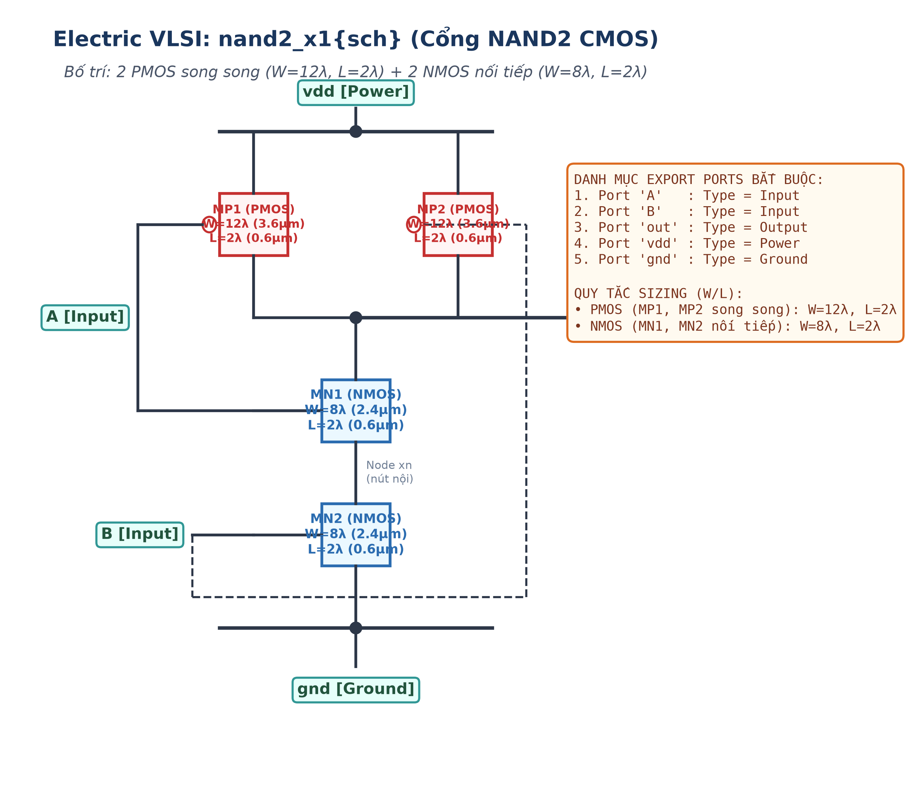
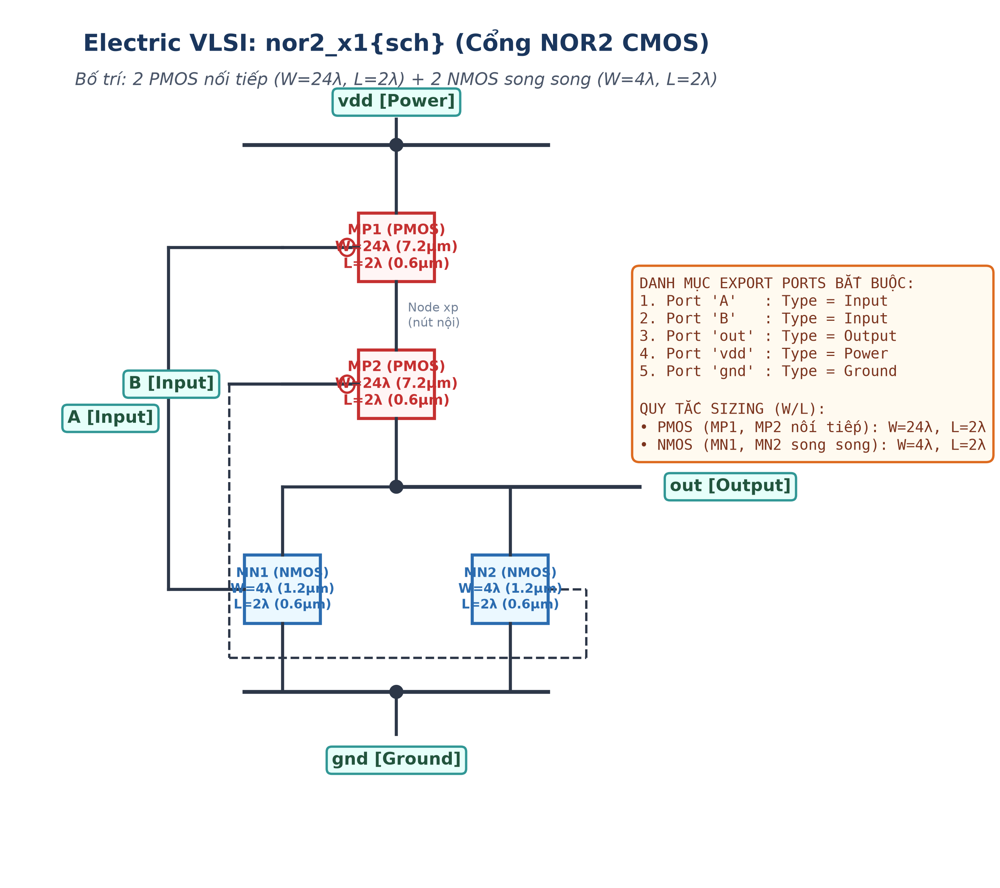

# THỰC HÀNH THIẾT KẾ VLSI — BÀI 2
# THIẾT KẾ CỔNG LOGIC TĨNH NAND2 VÀ NOR2 CMOS

---
**Bộ môn:** Điện tử - Viễn thông | **Khoa:** Điện - Điện tử  
**Trường:** Đại học Sư phạm Kỹ thuật – Đại học Đà Nẵng  
**Thời lượng:** 5 tiết thực hành tại phòng máy (kết hợp tự học Pre-lab & hoàn thiện Post-lab)  
**Công cụ sử dụng:** Electric VLSI Design System (v9.07+), LTspice XVII / LTspice 2025  
**Công nghệ tham chiếu:** MOSIS SCMOS SUBMICRON C5N 0.5µm ($\lambda = 0.30\,\mu\text{m}$, 3 Metal layers, $V_{DD} = 5.0\,\text{V}$)  
---

## I. MỤC TIÊU

Sau khi hoàn thành bài thực hành này, sinh viên có khả năng:
1. **Nắm vững nguyên lý đối ngẫu (Duality Principle):** Hiểu rõ mối liên hệ topo học giữa mạng kéo lên (PUN) và mạng kéo xuống (PDN) trong cấu trúc logic CMOS tĩnh chuẩn; phân tích hàm truyền đạt logic của cổng NAND2 và NOR2.
2. **Định kích thước Transistor theo điện trở tương đương ($R_{on}$):** Tính toán chính xác độ rộng kênh $(W/L)$ cho các transistor mắc nối tiếp và song song, bảo đảm khả năng kéo dòng của cổng NAND2 và NOR2 tương đương với Inverter chuẩn `INV_X1` đã thiết kế ở Bài 1.
3. **Áp dụng Phương pháp Đường đi Euler (Euler Path):** Tìm đường đi Euler chung trên đồ thị mạch để bố trí dải Polysilicon liên tục; thực hiện kỹ thuật chia sẻ vùng khuếch tán (Diffusion Sharing/Abutment), triệt tiêu các khoảng ngắt khuếch tán nhằm tối ưu diện tích và giảm thiểu điện dung ký sinh.
4. **Phân tích Trễ phụ thuộc Vector ngõ vào (Input-Pattern Dependent Delay):** Khảo sát thực nghiệm thời gian trễ $t_{pHL}$ và $t_{pLH}$ khi các ngõ vào chuyển mạch đồng thời hoặc lệch pha; phân tích ảnh hưởng của điện dung nút nội trung gian (Internal Node Capacitance) trong chuỗi NMOS nối tiếp.
5. **Thiết kế Mặt nạ Vật lý (Physical Layout):** Vẽ Layout hoàn chỉnh cho `NAND2_X1` và `NOR2_X1` trên Electric VLSI; kiểm tra luật hình học DRC đạt 0 lỗi và đối chiếu LVS đạt trùng khớp sơ đồ 100%.
6. **Trích xuất Ký sinh (PEX) & Đánh giá PPA:** Trích xuất Netlist ký sinh sau Layout; đo đạc độ suy giảm tốc độ Post-layout; lập bảng so sánh toàn diện về Công suất – Hiệu năng – Diện tích (PPA) giữa NAND2 và NOR2 để giải thích tại sao cổng NAND luôn được ưu tiên tuyệt đối trong công nghiệp vi mạch bán dẫn.
7. **Đóng gói Thư viện Chuẩn:** Tạo tế bào chuẩn `NAND2_X1` và `NOR2_X1` kèm Icon View để bàn giao cho Bài 3 (Cổng phức hợp AOI/OAI) và Bài 6 (Bộ cộng 1-bit Full Adder).

---

## II. CÔNG CỤ VÀ THƯ VIỆN MÔ HÌNH

1. **Phần mềm thiết kế:**
   - **Electric VLSI Design System:** Phiên bản 9.07 trở lên (công nghệ `mocmos`, $\lambda = 0.30\,\mu\text{m}$).
   - **LTspice:** Phiên bản XVII hoặc 2025.
2. **Thư viện mô hình SPICE:**
   - Tệp thư viện tham chiếu: `04 - Models_and_Libraries/C5_models.txt` (NMOS: `N`, PMOS: `P`).
3. **IP kế thừa từ Bài 1:**
   - Tế bào chuẩn `INV_X1` ($W_n = 4\lambda = 1.2\,\mu\text{m}, W_p = 12\lambda = 3.6\,\mu\text{m}, L = 2\lambda = 0.6\,\mu\text{m}$, điện trở dẫn chuẩn $R_{on,n0} \approx 969\,\Omega, R_{on,p0} \approx 992\,\Omega$).

---

## III. CƠ SỞ LÝ THUYẾT VÀ NGUYÊN LÝ THIẾT KẾ

### 1. Kiến trúc Cổng Logic Tĩnh NAND2 và NOR2
Một cổng logic CMOS tĩnh bất kỳ luôn gồm hai mạng chuyển mạch đối ngẫu bù trừ nhau:
- **Mạng kéo lên (Pull-Up Network - PUN):** Gồm các PMOS nối giữa nguồn $V_{DD}$ và ngõ ra $Out$, dẫn điện khi ngõ ra đạt mức logic '1'.
- **Mạng kéo xuống (Pull-Down Network - PDN):** Gồm các NMOS nối giữa ngõ ra $Out$ và đất $GND$, dẫn điện khi ngõ ra đạt mức logic '0'.

```
             CỔNG NAND2 (Y = !(A * B))                      CỔNG NOR2 (Y = !(A + B))
                    VDD (5V)                                      VDD (5V)
                 ┌─────┴─────┐                                       │
                 │           │                                   ┌───┴───┐
             ┌───┴───┐   ┌───┴───┐                               │  MP1  │ (A)
             │  MP1  │   │  MP2  │                               └───┬───┘
         A ──┤ (Wp)  │ B─┤ (Wp)  │                                   │ (Nút nội Xp)
             └───┬───┘   └───┬───┘                               ┌───┴───┐
                 └─────┬─────┘                                   │  MP2  │ (B)
                       ├──────────── Out                         └───┬───┘
                 ┌─────┴─────┐                                       ├──────────── Out
                 │  MN1 (Wn) │ (A)                               ┌───┴───┐
                 └───┬───────┘                               ┌───┴───┐   ┌───┴───┐
                     │ (Nút nội Xn)                          │  MN1  │   │  MN2  │
                 ┌───┴───────┐                           A ──┤ (Wn)  │ B─┤ (Wn)  │
                 │  MN2 (Wn) │ (B)                           └───┬───┘   └───┬───┘
                 └───┬───────┘                                   └─────┬─────┘
                     │                                                 │
                    GND                                               GND
```

<div align="center">

| Cổng NAND2 (`nand2_x1{sch}`) | Cổng NOR2 (`nor2_x1{sch}`) |
| :---: | :---: |
|  |  |
| *Hình 2.1: Sơ đồ nguyên lý Cell `nand2_x1`* | *Hình 2.2: Sơ đồ nguyên lý Cell `nor2_x1`* |

</div>

---

### 2. Định kích thước Transistor theo Điện trở Tương đương $R_{on}$
Để cổng logic đa ngõ vào có khả năng kéo dòng và tốc độ chuyển mạch cân bằng với Inverter chuẩn `INV_X1`, ta định kích thước theo **trường hợp xấu nhất (Worst-Case Analysis)**:

#### a. Cổng NAND2 ($Y = \overline{A \cdot B}$)
- **Mạng PDN (2 NMOS nối tiếp):** Khi cả $A=1$ và $B=1$, dòng xả đi qua 2 NMOS mắc nối tiếp. Để điện trở tương đương tổng bằng $R_{on,n0}$ của Inverter chuẩn:

  $$R_{eq,N} = R_{on,MN1} + R_{on,MN2} = R_{on,n0} \implies W_n = 2 \times W_{n,inv} = 2 \times 4\lambda = 8\lambda = 2.40\,\mu\text{m}$$

- **Mạng PUN (2 PMOS song song):** Trường hợp xấu nhất xảy ra khi chỉ có **1 PMOS dẫn** (ví dụ $A=0, B=1$ hoặc $A=1, B=0$). Để thời gian sườn lên không chậm hơn Inverter:

  $$W_p = W_{p,inv} = 12\lambda = 3.60\,\mu\text{m}$$

- *(Trường hợp tốt nhất khi cả hai PMOS cùng dẫn $A=0, B=0$, điện trở tương đương giảm còn một nửa $R_{eq,P} = R_{on,p0} / 2$, giúp trễ $t_{pLH}$ nhanh gấp đôi).*

#### b. Cổng NOR2 ($Y = \overline{A + B}$)
- **Mạng PUN (2 PMOS nối tiếp):** Để ngõ ra lên mức cao, bắt buộc cả 2 PMOS phải dẫn đồng thời. Do điện trở của PMOS vốn đã lớn gấp 3 lần NMOS (vì $\mu_p \approx \mu_n/3$), việc mắc nối tiếp 2 PMOS đòi hỏi kích thước rất lớn:

  $$R_{eq,P} = R_{on,MP1} + R_{on,MP2} = R_{on,p0} \implies W_p = 2 \times W_{p,inv} = 2 \times 12\lambda = 24\lambda = 7.20\,\mu\text{m}$$

- **Mạng PDN (2 NMOS song song):** Trường hợp xấu nhất xảy ra khi chỉ có **1 NMOS dẫn**:

  $$W_n = W_{n,inv} = 4\lambda = 1.20\,\mu\text{m}$$

> [!IMPORTANT]
> **Hệ quả PPA quan trọng:**  
> Trong cổng NOR2, transistor PMOS phải có bề rộng lên tới $W_p = 24\lambda = 7.2\,\mu\text{m}$ (gấp đôi PMOS của NAND2). Điều này làm tăng vọt diện tích tế bào và điện dung ngõ vào ($C_{in} = C_{ox}(W_n L + W_p L)$), khiến cổng lái phía trước bị tải nặng. Do đó, trong thiết kế vi mạch số, **cổng NAND luôn nhỏ hơn, nhanh hơn và tiết kiệm năng lượng hơn cổng NOR**.

---

### 3. Phương pháp Đường đi Euler và Tối ưu Hóa Sơ đồ que (Stick Diagram)
Khi vẽ Layout cho cổng logic có nhiều transistor, nếu bố trí các cực khuếch tán (Active) ngẫu nhiên, ta sẽ phải cắt rời các vùng Active và nối dây kim loại Metal 1 phức tạp, gây lãng phí diện tích và tăng điện dung ký sinh.

**Phương pháp đường đi Euler (Euler Path Method):**
1. Lập đồ thị mạng PUN và PDN: Mỗi transistor là một cạnh nối giữa hai nút điện thế.
2. Tìm một đường đi qua tất cả các cạnh đúng một lần (**Euler Path**) sao cho thứ tự các biến cổng (ví dụ: $A - B$ hoặc $B - A$) trên mạng PUN **trùng khớp hoàn toàn** với thứ tự trên mạng PDN.
3. Khi thứ tự cổng trùng nhau, ta có thể đặt một dải Polysilicon thẳng đứng liên tục cắt qua cả P-Active và N-Active.
4. Các transistor nằm cạnh nhau có chung chân (ví dụ: cực má nối chung ra $Out$) sẽ được **nối liền vùng khuếch tán (Abutment)** mà không cần khoảng cách cách ly giữa hai vùng Active ($3\lambda$), tiết kiệm đáng kể diện tích tế bào.

```
                  SƠ ĐỒ QUE (STICK DIAGRAM) TỐI ƯU CHO CỔNG NAND2
     VDD ───────────────────────────────────────────────────────────── (Metal 1)
                  │ (Contact)                      │ (Contact)
             ┌────┴────────────────────────────────┴────┐
             │            P-Diffusion (Active)          │  (N-Well)
             └────┬──────────────────┬──────────────────┘
                  │ (Gate A)         │ (Gate B)
     In_A ────────┼──────────────────┼────────────────────────
                  │                  │ (Gate B)
     In_B ────────┼──────────────────┼────────────────────────
                  │ (Gate A)         │
             ┌────┴──────────────────┴──────────────────┐
             │            N-Diffusion (Active)          │  (P-Substrate)
             └────┬─────────────────────────────────────┘
                  │ (Contact)
     GND ───────────────────────────────────────────────────────────── (Metal 1)
```

---

### 4. Hiệu ứng Nút nội và Trễ phụ thuộc Vector ngõ vào
Xét chuỗi NMOS của cổng NAND2:
- Transistor $M_{N1}$ (nối với $Out$) và $M_{N2}$ (nối với $GND$) tiếp xúc với nhau tại **nút nội $X_n$**. Nút này có điện dung ký sinh $C_{int} = C_{db,MN2} + C_{sb,MN1}$.
- **Trường hợp 1 (Ngõ vào $A$ chuyển mạch trễ hơn $B$):** Giả sử $B=1$ từ trước. Nút $X_n$ đã được xả điện tích xuống $0\,\text{V}$ qua $M_{N2}$. Khi $A$ nhảy từ $0 \to 1$, dòng xả chỉ cần rút điện tích từ tải dung $C_L$ tại nút ngõ ra $Out$ qua 2 transistor.
- **Trường hợp 2 (Ngõ vào $B$ chuyển mạch trễ hơn $A$):** Giả sử $A=1$ từ trước, $B=0$. Ngõ ra đang ở mức $5\,\text{V}$, làm tụ $C_{int}$ tại nút nội nạp lên điện thế xấp xỉ $V_{DD} - V_{thn} \approx 4.3\,\text{V}$. Khi $B$ nhảy từ $0 \to 1$, dòng qua $M_{N2}$ phải đồng thời xả cả tụ tải $C_L$ lẫn tụ nút nội $C_{int}$ xuống đất.  
  $\implies$ **Thời gian trễ $t_{pHL}$ khi $B$ chuyển đổi chậm hơn khi $A$ chuyển đổi từ $10\%$ đến $25\%$.**

---

## IV. CHUẨN BỊ TRƯỚC THỰC HÀNH (PRE-LAB - Ở NHÀ)

> [!IMPORTANT]
> Toàn bộ phần chuẩn bị phải được sinh viên ghi chép đầy đủ vào **Mục VI.a (Phần chuẩn bị)** trong Phiếu báo cáo trước khi vào lớp.

1. **Tính toán kích thước Transistor:**
   - Dựa vào tỉ số định kích thước ở mục III.2, ghi lại kích thước hình học $(W/L)$ theo đơn vị $\lambda$ và $\mu\text{m}$ cho 4 transistor của `NAND2_X1` và 4 transistor của `NOR2_X1`.
   - Tính điện trở dẫn tương đương trường hợp xấu nhất: $R_{eq,N}$ và $R_{eq,P}$ của cả hai cổng.
2. **Ước lượng thời gian trễ lý thuyết ($C_L = 50\,\text{fF}$):**
   - Tính trễ sườn xuống $t_{pHL}$ và sườn lên xấu nhất $t_{pLH,worst}$ cho cổng NAND2.
   - Tính trễ sườn lên $t_{pLH}$ và sườn xuống xấu nhất $t_{pHL,worst}$ cho cổng NOR2.
   - Tính trễ trung bình $t_{pd,worst}$ cho mỗi cổng.
3. **Đồ thị Euler và Sơ đồ que (Stick Diagram):**
   - Vẽ đồ thị mạch (Graph) cho PUN và PDN của cổng NAND2; chỉ ra chu trình Euler với thứ tự cổng Poly $A - B$.
   - Vẽ sơ đồ que Stick Diagram của cổng `NAND2_X1` lên giấy ô ly, đánh dấu rõ vị trí chia sẻ cực má chung nối ra chân `out`.
   - Lặp lại vẽ sơ đồ que Stick Diagram cho cổng `NOR2_X1`.
4. **Chuẩn bị kịch bản đo đạc SPICE (.MEAS):**
   Soạn sẵn các câu lệnh `.MEAS` đo $t_{pHL}$ và $t_{pLH}$ tương ứng với hai kịch bản kích thích:
   - Ca A: Ngõ vào $B = 1$ cố định, ngõ vào $A$ cấp xung vuông $0 \to 5\text{V}$.
   - Ca B: Ngõ vào $A = 1$ cố định, ngõ vào $B$ cấp xung vuông $0 \to 5\text{V}$.

---

## V. NỘI DUNG THỰC HÀNH TẠI PHÒNG LAB (IN-LAB)

### 1. Thiết kế Schematic và Phân tích VTC Cổng NAND2 trên Electric & LTspice


1. **Khởi tạo Cell mới trong Electric:**
   - Chọn menu `Cell -> New Cell...` (phím tắt `Ctrl + N`).
   - Đặt tên Cell: `nand2_x1`, chọn View type: `schematic` $\to$ Cell mới được tạo là `nand2_x1{sch}`.
2. **Bố trí linh kiện và định kích thước transistor:**
   - **Mạng PUN (2 PMOS song song):**
     * Đặt 2 transistor PMOS (`mocmos:P-Transistor`, phím `P`).
     * Đặt kích thước cho cả 2 PMOS: $W = 12\lambda = 3.60\,\mu\text{m}$, $L = 2\lambda = 0.60\,\mu\text{m}$.
     * Cực Nguồn (Source) và cực Thân (Bulk) của 2 PMOS nối lên `vdd`.
     * Cực Máng (Drain) của 2 PMOS nối chập lại với nhau đưa ra nút `out`.
   - **Mạng PDN (2 NMOS nối tiếp):**
     * Đặt 2 transistor NMOS (`mocmos:N-Transistor`, phím `N`).
     * Đặt kích thước cho cả 2 NMOS: $W = 8\lambda = 2.40\,\mu\text{m}$, $L = 2\lambda = 0.60\,\mu\text{m}$.
     * Cực Máng (Drain) của NMOS trên nối ra nút `out`.
     * Cực Nguồn (Source) của NMOS trên nối với cực Máng (Drain) của NMOS dưới (tạo nút nội $X_n$).
     * Cực Nguồn (Source) của NMOS dưới nối xuống `gnd`.
     * Cực Thân (Bulk) của cả 2 NMOS nối xuống `gnd`.
   - **Đấu nối cực Cổng (Gate):**
     * Cực Cổng của PMOS thứ nhất và NMOS thứ nhất nối chung làm ngõ vào `A`.
     * Cực Cổng của PMOS thứ hai và NMOS thứ hai nối chung làm ngõ vào `B`.
3. **Gán đầy đủ 5 chân Export (`Ctrl + E`):**

   | Tên chân Export | Hướng (Characteristics) | Vị trí kết nối trên mạch | Chức năng |
   | :--- | :--- | :--- | :--- |
   | **`A`** | `Input` | Cực cổng chung $M_{P1}$ và $M_{N1}$ | Tín hiệu logic ngõ vào A |
   | **`B`** | `Input` | Cực cổng chung $M_{P2}$ và $M_{N2}$ | Tín hiệu logic ngõ vào B |
   | **`out`** | `Output` | Nút ngõ ra chung ($D_{P1}, D_{P2}, D_{N1}$) | Tín hiệu logic ngõ ra $Y = \overline{A \cdot B}$ |
   | **`vdd`** | `Power` | Source & Bulk của các PMOS | Cực nguồn $+5.0\,\text{V}$ |
   | **`gnd`** | `Ground` | Source & Bulk của các NMOS | Đường nối đất chuẩn $0\,\text{V}$ |

4. Nhấn phím `F5` kiểm tra kết nối mạng (Check and Clean). Xuất SPICE Netlist sang LTspice.
5. **Khảo sát đường cong truyền đạt tĩnh (VTC):**
   - Nối chân $B$ lên nguồn tĩnh $5.0\,\text{V}$ (`Vb B 0 DC 5.0`).
   - Quét điện áp ngõ vào $A$: `.dc Va 0 5 0.005`.
   - Chạy mô phỏng, đo điện áp ngưỡng chuyển mạch $V_M$ tại vị trí $V_{out} = V_A$.
   - Lặp lại quét khi nối chung hai ngõ vào $A = B = V_{in}$ (cả hai transistor cùng chuyển mạch đồng thời). So sánh độ dời của điểm $V_M$.

---

### 2. Đo đạc Trễ Quá độ và Hiệu ứng Nút nội trên Cổng NAND2
1. Thiết lập nguồn xung vuông $50\,\text{MHz}$ cho ngõ vào chuyển mạch và nguồn DC cho ngõ vào giữ mức cao. Tải dung ngõ ra: $C_L = 50\,\text{fF}$.
2. **Kịch bản 1 (Ngõ vào $A$ chuyển mạch, $B = 5\,\text{V}$ cố định):**
   - Chạy mô phỏng quá độ: `.tran 1p 50n`.
   - Dùng lệnh `.MEAS` đọc trễ sườn xuống $t_{pHL(A)}$ và trễ sườn lên $t_{pLH(A)}$.
3. **Kịch bản 2 (Ngõ vào $B$ chuyển mạch, $A = 5\,\text{V}$ cố định):**
   - Chạy mô phỏng quá độ `.tran 1p 50n`.
   - Dùng lệnh `.MEAS` đọc trễ sườn xuống $t_{pHL(B)}$ và trễ sườn lên $t_{pLH(B)}$.
4. **Kịch bản 3 (Cả $A$ và $B$ cùng chuyển mạch đồng thời $0 \to 5\,\text{V}$):**
   - Đọc trễ sườn lên trường hợp tốt nhất $t_{pLH(AB)}$ khi cả hai PMOS cùng dẫn song song.
   - So sánh $t_{pLH(AB)}$ với $t_{pLH(A)}$ để kiểm chứng lý thuyết $R_{eq}$ giảm một nửa.
5. Đóng gói Cell Icon `nand2_x1{ic}` chuẩn IEEE (ký hiệu cổng NAND 2 ngõ vào).

---

### 3. Thiết kế Schematic và Khảo sát Trễ Cổng NOR2 trong Electric VLSI


1. **Khởi tạo Cell mới trong Electric:**
   - Vào menu `Cell -> New Cell...` (phím tắt `Ctrl + N`).
   - Đặt tên Cell: `nor2_x1`, chọn View type: `schematic` $\to$ Cell mới được tạo có tên đầy đủ là `nor2_x1{sch}`.
2. **Bố trí 2 PMOS nối tiếp và 2 NMOS song song:**
   - **Mạng kéo lên (PUN) - 2 PMOS nối tiếp:**
     * Kéo 2 linh kiện PMOS (`mocmos:P-Transistor`, phím tắt `P`).
     * Nhấp đúp chuột vào từng PMOS (hoặc nhấn `Ctrl + I`) để đặt kích thước định cỡ:
       + Bề rộng kênh: **$W = 24\lambda = 7.20\,\mu\text{m}$** (gõ `7.2u`).
       + Chiều dài kênh: **$L = 2\lambda = 0.60\,\mu\text{m}$** (gõ `0.6u`).
     * Nối cực Nguồn (Source) của PMOS thứ nhất lên dây nguồn `vdd`.
     * Nối cực Máng (Drain) của PMOS thứ nhất vào cực Nguồn (Source) của PMOS thứ hai (hình thành nút nội $X_p$).
     * Nối cực Máng (Drain) của PMOS thứ hai ra nút ngõ ra `out`.
     * Cực Thân (Bulk) của cả 2 PMOS nối lên `vdd`.
   - **Mạng kéo xuống (PDN) - 2 NMOS song song:**
     * Kéo 2 linh kiện NMOS (`mocmos:N-Transistor`, phím tắt `N`).
     * Nhấp đúp chuột vào từng NMOS (hoặc nhấn `Ctrl + I`) để đặt kích thước định cỡ:
       + Bề rộng kênh: **$W = 4\lambda = 1.20\,\mu\text{m}$** (gõ `1.2u`).
       + Chiều dài kênh: **$L = 2\lambda = 0.60\,\mu\text{m}$** (gõ `0.6u`).
     * Nối chập 2 cực Máng (Drain) của 2 NMOS vào nút ngõ ra `out`.
     * Nối chập 2 cực Nguồn (Source) của 2 NMOS xuống dây đất `gnd`.
     * Cực Thân (Bulk) của cả 2 NMOS nối xuống `gnd`.
   - **Đấu nối cực Cổng (Gate):**
     * Nối cực Cổng của PMOS thứ nhất và NMOS thứ nhất lại với nhau $\to$ nút ngõ vào `A`.
     * Nối cực Cổng của PMOS thứ hai và NMOS thứ hai lại với nhau $\to$ nút ngõ vào `B`.
3. **Gán đầy đủ 5 chân Export (`Ctrl + E`):**
   - Chọn nút mạng tương ứng, vào menu `Export -> Create Export...` (phím tắt `Ctrl + E`), đặt tên và chọn đặc tính (Export Characteristics):

   | Tên chân Export | Hướng (Characteristics) | Vị trí đấu nối trên mạch | Chức năng chi tiết |
   | :--- | :--- | :--- | :--- |
   | **`A`** | `Input` | Cực cổng chung $M_{P1}$ và $M_{N1}$ | Tín hiệu logic ngõ vào A |
   | **`B`** | `Input` | Cực cổng chung $M_{P2}$ và $M_{N2}$ | Tín hiệu logic ngõ vào B |
   | **`out`** | `Output` | Nút ngõ ra chung ($D_{P2}, D_{N1}, D_{N2}$) | Tín hiệu logic ngõ ra $Y = \overline{A + B}$ |
   | **`vdd`** | `Power` | Source & Bulk của các PMOS | Cực nguồn $+5.0\,\text{V}$ |
   | **`gnd`** | `Ground` | Source & Bulk của các NMOS | Đường nối đất chuẩn $0\,\text{V}$ |

4. Nhấn phím `F5` kiểm tra tính đúng đắn của sơ đồ nguyên lý (bảo đảm **0 errors, 0 warnings**).
5. Xuất Netlist và mô phỏng Transient trên LTspice với tải dung $C_L = 50\,\text{fF}$.
6. Khảo sát trễ sườn lên $t_{pLH}$ và sườn xuống trường hợp xấu nhất ($1$ NMOS dẫn) và tốt nhất ($2$ NMOS cùng dẫn).
7. Đóng gói Cell Icon `nor2_x1{ic}` chuẩn IEEE (ký hiệu cổng NOR 2 ngõ vào).

---

### 4. Thiết kế Mask Layout, Chạy DRC & LVS cho Cổng NAND2
1. Trong Electric, tạo Cell Layout: `nand2_x1{lay}`.
2. Tạo hai đường ray nguồn Metal 1 nằm ngang `vdd` và `gnd` (độ rộng $\ge 6\lambda$).
3. Bố trí vùng N-Well ở nửa trên; đặt vùng P-Active liên tục.
4. Bố trí vùng N-Active liên tục ở nửa dưới.
5. Vẽ 2 dải Polysilicon song song thẳng đứng cắt qua cả P-Active và N-Active tương ứng với hai ngõ vào $A$ và $B$ (khoảng cách giữa 2 dải Poly $\ge 3\lambda$).
6. **Thực hiện kỹ thuật chia sẻ vùng khuếch tán (Abutment):**
   - Cực má chung của 2 PMOS nối liền nhau và nối với cực má của NMOS trên bằng Metal 1 ra chân `out`.
   - Cực nguồn của 2 PMOS nối lên `vdd`.
   - Cực Source của NMOS dưới nối xuống `gnd`. Cực nối giữa 2 NMOS là nút nội tự nhiên trong dải khuếch tán, không cần tiếp xúc ra ngoài.
7. Đặt tiếp xúc phân cực $N^+$-tap lên `vdd` và $P^+$-tap xuống `gnd`.
8. Nhấn `F5` chạy kiểm tra DRC. Sửa toàn bộ lỗi hình học đạt **0 errors found**.
9. Vào *Tools $\to$ NCC $\to$ Schematic and Layout Comparison*. Kiểm tra kết quả LVS đạt **"MATCH"**.

---

### 5. Trích xuất Ký sinh PEX & So sánh PPA giữa NAND2 và NOR2
1. Bật tùy chọn trích xuất tụ ký sinh trong Electric, xuất file Netlist Post-layout cho `nand2_x1`.
2. Chạy mô phỏng Transient Post-layout với $C_L = 50\,\text{fF}$.
3. Đo đạc độ suy giảm tốc độ giữa Pre-layout và Post-layout do tụ ký sinh nút nội $C_{int}$ và tụ cực má $C_{db}$.
4. So sánh diện tích mặt nạ hình học ($W \times H$) của Layout `NAND2_X1` so với Layout `NOR2_X1`.

---

## VI. BÁO CÁO THỰC HÀNH (MẪU PHIẾU ĐIỀN KHUYẾT CHO SINH VIÊN)

```
========================================================================================
                          BÁO CÁO THỰC HÀNH: BÀI 2
                 THIẾT KẾ CỔNG LOGIC TĨNH NAND2 VÀ NOR2 CMOS
Họ và Tên: ..................................................... MSSV: .................
Lớp: ....................................... Nhóm/Bàn: ......... Ngày: .................
Chữ ký Giảng viên / Điểm nghiệm thu tại bàn: ............................................
========================================================================================
```

### a. Phần Chuẩn bị (Pre-lab)

1. **Bảng kích thước transistor định cỡ lý thuyết:**

   | Cổng logic | Transistor | Vai trò | Kích thước $(W/L)$ theo $\lambda$ | Kích thước $(W/L)$ theo $\mu\text{m}$ | Điện trở dẫn hiệu dụng $R_{on}$ ($\Omega$) |
   | :--- | :---: | :---: | :---: | :---: | :---: |
   | **NAND2** | $M_{N1}, M_{N2}$ | PDN (nối tiếp) | .................... | .................... | $R_{on,N1} = R_{on,N2} =$ .................... |
   | **NAND2** | $M_{P1}, M_{P2}$ | PUN (song song) | .................... | .................... | $R_{on,P1} = R_{on,P2} =$ .................... |
   | **NOR2** | $M_{N1}, M_{N2}$ | PDN (song song) | .................... | .................... | $R_{on,N1} = R_{on,N2} =$ .................... |
   | **NOR2** | $M_{P1}, M_{P2}$ | PUN (nối tiếp) | .................... | .................... | $R_{on,P1} = R_{on,P2} =$ .................... |

2. **Dự đoán thời gian trễ lý thuyết ($C_L = 50\,\text{fF}$):**
   - **Cổng NAND2:**
     * Trễ sườn xuống: $t_{pHL} = 0.69 \times R_{eq,N} \times C_L =$ ........................................ ps
     * Trễ sườn lên xấu nhất (1 PMOS dẫn): $t_{pLH,worst} = 0.69 \times R_{eq,P} \times C_L =$ ........................................ ps
     * Trễ sườn lên tốt nhất (2 PMOS dẫn): $t_{pLH,best} = 0.69 \times (R_{eq,P}/2) \times C_L =$ ........................................ ps
   - **Cổng NOR2:**
     * Trễ sườn lên: $t_{pLH} = 0.69 \times R_{eq,P} \times C_L =$ ........................................ ps
     * Trễ sườn xuống xấu nhất (1 NMOS dẫn): $t_{pHL,worst} = 0.69 \times R_{eq,N} \times C_L =$ ........................................ ps
     * Trễ sườn xuống tốt nhất (2 NMOS dẫn): $t_{pHL,best} = 0.69 \times (R_{eq,N}/2) \times C_L =$ ........................................ ps

3. **Sơ đồ que Stick Diagram của cổng `NAND2_X1` (Tối ưu đường Euler $A-B$):**  
   *(Vẽ sơ đồ que vào khung dưới đây, chú thích rõ dải khuếch tán liên tục, cổng Poly A và B, cực má chung Out)*

   ```
   ┌──────────────────────────────────────────────────────────────────────────────────┐
   │                                                                                  │
   │                                                                                  │
   │                                                                                  │
   │                                                                                  │
   │                                                                                  │
   │                                                                                  │
   │                                                                                  │
   │                                                                                  │
   └──────────────────────────────────────────────────────────────────────────────────┘
   ```

---

### b. Phần Thực hành (In-lab)

1. **Khảo sát đặc tuyến VTC của cổng NAND2:**
   - Ngưỡng chuyển mạch khi ngõ vào $B = 5\,\text{V}$ cố định, quét $V_A$: $V_M =$ .................... V
   - Ngưỡng chuyển mạch khi nối chung hai ngõ vào $A = B = V_{in}$: $V_M =$ .................... V
   - *Giải thích tại sao $V_M$ bị dịch chuyển khi cả hai ngõ vào cùng nối chung:*  
     ................................................................................................................................................

2. **Bảng đo trễ quá độ (Transient) Pre-layout của cổng NAND2 ($C_L = 50\,\text{fF}$):**

   | Kịch bản kích thích | Ngõ vào $A$ | Ngõ vào $B$ | $t_{pHL}$ (ps) | $t_{pLH}$ (ps) | $t_{pd}$ trung bình (ps) |
   | :--- | :---: | :---: | :---: | :---: | :---: |
   | **Ca 1 ($A$ chuyển mạch trễ)** | Xung $0 \to 5\text{V}$ | $5.0\,\text{V}$ tĩnh | ................ | ................ | ................ |
   | **Ca 2 ($B$ chuyển mạch trễ)** | $5.0\,\text{V}$ tĩnh | Xung $0 \to 5\text{V}$ | ................ | ................ | ................ |
   | **Ca 3 ($A, B$ cùng chuyển mạch)**| Xung $0 \to 5\text{V}$ | Xung $0 \to 5\text{V}$ | ................ | ................ | ................ |

   *So sánh $t_{pHL}$ giữa Ca 1 và Ca 2: Trường hợp nào chậm hơn? Giải thích nguyên nhân do tụ nút nội $C_{int}$:*  
   ....................................................................................................................................................  
   ....................................................................................................................................................

3. **Bảng đo trễ quá độ (Transient) Pre-layout của cổng NOR2 ($C_L = 50\,\text{fF}$):**

   | Kịch bản kích thích | Ngõ vào $A$ | Ngõ vào $B$ | $t_{pLH}$ (ps) | $t_{pHL}$ (ps) | $t_{pd}$ trung bình (ps) |
   | :--- | :---: | :---: | :---: | :---: | :---: |
   | **Ca 1 ($A$ chuyển mạch trễ)** | Xung $0 \to 5\text{V}$ | $0.0\,\text{V}$ tĩnh | ................ | ................ | ................ |
   | **Ca 2 ($B$ chuyển mạch trễ)** | $0.0\,\text{V}$ tĩnh | Xung $0 \to 5\text{V}$ | ................ | ................ | ................ |
   | **Ca 3 ($A, B$ cùng chuyển mạch)**| Xung $0 \to 5\text{V}$ | Xung $0 \to 5\text{V}$ | ................ | ................ | ................ |

4. **Kết quả Thiết kế Mask Layout và Đối chiếu Vật lý Cổng NAND2:**
   - Kích thước tế bào: Chiều rộng $W =$ ............. $\lambda$ ($.............\,\mu\text{m}$); Chiều cao $H =$ ............. $\lambda$ ($.............\,\mu\text{m}$)
   - Diện tích Layout: ........................ $\mu\text{m}^2$
   - Số lỗi DRC: .................... lỗi
   - Kết quả đối chiếu LVS: ....................................................................................................................

5. **Bảng So sánh Đối chiếu Toàn diện PPA giữa NAND2 và NOR2:**

   | Tiêu chí so sánh | Cổng NAND2_X1 | Cổng NOR2_X1 | Tỉ số so sánh ($\frac{\text{NOR2}}{\text{NAND2}}$) | Đánh giá ưu thế |
   | :--- | :---: | :---: | :---: | :---: |
   | **Tổng bề rộng kênh $\sum W$** | $12.0\,\mu\text{m}$ | $16.8\,\mu\text{m}$ | $+40.0\%$ | NAND2 nhỏ hơn |
   | **Điện dung ngõ vào Pin A ($C_{in}$)** | $6.0\,\mu\text{m} \times C_{ox}$ | $8.4\,\mu\text{m} \times C_{ox}$ | $+40.0\%$ | NAND2 ít tải hơn |
   | **Diện tích Layout hình học ($W \times H$)** | .............. $\mu\text{m}^2$ | .............. $\mu\text{m}^2$ | .............. % | .............................. |
   | **Trễ trung bình Pre-layout ($t_{pd}$)** | .............. ps | .............. ps | .............. % | .............................. |
   | **Trễ trung bình Post-layout (PEX)** | .............. ps | .............. ps | .............. % | .............................. |

6. **Phân tích và Biện luận Kỹ thuật:**
   - *Câu hỏi 1: Dựa vào bảng số liệu trên, hãy giải thích tại sao trong thiết kế ASIC/SoC thực tế, các kỹ sư thường tìm cách chuyển đổi biểu thức logic về dạng cổng NAND thay vì cổng NOR?*  
     ................................................................................................................................................  
     ................................................................................................................................................  
     ................................................................................................................................................
   - *Câu hỏi 2: Kỹ thuật chia sẻ vùng khuếch tán (Abutment) giúp cải thiện những thông số nào của tế bào vi mạch? Nếu không dùng kỹ thuật này thì diện tích và điện dung ký sinh nút ngõ ra sẽ bị ảnh hưởng ra sao?*  
     ................................................................................................................................................  
     ................................................................................................................................................  
     ................................................................................................................................................
   - *Câu hỏi 3: Nếu phải thiết kế cổng NAND 4 ngõ vào (NAND4), chiều rộng kênh của 4 NMOS mắc nối tiếp sẽ bằng bao nhiêu? Việc mắc nối tiếp quá nhiều transistor ($\ge 4$) trong logic CMOS tĩnh sẽ dẫn đến nhược điểm nghiêm trọng gì về mặt hiệu năng?*  
     ................................................................................................................................................  
     ................................................................................................................................................  
     ................................................................................................................................................

---

## VII. RUBRIC ĐÁNH GIÁ (THANG ĐIỂM 10)

| Tiêu chí | Trọng số | Mức Xuất sắc (8.5 – 10) | Mức Khá (7.0 – 8.4) | Mức Đạt (5.0 – 6.9) | Mức Không đạt (< 5.0) |
| :--- | :---: | :--- | :--- | :--- | :--- |
| **1. Chuẩn bị Pre-lab (Mục VI.a)** | **20%** | Tính đúng $100\%$ kích thước $W/L$, điện trở $R_{eq}$, trễ lý thuyết; Stick diagram vẽ đúng đường Euler và chia sẻ cực má chung. | Tính toán đúng các công thức chính; Stick diagram đúng nguyên lý nhưng chưa ghi rõ các lớp. | Tính toán còn sai lệch số học; Stick diagram vẽ sơ sài, thiếu tiếp xúc Taps. | Không chuẩn bị bài trước ở nhà hoặc sao chép bài của bạn. |
| **2. Phân tích VTC & Đo trễ NAND2** | **25%** | Đo đúng VTC và ngưỡng $V_M$; Dùng thành thạo `.MEAS` khảo sát đủ 3 kịch bản chuyển mạch; Đo chính xác độ lệch trễ nút nội $C_{int}$. | Đo được VTC; Chạy được mô phỏng quá độ nhưng thao tác câu lệnh `.MEAS` còn chậm. | Đo trễ bằng con trỏ thủ công do chưa thiết lập được lệnh `.MEAS`. | Không hoàn thành mô phỏng hoặc mạch báo lỗi cú pháp SPICE. |
| **3. Khảo sát Cổng NOR2 & So sánh** | **20%** | Xây dựng Schematic NOR2 chuẩn kích thước; Đo đủ trễ các ca sườn lên/xuống; Điền đúng bảng so sánh PPA giữa NAND và NOR. | Dựng được NOR2; Đo được trễ trường hợp xấu nhất; Lập được bảng so sánh PPA. | Dựng được mạch NOR2 nhưng kích thước $W_p$ chưa đúng yêu cầu; So sánh sơ sài. | Không hoàn thành mạch NOR2. |
| **4. Physical Layout, DRC & LVS** | **25%** | Layout NAND2 gọn gàng, chia sẻ khuếch tán triệt để; Kiểm tra DRC đạt 0 lỗi; Đối chiếu LVS báo MATCH 100% độc lập. | Layout đạt chuẩn, 0 lỗi DRC; LVS match sau 1 lần chỉnh sửa nhỏ về nhãn cổng. | Layout còn cồng kềnh, vi phạm một vài lỗi khoảng cách DRC nhưng tự sửa được. | Vi phạm nhiều lỗi DRC nghiêm trọng; LVS không match; không hoàn thành layout. |
| **5. Trích xuất PEX & Biện luận Báo cáo** | **10%** | Trích xuất PEX thành công; Hoàn thiện bảng số liệu 3 chiều; Trả lời xuất sắc 3 câu hỏi phân tích bản chất vật lý vi mạch. | Trích xuất PEX thành công; Điền đủ bảng số liệu; Trả lời đúng các câu hỏi lý thuyết. | Trích xuất được PEX nhưng phần giải thích nguyên nhân ưu thế của NAND còn mơ hồ. | Không thực hiện được bước PEX hoặc nộp báo cáo để trống nhiều phần. |
