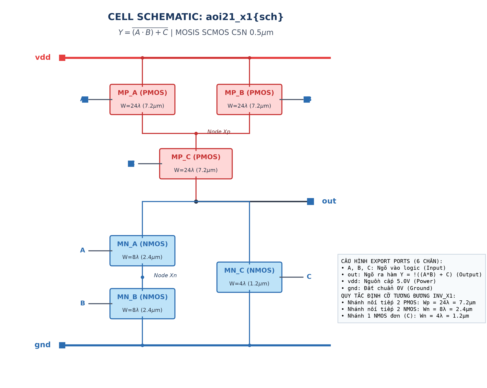
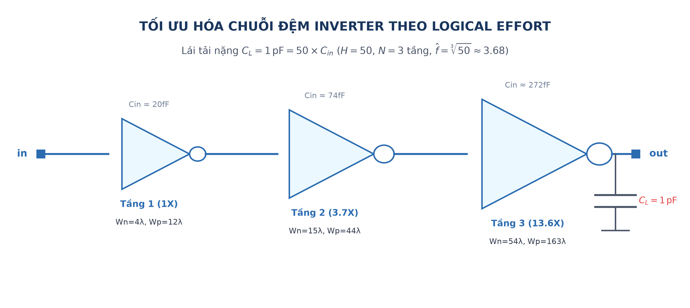

# THỰC HÀNH THIẾT KẾ VLSI — BÀI 3
# CỔNG PHỨC HỢP (AOI/OAI) VÀ TỐI ƯU TRỄ THEO PHƯƠNG PHÁP LOGICAL EFFORT

---
**Bộ môn:** Điện tử - Viễn thông | **Khoa:** Điện - Điện tử  
**Trường:** Đại học Sư phạm Kỹ thuật – Đại học Đà Nẵng  
**Thời lượng:** 5 tiết thực hành tại phòng máy (kết hợp tự học Pre-lab & hoàn thiện Post-lab)  
**Công cụ sử dụng:** Electric VLSI Design System (v9.07+), LTspice XVII / LTspice 2025  
**Công nghệ tham chiếu:** MOSIS SCMOS SUBMICRON C5N 0.5µm ($\lambda = 0.30\,\mu\text{m}$, 3 Metal layers, $V_{DD} = 5.0\,\text{V}$)  
---

## I. MỤC TIÊU

Sau khi hoàn thành bài thực hành này, sinh viên có khả năng:
1. **Nắm vững nguyên lý thiết kế Cổng phức hợp CMOS (Complex Logic Gates):** Phân tích và hiện thực hàm logic dạng AND-OR-INVERT (`AOI`) và OR-AND-INVERT (`OAI`) chỉ trong **một tầng logic duy nhất (Single-stage Gate)**; hiểu rõ ưu thế vượt trội về diện tích và tốc độ so với việc ghép nối các cổng rời (NAND, NOR, Inverter).
2. **Định kích thước Transistor theo điện trở tương đương ($R_{on}$):** Định cỡ bề rộng kênh $(W/L)$ cho mạng kéo lên (PUN) và kéo xuống (PDN) không đối xứng, bảo đảm dòng nạp/xả trong trường hợp xấu nhất tương đương với Inverter chuẩn `INV_X1`.
3. **Làm chủ Lý thuyết Nỗ lực Logic (Logical Effort Theory):** 
   - Xác định chính xác nỗ lực logic $g$ (Logical Effort) và trễ ký sinh $p$ (Parasitic Delay) cho từng ngõ vào của cổng phức hợp.
   - Hiểu rõ bản chất hàm trễ tuyến tính $d = g \cdot h + p$ thông qua phương pháp đo đạc quét tải dung (Fan-out $h$).
4. **Giải bài toán Tối ưu hóa Chuỗi đệm (Inverter Buffer Chain Optimization):** Tính toán số tầng đệm tối ưu $N$, hệ số phóng đại từng tầng $\hat{f}$, và thiết kế chuỗi Inverter nhiều tầng để lái tải dung lớn ($C_L = 1\,\text{pF}$) với độ trễ cực tiểu lý thuyết.
5. **Thiết kế Mask Layout cho Cổng phức hợp:** Áp dụng phương pháp đường đi Euler để tìm thứ tự cổng Polysilicon tối ưu, giảm thiểu số vết cắt khuếch tán, vượt qua kiểm tra luật hình học DRC và đối chiếu sơ đồ LVS đạt kết quả trùng khớp hoàn hảo (**MATCH**).
6. **Đóng gói IP Tế bào chuẩn:** Tạo Cell Icon `aoi21_x1{ic}` và tế bào chuỗi đệm `buf_chain_3st{ic}` bàn giao cho khối tính toán số học ở các bài thực hành tiếp theo.

---

## II. CÔNG CỤ VÀ THƯ VIỆN MÔ HÌNH

1. **Phần mềm thiết kế:**
   - **Electric VLSI Design System:** Phiên bản 9.07 trở lên (công nghệ `mocmos`, $\lambda = 0.30\,\mu\text{m}$).
   - **LTspice:** Phiên bản XVII hoặc LTspice 2025.
2. **Thư viện mô hình SPICE:**
   - Tệp thư viện tham chiếu: `04 - Models_and_Libraries/C5_models.txt` (NMOS: `N`, PMOS: `P`).
3. **IP kế thừa từ Bài 1 và Bài 2:**
   - Tế bào Inverter chuẩn `INV_X1` ($W_n = 4\lambda = 1.2\,\mu\text{m}, W_p = 12\lambda = 3.6\,\mu\text{m}, L = 2\lambda = 0.6\,\mu\text{m}$).
   - Tế bào NAND2 chuẩn `NAND2_X1` và NOR2 chuẩn `NOR2_X1`.

---

## III. CƠ SỞ LÝ THUYẾT VÀ NGUYÊN LÝ THIẾT KẾ

### 1. Cấu trúc Cổng Phức Hợp AOI21 ($Y = \overline{(A \cdot B) + C}$)

Trong thiết kế vi mạch CMOS tĩnh, việc hiện thực một hàm logic phức tạp bằng cách ghép các cổng đơn lẻ (ví dụ: dùng 1 cổng AND2 và 1 cổng NOR2 để tạo $Y = \overline{(A \cdot B) + C}$) đòi hỏi:
- Cổng AND2 cần: 4 transistor (NAND2) + 2 transistor (Inverter) = 6 transistor.
- Cổng NOR2 cần: 4 transistor.
- $\implies$ **Tổng số transistor: $6 + 4 = 10$ transistor**, tín hiệu phải truyền qua **2 tầng trễ logic**.

Thay vào đó, cấu trúc **Cổng phức hợp AOI21 (And-Or-Invert 2-1)** tích hợp toàn bộ hàm logic vào một tế bào duy nhất:
- **Mạng kéo xuống (PDN):** Thực hiện hàm logic không đảo $F = (A \cdot B) + C$. Nhánh $A \cdot B$ gồm 2 NMOS mắc nối tiếp ($M_{NA}, M_{NB}$); nhánh này mắc song song với 1 NMOS đơn ($M_{NC}$) đại diện cho biến $C$.
- **Mạng kéo lên (PUN):** Thực hiện hàm bù bằng luật De Morgan:

  $$Y = \overline{(A \cdot B) + C} = \overline{(A \cdot B)} \cdot \bar{C} = (\bar{A} + \bar{B}) \cdot \bar{C}$$

  Mạng gồm 2 PMOS mắc song song ($M_{PA} \parallel M_{PB}$), sau đó nối tiếp với 1 PMOS đại diện cho biến $C$ ($M_{PC}$).
- $\implies$ **Tổng số transistor chỉ còn: 6 transistor (3 PMOS + 3 NMOS)**. Tín hiệu chỉ đi qua **1 tầng chuyển mạch duy nhất**, giúp giảm diện tích mặt nạ $\approx 40\%$ và giảm trễ đáng kể.

<div align="center">


*Hình 3.1: Sơ đồ nguyên lý tế bào chuẩn `aoi21_x1{sch}` trong Electric VLSI*

</div>

---

### 2. Định Kích thước Transistor theo Điện trở Dẫn $R_{on}$ Trường hợp Xấu nhất

Để cổng `AOI21_X1` có khả năng kéo dòng nạp/xả cân bằng với Inverter chuẩn `INV_X1` ($R_{on,n0} \approx 969\,\Omega, R_{on,p0} \approx 992\,\Omega$):

#### a. Mạng kéo xuống (PDN)
- **Nhánh $A \cdot B$ (2 NMOS nối tiếp):** Khi cả $A=1, B=1$, dòng xả đi qua 2 NMOS nối tiếp. Để điện trở bằng $R_{on,n0}$:

  $$R_{eq} = R_{on,NA} + R_{on,NB} = R_{on,n0} \implies W_{n,A} = W_{n,B} = 2 \times W_{n,inv} = 2 \times 4\lambda = 8\lambda = 2.40\,\mu\text{m}$$

- **Nhánh $C$ (1 NMOS đơn):** Khi chỉ có $C=1$, dòng xả đi qua 1 NMOS độc lập. Để điện trở bằng $R_{on,n0}$:

  $$W_{n,C} = W_{n,inv} = 4\lambda = 1.20\,\mu\text{m}$$

#### b. Mạng kéo lên (PUN)
- Mạng gồm cụm $(M_{PA} \parallel M_{PB})$ mắc nối tiếp với $M_{PC}$.
- **Trường hợp xấu nhất (Worst-Case):** Xảy ra khi chỉ có **1 PMOS trong nhánh song song dẫn** (ví dụ $A=0, B=1, C=0$ hoặc $A=1, B=0, C=0$). Khi đó, đường dẫn từ $V_{DD}$ xuống $Out$ đi qua đúng 2 PMOS mắc nối tiếp.
- Do đó, để điện trở tương đương tổng bằng $R_{on,p0}$:

  $$R_{eq} = R_{on,P(A/B)} + R_{on,PC} = R_{on,p0} \implies W_{p,A} = W_{p,B} = W_{p,C} = 2 \times W_{p,inv} = 2 \times 12\lambda = 24\lambda = 7.20\,\mu\text{m}$$

> [!NOTE]
> Bảng tổng hợp kích thước tế bào `AOI21_X1`:
> - $M_{PA}, M_{PB}, M_{PC}$: $W = 24\lambda = 7.20\,\mu\text{m}, L = 2\lambda = 0.60\,\mu\text{m}$.
> - $M_{NA}, M_{NB}$: $W = 8\lambda = 2.40\,\mu\text{m}, L = 2\lambda = 0.60\,\mu\text{m}$.
> - $M_{NC}$: $W = 4\lambda = 1.20\,\mu\text{m}, L = 2\lambda = 0.60\,\mu\text{m}$.

---

### 3. Phương pháp Logical Effort (Sutherland, Sproull, Harris)

Phương pháp **Logical Effort (Nỗ lực Logic)** là công cụ giải tích kinh điển giúp kỹ sư vi mạch định lượng và tối ưu hóa thời gian trễ của các cổng logic mà không cần chạy hàng nghìn lượt mô phỏng SPICE.

#### a. Mô hình trễ tuyến tính chuẩn hóa
Thời gian trễ $d$ của một cổng logic được chuẩn hóa theo trễ cơ bản của Inverter không tải $\tau$:

$$d = f + p = g \cdot h + p$$

Trong đó:
- $p$: **Trễ ký sinh (Parasitic Delay)** do điện dung cực má (Drain capacitance) của chính cổng đó tạo ra tại ngõ ra khi không có tải ngoài ($h=0$).
- $f = g \cdot h$: **Nỗ lực tầng (Stage Effort)**.
- $h = \frac{C_{out}}{C_{in}}$: **Nỗ lực điện (Electrical Effort)** hay tỉ số tải dung (Fan-out).
- $g$: **Nỗ lực logic (Logical Effort)**, biểu thị mức độ "kém hiệu quả" của cổng logic so với Inverter chuẩn trong việc cấp dòng khi có cùng điện dung ngõ vào:

  $$g = \frac{C_{in,\text{gate}}}{C_{in,\text{inverter}}}$$

  (với quy ước kích thước cổng đã được định cỡ sao cho có cùng điện trở dẫn $R_{on}$).

#### b. Tính toán Logical Effort cho cổng AOI21
Với Inverter chuẩn `INV_X1`:

$$C_{in,inv} \propto W_n + W_p = 4\lambda + 12\lambda = 16\lambda$$

Với cổng `AOI21_X1`:
- **Ngõ vào $A$:** Nối vào $M_{NA}$ ($W_n = 8\lambda$) và $M_{PA}$ ($W_p = 24\lambda$):

  $$C_{in,A} \propto 8\lambda + 24\lambda = 32\lambda \implies g_A = \frac{32\lambda}{16\lambda} = \mathbf{2.000} \quad \left(=\frac{6}{3}\right)$$

- **Ngõ vào $B$:** Nối vào $M_{NB}$ ($W_n = 8\lambda$) và $M_{PB}$ ($W_p = 24\lambda$):

  $$C_{in,B} \propto 8\lambda + 24\lambda = 32\lambda \implies g_B = \frac{32\lambda}{16\lambda} = \mathbf{2.000} \quad \left(=\frac{6}{3}\right)$$

- **Ngõ vào $C$:** Nối vào $M_{NC}$ ($W_n = 4\lambda$) và $M_{PC}$ ($W_p = 24\lambda$):

  $$C_{in,C} \propto 4\lambda + 24\lambda = 28\lambda \implies g_C = \frac{28\lambda}{16\lambda} = \mathbf{1.750} \quad \left(=\frac{7}{4}\right)$$

> [!TIP]
> **Nhận xét sâu sắc:** Ngõ vào $C$ có nỗ lực logic $g_C = 1.75$ **nhỏ hơn** ngõ vào $A$ và $B$ ($g=2.0$). Trong thiết kế mạch số tốc độ cao, tín hiệu thuộc đường trễ tới hạn (Critical Path) **luôn được ưu tiên gán vào ngõ vào $C$** để đạt tốc độ đóng ngắt nhanh nhất!

#### c. Trễ ký sinh $p$ của AOI21
Điện dung cực má tại nút ngõ ra $Out$ gồm: Drain của $M_{PC}$ ($24\lambda$), Drain của $M_{NA}$ ($8\lambda$), và Drain của $M_{NC}$ ($4\lambda$):

$$C_{out,parasitic} \propto 24\lambda + 8\lambda + 4\lambda = 36\lambda$$

So với Inverter chuẩn có $C_{out,inv} \propto 12\lambda + 4\lambda = 16\lambda$:

$$p_{AOI21} = \frac{36\lambda}{16\lambda} = \mathbf{2.250} \quad \left(=\frac{9}{4}\tau\right)$$

---

### 4. Tối ưu Hóa Chuỗi Đệm Inverter (Inverter Buffer Chain Optimization)

Khi một cổng logic cần lái tải dung cực lớn (ví dụ đường bus dài trên chip, mạng phân phối xung Clock, hoặc chân I/O Pad $C_L = 1\,\text{pF}$ đến vài chục pF), nếu dùng trực tiếp một Inverter đơn lẻ có kích thước nhỏ ($C_{in} \approx 20\,\text{fF}$):
- Tỉ số nỗ lực điện: $H = \frac{C_L}{C_{in}} = \frac{1000\,\text{fF}}{20\,\text{fF}} = 50$.
- Thời gian trễ sẽ rất lớn: $D = 1 \times 50 + 1 = 51\,\tau$. Sườn xung bị thoái hóa nghiêm trọng.

<div align="center">


*Hình 3.2: Kiến trúc chuỗi đệm Inverter 3 tầng tối ưu hóa theo Logical Effort*

</div>

Để cực tiểu hóa thời gian trễ toàn chuỗi, ta chèn một chuỗi gồm $N$ tầng Inverter có kích thước tăng dần theo cấp số nhân:
1. **Nỗ lực đường dẫn (Path Effort):**

   $$F = G \cdot B \cdot H = (1 \times 1 \times \dots) \cdot 1 \cdot H = H = 50$$

2. **Nỗ lực tối ưu trên mỗi tầng ($\hat{f}$):**

   $$\hat{f} = F^{1/N} = H^{1/N}$$

3. **Tổng thời gian trễ của chuỗi $N$ tầng:**

   $$D = N \cdot \hat{f} + N \cdot p_{inv} = N \left(H^{1/N} + 1\right) \cdot \tau$$

4. **Xác định số tầng tối ưu $N$:**
   Lấy đạo hàm $\frac{\partial D}{\partial N} = 0 \implies \hat{f} \ln \hat{f} - \hat{f} - 1 = 0 \implies \hat{f} \approx 3.59 \approx 3.6$ (hoặc $\approx e \approx 2.718$ khi bỏ qua $p$).
   - Với $H = 50$:
     * $N = 1$: $\hat{f} = 50.00 \implies D = 1 \times (50 + 1) = 51.00\,\tau$.
     * $N = 2$: $\hat{f} = \sqrt{50} \approx 7.07 \implies D = 2 \times (7.07 + 1) = 16.14\,\tau$.
     * **$N = 3$**: $\hat{f} = \sqrt[3]{50} \approx \mathbf{3.68} \implies D = 3 \times (3.68 + 1) = \mathbf{14.05\,\tau}$ **(TỐI ƯU CỰC TIỂU!)**
     * $N = 4$: $\hat{f} = \sqrt[4]{50} \approx 2.66 \implies D = 4 \times (2.66 + 1) = 14.64\,\tau$.
     * $N = 5$: $\hat{f} = \sqrt[5]{50} \approx 2.19 \implies D = 5 \times (2.19 + 1) = 15.93\,\tau$.
5. **Kích thước các tầng cho $N = 3$ ($\hat{f} \approx 3.68$):**
   - **Tầng 1 ($1.0\times$):** $W_n = 4\lambda = 1.20\,\mu\text{m}$, $W_p = 12\lambda = 3.60\,\mu\text{m}$.
   - **Tầng 2 ($3.68\times$):** $W_n \approx 15\lambda = 4.42\,\mu\text{m}$, $W_p \approx 44\lambda = 13.26\,\mu\text{m}$.
   - **Tầng 3 ($13.57\times$):** $W_n \approx 54\lambda = 16.29\,\mu\text{m}$, $W_p \approx 163\lambda = 48.86\,\mu\text{m}$.
   $\implies$ **Độ cải thiện tốc độ:** Giảm trễ từ $51.0\,\tau$ xuống còn $14.05\,\tau$, **nhanh hơn 3.63 lần (cải thiện 363%)!**

---

## IV. CHUẨN BỊ TRƯỚC THỰC HÀNH (PRE-LAB - Ở NHÀ)

> [!IMPORTANT]
> Toàn bộ nội dung chuẩn bị phải được sinh viên tính toán chi tiết và ghi vào **Mục VI.a** của Phiếu báo cáo trước khi bước vào phòng máy.

1. **Bảng chân trị logic của AOI21:**
   Lập bảng chân trị đầy đủ gồm 8 trạng thái ngõ vào ($A, B, C \in \{0, 1\}^3$), xác định giá trị logic ngõ ra $Y = \overline{(A \cdot B) + C}$.
2. **Tính toán kích thước Transistor:**
   Ghi lại kích thước hình học $(W/L)$ theo đơn vị $\lambda$ và $\mu\text{m}$ cho cả 6 transistor của tế bào `AOI21_X1`.
3. **Tính toán Nỗ lực Logic lý thuyết:**
   - Tính nỗ lực logic $g_A, g_B, g_C$ và trễ ký sinh $p$ của cổng AOI21.
   - Giải thích tại sao $g_C < g_A = g_B$.
4. **Bài toán Chuỗi đệm Inverter:**
   - Với tải $C_L = 1\,\text{pF}$ và $C_{in} = 20\,\text{fF}$, lập bảng so sánh trễ chuẩn hóa $D$ khi thay đổi số tầng $N$ từ 1 đến 5. Xác nhận giá trị $N$ tối ưu.
   - Tính kích thước $(W/L)_n$ và $(W/L)_p$ cho từng tầng trong chuỗi tối ưu $N=3$.
5. **Đồ thị Euler & Sơ đồ que (Stick Diagram):**
   - Vẽ đồ thị mạch cho PUN và PDN của cổng AOI21.
   - Tìm một chu trình Euler có thứ tự các biến cổng trùng khớp giữa PUN và PDN (gợi ý: thứ tự $A - B - C$ hoặc $C - A - B$).
   - Vẽ phác thảo sơ đồ que Stick Diagram lên giấy kẻ ô ly.

---

## V. NỘI DUNG THỰC HÀNH TẠI PHÒNG LAB (IN-LAB)

### 1. Thiết kế Schematic Cổng AOI21 trong Electric VLSI

<div align="center">


*Hình 3.3: Sơ đồ nguyên lý tế bào aoi21_x1{sch} với đầy đủ kích thước và 6 cổng Export*

</div>

1. Khởi động Electric VLSI, mở thư viện thực hành của nhóm.
2. Vào menu `Cell -> New Cell...` (`Ctrl + N`). Đặt tên `aoi21_x1`, chọn View type: `schematic`.
3. **Bố trí 3 Transistor PMOS (Mạng PUN):**
   - Đặt 2 PMOS ($M_{PA}, M_{PB}$) mắc song song ở tầng trên:
     * Kích thước: **$W = 24\lambda = 7.20\,\mu\text{m}$**, **$L = 2\lambda = 0.60\,\mu\text{m}$**.
     * Cực Source của cả 2 PMOS nối lên `vdd`. Cực Substrate nối lên `vdd`.
     * Cực Drain của $M_{PA}$ và $M_{PB}$ chập lại tại nút nội $X_p$.
   - Đặt 1 PMOS ($M_{PC}$) mắc nối tiếp phía dưới:
     * Kích thước: **$W = 24\lambda = 7.20\,\mu\text{m}$**, **$L = 2\lambda = 0.60\,\mu\text{m}$**.
     * Cực Source nối vào nút nội $X_p$. Cực Drain nối ra nút ngõ ra `out`. Cực Substrate nối lên `vdd`.
4. **Bố trí 3 Transistor NMOS (Mạng PDN):**
   - Đặt 2 NMOS ($M_{NA}, M_{NB}$) mắc nối tiếp ở nhánh trái:
     * Kích thước: **$W = 8\lambda = 2.40\,\mu\text{m}$**, **$L = 2\lambda = 0.60\,\mu\text{m}$**.
     * Cực Drain của $M_{NA}$ nối ra nút ngõ ra `out`.
     * Cực Source của $M_{NA}$ nối vào cực Drain của $M_{NB}$ (tạo nút nội $X_n$).
     * Cực Source của $M_{NB}$ nối xuống `gnd`. Cực Substrate nối xuống `gnd`.
   - Đặt 1 NMOS ($M_{NC}$) ở nhánh phải:
     * Kích thước: **$W = 4\lambda = 1.20\,\mu\text{m}$**, **$L = 2\lambda = 0.60\,\mu\text{m}$**.
     * Cực Drain nối ra nút ngõ ra `out`. Cực Source nối xuống `gnd`. Cực Substrate nối xuống `gnd`.
5. **Đấu nối cực Cổng (Gate):**
   - Cổng của $M_{PA}$ nối chung với cổng của $M_{NA}$ tạo ngõ vào `A`.
   - Cổng của $M_{PB}$ nối chung với cổng của $M_{NB}$ tạo ngõ vào `B`.
   - Cổng của $M_{PC}$ nối chung với cổng của $M_{NC}$ tạo ngõ vào `C`.
6. **Tạo 6 chân Export (`Ctrl + E`):**

   | Tên chân Export | Hướng (Characteristics) | Vị trí kết nối trên mạch | Chức năng chi tiết |
   | :--- | :--- | :--- | :--- |
   | **`A`** | `Input` | Cực cổng chung $M_{PA}$ và $M_{NA}$ | Tín hiệu ngõ vào logic A |
   | **`B`** | `Input` | Cực cổng chung $M_{PB}$ và $M_{NB}$ | Tín hiệu ngõ vào logic B |
   | **`C`** | `Input` | Cực cổng chung $M_{PC}$ và $M_{NC}$ | Tín hiệu ngõ vào logic C (ngõ ưu tiên) |
   | **`out`** | `Output` | Cực má chung ($D_{PC}, D_{NA}, D_{NC}$) | Ngõ ra hàm logic $Y = \overline{(A \cdot B) + C}$ |
   | **`vdd`** | `Power` | Cực nguồn & Thân của các PMOS | Nguồn cấp $+5.0\,\text{V}$ |
   | **`gnd`** | `Ground` | Cực nguồn & Thân của các NMOS | Đất chuẩn tham chiếu $0\,\text{V}$ |

7. Nhấn phím `F5` kiểm tra kết nối mạng (yêu cầu hiển thị **0 errors, 0 warnings**).
8. Đóng gói Cell Icon `aoi21_x1{ic}` chuẩn công nghiệp.

---

### 2. Kiểm chứng Bảng Chân Trị và Đo Đạc Trễ Quá Độ trên LTspice

1. Xuất file Netlist SPICE từ Electric sang thư mục làm việc.
2. Thiết lập kích thích kiểm chứng toàn bộ 8 tổ hợp ngõ vào ($A, B, C$ chạy lần lượt từ `000` đến `111` bằng các nguồn xung `PULSE` có chu kỳ lệch nhau: $T_A = 40\,\text{ns}, T_B = 20\,\text{ns}, T_C = 10\,\text{ns}$).
3. Chạy mô phỏng quá độ: `.tran 0.1n 80n`.
4. Đối chiếu dạng sóng ngõ ra $V(out)$ với bảng chân trị lý thuyết đã chuẩn bị.
5. **Đo đạc thời gian trễ theo từng ngõ vào ($C_L = 50\,\text{fF}$):**
   - **Ca 1 (Kích ngõ vào $C$):** Giữ $A = 0, B = 0$. Cấp xung vuông $0 \to 5\,\text{V}$ vào chân $C$. Dùng lệnh `.MEAS` đọc trễ $t_{pHL(C)}$ và $t_{pLH(C)}$.
   - **Ca 2 (Kích ngõ vào $A$):** Giữ $B = 5\,\text{V}, C = 0\,\text{V}$. Cấp xung vuông vào chân $A$. Dùng lệnh `.MEAS` đọc trễ $t_{pHL(A)}$ và $t_{pLH(A)}$.
   - So sánh trễ giữa Ca 1 và Ca 2 để kiểm chứng lý thuyết $g_C < g_A$.

---

### 3. Thực Nghiệm Xác Định Logical Effort $g$ và Trễ Ký Sinh $p$

Để đo thực nghiệm Logical Effort theo đúng định nghĩa lý thuyết $d = g \cdot h + p$:
1. Thiết lập mạch đo với cổng `AOI21_X1` ngõ vào kích $A$ ($B=5\,\text{V}, C=0\,\text{V}$).
2. Cho quét giá trị tải dung ngõ ra $C_L$ tương ứng với các tỉ số Fan-out:

   $$h \in \{1, 2, 3, 4\} \quad (\text{with } C_L = h \times C_{in,inv} \approx h \times 20\,\text{fF})$$

3. Ghi lại giá trị trễ trung bình $t_{pd} = \frac{t_{pHL} + t_{pLH}}{2}$ cho từng giá trị $h$.
4. Vẽ đồ thị thực nghiệm $t_{pd}$ theo $h$.
5. Dùng phương pháp hồi quy tuyến tính (Linear Regression):
   - **Độ dốc (Slope):** Cho biết nỗ lực logic thực nghiệm $g_{meas} = \frac{\Delta t_{pd}}{\Delta h \cdot \tau}$.
   - **Giao điểm trục tung (Y-intercept tại $h=0$):** Cho biết trễ ký sinh thực nghiệm $p_{meas} = \frac{t_{pd}(h=0)}{\tau}$.
6. Đối chiếu kết quả đo với giá trị lý thuyết tính tay ($g_A = 2.0, p = 2.25$).

---

### 4. Tối ưu Hóa Chuỗi Đệm Inverter (Inverter Buffer Chain)

<div align="center">


**Hình 3.4:** Sơ đồ nguyên lý chuỗi đệm Inverter 3 tầng lái tải nặng $C_L = 1\,\text{pF}$

</div>

1. Thiết lập bài toán lái tải nặng: Nguồn phát tín hiệu có trở kháng tương đương Inverter chuẩn $1\times$, cần truyền xung vuông tần số $20\,\text{MHz}$ tới tải dung cực lớn $C_L = 1.0\,\text{pF}$.
2. **Kịch bản A (Lái trực tiếp bằng Inverter đơn $1\times$):**
   - Đặt 1 Inverter chuẩn `INV_X1` ($W_n = 4\lambda, W_p = 12\lambda$) nối trực tiếp vào tải $C_L = 1\,\text{pF}$.
   - Đo thời gian trễ $t_{pd,direct}$ và thời gian sườn lên $t_{rise}$, sườn xuống $t_{fall}$ tại tải.
3. **Kịch bản B (Lái qua Chuỗi đệm 3 tầng tối ưu):**
   - Tạo tế bào mới `buf_chain_3st{sch}` gồm 3 Inverter nối tiếp:
     * Tầng 1 ($1.0\times$): $W_n = 4\lambda = 1.2\,\mu\text{m}, W_p = 12\lambda = 3.6\,\mu\text{m}$.
     * Tầng 2 ($3.7\times$): $W_n = 15\lambda = 4.5\,\mu\text{m}, W_p = 44\lambda = 13.2\,\mu\text{m}$.
     * Tầng 3 ($13.6\times$): $W_n = 54\lambda = 16.2\,\mu\text{m}, W_p = 163\lambda = 48.9\,\mu\text{m}$.
   - Nối ngõ ra tầng 3 vào tải $C_L = 1\,\text{pF}$.
   - Đo thời gian trễ toàn chuỗi $t_{pd,chain}$ từ ngõ vào tầng 1 đến ngõ ra tầng 3.
4. **So sánh hiệu năng:** Tính tỉ số cải thiện tốc độ $\frac{t_{pd,direct}}{t_{pd,chain}}$. Quan sát sự phục hồi độ dốc của sườn xung tại ngõ ra.

---

### 5. Thiết kế Mask Layout, Chạy DRC & LVS cho Cổng AOI21

1. Trong Electric, tạo Cell Layout: `aoi21_x1{lay}`.
2. Vẽ 2 thanh ray kim loại Metal 1 nằm ngang `vdd` và `gnd` (bề rộng $\ge 6\lambda$, khoảng cách chuẩn công nghiệp $60\lambda$).
3. Bố trí vùng N-Well ở nửa trên; đặt vùng P-Active. Bố trí vùng N-Active ở nửa dưới.
4. Bố trí 3 dải Polysilicon thẳng đứng tương ứng với 3 biến cổng theo thứ tự Euler đã tìm ở Pre-lab: $A - B - C$.
5. **Kỹ thuật chia sẻ vùng khuếch tán (Abutment):**
   - Trong mạng PDN: Nối liền cực Drain của $M_{NA}$ và cực Drain của $M_{NC}$ vào cùng một vùng khuếch tán nối ra `out`. Nút nối giữa $M_{NA}$ và $M_{NB}$ nằm hoàn toàn trong Active không cần contact.
   - Trong mạng PUN: Cực Source của $M_{PA}$ và $M_{PB}$ nối liền với nhau lên `vdd`. Nút nội $X_p$ nối cực Drain của cụm $(A, B)$ sang cực Source của $M_{PC}$.
6. Đặt các tiếp xúc phân cực Substrate Tap ($N^+$-tap lên `vdd`, $P^+$-tap xuống `gnd`).
7. Nhấn phím `F5` kiểm tra DRC đạt **0 errors found**.
8. Chạy đối chiếu *Tools $\to$ NCC $\to$ Schematic and Layout Comparison*. Kết quả LVS phải báo **"Netlists Match Perfectly"**.

---

### 6. Trích Xuất Ký Sinh PEX & Đánh Giá Post-Layout

1. Bật tính năng trích xuất ký sinh trong Electric, xuất file Netlist Post-layout cho `aoi21_x1`.
2. Mô phỏng Transient Post-layout với $C_L = 50\,\text{fF}$.
3. Đo đạc lại trễ $t_{pHL}$ và $t_{pLH}$.
4. So sánh số liệu Pre-layout vs Post-layout để lượng hóa ảnh hưởng của tụ ký sinh nút nội $X_n, X_p$ và tụ diện tích khuếch tán cực má.

---

## VI. BÁO CÁO THỰC HÀNH (MẪU PHIẾU ĐIỀN KHUYẾT CHO SINH VIÊN)

```
========================================================================================
                          BÁO CÁO THỰC HÀNH: BÀI 3
          CỔNG PHỨC HỢP AOI21 VÀ TỐI ƯU TRỄ THEO PHƯƠNG PHÁP LOGICAL EFFORT
Họ và Tên: ..................................................... MSSV: .................
Lớp: ....................................... Nhóm/Bàn: ......... Ngày: .................
Chữ ký Giảng viên / Điểm nghiệm thu tại bàn: ............................................
========================================================================================
```

### a. Phần Chuẩn bị (Pre-lab)

1. **Bảng chân trị lý thuyết của cổng AOI21 ($Y = \overline{(A \cdot B) + C}$):**

   | A | B | C | $A \cdot B$ | $(A \cdot B) + C$ | Ngõ ra Y lý thuyết |
   | :-: | :-: | :-: | :-: | :-: | :---: |
   | 0 | 0 | 0 | 0 | 0 | ......... |
   | 0 | 0 | 1 | 0 | 1 | ......... |
   | 0 | 1 | 0 | 0 | 0 | ......... |
   | 0 | 1 | 1 | 0 | 1 | ......... |
   | 1 | 0 | 0 | 0 | 0 | ......... |
   | 1 | 0 | 1 | 0 | 1 | ......... |
   | 1 | 1 | 0 | 1 | 1 | ......... |
   | 1 | 1 | 1 | 1 | 1 | ......... |

2. **Kích thước định cỡ Transistor của tế bào `AOI21_X1`:**

   | Transistor | Vị trí mạch | Kích thước $(W/L)$ theo $\lambda$ | Kích thước $(W/L)$ theo $\mu\text{m}$ | Điện trở tương đương $R_{on}$ ($\Omega$) |
   | :--- | :---: | :---: | :---: | :---: |
   | **$M_{PA}$** | PUN (nhánh A) | .................... | .................... | .................... |
   | **$M_{PB}$** | PUN (nhánh B) | .................... | .................... | .................... |
   | **$M_{PC}$** | PUN (nhánh C) | .................... | .................... | .................... |
   | **$M_{NA}$** | PDN (nhánh nối tiếp) | .................... | .................... | .................... |
   | **$M_{NB}$** | PDN (nhánh nối tiếp) | .................... | .................... | .................... |
   | **$M_{NC}$** | PDN (nhánh đơn C) | .................... | .................... | .................... |

3. **Tính toán Logical Effort lý thuyết:**
   - $g_A =$ .................... ; $g_B =$ .................... ; $g_C =$ ....................
   - Trễ ký sinh lý thuyết $p =$ ....................
   - Giải thích ngắn gọn tại sao ngõ vào C có $g_C$ nhỏ hơn $g_A$: ...................................................................

4. **Tính toán tối ưu chuỗi đệm Inverter ($C_{in} = 20\,\text{fF}, C_L = 1\,\text{pF} \implies H = 50$):**

   | Số tầng N | Hệ số phóng đại $\hat{f} = 50^{1/N}$ | Trễ chuẩn hóa $D / \tau$ | Đánh giá |
   | :---: | :---: | :---: | :--- |
   | **N = 1** | 50.00 | .................... | Lái trực tiếp |
   | **N = 2** | 7.07 | .................... | Chưa tối ưu |
   | **N = 3** | 3.68 | .................... | .................... |
   | **N = 4** | 2.66 | .................... | Tăng số tầng |
   | **N = 5** | 2.19 | .................... | Quá nhiều tầng |

---

### b. Kết quả Đo đạc Thực hành (In-lab & Post-lab)

1. **Khảo sát Trễ quá độ của cổng AOI21 ($C_L = 50\,\text{fF}$):**

   | Kịch bản kích thích | $t_{pHL}$ (ps) | $t_{pLH}$ (ps) | $t_{pd}$ trung bình (ps) |
   | :--- | :---: | :---: | :---: |
   | **Kích ngõ A** ($B=5\,\text{V}, C=0\,\text{V}$) | .................... | .................... | .................... |
   | **Kích ngõ C** ($A=0\,\text{V}, B=0\,\text{V}$) | .................... | .................... | .................... |
   | **Độ lệch tốc độ:** Ngõ C nhanh hơn ngõ A | .................... % | .................... % | .................... % |

2. **Đo đạc hồi quy tuyến tính Logical Effort của ngõ vào A:**

   | Fan-out $h$ | Tải dung $C_L$ (fF) | $t_{pHL}$ (ps) | $t_{pLH}$ (ps) | $t_{pd}$ trung bình (ps) |
   | :---: | :---: | :---: | :---: | :---: |
   | **h = 1** | 20 fF | .................... | .................... | .................... |
   | **h = 2** | 40 fF | .................... | .................... | .................... |
   | **h = 3** | 60 fF | .................... | .................... | .................... |
   | **h = 4** | 80 fF | .................... | .................... | .................... |

   - Phương trình đường thẳng hồi quy $t_{pd}(h) = (\text{Slope}) \cdot h + (\text{Intercept})$:

     $$t_{pd}(h) = \text{....................} \cdot h + \text{....................} \quad (\text{ps})$$

   - Suy ra nỗ lực logic thực nghiệm: $g_{meas} =$ .................... (Lý thuyết: $2.00$)
   - Suy ra trễ ký sinh thực nghiệm: $p_{meas} =$ .................... (Lý thuyết: $2.25$)

3. **Kết quả thực nghiệm Tối ưu Chuỗi đệm lái tải $C_L = 1\,\text{pF}$:**

   | Thông số đo đạc | Kịch bản A (Inverter đơn 1X) | Kịch bản B (Chuỗi đệm 3 tầng) | Tỉ số cải thiện |
   | :--- | :---: | :---: | :---: |
   | **Thời gian trễ $t_{pd}$** | .................... ns | .................... ns | Nhanh hơn ........... lần |
   | **Thời gian sườn lên $t_{rise}$** | .................... ns | .................... ns | Nhanh hơn ........... lần |
   | **Thời gian sườn xuống $t_{fall}$**| .................... ns | .................... ns | Nhanh hơn ........... lần |

4. **Kết quả Kiểm tra Vật lý Layout cổng AOI21:**
   - Kết quả kiểm tra DRC: `............................................................`
   - Kết quả đối chiếu LVS: `............................................................`
   - Kích thước Layout: Chiều rộng $W =$ .................... $\mu\text{m}$, Chiều cao $H =$ .................... $\mu\text{m}$, Diện tích = .................... $\mu\text{m}^2$.

---

### c. Câu hỏi Thảo luận và Mở rộng

1. **Câu hỏi 1:** Tại sao trong các thư viện tế bào chuẩn công nghiệp (Standard Cell Library), cổng AOI21 và AOI22 luôn được thiết kế sẵn và được trình biên dịch logic (Logic Synthesis) sử dụng với tần suất rất cao?
   *Trả lời:* ............................................................................................................................
2. **Câu hỏi 2:** Giả sử một đường dữ liệu có tổng nỗ lực $F = 64$. Nếu chỉ được phép dùng cổng Inverter, hãy xác định số tầng tối ưu $N$ và tính tổng trễ tối ưu $D$.
   *Trả lời:* ............................................................................................................................

---

## VII. RUBRIC ĐÁNH GIÁ NGHIỆM THU (THANG 10 CHUẨN OBE/ABET)

Sinh viên được đánh giá theo 5 tiêu chí định lượng chuẩn OBE:

| Tiêu chí | Trọng số | Mức 1: Xuất sắc (8.5 – 10) | Mức 2: Khá (7.0 – 8.4) | Mức 3: Đạt (5.0 – 6.9) | Mức 4: Không đạt (< 5.0) |
| :--- | :---: | :--- | :--- | :--- | :--- |
| **1. Chuẩn bị Pre-lab** | 20% | Tính đúng $100\%$ kích thước $W/L$, $g_A, g_B, g_C$, trễ ký sinh $p$; giải bài toán buffer chain chính xác; vẽ Euler path tối ưu. | Tính đúng kích thước và bài toán buffer chain; nỗ lực logic còn nhầm lẫn nhỏ; Euler path vẽ được. | Có chuẩn bị nhưng tính toán còn sai số; chưa vẽ được Euler path hoàn chỉnh. | Không làm bài chuẩn bị hoặc sao chép. |
| **2. Schematic & Đo đạc SPICE (Ex1–Ex3)** | 30% | Dựng đúng Schematic AOI21; kiểm chứng đủ 8 trạng thái logic; trích xuất thực nghiệm $g$ và $p$ qua hồi quy tuyến tính khớp lý thuyết. | Dựng đúng Schematic; kiểm chứng được bảng chân trị; đo được trễ nhưng đồ thị hồi quy chưa chính xác. | Dựng được Schematic nhưng kết nối chưa tối ưu; mô phỏng SPICE chưa đủ 8 trạng thái. | Không hoàn thành mô phỏng hoặc SPICE báo lỗi không hội tụ. |
| **3. Tối ưu Chuỗi đệm (Ex4)** | 20% | Hiện thực chuẩn xác chuỗi đệm 3 tầng; chứng minh thực nghiệm trễ giảm trên 3 lần so với Inverter đơn; sườn xung vuông vức. | Thiết kế được chuỗi đệm 3 tầng; đo được độ giảm trễ nhưng sizing transistor chưa đúng hoàn toàn. | Lắp ráp được chuỗi đệm nhưng trễ đo đạc chưa tối ưu; thao tác đo lúng túng. | Không hiện thực được bài toán chuỗi đệm. |
| **4. Layout, DRC & LVS (Ex5)** | 20% | Layout chặt chẽ, tối ưu Abutment; kiểm tra DRC đạt 0 lỗi; LVS báo **"Netlists Match Perfectly"** độc lập. | Layout đạt chuẩn, 0 lỗi DRC; LVS match sau 1 lần sửa nhỏ về tên port. | Layout còn cồng kềnh, vi phạm một vài lỗi DRC nhưng tự sửa được; LVS match. | Không hoàn thành Layout, hoặc vi phạm DRC nghiêm trọng, LVS không match. |
| **5. Ý thức & Báo cáo** | 10% | Báo cáo đầy đủ, số liệu trung thực; phân tích sâu sắc ưu thế của ngõ vào C; tuân thủ quy chế phòng lab. | Báo cáo đầy đủ, nộp đúng giờ; chấp hành tốt nội quy phòng máy. | Báo cáo còn sơ sài ở phần nhận xét; còn để nhắc nhở tác phong. | Sao chép số liệu hoặc vi phạm nội quy phòng thí nghiệm. |
