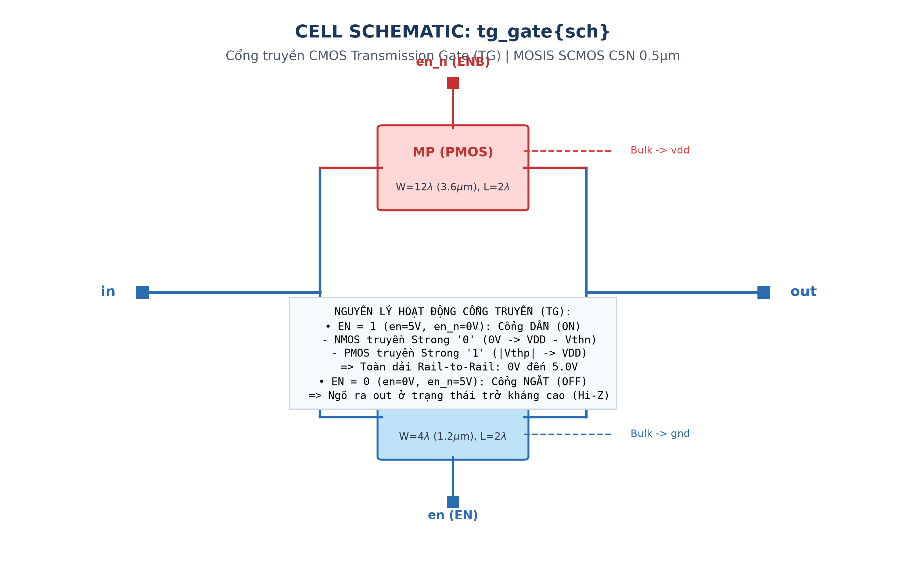
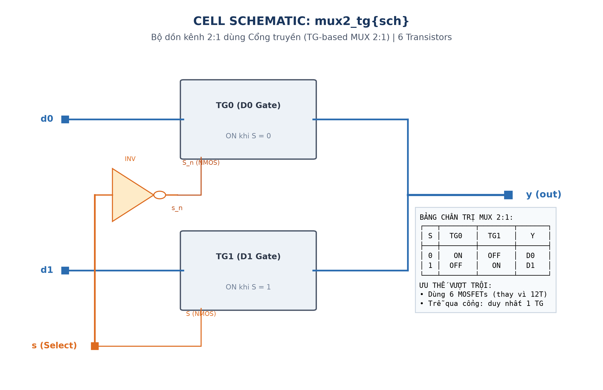

# THỰC HÀNH THIẾT KẾ VLSI — BÀI 4
# CỔNG TRUYỀN (TRANSMISSION GATE) VÀ BỘ DỒN KÊNH MUX MỨC TRANSISTOR

---
**Bộ môn:** Điện tử - Viễn thông | **Khoa:** Điện - Điện tử  
**Trường:** Đại học Sư phạm Kỹ thuật – Đại học Đà Nẵng  
**Thời lượng:** 5 tiết thực hành tại phòng máy (kết hợp tự học Pre-lab & hoàn thiện Post-lab)  
**Công cụ sử dụng:** Electric VLSI Design System (v9.07+), LTspice XVII / LTspice 2025  
**Công nghệ tham chiếu:** MOSIS SCMOS SUBMICRON C5N 0.5µm ($\lambda = 0.30\,\mu\text{m}$, 3 Metal layers, $V_{DD} = 5.0\,\text{V}$)  
---

## I. MỤC TIÊU

Sau khi hoàn thành bài thực hành này, sinh viên có khả năng:
1. **Hiểu rõ giới hạn của Transistor Truyền (Pass Transistor Logic):** Phân tích và đo đạc thực nghiệm hiện tượng sụt giảm điện áp ngưỡng khi truyền mức logic '1' qua NMOS (Weak '1') và truyền mức logic '0' qua PMOS (Weak '0') dưới tác động của hiệu ứng phân cực thân (Body Effect).
2. **Nắm vững nguyên lý hoạt động của Cổng truyền CMOS (Transmission Gate - TG):** Giải thích cơ chế ghép song song NMOS và PMOS điều khiển đối pha để đạt được khả năng truyền tín hiệu toàn dải từ nguồn tới đất (Full Rail-to-Rail Swing: Strong '0' và Strong '1'); khảo sát đường cong điện trở dẫn $R_{TG}$ trên toàn dải điện áp $0 \to V_{DD}$.
3. **Thiết kế Bộ dồn kênh MUX 2:1 và MUX 4:1 mức Transistor:**
   - Hiện thực tế bào MUX 2:1 dùng Cổng truyền (`MUX2_TG`) chỉ với 6 transistor (2 TG + 1 Inverter); phân tích ưu thế vượt trội về diện tích và trễ so với MUX cổng tĩnh chuẩn (Static CMOS MUX tốn 10–12 transistor).
   - Ghép nối cấu trúc cây phân cấp (Hierarchical Tree) để tạo bộ dồn kênh MUX 4:1 bàn giao cho khối chọn đường dữ liệu của ALU.
4. **Thiết kế Mask Layout cho Cổng truyền và MUX 2:1:** Bố trí linh kiện tối ưu, định tuyến đường điều khiển đối pha $S$ và $\overline{S}$, kiểm tra luật hình học DRC đạt 0 lỗi và đối chiếu sơ đồ LVS đạt trùng khớp hoàn toàn (**MATCH**).
5. **Trích xuất Ký sinh PEX & Đo đạc Post-layout:** Đo lường sự thay đổi trễ truyền lan khi có thêm điện dung tiếp giáp khuếch tán và tụ ký sinh dây dẫn kim loại; đánh giá suy giảm biên độ xung khi nối tầng nhiều cổng truyền liên tiếp.
6. **Đóng gói IP Thư viện Chuẩn:** Đóng gói Cell Icon `tg_gate{ic}`, `mux2_tg{ic}` và `mux4_tg{ic}` phục vụ Bài 5 (Mạch tuần tự Latch/Flip-Flop) và Bài 10 (Capstone ALU).

---

## II. CÔNG CỤ VÀ THƯ VIỆN MÔ HÌNH

1. **Phần mềm thiết kế:**
   - **Electric VLSI Design System:** Phiên bản 9.07 trở lên (công nghệ `mocmos`, $\lambda = 0.30\,\mu\text{m}$).
   - **LTspice:** Phiên bản XVII hoặc LTspice 2025.
2. **Thư viện mô hình SPICE:**
   - Tệp thư viện tham chiếu: `04 - Models_and_Libraries/C5_models.txt` (NMOS: `N`, PMOS: `P`).
3. **IP kế thừa từ Bài 1:**
   - Tế bào Inverter chuẩn `INV_X1` ($W_n = 4\lambda = 1.2\,\mu\text{m}, W_p = 12\lambda = 3.6\,\mu\text{m}, L = 2\lambda = 0.6\,\mu\text{m}$).

---

## III. CƠ SỞ LÝ THUYẾT VÀ NGUYÊN LÝ THIẾT KẾ

### 1. Hạn Chế của Transistor Truyền Đơn Lẻ (Pass Transistor)

Trong thiết kế vi mạch, việc dùng một transistor duy nhất làm khóa chuyển mạch (Pass Transistor) giúp tiết kiệm diện tích nhưng gặp phải hạn chế vật lý nghiêm trọng:

```
  TRUYỀN MỨC '1' QUA NMOS (Weak '1')           TRUYỀN MỨC '0' QUA PMOS (Weak '0')
        V_Gate = 5.0V                                V_Gate = 0.0V
             │                                            │
        ┌────┴────┐                                  ┌────┴────┐
 Vin ───┤  NMOS   ├─── Vout                   Vin ───┤  PMOS   ├─── Vout
 (5V)   └────┬────┘    (Tụ CL)                (0V)   └────┬────┘    (Tụ CL)
             │                                            │
          GND (0V)                                     VDD (5V)
   Vout nạp đến: VDD - Vthn                     Vout xả xuống: |Vthp|
      ≈ 3.6V - 4.1V                                ≈ 0.8V - 1.1V
```

#### a. NMOS truyền mức logic '1' (Weak '1'):
- Đặt cực Cổng $V_G = 5.0\,\text{V}$, cực Máng $V_D = 5.0\,\text{V}$. Ban đầu tụ tải $V_{out} = 0\,\text{V}$.
- NMOS dẫn, nạp điện tích vào tụ làm $V_{out}$ tăng dần. Điện áp cực Cổng-Nguồn giảm dần: $V_{GS} = V_G - V_{out} = 5.0\,\text{V} - V_{out}$.
- Khi $V_{out}$ tăng đến ngưỡng mà $V_{GS} = V_{thn}$, transistor bị **ngắt (Cut-off)**. Dòng nạp ngừng lại.
- Do đó, điện áp ngõ ra cực đại chỉ đạt được:

  $$V_{out,max} = V_{DD} - V_{thn}$$

- **Tác động của Hiệu ứng Phân cực Thân (Body Effect):** Do cực Thân (Bulk) của NMOS nối đất ($0\,\text{V}$) trong khi cực Nguồn (Source) tăng lên $V_{out}$, xuất hiện điện áp ngược $V_{SB} = V_{out} - 0 = V_{out} > 0$. Điện áp ngưỡng tăng theo phương trình:

  $$V_{thn}(V_{SB}) = V_{th0} + \gamma \left( \sqrt{2\phi_F + V_{SB}} - \sqrt{2\phi_F} \right)$$

  Làm $V_{thn}$ tăng từ $0.70\,\text{V}$ lên $\approx 1.37\,\text{V}$, khiến $V_{out,max}$ tụt xuống chỉ còn $\approx \mathbf{3.63\,\text{V}}$ (thất thoát hơn $1.3\,\text{V}$ so với nguồn cấp $5\,\text{V}$!).

#### b. PMOS truyền mức logic '0' (Weak '0'):
- Tương tự, khi dùng PMOS xả tụ tải từ $5.0\,\text{V}$ xuống đất ($V_G = 0\,\text{V}, V_D = 0\,\text{V}$), khi $V_{out}$ giảm tới $|V_{thp}|$, hiệu điện thế $|V_{GS}| = V_{out} - 0 = |V_{thp}|$ làm PMOS bị ngắt.
- Điện áp ngõ ra không thể xuống $0\,\text{V}$ mà dừng lại ở:

  $$V_{out,min} = |V_{thp}| \approx \mathbf{0.80 - 1.05\,\text{V}}$$

---

### 2. Cấu Trúc và Nguyên Lý Cổng Truyền CMOS (Transmission Gate - TG)

Để khắc phục hoàn toàn nhược điểm trên, **Cổng truyền CMOS (Transmission Gate)** kết hợp 1 NMOS và 1 PMOS mắc song song với nhau, được điều khiển bởi hai tín hiệu đối pha: Cổng NMOS nhận $EN$, Cổng PMOS nhận $\overline{EN}$ ($EN\_n$).

<div align="center">


*Hình 4.1: Sơ đồ nguyên lý tế bào chuẩn Cổng truyền `tg_gate{sch}`*

</div>

#### Nguyên lý bù trừ hoàn hảo:
- **Khi $EN = 0$ ($EN = 0\,\text{V}, \overline{EN} = 5\,\text{V}$):** Cả NMOS và PMOS đều ngắt hoàn toàn. Ngõ ra bị cách ly khỏi ngõ vào, ở trạng thái trở kháng cao (**Hi-Z**).
- **Khi $EN = 1$ ($EN = 5\,\text{V}, \overline{EN} = 0\,\text{V}$):** Cổng mở (ON):
  * Khi truyền mức '0' ($V_{in} \to 0\,\text{V}$): NMOS hoạt động ở vùng tuyến tính (Triode) dẫn cực mạnh kéo $V_{out}$ xuống sát **$0.000\,\text{V}$ (Strong '0')**.
  * Khi truyền mức '1' ($V_{in} \to 5\,\text{V}$): PMOS hoạt động ở vùng tuyến tính dẫn cực mạnh kéo $V_{out}$ lên tới đúng **$5.000\,\text{V}$ (Strong '1')**.
  * Kết quả: Cổng truyền đạt **biên độ logic toàn dải Rail-to-Rail ($0.0\,\text{V} \to 5.0\,\text{V}$)** mà không bị suy giảm bất kỳ điện áp ngưỡng nào!

#### Đường cong điện trở dẫn $R_{TG}$ phẳng trên toàn dải:
Điện trở tương đương của cổng truyền là điện trở mắc song song của hai kênh dẫn:

$$R_{TG}(V_{in}) = R_{on,n}(V_{in}) \parallel R_{on,p}(V_{in}) = \frac{R_{on,n} \cdot R_{on,p}}{R_{on,n} + R_{on,p}}$$

- Khi $V_{in} \approx 0\,\text{V}$: $R_{on,n} \approx 969\,\Omega$ (thấp), $R_{on,p}$ rất lớn $\implies R_{TG} \approx 969\,\Omega$.
- Khi $V_{in} \approx 5\,\text{V}$: $R_{on,p} \approx 992\,\Omega$ (thấp), $R_{on,n}$ rất lớn $\implies R_{TG} \approx 992\,\Omega$.
- Khi $V_{in} \approx 2.5\,\text{V}$: Cả NMOS và PMOS đều cùng dẫn $\implies R_{TG} \approx 969 \parallel 992 \approx 490\,\Omega$.  
$\implies$ **Đặc tính phẳng:** Điện trở tương đương $R_{TG}$ dao động trong dải hẹp $500 - 1000\,\Omega$, giúp trễ truyền qua cổng truyền rất nhỏ và ổn định, độc lập với mức logic truyền qua.

---

### 3. Kiến Trúc Bộ Dồn Kênh MUX 2:1 Dùng Cổng Truyền (`MUX2_TG`)

<div align="center">


*Hình 4.2: Sơ đồ nguyên lý Bộ dồn kênh MUX 2:1 dùng Cổng truyền (`mux2_tg{sch}`)*

</div>

Bộ dồn kênh MUX 2:1 có chức năng chọn 1 trong 2 luồng dữ liệu ngõ vào ($D_0$ hoặc $D_1$) đưa ra ngõ xuất $Y$ dựa vào tín hiệu điều khiển chọn $S$:

$$Y = \begin{cases} D_0 & \text{khi } S = 0 \\ D_1 & \text{khi } S = 1 \end{cases}$$

#### a. Cấu tạo mạch:
- Gồm **2 Cổng truyền TG** ($TG_0$ và $TG_1$) và **1 Cổng Inverter** tạo tín hiệu bù $\overline{S}$.
- $TG_0$ nối giữa $D_0$ và $Y$: NMOS nhận $\overline{S}$, PMOS nhận $S$ $\implies$ Mở khi $S=0$.
- $TG_1$ nối giữa $D_1$ và $Y$: NMOS nhận $S$, PMOS nhận $\overline{S}$ $\implies$ Mở khi $S=1$.
- **Tổng số linh kiện:** $2 \times 2T (\text{TG}) + 2T (\text{INV}) = \mathbf{6 \text{ Transistors}}$.

#### b. Đối sánh PPA với MUX cổng logic tĩnh (Static CMOS MUX):

| Chỉ số PPA | MUX 2:1 dùng Cổng truyền (TG MUX) | MUX 2:1 Cổng tĩnh chuẩn (AOI22 + INV) | Mức độ cải thiện của TG |
| :--- | :---: | :---: | :---: |
| **Số lượng Transistor** | **6 Transistors** | **10 - 12 Transistors** | **Tiết kiệm $40 - 50\%$** |
| **Số tầng trễ logic** | **1 Cổng TG** | **2 Tầng cổng logic** | **Nhanh gấp $2.5 - 3.0$ lần** |
| **Thời gian trễ $t_{pd}$** | $\approx \mathbf{40 - 55\,\text{ps}}$ | $\approx \mathbf{120 - 160\,\text{ps}}$ | Trễ giảm trên $60\%$ |
| **Diện tích Layout** | $\approx \mathbf{24\lambda \times 40\lambda}$ | $\approx \mathbf{36\lambda \times 44\lambda}$ | **Giảm diện tích $\approx 39\%$** |
| **Hiện tượng tranh chấp (Contention)** | Không có (2 TG đóng ngắt bù pha) | Không có | Độ tin cậy như nhau |

---

### 4. Kiến Trúc Bộ Dồn Kênh MUX 4:1 Phân Cấp (Hierarchical MUX 4:1)

Để mở rộng thành bộ dồn kênh 4 sang 1 (`MUX4_TG`) phục vụ chọn 4 chế độ tính toán của ALU, ta kết nối theo **cấu trúc cây phân cấp (Tree Architecture)** sử dụng 3 tế bào `MUX2_TG`:
- **Tầng 1:** 
  * Tế bào `MUX2_A`: Nhận $D_0, D_1$, điều khiển bởi bit chọn $S_0$, xuất ra ngõ trung gian $Y_{01}$.
  * Tế bào `MUX2_B`: Nhận $D_2, D_3$, điều khiển bởi bit chọn $S_0$, xuất ra ngõ trung gian $Y_{23}$.
- **Tầng 2:** 
  * Tế bào `MUX2_C`: Nhận $Y_{01}, Y_{23}$, điều khiển bởi bit chọn $S_1$, xuất ra ngõ ra cuối cùng $Y$.
- $\implies$ **Tổng số transistor:** $3 \times 6T = \mathbf{18 \text{ Transistors}}$ (so với MUX 4:1 cổng tĩnh cần tới 34–38 transistor!).
- **Thời gian trễ toàn phần:** Tín hiệu dữ liệu chỉ truyền qua **2 cổng truyền nối tiếp** ($2 \times t_{pd,TG} \approx 90 - 110\,\text{ps}$).

---

## IV. CHUẨN BỊ TRƯỚC THỰC HÀNH (PRE-LAB - Ở NHÀ)

> [!IMPORTANT]
> Toàn bộ phần tính toán và sơ đồ phải được sinh viên hoàn thành vào **Mục VI.a** của Phiếu báo cáo trước giờ vào phòng máy.

1. **Tính toán giải tích hiệu ứng phân cực thân (Body Effect):**
   - Với NMOS Pass Transistor trong công nghệ C5N ($V_{th0} = 0.70\,\text{V}, \gamma = 0.53\,\text{V}^{1/2}, 2\phi_F = 0.65\,\text{V}$), tính điện áp ngưỡng thực tế $V_{thn}$ khi $V_{out} = 3.6\,\text{V}$ ($V_{SB} = 3.6\,\text{V}$).
   - Tính điện áp ra cực đại $V_{out,max}$ của NMOS khi cấp $V_{in} = 5.0\,\text{V}, V_G = 5.0\,\text{V}$.
2. **Kích thước định cỡ Transistor:**
   - Xác định kích thước $W_n, L_n$ và $W_p, L_p$ cho cổng truyền `tg_gate` để có điện trở dẫn tương đương Inverter chuẩn `INV_X1`.
   - Lập danh mục transistor và kích thước tương ứng cho toàn bộ tế bào `MUX2_TG` (gồm 2 TG và 1 Inverter).
3. **Bảng chân trị hoạt động của MUX 2:1 và MUX 4:1:**
   - Viết bảng chân trị cho `MUX2_TG` ($S, D_0, D_1 \to Y$).
   - Viết bảng chân trị cho `MUX4_TG` ($S_1, S_0, D_0, D_1, D_2, D_3 \to Y$).
4. **Vẽ sơ đồ que Stick Diagram cho `MUX2_TG`:**
   - Bố trí 2 ray nguồn $V_{DD}$ và $GND$.
   - Vẽ dải P-Active và N-Active; đặt các dải Poly cho Inverter tạo $\overline{S}$ và cho 2 cổng truyền.
   - Chỉ ra vị trí đưa 2 ngõ dữ liệu $D_0, D_1$ vào và vị trí gộp cực má ra ngõ $Y$.

---

## V. NỘI DUNG THỰC HÀNH TẠI PHÒNG LAB (IN-LAB)

### 1. Khảo Sát Suy Giảm Điện Áp Ngưỡng Trên Pass Transistor (LTspice)

1. Mở LTspice, dựng mạch thí nghiệm gồm 3 nhánh độc lập cùng nhận nguồn xung vuông $0 \to 5.0\,\text{V}$ (tần số $20\,\text{MHz}$) tại ngõ vào $In$, tải dung mỗi ngõ ra $C_L = 50\,\text{fF}$:
   - **Nhánh 1 (NMOS Pass Transistor):** Cổng nối lên $V_{DD} = 5.0\,\text{V}$, Substrate nối $0\,\text{V}$.
   - **Nhánh 2 (PMOS Pass Transistor):** Cổng nối xuống $0\,\text{V}$, Substrate nối $V_{DD} = 5.0\,\text{V}$.
   - **Nhánh 3 (CMOS Transmission Gate):** NMOS cổng nối $5.0\,\text{V}$, PMOS cổng nối $0\,\text{V}$.
2. Chạy mô phỏng quá độ: `.tran 0.05n 60n`.
3. Dùng lệnh `.MEAS` đọc biên độ điện áp đỉnh cực đại $V_{max}$ và đỉnh cực tiểu $V_{min}$ tại ngõ ra của cả 3 nhánh.
4. Xác nhận hiện tượng Weak '1' ở NMOS, Weak '0' ở PMOS, và Full Rail-to-Rail ở TG.

---

### 2. Thiết Kế Schematic Tế Bào Cổng Truyền `tg_gate{sch}` (Electric VLSI)

<div align="center">


*Hình 4.3: Thiết kế tế bào chuẩn tg_gate{sch} với đầy đủ kích thước và chân Export*

</div>

1. Trong Electric VLSI, tạo Cell mới: `tg_gate`, View type: `schematic`.
2. **Bố trí Transistor:**
   - 1 PMOS (`mocmos:P-Transistor`): **$W = 12\lambda = 3.60\,\mu\text{m}$**, **$L = 2\lambda = 0.60\,\mu\text{m}$**. Cực Substrate nối lên `vdd`.
   - 1 NMOS (`mocmos:N-Transistor`): **$W = 4\lambda = 1.20\,\mu\text{m}$**, **$L = 2\lambda = 0.60\,\mu\text{m}$**. Cực Substrate nối xuống `gnd`.
   - Nối chập cực Source của NMOS và Source của PMOS tạo ngõ `in`.
   - Nối chập cực Drain của NMOS và Drain của PMOS tạo ngõ `out`.
3. **Tạo 6 chân Export (`Ctrl + E`):**

   | Tên chân Export | Hướng (Characteristics) | Vị trí kết nối trên mạch | Chức năng chi tiết |
   | :--- | :--- | :--- | :--- |
   | **`in`** | `Bidirectional` | Nối chung Source NMOS & PMOS | Ngõ vào tín hiệu truyền qua |
   | **`out`** | `Bidirectional` | Nối chung Drain NMOS & PMOS | Ngõ ra tín hiệu truyền qua |
   | **`en`** | `Input` | Cực cổng của NMOS | Tín hiệu cho phép tích cực cao |
   | **`en_n`** | `Input` | Cực cổng của PMOS | Tín hiệu cho phép bù tích cực thấp |
   | **`vdd`** | `Power` | Thân (Bulk) của PMOS | Nguồn cấp $+5.0\,\text{V}$ |
   | **`gnd`** | `Ground` | Thân (Bulk) của NMOS | Đất chuẩn tham chiếu $0\,\text{V}$ |

4. Nhấn `F5` kiểm tra kết nối (yêu cầu **0 errors, 0 warnings**).
5. Đóng gói Cell Icon `tg_gate{ic}` chuẩn công nghiệp (hình 2 tam giác đối xứng).

---

### 3. Thiết Kế Schematic Bộ Dồn Kênh MUX 2:1 (`mux2_tg{sch}`)

<div align="center">


*Hình 4.4: Sơ đồ nguyên lý tế bào mux2_tg{sch} ghép từ 2 TG và 1 Inverter*

</div>

1. Tạo Cell mới: `mux2_tg`, View type: `schematic`.
2. Gọi 2 Instance của tế bào `tg_gate{ic}` đặt tên là `X_TG0` và `X_TG1`.
3. Đặt 1 Inverter chuẩn `INV_X1` (gồm 1 PMOS $12\lambda$ và 1 NMOS $4\lambda$) để tạo tín hiệu bù $S\_n$ từ chân chọn $S$.
4. **Đấu nối mạch logic:**
   - Ngõ vào $D_0$ nối vào chân `in` của `X_TG0`.
   - Ngõ vào $D_1$ nối vào chân `in` của `X_TG1`.
   - Chân `out` của `X_TG0` và `X_TG1` nối chập vào nhau đưa ra ngõ xuất `y`.
   - Tín hiệu chọn $S$: Nối vào chân `en` của `X_TG1`, chân `en_n` của `X_TG0`, và ngõ vào của Inverter.
   - Tín hiệu đảo $S\_n$: Nối từ ngõ ra Inverter sang chân `en` của `X_TG0` và chân `en_n` của `X_TG1`.
5. **Tạo 6 chân Export (`Ctrl + E`):**
   - `d0` (Input), `d1` (Input), `s` (Input), `y` (Output), `vdd` (Power), `gnd` (Ground).
6. Nhấn `F5` kiểm tra kết nối. Đóng gói Cell Icon `mux2_tg{ic}` chuẩn hình thang MUX.

---

### 4. Mô Phỏng Kiểm Chứng Dồn Kênh & Đo Trễ Quá Độ trên LTspice

1. Xuất SPICE Netlist từ Electric cho `mux2_tg`.
2. Thiết lập kích thích kiểm chứng dồn kênh:
   - $D_0$: Nguồn xung vuông tần số $25\,\text{MHz}$ ($T = 40\,\text{ns}$).
   - $D_1$: Nguồn xung vuông tần số $50\,\text{MHz}$ ($T = 20\,\text{ns}$).
   - $S$: Nguồn xung chọn tần số $12.5\,\text{MHz}$ ($T = 80\,\text{ns}$, nửa chu kỳ đầu $S=0$, nửa chu kỳ sau $S=1$).
   - Tải dung ngõ ra: $C_L = 50\,\text{fF}$.
3. Chạy mô phỏng quá độ: `.tran 0.05n 160n`.
4. Quan sát dạng sóng ngõ ra $V(y)$:
   - Trong khoảng $t \in [0, 40\,\text{ns}]$ ($S=0$): Ngõ ra $Y$ bám sát hoàn hảo theo dữ liệu $D_0$ ($25\,\text{MHz}$).
   - Trong khoảng $t \in [40, 80\,\text{ns}]$ ($S=1$): Ngõ ra $Y$ bám sát hoàn hảo theo dữ liệu $D_1$ ($50\,\text{MHz}$).
5. Dùng câu lệnh `.MEAS` đo thời gian trễ truyền lan dữ liệu:
   - Trễ từ $D_0 \to Y$ (khi $S=0$): $t_{pd(D0 \to Y)}$.
   - Trễ từ $D_1 \to Y$ (khi $S=1$): $t_{pd(D1 \to Y)}$.
   - Trễ từ tín hiệu chọn $S \to Y$ (Select-to-Output Delay): $t_{pd(S \to Y)}$.

---

### 5. Thiết Kế Phân Cấp Bộ Dồn Kênh MUX 4:1 (`mux4_tg{sch}`)

1. Tạo Cell mới: `mux4_tg`, View type: `schematic`.
2. Gọi 3 Instance của tế bào `mux2_tg{ic}`:
   - `X_MUX_A`: Ngõ vào `d0` nhận $D_0$, `d1` nhận $D_1$, chân `s` nhận $S_0$.
   - `X_MUX_B`: Ngõ vào `d0` nhận $D_2$, `d1` nhận $D_3$, chân `s` nhận $S_0$.
   - `X_MUX_C`: Ngõ vào `d0` nhận ngõ ra của `X_MUX_A`, `d1` nhận ngõ ra của `X_MUX_B`, chân `s` nhận $S_1$.
3. Ngõ ra của `X_MUX_C` đưa ra chân Export ngõ xuất `y`.
4. Tạo đầy đủ các chân Export: $D_0, D_1, D_2, D_3, S_0, S_1, Y, VDD, GND$.
5. Kiểm tra kết nối mạng `F5` đạt 0 lỗi; đóng gói Cell Icon `mux4_tg{ic}`.

---

### 6. Thiết Kế Mask Layout, Chạy DRC & LVS cho `mux2_tg`

1. Trong Electric, tạo Cell Layout: `mux2_tg{lay}`.
2. Vẽ 2 đường ray nguồn Metal 1 nằm ngang `vdd` và `gnd` (độ rộng $\ge 6\lambda$, khoảng cách chuẩn $60\lambda$).
3. Bố trí vùng N-Well ở nửa trên; đặt vùng P-Active cho 3 PMOS (1 PMOS Inverter + 2 PMOS Cổng truyền).
4. Bố trí vùng N-Active ở nửa dưới cho 3 NMOS (1 NMOS Inverter + 2 NMOS Cổng truyền).
5. Bố trí các dải Polysilicon:
   - Dải Poly cho Inverter nhận tín hiệu chọn $S$.
   - Dải Poly cho Cổng truyền nhận $S$ và tín hiệu bù $S\_n$ (lấy từ ngõ ra Inverter).
6. Định tuyến dây Metal 1 nối $D_0$ vào cực Source $TG_0$, $D_1$ vào cực Source $TG_1$, và chập hai cực Drain ra chân Export `y`.
7. Đặt đầy đủ Substrate Tap ($P^+$-tap xuống `gnd`) và Well Tap ($N^+$-tap lên `vdd`).
8. Nhấn `F5` kiểm tra DRC đạt **0 errors found**.
9. Chạy đối chiếu *Tools $\to$ NCC $\to$ Schematic and Layout Comparison*. Kết quả LVS phải báo **"Netlists Match Perfectly"**.

---

### 7. Trích Xuất Ký Sinh PEX & Đánh Giá Post-Layout

1. Bật tùy chọn trích xuất tụ ký sinh trong Electric, xuất file Netlist Post-layout cho `mux2_tg`.
2. Mô phỏng Transient Post-layout với tải $C_L = 50\,\text{fF}$.
3. Đo đạc lại thời gian trễ $t_{pd(D0 \to Y)}$ và $t_{pd(S \to Y)}$.
4. So sánh số liệu Pre-layout vs Post-layout để lượng hóa độ suy giảm tốc độ do tụ ký sinh tiếp giáp cực má và điện trở ký sinh dây nối.

---

## VI. BÁO CÁO THỰC HÀNH (MẪU PHIẾU ĐIỀN KHUYẾT CHO SINH VIÊN)

```
========================================================================================
                          BÁO CÁO THỰC HÀNH: BÀI 4
        CỔNG TRUYỀN (TRANSMISSION GATE) VÀ BỘ DỒN KÊNH MUX MỨC TRANSISTOR
Họ và Tên: ..................................................... MSSV: .................
Lớp: ....................................... Nhóm/Bàn: ......... Ngày: .................
Chữ ký Giảng viên / Điểm nghiệm thu tại bàn: ............................................
========================================================================================
```

### a. Phần Chuẩn bị (Pre-lab)

1. **Tính toán lý thuyết sụt giảm điện áp do Body Effect:**
   - Điện áp ngưỡng $V_{thn}$ khi có phân cực thân ($V_{SB} = 3.6\,\text{V}$): $V_{thn} =$ .................... $\text{V}$ (gốc $0.70\,\text{V}$).
   - Điện áp đỉnh ra cực đại khi truyền mức '1' qua NMOS: $V_{out,max} =$ .................... $\text{V}$.
   - Điện áp đáy ra cực tiểu khi truyền mức '0' qua PMOS: $V_{out,min} =$ .................... $\text{V}$.
   - Điện áp ra cực đại và cực tiểu của Cổng truyền CMOS (TG): $V_{max} =$ ............ $\text{V}$ ; $V_{min} =$ ............ $\text{V}$.

2. **Bảng kích thước hình học Transistor của tế bào `mux2_tg`:**

   | Linh kiện | Khối chức năng | Loại MOS | Bề rộng kênh $W$ ($\mu\text{m}$) | Chiều dài kênh $L$ ($\mu\text{m}$) |
   | :--- | :--- | :---: | :---: | :---: |
   | **$M_{N,inv}$** | Inverter tạo $\overline{S}$ | NMOS | .................... | .................... |
   | **$M_{P,inv}$** | Inverter tạo $\overline{S}$ | PMOS | .................... | .................... |
   | **$M_{N,TG0}$** | Cổng truyền $TG_0$ ($D_0$) | NMOS | .................... | .................... |
   | **$M_{P,TG0}$** | Cổng truyền $TG_0$ ($D_0$) | PMOS | .................... | .................... |
   | **$M_{N,TG1}$** | Cổng truyền $TG_1$ ($D_1$) | NMOS | .................... | .................... |
   | **$M_{P,TG1}$** | Cổng truyền $TG_1$ ($D_1$) | PMOS | .................... | .................... |

3. **Bảng chân trị lý thuyết của MUX 4:1:**

   | $S_1$ | $S_0$ | Cổng TG dẫn ở Tầng 1 | Cổng TG dẫn ở Tầng 2 | Ngõ ra Y |
   | :-: | :-: | :---: | :---: | :---: |
   | 0 | 0 | $TG_{0}$ và $TG_{2}$ | $TG_{A}$ | **$D_0$** |
   | 0 | 1 | .................... | .................... | .................... |
   | 1 | 0 | .................... | .................... | .................... |
   | 1 | 1 | .................... | .................... | .................... |

---

### b. Kết quả Đo đạc Thực hành (In-lab & Post-lab)

1. **Khảo sát đặc tính truyền mức logic qua Pass Transistor vs TG:**

   | Nhánh mạch đo | Mức logic '0' ($V_{out,min}$) | Mức logic '1' ($V_{out,max}$) | Biên độ xung đỉnh-đỉnh | Đánh giá chất lượng tín hiệu |
   | :--- | :---: | :---: | :---: | :--- |
   | **NMOS Pass Transistor** | ............... V | ............... V | ............... V | Weak '1' / Strong '0' |
   | **PMOS Pass Transistor** | ............... V | ............... V | ............... V | Weak '0' / Strong '1' |
   | **CMOS Transmission Gate**| ............... V | ............... V | ............... V | Rail-to-Rail hoàn hảo |

2. **Đo đạc thời gian trễ của Bộ dồn kênh `mux2_tg` ($C_L = 50\,\text{fF}$):**

   | Đường truyền tín hiệu | Trễ sườn xuống $t_{pHL}$ (ps) | Trễ sườn lên $t_{pLH}$ (ps) | Trễ trung bình $t_{pd}$ (ps) |
   | :--- | :---: | :---: | :---: |
   | **Đường dữ liệu $D_0 \to Y$ ($S=0$)** | .................... | .................... | .................... |
   | **Đường dữ liệu $D_1 \to Y$ ($S=1$)** | .................... | .................... | .................... |
   | **Đường chọn kênh $S \to Y$** | .................... | .................... | .................... |

3. **So sánh trễ Pre-layout vs Post-layout (PEX) của `mux2_tg`:**

   | Thông số trễ | Mô phỏng Pre-layout | Đo đạc Post-layout (PEX) | Độ suy giảm tốc độ (%) |
   | :--- | :---: | :---: | :---: |
   | $t_{pd(D0 \to Y)}$ | .................... ps | .................... ps | .................... % |
   | $t_{pd(S \to Y)}$ | .................... ps | .................... ps | .................... % |

4. **Kết quả kiểm tra vật lý Layout `mux2_tg`:**
   - Kết quả kiểm tra DRC: `............................................................`
   - Kết quả đối chiếu LVS: `............................................................`
   - Kích thước Layout: $W =$ ............ $\mu\text{m}$, $H =$ ............ $\mu\text{m}$, Diện tích = ............ $\mu\text{m}^2$.

---

### c. Câu hỏi Thảo luận và Mở rộng

1. **Câu hỏi 1:** Khi mắc nối tiếp một chuỗi nhiều cổng truyền liên tiếp ($N \ge 4$ cổng TG) mà không có cổng đệm Inverter ở giữa, thời gian trễ truyền lan của chuỗi tăng lên theo quy luật nào ($O(N)$ hay $O(N^2)$)? Giải thích tại sao.
   *Trả lời:* ............................................................................................................................
2. **Câu hỏi 2:** Tại sao trong sơ đồ mạch của `mux2_tg`, cực Substrate của PMOS trong cổng truyền bắt buộc phải nối lên $V_{DD}$ chứ không được nối vào cực Source hay cực Drain của chính nó?
   *Trả lời:* ............................................................................................................................

---

## VII. RUBRIC ĐÁNH GIÁ NGHIỆM THU (THANG 10 CHUẨN OBE/ABET)

| Tiêu chí | Trọng số | Mức 1: Xuất sắc (8.5 – 10) | Mức 2: Khá (7.0 – 8.4) | Mức 3: Đạt (5.0 – 6.9) | Mức 4: Không đạt (< 5.0) |
| :--- | :---: | :--- | :--- | :--- | :--- |
| **1. Chuẩn bị Pre-lab** | 20% | Tính đúng $100\%$ điện áp sụt giảm do Body Effect; lập đủ bảng chân trị MUX 2:1 và 4:1; vẽ Stick diagram MUX 2:1 chuẩn. | Tính đúng sụt áp do Body Effect; bảng chân trị đúng; Stick diagram còn sơ sài. | Có làm tính toán nhưng còn sai số; chưa vẽ được Stick diagram. | Không làm bài chuẩn bị hoặc sao chép. |
| **2. Khảo sát Pass Transistor & TG (Ex1–Ex2)** | 25% | Đo đạc và đối chiếu chính xác biên độ Weak '1' (NMOS), Weak '0' (PMOS) và Full Swing (TG); giải thích rõ cơ chế bù trừ. | Chạy được mô phỏng 3 nhánh; đo được điện áp nhưng phần giải thích chưa sâu sắc. | Chạy được mô phỏng nhưng số liệu đo đạc còn nhầm lẫn. | Không hoàn thành mô phỏng hoặc SPICE báo lỗi. |
| **3. Dựng Schematic & Đo trễ MUX 2:1/4:1 (Ex3–Ex4)** | 25% | Dựng đúng schematic `mux2_tg` và `mux4_tg`; kiểm chứng chuẩn xác dạng sóng dồn kênh 2 tần số; đo đủ các đường trễ $D \to Y$ và $S \to Y$. | Dựng đúng mạch; kiểm chứng được chức năng dồn kênh; đo trễ còn thiếu trường hợp chọn kênh $S \to Y$. | Dựng được mạch nhưng kết nối chân chọn kênh $S$ chưa đúng; dạng sóng dồn kênh bị xung đột. | Không hoàn thành mạch MUX. |
| **4. Layout, DRC & LVS (Ex5–Ex6)** | 20% | Layout chặt chẽ, tối ưu đi dây; 0 lỗi DRC; LVS báo **"Netlists Match Perfectly"** độc lập không cần can thiệp. | Layout đạt chuẩn, 0 lỗi DRC; LVS match sau 1 lần sửa nhỏ. | Layout cồng kềnh, vi phạm DRC đơn giản tự sửa được; LVS match. | Không hoàn thành Layout, hoặc vi phạm DRC nghiêm trọng, LVS không match. |
| **5. Báo cáo & Tác phong** | 10% | Báo cáo đầy đủ, trung thực; trả lời xuất sắc 2 câu hỏi mở rộng; giữ gìn máy móc phòng lab. | Báo cáo đầy đủ, nộp đúng hạn; trả lời được câu hỏi mở rộng. | Báo cáo còn thiếu số liệu; trả lời câu hỏi mở rộng chưa chính xác. | Vi phạm quy chế phòng thực hành hoặc nộp trễ. |
