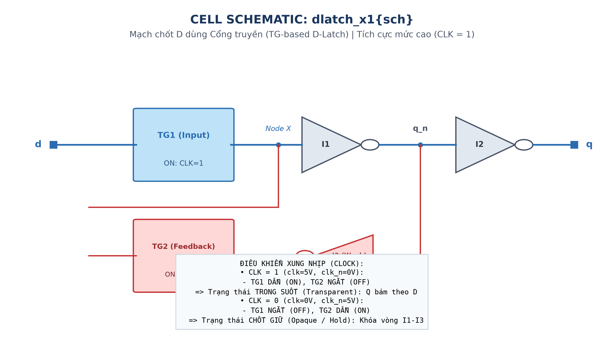
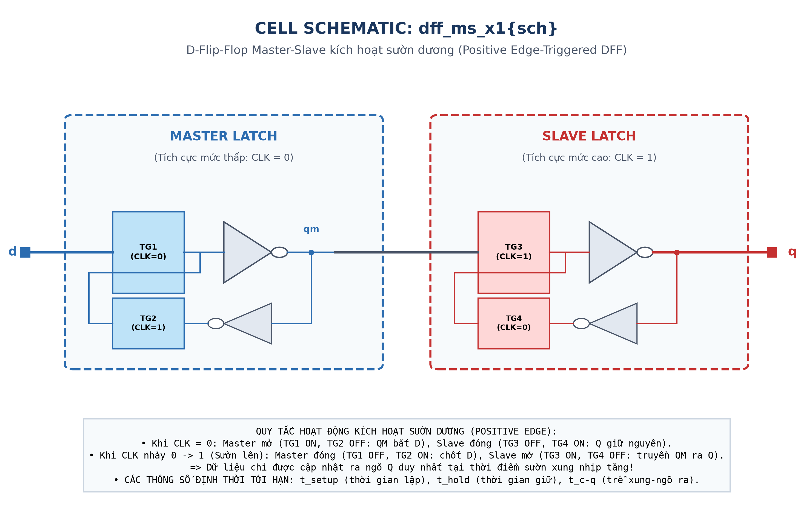

# THỰC HÀNH THIẾT KẾ VLSI — BÀI 5
# MẠCH TUẦN TỰ MỨC TRANSISTOR: D-LATCH VÀ D-FLIP-FLOP MASTER-SLAVE

---
**Bộ môn:** Điện tử - Viễn thông | **Khoa:** Điện - Điện tử  
**Trường:** Đại học Sư phạm Kỹ thuật – Đại học Đà Nẵng  
**Thời lượng:** 5 tiết thực hành tại phòng máy (kết hợp tự học Pre-lab & hoàn thiện Post-lab)  
**Công cụ sử dụng:** Electric VLSI Design System (v9.07+), LTspice XVII / LTspice 2025  
**Công nghệ tham chiếu:** MOSIS SCMOS SUBMICRON C5N 0.5µm ($\lambda = 0.30\,\mu\text{m}$, 3 Metal layers, $V_{DD} = 5.0\,\text{V}$)  
---

## I. MỤC TIÊU

Sau khi hoàn thành bài thực hành này, sinh viên có khả năng:
1. **Phân biệt bản chất vật lý giữa Latch và Flip-Flop:** Hiểu rõ cơ chế nhạy theo mức điện áp (Level-Sensitive) của Mạch chốt (Latch) so với cơ chế kích hoạt theo sườn xung nhịp (Edge-Triggered) của Mạch lật (Flip-Flop).
2. **Làm chủ thiết kế D-Latch dùng Cổng truyền (TG-based D-Latch):**
   - Phân tích cơ chế chuyển mạch hai trạng thái: Trạng thái trong suốt (Transparent Phase khi $CLK=1$) và trạng thái chốt giữ (Opaque / Hold Phase khi $CLK=0$).
   - Hiểu rõ vai trò của vòng phản hồi Inverter nối chéo (Cross-coupled Inverters) và kỹ thuật định cỡ Weak Feedback Inverter để triệt tiêu hiện tượng tranh chấp dòng nạp/xả (Drive Contention).
3. **Thiết kế Mạch lật D-Flip-Flop Master-Slave kích hoạt sườn dương (Positive Edge-Triggered DFF):**
   - Ghép nối phân cấp 2 tầng D-Latch nối tiếp (Master Latch tích cực mức thấp, Slave Latch tích cực mức cao) để loại bỏ hoàn toàn hiện tượng chạy đua dữ liệu (Race Condition).
   - Đo đạc thực nghiệm các thông số định thời tới hạn mức transistor: Thời gian thiết lập ($t_{setup}$), thời gian giữ ($t_{hold}$), và trễ truyền lan xung nhịp đến ngõ ra ($t_{c-q}$).
4. **Phương pháp Quét Đặc tính Định thời (Timing Characterization):**
   - Thực hiện mô phỏng quét độ lệch pha giữa dữ liệu và xung nhịp ($t_{data-clk}$) trên LTspice để vẽ đường cong đặc tính trễ $t_{c-q}$; xác định chính xác điểm gãy (Knee Point / trễ tăng 10%) để định nghĩa $t_{setup}$ và $t_{hold}$ theo chuẩn công nghiệp vi mạch.
5. **Thiết kế Mask Layout cho D-Latch và DFF:** Bố trí linh kiện đối xứng, định tuyến mạng xung nhịp $CLK$ và $\overline{CLK}$ cân bằng, vượt qua kiểm tra luật hình học DRC đạt 0 lỗi và đối chiếu LVS đạt trùng khớp sơ đồ 100%.
6. **Đóng gói IP Tế bào chuẩn:** Tạo Cell Icon `dlatch_x1{ic}` và `dff_ms_x1{ic}` bàn giao cho Bài 10 để làm thanh ghi tích lũy ngõ ra (Output Accumulator Register) của khối vi mạch 4-bit ALU.

---

## II. CÔNG CỤ VÀ THƯ VIỆN MÔ HÌNH

1. **Phần mềm thiết kế:**
   - **Electric VLSI Design System:** Phiên bản 9.07 trở lên (công nghệ `mocmos`, $\lambda = 0.30\,\mu\text{m}$).
   - **LTspice:** Phiên bản XVII hoặc LTspice 2025.
2. **Thư viện mô hình SPICE:**
   - Tệp thư viện tham chiếu: `04 - Models_and_Libraries/C5_models.txt` (NMOS: `N`, PMOS: `P`).
3. **IP kế thừa từ các bài trước:**
   - Tế bào Inverter chuẩn `INV_X1` (Bài 1).
   - Tế bào Cổng truyền `TG_GATE` (Bài 4).

---

## III. CƠ SỞ LÝ THUYẾT VÀ NGUYÊN LÝ THIẾT KẾ

### 1. Kiến Trúc Mạch Chốt D Dùng Cổng Truyền (`DLATCH_X1`)

Mạch chốt D tĩnh mức transistor là phần tử nhớ 1-bit cơ sở trong các mạch tuần tự.

<div align="center">


*Hình 5.1: Sơ đồ nguyên lý tế bào chuẩn dlatch_x1{sch} tích cực mức cao*

</div>

#### a. Cấu tạo mạch:
- **Cổng truyền ngõ vào ($TG_1$):** Nối ngõ vào dữ liệu $D$ với nút lưu trữ nội $X$. Cổng NMOS nhận $CLK$, cổng PMOS nhận $\overline{CLK}$.
- **Cặp Inverter thuận ($I_1, I_2$):** Inverter $I_1$ đảo tín hiệu từ nút $X$ tạo ra $\bar{Q}$; Inverter $I_2$ đảo tín hiệu từ $\bar{Q}$ tạo ra ngõ xuất chính $Q$.
- **Cổng truyền phản hồi ($TG_2$):** Nối ngõ ra của Inverter hồi tiếp $I_3$ quay trở lại nút $X$. Cổng NMOS nhận $\overline{CLK}$, cổng PMOS nhận $CLK$.

#### b. Nguyên lý hoạt động:
- **Giai đoạn trong suốt (Transparent Phase - $CLK = 1$, $\overline{CLK} = 0$):**
  * $TG_1$ dẫn (ON), $TG_2$ ngắt (OFF).
  * Vòng phản hồi bị hở mạch. Dữ liệu từ ngõ $D$ truyền trực tiếp qua $TG_1$ vào nút $X$, qua $I_1, I_2$ xuất ra ngõ $Q$.
  * Ngõ ra $Q$ bám sát liên tục theo mọi biến động của ngõ vào $D$ với độ trễ truyền lan $t_{pd(D \to Q)} = t_{pd,TG1} + t_{pd,I1} + t_{pd,I2} \approx 110\,\text{ps}$.
- **Giai đoạn chốt giữ (Opaque / Hold Phase - $CLK = 0$, $\overline{CLK} = 1$):**
  * $TG_1$ ngắt (OFF), $TG_2$ dẫn (ON).
  * Ngõ vào $D$ bị cách ly hoàn toàn khỏi nút $X$. Vòng phản hồi kín $I_1 - I_3 - TG_2$ được đóng lại, khóa chặt trạng thái logic cuối cùng tại nút $X$ và duy trì ngõ ra $Q$ ổn định, bất chấp ngõ vào $D$ có thay đổi.

---

### 2. Kiến Trúc Mạch Lật D-Flip-Flop Master-Slave (`DFF_MS_X1`)

Hạn chế lớn nhất của Latch là tính trong suốt theo mức: Khi $CLK=1$, mọi nhiễu hoặc biến động trên đường dữ liệu $D$ đều xuyên thẳng ra ngõ ra $Q$. Nếu mắc nối tiếp 2 Latch cùng mức xung nhịp, dữ liệu sẽ chạy xuyên qua cả hai tầng trong cùng một chu kỳ xung nhịp (Hiện tượng chạy đua - Race Condition).

Để tạo ra phần tử nhớ **chỉ nhạy theo sườn cạnh (Edge-Triggered)**, ta ghép 2 D-Latch nối tiếp nhau theo cấu trúc **Master-Slave (Chủ - Tớ)**:

<div align="center">


*Hình 5.2: Sơ đồ nguyên lý D-Flip-Flop Master-Slave kích hoạt sườn dương (`dff_ms_x1{sch}`)*

</div>

- **Tầng Chủ (Master Latch):** Nhạy mức thấp ($CLK = 0$). Khi $CLK=0$, Master mở để đón dữ liệu $D$ nạp vào nút trung gian $Q_M$.
- **Tầng Tớ (Slave Latch):** Nhạy mức cao ($CLK = 1$). Khi $CLK=0$, Slave đóng chốt để giữ trạng thái cũ của ngõ ra $Q$.
- **Thời điểm chuyển trạng thái (Sườn lên $CLK: 0 \to 1$):**
  * Master chuyển từ mở sang đóng (khóa chặt giá trị $D$ vừa bắt được tại nút $Q_M$).
  * Slave đồng thời chuyển từ đóng sang mở (nhận giá trị từ $Q_M$ đẩy thẳng ra ngõ ra $Q$).
  * Sau thời điểm này, dù $D$ có thay đổi thế nào thì Master đã đóng nên không thể làm thay đổi $Q_M$.
  $\implies$ **Dữ liệu ngõ vào $D$ chỉ được lấy mẫu và xuất ra ngõ $Q$ duy nhất tại thời điểm xuất hiện sườn dương của xung nhịp!**

---

### 3. Các Thông Số Định Thời Tới Hạn Mức Transistor (Timing Parameters)

Trong thiết kế vi mạch số tốc độ cao, tính đúng đắn của Flip-Flop được quyết định bởi 3 thông số định thời:

```
               ◄── t_setup ──►◄── t_hold ──►
                             ▲
 D:    ───────────────XXXXXXXXX───────────────────────────────
                             │
 CLK:  ──────────────────────┌───────────────────────────────
                             │       ◄── t_c-q ──►
 Q:    ──────────────────────┴───────────────────XXXXXXXX────
                             │                   ▲
                             Sườn lên CLK        Q đổi trạng thái
```

1. **Thời gian thiết lập ($t_{setup}$ - Setup Time):**
   - **Định nghĩa:** Khoảng thời gian tối thiểu dữ liệu $D$ phải giữ ổn định **trước** khi sườn lên của xung nhịp $CLK$ xuất hiện.
   - **Bản chất vật lý:** Thời gian cần thiết để điện荷 từ ngõ $D$ nạp/xả qua cổng truyền $TG_{M1}$ và lật trạng thái điện áp tại nút lưu trữ nội $Q_M$ của Master Latch trước khi $TG_{M1}$ kịp đóng lại.
   - Nếu vi phạm $t_{setup}$ ($D$ thay đổi quá sát sườn $CLK$): Nút $Q_M$ rơi vào trạng thái điện áp lơ lửng giữa chừng ($V_{DD}/2$), dẫn đến hiện tượng **Bất ổn định (Metastability)** khiến Flip-Flop bị dao động hoặc trễ vô hạn.
2. **Thời gian giữ ($t_{hold}$ - Hold Time):**
   - **Định nghĩa:** Khoảng thời gian tối thiểu dữ liệu $D$ phải tiếp tục giữ nguyên **sau** khi sườn lên của xung nhịp $CLK$ đã xuất hiện.
   - **Bản chất vật lý:** Thời gian cần thiết để xung nhịp $CLK$ truyền qua Inverter tạo $\overline{CLK}$ và đóng hoàn toàn cổng truyền $TG_{M1}$, ngăn không cho dữ liệu mới của chu kỳ sau lọt vào làm hỏng trạng thái vừa chốt.
3. **Thời gian trễ Xung nhịp - Ngõ ra ($t_{c-q}$ hay $t_{clk-q}$ - Clock-to-Q Delay):**
   - **Định nghĩa:** Khoảng thời gian trễ từ thời điểm xung nhịp $CLK$ đạt $50\%$ mức điện thế sườn lên cho đến khi ngõ ra $Q$ đạt $50\%$ mức điện thế tương ứng.
   - **Bản chất:** Tổng thời gian trễ qua Inverter đảo pha $CLK$ + trễ qua cổng truyền $TG_{S1}$ + trễ qua Inverter ngõ ra của Slave Latch.

---

### 4. Phương Pháp Quét Thực Nghiệm Đặc Tính Định Thời (Setup-Hold Sweep)

Để xác định chính xác $t_{setup}$ theo tiêu chuẩn công nghiệp vi mạch:
1. Cho một chuỗi xung nhịp $CLK$ tuần hoàn cố định.
2. Dịch chuyển thời điểm chuyển mức của dữ liệu $D$ tiến dần lại gần sườn lên của $CLK$ (giảm dần khoảng cách $\Delta t = t_{CLK} - t_D$).
3. Với mỗi giá trị $\Delta t$, đo đạc thời gian trễ $t_{c-q}$.
4. Vẽ đồ thị $t_{c-q}$ theo $\Delta t$:
   - Khi $\Delta t$ lớn: $t_{c-q}$ là một hằng số danh định ổn định ($t_{c-q,nominal} \approx 110\,\text{ps}$).
   - Khi $\Delta t$ giảm dần: Nút Master chưa kịp nạp đầy nên Slave phải mất nhiều thời gian hơn để phục hồi biên độ, làm $t_{c-q}$ bắt đầu tăng vọt lên (Hiện tượng sườn dốc - Push-out effect).
   - **Tiêu chuẩn công nghiệp (10% Push-out Rule):** Thời gian thiết lập $t_{setup}$ được định nghĩa chính xác tại điểm mà $t_{c-q}$ tăng thêm đúng **$10\%$** so với giá trị danh định:

     $$t_{setup} = \Delta t \quad \text{where } t_{c-q}(\Delta t) = 1.10 \times t_{c-q,nominal}$$

---

## IV. CHUẨN BỊ TRƯỚC THỰC HÀNH (PRE-LAB - Ở NHÀ)

> [!IMPORTANT]
> Sinh viên tính toán các biểu thức lý thuyết và điền vào **Mục VI.a** của Phiếu báo cáo trước khi vào phòng thực hành.

1. **Bảng chân trị hoạt động của Master-Slave DFF:**
   Lập bảng trạng thái kế tiếp $Q_{next}$ theo $CLK$ và $D$; giải thích trạng thái của Master Latch và Slave Latch tại mỗi nửa chu kỳ xung nhịp.
2. **Tính toán ước lượng các thông số định thời:**
   - Dựa vào trễ truyền lan của Inverter `INV_X1` ($t_{pd,inv} \approx 34\,\text{ps}$) và Cổng truyền `TG` ($t_{pd,tg} \approx 42\,\text{ps}$) từ Bài 1 và Bài 4:
     * Ước lượng trễ truyền lan của D-Latch khi mở: $t_{pd(D \to Q)}$.
     * Ước lượng thời gian thiết lập lý thuyết: $t_{setup} \approx t_{pd,TG} + t_{pd,INV}$.
     * Ước lượng trễ xung nhịp đến ngõ ra: $t_{c-q} \approx t_{pd,INV(CLK)} + t_{pd,TG} + t_{pd,INV}$.
     * Ước lượng tần số hoạt động cực đại $f_{max} = \frac{1}{t_{c-q} + t_{setup}}$.
3. **Kích thước định cỡ Transistor:**
   - Để tránh xung đột dữ liệu (Drive Contention) khi $TG_1$ mở ghi đè dữ liệu mới vào nút $X$, Inverter phản hồi $I_3$ phải được thiết kế dạng **Weak Inverter** (Điện trở dẫn lớn hơn ngõ vào).
   - Giải thích tại sao Inverter phản hồi $I_3$ nên có kích thước kênh hẹp ($W_n = 4\lambda, W_p = 4\lambda$ hoặc chiều dài kênh lớn $L = 4\lambda$).
4. **Vẽ sơ đồ que Stick Diagram cho `dlatch_x1`:**
   - Vẽ bố trí các thanh ray $V_{DD}, GND$, các vùng P-Active, N-Active và dải Poly cho 2 TG và 3 Inverter.

---

## V. NỘI DUNG THỰC HÀNH TẠI PHÒNG LAB (IN-LAB)

### 1. Thiết Kế Schematic Tế Bào D-Latch (`dlatch_x1{sch}`)

<div align="center">


*Hình 5.3: Schematic dlatch_x1{sch} với 2 Cổng truyền TG và 3 Inverters*

</div>

1. Khởi động Electric VLSI, tạo Cell mới: `dlatch_x1`, View type: `schematic`.
2. Gọi các Instance linh kiện:
   - 2 Cổng truyền `tg_gate{ic}`: Đặt tên `X_TG1` (ngõ vào) và `X_TG2` (phản hồi).
   - 2 Inverter chuẩn `inv_x1{ic}`: Đặt tên `X_INV1` (tạo $\bar{Q}$) và `X_INV2` (đệm ngõ ra $Q$).
   - 1 Inverter phản hồi yếu: Đặt 1 PMOS ($W=4\lambda, L=2\lambda$) và 1 NMOS ($W=4\lambda, L=2\lambda$) tạo `X_INV3`.
3. **Đấu nối mạch:**
   - Ngõ vào $D$ nối vào `in` của `X_TG1`. Chân `out` của `X_TG1` nối vào nút nội $X$.
   - Nút $X$ nối vào ngõ vào `X_INV1`. Ngõ ra của `X_INV1` nối vào ngõ vào `X_INV2` và ngõ vào `X_INV3`.
   - Ngõ ra của `X_INV2` đưa ra chân Export ngõ xuất `q`.
   - Ngõ ra của `X_INV3` nối vào `in` của `X_TG2`. Chân `out` của `X_TG2` nối vòng ngược lại nút $X$.
   - Tín hiệu xung nhịp: Chân `clk` nối vào chân điều khiển mở của `X_TG1` và chân ngắt của `X_TG2`; chân `clk_n` nối ngược lại.
4. **Tạo 6 chân Export (`Ctrl + E`):**
   - `d` (Input), `clk` (Input), `clk_n` (Input), `q` (Output), `vdd` (Power), `gnd` (Ground).
5. Nhấn `F5` kiểm tra kết nối (yêu cầu **0 errors, 0 warnings**). Đóng gói Cell Icon `dlatch_x1{ic}`.

---

### 2. Mô Phỏng Kiểm Chứng Hoạt Động Của D-Latch trên LTspice

1. Xuất file Netlist SPICE cho `dlatch_x1`.
2. Thiết lập kích thích kiểm chứng:
   - $CLK$: Nguồn xung vuông tuần hoàn $25\,\text{MHz}$ ($T = 40\,\text{ns}$, độ rộng mức cao $20\,\text{ns}$).
   - $D$: Nguồn xung vuông tần số $12.5\,\text{MHz}$ ($T = 80\,\text{ns}$) có thời điểm chuyển mạch lệch pha so với $CLK$.
   - Tải dung ngõ ra: $C_L = 50\,\text{fF}$.
3. Chạy mô phỏng quá độ: `.tran 0.05n 160n`.
4. Quan sát dạng sóng ngõ ra $V(q)$:
   - Khi $CLK = 5\,\text{V}$: Xác nhận $V(q)$ thay đổi liên tục bám sát theo $V(d)$ (Trạng thái trong suốt).
   - Khi $CLK = 0\,\text{V}$: Xác nhận $V(q)$ hoàn toàn đóng băng không đổi, giữ nguyên mức logic cuối cùng dù $V(d)$ có chuyển trạng thái (Trạng thái chốt giữ).

---

### 3. Thiết Kế Schematic Master-Slave D-Flip-Flop (`dff_ms_x1{sch}`)

<div align="center">


*Hình 5.4: Schematic dff_ms_x1{sch} ghép phân cấp từ 2 D-Latch và 1 Inverter xung nhịp*

</div>

1. Trong Electric, tạo Cell mới: `dff_ms_x1`, View type: `schematic`.
2. Gọi 2 Instance của tế bào `dlatch_x1{ic}`:
   - `X_MASTER`: Đặt ở tầng trước.
   - `X_SLAVE`: Đặt ở tầng sau.
3. Gọi 1 Inverter chuẩn `inv_x1{ic}`: Đặt tên `X_CLK_INV` để tạo tín hiệu đảo $\overline{CLK}$ (`clk_b`) từ xung nhịp đầu vào `clk`.
4. **Đấu nối phân cấp:**
   - Chân `d` của DFF nối vào chân `d` của `X_MASTER`.
   - Ngõ ra `q` của `X_MASTER` (nút trung gian $Q_M$) nối vào chân `d` của `X_SLAVE`.
   - Ngõ ra `q` của `X_SLAVE` đưa ra chân Export ngõ xuất chính `q` của Flip-Flop.
   - **Phân phối xung nhịp đối pha:**
     * Chân `clk` của `X_MASTER` nối vào `clk_b`; chân `clk_n` nối vào `clk` $\to$ Master tích cực khi $CLK = 0$.
     * Chân `clk` của `X_SLAVE` nối vào `clk`; chân `clk_n` nối vào `clk_b` $\to$ Slave tích cực khi $CLK = 1$.
5. **Tạo 5 chân Export (`Ctrl + E`):**
   - `d` (Input), `clk` (Input), `q` (Output), `vdd` (Power), `gnd` (Ground).
6. Nhấn `F5` kiểm tra kết nối đạt 0 lỗi. Đóng gói Cell Icon `dff_ms_x1{ic}` chuẩn IEEE (hình chữ nhật có ký hiệu tam giác sườn xung tại chân CLK).

---

### 4. Đo Đạc Thực Nghiệm Các Thông Số Định Thời ($t_{setup}, t_{hold}, t_{c-q}$)

1. Dựng file mô phỏng SPICE cho `dff_ms_x1` với tải $C_L = 50\,\text{fF}$.
2. **Đo trễ Clock-to-Q ($t_{c-q}$):**
   - Đặt ngõ vào $D$ ở mức '1' ($5\,\text{V}$) ổn định từ trước.
   - Cấp sườn lên cho xung nhịp $CLK$ tại thời điểm $t = 10\,\text{ns}$.
   - Dùng lệnh `.MEAS` đo khoảng cách thời gian từ khi $V(clk) = 2.5\,\text{V}$ sườn lên đến khi $V(q) = 2.5\,\text{V}$ sườn lên:
     ```spice
     .MEAS TRAN t_cq_LH TRIG V(clk)=2.5 RISE=1 TARG V(q)=2.5 RISE=1
     ```
   - Lặp lại với sườn xuống của dữ liệu $D$ để đo $t_{c-q,HL}$.
3. **Đo đặc tính thời gian thiết lập ($t_{setup}$):**
   - Cố định sườn lên của $CLK$ tại mốc thời gian $t_C = 20\,\text{ns}$.
   - Cho sườn chuyển mức của $D$ dịch chuyển gần dần tới $t_C$ qua câu lệnh quét tham số:
     `.step param T_data_delay 19.5n 19.98n 0.02n`.
   - Quan sát giá trị $t_{c-q}$ tăng dần khi dữ liệu đến quá muộn.
   - Xác định giá trị $t_{setup}$ tại điểm $t_{c-q}$ tăng thêm $10\%$.
4. **Khảo sát hiện tượng vi phạm thời gian giữ ($t_{hold}$):**
   - Cố ý thay đổi dữ liệu $D$ ngay sau sườn $CLK$ ($+10\,\text{ps}, +20\,\text{ps}, +30\,\text{ps}$).
   - Quan sát dạng sóng ngõ ra $Q$ để tìm ngưỡng thời gian giữ tối thiểu bảo đảm dữ liệu không bị ghi đè sai.

---

### 5. Thiết Kế Mask Layout, Chạy DRC & LVS cho `dff_ms_x1`

1. Trong Electric, tạo Cell Layout: `dff_ms_x1{lay}`.
2. Thiết kế 2 thanh ray nguồn kim loại Metal 1 nằm ngang `vdd` và `gnd` (độ rộng $\ge 6\lambda$, khoảng cách chuẩn $60\lambda$).
3. Bố trí vùng N-Well ở nửa trên cho toàn bộ PMOS; N-Active ở nửa dưới cho toàn bộ NMOS.
4. Đặt khối Inverter tạo xung nhịp $\overline{CLK}$ ở vị trí trung tâm để giảm thiểu độ lệch pha đường dây (Clock Skew) giữa Master và Slave.
5. Bố trí đối xứng 2 khối Master Latch (nửa trái) và Slave Latch (nửa phải).
6. Đặt đầy đủ các tiếp xúc phân cực đế ($P^+$-tap xuống `gnd`) và giếng ($N^+$-tap lên `vdd`).
7. Nhấn `F5` kiểm tra DRC đạt **0 errors found**.
8. Chạy đối chiếu *Tools $\to$ NCC $\to$ Schematic and Layout Comparison*. Kết quả LVS phải báo **"Netlists Match Perfectly"**.

---

### 6. Trích Xuất Ký Sinh PEX & Đánh Giá Tần Số Hoạt Động Cực Đại

1. Trích xuất Netlist ký sinh Post-layout (PEX) cho `dff_ms_x1`.
2. Chạy lại mô phỏng đo $t_{c-q,pex}$ và $t_{setup,pex}$.
3. So sánh độ tăng trễ do điện dung ký sinh nút lưu trữ nội $Q_M$ và nút ngõ ra $Q$.
4. Tính toán tần số xung nhịp cực đại an toàn sau đóng gói Layout:

   $$f_{max,pex} = \frac{1}{t_{c-q,pex} + t_{setup,pex}}$$

---

## VI. BÁO CÁO THỰC HÀNH (MẪU PHIẾU ĐIỀN KHUYẾT CHO SINH VIÊN)

```
========================================================================================
                          BÁO CÁO THỰC HÀNH: BÀI 5
     MẠCH TUẦN TỰ MỨC TRANSISTOR: D-LATCH VÀ D-FLIP-FLOP MASTER-SLAVE
Họ và Tên: ..................................................... MSSV: .................
Lớp: ....................................... Nhóm/Bàn: ......... Ngày: .................
Chữ ký Giảng viên / Điểm nghiệm thu tại bàn: ............................................
========================================================================================
```

### a. Phần Chuẩn bị (Pre-lab)

1. **Bảng chân trị hoạt động của Master-Slave DFF:**

   | $CLK$ | Ngõ vào $D$ | Trạng thái Master Latch | Trạng thái Slave Latch | Ngõ ra $Q_{next}$ | Chế độ hoạt động |
   | :---: | :---: | :---: | :---: | :---: | :--- |
   | 0 | 0 | Trong suốt ($Q_M = 0$) | Chốt giữ ($Q = Q_{prev}$) | $Q_{prev}$ | Master nạp dữ liệu |
   | 0 | 1 | Trong suốt ($Q_M = 1$) | Chốt giữ ($Q = Q_{prev}$) | $Q_{prev}$ | Master nạp dữ liệu |
   | 1 | X | Chốt giữ ($Q_M$ giữ) | Trong suốt ($Q = Q_M$) | $Q_M$ | Slave xuất dữ liệu ra Q |
   | $\uparrow$ (Sườn lên) | 0 | Chuyển sang chốt giữ | Chuyển sang mở | **0** | **Lấy mẫu mức 0** |
   | $\uparrow$ (Sườn lên) | 1 | Chuyển sang chốt giữ | Chuyển sang mở | **1** | **Lấy mẫu mức 1** |

2. **Dự đoán các thông số định thời lý thuyết:**
   - Trễ truyền lan D-Latch khi mở: $t_{pd(D \to Q)} =$ .................... ps.
   - Thời gian thiết lập lý thuyết: $t_{setup} =$ .................... ps.
   - Thời gian giữ lý thuyết: $t_{hold} =$ .................... ps.
   - Trễ Clock-to-Q lý thuyết: $t_{c-q} =$ .................... ps.
   - Chu kỳ xung nhịp tối thiểu: $T_{min} =$ .................... ps $\implies f_{max} =$ .................... GHz.

---

### b. Kết quả Đo đạc Thực hành (In-lab & Post-lab)

1. **Kết quả đo đạc D-Latch (`dlatch_x1`):**
   - Trễ từ $D \to Q$ khi $CLK=5\,\text{V}$ (giai đoạn trong suốt): $t_{pd(D \to Q)} =$ .................... ps.
   - Biên độ điện áp ngõ ra khi chốt giữ mức 1: $V_{Q,high} =$ .................... V.
   - Biên độ điện áp ngõ ra khi chốt giữ mức 0: $V_{Q,low} =$ .................... V.

2. **Kết quả đo đạc Mạch lật Master-Slave DFF (`dff_ms_x1`):**

   | Thông số định thời | Giá trị mô phỏng Pre-layout | Đo đạc Post-layout (PEX) | Sai lệch do ký sinh (%) |
   | :--- | :---: | :---: | :---: |
   | **Trễ Clock-to-Q sườn lên ($t_{c-q,LH}$)** | .................... ps | .................... ps | .................... % |
   | **Trễ Clock-to-Q sườn xuống ($t_{c-q,HL}$)** | .................... ps | .................... ps | .................... % |
   | **Trễ $t_{c-q}$ danh định trung bình** | .................... ps | .................... ps | .................... % |
   | **Thời gian thiết lập ($t_{setup}$)** | .................... ps | .................... ps | .................... % |
   | **Thời gian giữ ($t_{hold}$)** | .................... ps | .................... ps | .................... % |
   | **Tần số xung nhịp cực đại $f_{max}$** | .................... GHz | .................... GHz | .................... % |

3. **Kết quả Kiểm tra Vật lý Layout `dff_ms_x1`:**
   - Kết quả kiểm tra DRC: `............................................................`
   - Kết quả đối chiếu LVS: `............................................................`
   - Kích thước Layout: Chiều rộng $W =$ ............ $\mu\text{m}$, Chiều cao $H =$ ............ $\mu\text{m}$, Diện tích = ............ $\mu\text{m}^2$.

---

### c. Câu hỏi Thảo luận và Mở rộng

1. **Câu hỏi 1:** Hiện tượng Bất ổn định (Metastability) trong Flip-Flop là gì? Nếu một tín hiệu không đồng bộ (Asynchronous Input) vi phạm thời gian thiết lập $t_{setup}$, điều gì sẽ xảy ra tại nút lưu trữ nội và ngõ ra $Q$? Kỹ sư vi mạch giải quyết vấn đề này như thế nào?
   *Trả lời:* ............................................................................................................................
2. **Câu hỏi 2:** So sánh ưu và nhược điểm giữa cấu trúc D-Flip-Flop dùng Cổng truyền (TG-based DFF) và cấu trúc DFF dùng xung 1 pha thực (TSPC - True Single-Phase Clock DFF).
   *Trả lời:* ............................................................................................................................

---

## VII. RUBRIC ĐÁNH GIÁ NGHIỆM THU (THANG 10 CHUẨN OBE/ABET)

| Tiêu chí | Trọng số | Mức 1: Xuất sắc (8.5 – 10) | Mức 2: Khá (7.0 – 8.4) | Mức 3: Đạt (5.0 – 6.9) | Mức 4: Không đạt (< 5.0) |
| :--- | :---: | :--- | :--- | :--- | :--- |
| **1. Chuẩn bị Pre-lab** | 20% | Lập đúng bảng chân trị Master-Slave DFF; tính đúng $100\%$ trễ định thời lý thuyết; vẽ Stick diagram D-Latch chuẩn. | Lập đúng bảng chân trị; tính được $t_{setup}, t_{c-q}$; Stick diagram còn sơ sài. | Có làm bài chuẩn bị nhưng số liệu trễ còn nhầm lẫn; chưa vẽ được Stick diagram. | Không làm bài chuẩn bị hoặc sao chép. |
| **2. D-Latch Schematic & SPICE (Ex1–Ex2)** | 25% | Dựng đúng schematic D-Latch; chứng minh rõ ràng 2 trạng thái trong suốt và chốt giữ; đo đúng trễ $D \to Q$. | Dựng đúng schematic; mô phỏng được 2 trạng thái; đo trễ còn thao tác chậm. | Dựng được schematic nhưng kết nối phản hồi chưa đúng; ngõ ra bị méo dạng. | Không hoàn thành mô phỏng D-Latch. |
| **3. Master-Slave DFF & Đo định thời (Ex3–Ex4)** | 25% | Ghép nối phân cấp DFF hoàn hảo; đo đạc chính xác $t_{setup}, t_{hold}, t_{c-q}$; vẽ được đồ thị quét trễ xác định điểm knee $10\%$. | Dựng đúng DFF; đo được $t_{c-q}$ và $t_{setup}$ danh định; chưa quét tìm điểm gãy. | Dựng được DFF nhưng nhầm lẫn cực tính xung nhịp giữa Master và Slave; đo trễ sai. | Mạch lật không hoạt động hoặc xung đột logic. |
| **4. Layout, DRC & LVS (Ex5–Ex6)** | 20% | Layout chặt chẽ, đường Clock phân phối cân bằng; 0 lỗi DRC; LVS báo **"MATCH"** độc lập. | Layout đạt chuẩn, 0 lỗi DRC; LVS match sau 1 lần sửa nhỏ. | Layout cồng kềnh, vi phạm DRC đơn giản tự sửa được; LVS match. | Không hoàn thành Layout, hoặc vi phạm DRC nghiêm trọng, LVS không match. |
| **5. Báo cáo & Tác phong** | 10% | Báo cáo đầy đủ, trung thực; giải thích sâu sắc hiện tượng Metastability; tuân thủ quy định phòng lab. | Báo cáo đầy đủ, nộp đúng hạn; trả lời được câu hỏi mở rộng. | Báo cáo còn thiếu số liệu; trả lời câu hỏi mở rộng chưa chính xác. | Vi phạm quy chế phòng thực hành hoặc nộp trễ. |
