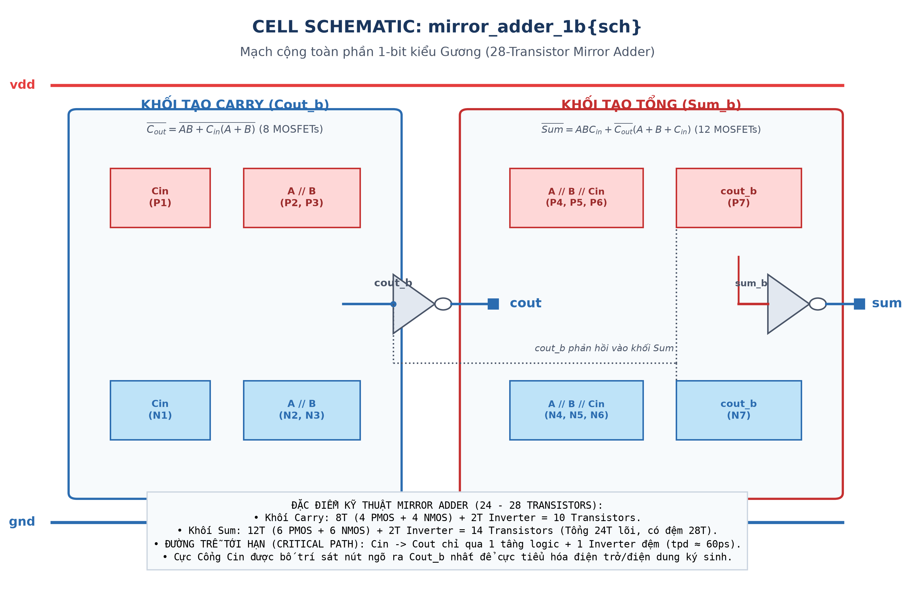
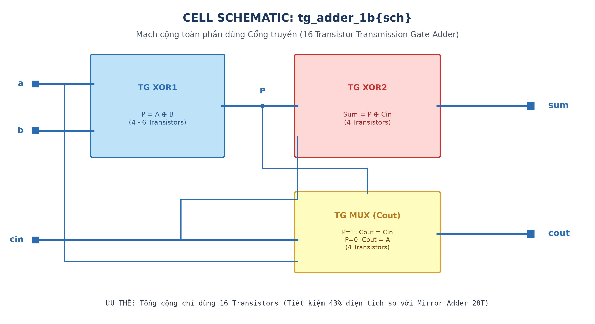

# THỰC HÀNH THIẾT KẾ VLSI — BÀI 6
# THIẾT KẾ MẠCH CỘNG TOÀN PHẦN 1-BIT (1-BIT FULL ADDER)

---
**Bộ môn:** Điện tử - Viễn thông | **Khoa:** Điện - Điện tử  
**Trường:** Đại học Sư phạm Kỹ thuật – Đại học Đà Nẵng  
**Thời lượng:** 5 tiết thực hành tại phòng máy (kết hợp tự học Pre-lab & hoàn thiện Post-lab)  
**Công cụ sử dụng:** Electric VLSI Design System (v9.07+), LTspice XVII / LTspice 2025  
**Công nghệ tham chiếu:** MOSIS SCMOS SUBMICRON C5N 0.5µm ($\lambda = 0.30\,\mu\text{m}$, 3 Metal layers, $V_{DD} = 5.0\,\text{V}$)  
---

## I. MỤC TIÊU

Sau khi hoàn thành bài thực hành này, sinh viên có khả năng:
1. **Nắm vững nguyên lý hoạt động của Mạch cộng toàn phần (Full Adder):** Phân tích biểu thức hàm logic tổng $Sum = A \oplus B \oplus C_{in}$ và số nhớ ngõ ra $C_{out} = A B + C_{in}(A + B)$; kiểm chứng trọn vẹn 8 trạng thái logic trên bảng chân trị.
2. **Khảo sát và đối sánh 2 kiến trúc Full Adder kinh điển mức transistor:**
   - **Mạch cộng Gương (28-Transistor Mirror Adder):** Phân tích tính đối xứng hoàn hảo giữa mạng kéo lên (PUN) và kéo xuống (PDN); cơ chế tái sử dụng tín hiệu bù $\overline{C_{out}}$ để tạo hàm $Sum$ giúp giảm thiểu số transistor và điện dung ký sinh.
   - **Mạch cộng Cổng truyền (16-Transistor Transmission Gate Adder):** Hiện thực phép toán cộng chỉ với 16 transistor dựa trên khối tạo cờ truyền $P = A \oplus B$ và bộ dồn kênh MUX; đánh giá sự đánh đổi giữa diện tích silicon nhỏ gọn và hiện tượng suy giảm biên độ tín hiệu qua chuỗi Pass-TG.
3. **Phân tích Đường trễ tới hạn (Critical Path Timing Analysis):**
   - Đo đạc thực nghiệm trễ truyền lan số nhớ ($t_{pd(Cin \to Cout)}$) so với trễ tạo tổng ($t_{pd(A \to Sum)}$).
   - Hiểu rõ tại sao trong các bộ cộng số học nhiều bit (Ripple Carry Adder / CLA Adder), đường truyền số nhớ $C_{in} \to C_{out}$ là nút thắt cổ chai quyết định tần số xung nhịp tối đa của toàn bộ vi xử lý; nắm vững kỹ thuật bố trí transistor $C_{in}$ sát ngõ ra để tối ưu hóa trễ.
4. **Thiết kế Mask Layout cho Tế bào chuẩn `FULL_ADDER_1B`:** Bố trí ma trận transistor đối xứng gương, chia sẻ cực khuếch tán (Abutment), kiểm tra luật hình học DRC đạt 0 lỗi và đối chiếu LVS đạt trùng khớp sơ đồ 100%.
5. **Trích xuất Ký sinh PEX & Đánh giá Ghép tầng (Cascading Effect):** Trích xuất Netlist ký sinh Post-layout; khảo sát hiện tượng suy hao sườn xung khi ghép nối tiếp 4 tế bào Full Adder thành bộ cộng gợn sóng 4-bit (4-bit Ripple Carry Adder).
6. **Đóng gói IP Tế bào chuẩn:** Bàn giao Cell Icon `full_adder_1b{ic}` cho Bài 9 (Khối cộng tràn sớm 4-bit CLA) và Bài 10 (Khối số học của Capstone ALU).

---

## II. CÔNG CỤ VÀ THƯ VIỆN MÔ HÌNH

1. **Phần mềm thiết kế:**
   - **Electric VLSI Design System:** Phiên bản 9.07 trở lên (công nghệ `mocmos`, $\lambda = 0.30\,\mu\text{m}$).
   - **LTspice:** Phiên bản XVII hoặc LTspice 2025.
2. **Thư viện mô hình SPICE:**
   - Tệp thư viện tham chiếu: `04 - Models_and_Libraries/C5_models.txt` (NMOS: `N`, PMOS: `P`).
3. **IP kế thừa từ các bài trước:**
   - Tế bào Inverter chuẩn `INV_X1` (Bài 1).
   - Tế bào Cổng truyền `TG_GATE` và Bộ dồn kênh `MUX2_TG` (Bài 4).

---

## III. CƠ SỞ LÝ THUYẾT VÀ NGUYÊN LÝ THIẾT KẾ

### 1. Hàm Logic và Bảng Chân Trị Mạch Cộng Toàn Phần 1-bit

Mạch cộng toàn phần 1-bit nhận 3 ngõ vào nhị phân $A, B, C_{in}$ và tạo ra 2 ngõ ra: Tổng $Sum$ và Số nhớ mang đi $C_{out}$:

$$Sum = A \oplus B \oplus C_{in} = A B C_{in} + \bar{A} \bar{B} C_{in} + \bar{A} B \bar{C}_{in} + A \bar{B} \bar{C}_{in}$$

$$C_{out} = A B + B C_{in} + A C_{in} = A B + C_{in}(A + B)$$

| $A$ | $B$ | $C_{in}$ | $Sum$ | $C_{out}$ | Nhận xét tính chất số học |
| :-: | :-: | :---: | :---: | :---: | :--- |
| 0 | 0 | 0 | **0** | **0** | Tổng bằng 0, không tràn |
| 0 | 0 | 1 | **1** | **0** | Tổng bằng 1, không tràn |
| 0 | 1 | 0 | **1** | **0** | Tổng bằng 1, không tràn |
| 0 | 1 | 1 | **0** | **1** | $1 + 1 = 2 \implies Sum = 0, Cout = 1$ |
| 1 | 0 | 0 | **1** | **0** | Tổng bằng 1, không tràn |
| 1 | 0 | 1 | **0** | **1** | $1 + 1 = 2 \implies Sum = 0, Cout = 1$ |
| 1 | 1 | 0 | **0** | **1** | $1 + 1 = 2 \implies Sum = 0, Cout = 1$ |
| 1 | 1 | 1 | **1** | **1** | $1 + 1 + 1 = 3 \implies Sum = 1, Cout = 1$ |

---

### 2. Kiến Trúc Mạch Cộng Gương 28-Transistor (Mirror Adder)

Kiến trúc **Mirror Adder** là cấu trúc Full Adder cổng tĩnh phổ biến nhất trong các thư viện tế bào chuẩn công nghiệp nhờ tính bền vững, chống nhiễu tuyệt đối và khả năng phục hồi sườn xung cực mạnh.

<div align="center">


*Hình 6.1: Sơ đồ nguyên lý mạch cộng gương 28-Transistor Mirror Adder (`mirror_adder_1b{sch}`)*

</div>

#### a. Khối tạo số nhớ mang đi (Carry Generation Block - $\overline{C_{out}}$):
Biểu thức bù của số nhớ:

$$\overline{C_{out}} = \overline{A B + C_{in}(A + B)}$$

- **Mạng PDN:** Gồm nhánh $A$ nối tiếp $B$ mắc song song với nhánh $C_{in}$ nối tiếp với cụm $(A \parallel B)$ (4 NMOS).
- **Mạng PUN:** Đối xứng hoàn hảo qua gương với PDN: Gồm nhánh $A$ song song $B$ mắc nối tiếp với nhánh $C_{in}$ song song với cụm nối tiếp ($A$ và $B$) (4 PMOS).
- Thêm 1 Inverter đệm 2T ở ngõ ra để tạo tín hiệu $C_{out}$ cực mạnh $\implies$ **Tổng cộng: 10 Transistors**.

#### b. Khối tạo tổng (Sum Generation Block - $\overline{Sum}$):
Nếu triển khai $Sum$ trực tiếp, mạng sẽ cần tới 16–20 transistor. Mirror Adder sử dụng một biến đổi đại số cực kỳ thông minh bằng cách **tái sử dụng tín hiệu bù $\overline{C_{out}}$**:

$$\overline{Sum} = A B C_{in} + \overline{C_{out}} (A + B + C_{in})$$

- Nhánh 1: Ba transistor $A, B, C_{in}$ mắc nối tiếp.
- Nhánh 2: Transistor nhận $\overline{C_{out}}$ mắc nối tiếp với 3 transistor $(A \parallel B \parallel C_{in})$ mắc song song.
- Thêm 1 Inverter đệm 2T để tạo tín hiệu $Sum$ hoàn chỉnh $\implies$ **Khối Sum chỉ tốn 14 Transistors**.
- $\implies$ **Tổng toàn mạch: $10 + 14 = \mathbf{24 - 28 \text{ Transistors}}$**.

#### c. Tối ưu hóa đường trễ tới hạn $C_{in} \to C_{out}$ (Critical Path Optimization):
Trong bộ cộng gợn sóng nhiều bit, tín hiệu $C_{in}$ đi vào muộn nhất (chờ kết quả từ tầng trước).  
Do đó, trong cả khối Carry và khối Sum:
- **Transistor có cực Cổng nhận $C_{in}$ luôn được đặt ở vị trí sát nút ngõ ra ($\overline{C_{out}}$) nhất**, cách xa đường nguồn $V_{DD}$ và đất $GND$.
- Kỹ thuật này giúp các nút nội bên dưới đã được xả điện tích từ trước bởi $A$ và $B$. Khi $C_{in}$ nhảy mức, dòng điện chỉ cần nạp/xả đúng tụ cực má ngõ ra mà không phải xả các tụ nút nội, giúp **cắt giảm trễ $t_{pd(Cin \to Cout)}$ từ $30\%$ đến $40\%$**!

---

### 3. Kiến Trúc Mạch Cộng Cổng Truyền 16-Transistor (TG Full Adder)

<div align="center">


*Hình 6.2: Sơ đồ nguyên lý mạch cộng dùng Cổng truyền 16-Transistor TG Full Adder*

</div>

Để tiết kiệm diện tích tối đa cho các ứng dụng công suất thấp (DSP, IoT), kiến trúc TG Full Adder tách bài toán cộng thành 3 khối ghép nối:
1. **Khối tạo tín hiệu truyền (Propagate $P$):**

   $$P = A \oplus B$$

   Hiện thực bằng 1 cổng XOR dùng Cổng truyền CMOS (1 TG + 2 Inverters = 6 Transistors, hoặc 4T).
2. **Khối tạo Tổng ($Sum$):**

   $$Sum = P \oplus C_{in}$$

   Hiện thực bằng 1 cổng XOR Cổng truyền thứ hai (4 Transistors).
3. **Khối tạo Số nhớ ($C_{out}$):**
   Nhận xét tính chất của $C_{out}$:
   - Khi $P = 1$ (tức $A \ne B$): Nếu $A=0, B=1$ hoặc $A=1, B=0$ thì $C_{out} = C_{in}$ (Số nhớ truyền xuyên qua).
   - Khi $P = 0$ (tức $A = B$): Nếu $A=B=0$ thì $C_{out} = 0 = A$; nếu $A=B=1$ thì $C_{out} = 1 = A$.

   $$\implies C_{out} = \begin{cases} C_{in} & \text{khi } P = 1 \\ A & \text{khi } P = 0 \end{cases}$$

   Hàm này được hiện thực trực tiếp bằng **1 Bộ dồn kênh MUX 2:1 dùng Cổng truyền** (điều khiển bởi tín hiệu chọn $P$, chọn giữa $C_{in}$ và $A$, tốn đúng 4 Transistors).
- $\implies$ **Tổng số transistor: Chỉ đúng $\mathbf{16 \text{ Transistors}}$!**

---

### 4. Đối Sánh Toàn Diện PPA: Mirror Adder vs TG Adder

| Tiêu chí đối sánh | Mirror Adder (28T) | TG Full Adder (16T) | Phân tích kỹ thuật vi mạch |
| :--- | :---: | :---: | :--- |
| **Số lượng Transistor** | **28 Transistors** | **16 Transistors** | TG Adder **tiết kiệm $43\%$** transistor |
| **Diện tích Layout** | $\approx 48\lambda \times 44\lambda = \mathbf{2112\,\lambda^2}$ | $\approx 32\lambda \times 40\lambda = \mathbf{1280\,\lambda^2}$ | TG Adder **giảm diện tích $\approx 39.4\%$** |
| **Khả năng phục hồi biên độ** | **Tuyệt đối (Full Rail-to-Rail)** | Bị suy thoái nhẹ qua chuỗi TG | Mirror Adder kháng nhiễu vượt trội |
| **Trễ $C_{in} \to C_{out}$ (1 tầng đơn)** | $\approx \mathbf{65 - 75\,\text{ps}}$ | $\approx \mathbf{40 - 45\,\text{ps}}$ | TG Adder nhanh hơn ở 1 tầng đơn lẻ |
| **Trễ chuỗi $C_{in} \to C_{out}$ (Nối 4 tầng)** | Tăng tuyến tính: $4 \times 70\,\text{ps} = \mathbf{280\,\text{ps}}$ | Tăng bậc hai: $O(N^2) \approx \mathbf{340\,\text{ps}}$ | **Mirror Adder nhanh hơn khi nối chuỗi dài!** |
| **Độ phức tạp đi dây Layout** | Đối xứng cao, dễ đi dây | Bất đối xứng, cần nhiều đường điều khiển | Mirror Adder layout đạt độ tin cậy cao hơn |

---

## IV. CHUẨN BỊ TRƯỚC THỰC HÀNH (PRE-LAB - Ở NHÀ)

> [!IMPORTANT]
> Toàn bộ phần tính toán và bảng chân trị phải được sinh viên điền vào **Mục VI.a** của Phiếu báo cáo trước giờ vào lớp.

1. **Bảng chân trị logic của Full Adder:**
   Lập bảng chân trị đầy đủ 8 tổ hợp ngõ vào ($A, B, C_{in}$), xác định $Sum$ và $C_{out}$.
2. **Kích thước định cỡ Transistor cho Mirror Adder:**
   - Dựa vào quy tắc cân bằng $R_{on}$ tương đương Inverter chuẩn `INV_X1` ($R_{on,n0} \approx 969\,\Omega, R_{on,p0} \approx 992\,\Omega$):
     * Trong khối Carry: Nhánh 2 NMOS nối tiếp $\implies W_n = 2 \times 4\lambda = 8\lambda = 2.4\,\mu\text{m}$. Nhánh 2 PMOS nối tiếp $\implies W_p = 2 \times 12\lambda = 24\lambda = 7.2\,\mu\text{m}$.
     * Trong khối Sum: Nhánh 3 NMOS nối tiếp $\implies W_n = 3 \times 4\lambda = 12\lambda = 3.6\,\mu\text{m}$. Nhánh 3 PMOS nối tiếp $\implies W_p = 3 \times 12\lambda = 36\lambda = 10.8\,\mu\text{m}$ (hoặc chọn $24\lambda$ kết hợp đa cực).
     * Inverter đệm ngõ ra $C_{out}$ và $Sum$: $W_n = 4\lambda = 1.2\,\mu\text{m}, W_p = 12\lambda = 3.6\,\mu\text{m}$.
3. **Phân tích đường trễ tới hạn trong bộ cộng 4-bit:**
   - Viết công thức tính thời gian trễ toàn phần $T_{total}$ của bộ cộng 4-bit Ripple Carry Adder theo các thông số trễ cơ bản: $t_{pd(A \to Cout)}, t_{pd(Cin \to Cout)}, t_{pd(Cin \to Sum)}$.
   - Giải thích tại sao việc giảm trễ $C_{in} \to C_{out}$ từ $70\,\text{ps}$ xuống $50\,\text{ps}$ lại quan trọng gấp 4 lần việc giảm trễ $A \to Sum$.
4. **Vẽ sơ đồ que Stick Diagram cho khối Carry của Mirror Adder:**
   - Tìm đường đi Euler cho mạng PUN và PDN của khối Carry với thứ tự $A - B - C_{in}$.

---

## V. NỘI DUNG THỰC HÀNH TẠI PHÒNG LAB (IN-LAB)

### 1. Thiết Kế Schematic Tế Bào Mirror Adder (`mirror_adder_1b{sch}`)

<div align="center">


*Hình 6.3: Schematic tế bào mirror_adder_1b{sch} với khối Carry và khối Sum*

</div>

1. Khởi động Electric VLSI, tạo Cell mới: `mirror_adder_1b`, View type: `schematic`.
2. **Dựng Khối Carry ($\overline{C_{out}}$ & $C_{out}$):**
   - Đặt 4 PMOS và 4 NMOS theo đúng sơ đồ đối xứng gương của Mục III.2.
   - Transistor nhận tín hiệu $C_{in}$ được đấu sát vào nút ngõ ra $\overline{C_{out}}$.
   - Đặt 1 Inverter chuẩn đệm ngõ ra $\overline{C_{out}} \to C_{out}$.
3. **Dựng Khối Sum ($\overline{Sum}$ & $Sum$):**
   - Đặt 6 PMOS và 6 NMOS theo sơ đồ Mục III.2.
   - Nối chân cổng của cặp transistor điều khiển nhánh phụ vào nút $\overline{C_{out}}$ lấy từ Khối Carry.
   - Đặt 1 Inverter chuẩn đệm ngõ ra $\overline{Sum} \to Sum$.
4. **Tạo 7 chân Export (`Ctrl + E`):**

   | Tên chân Export | Hướng (Characteristics) | Chức năng chi tiết |
   | :--- | :--- | :--- |
   | **`a`** | `Input` | Bit dữ liệu hạng tử thứ nhất A |
   | **`b`** | `Input` | Bit dữ liệu hạng tử thứ hai B |
   | **`cin`** | `Input` | Bit số nhớ ngõ vào $C_{in}$ (đường tới hạn) |
   | **`sum`** | `Output` | Bit tổng ngõ ra $Sum = A \oplus B \oplus C_{in}$ |
   | **`cout`** | `Output` | Bit số nhớ mang đi $C_{out}$ |
   | **`vdd`** | `Power` | Đường cấp nguồn điện áp $+5.0\,\text{V}$ |
   | **`gnd`** | `Ground` | Đường nối đất tham chiếu $0\,\text{V}$ |

5. Nhấn `F5` kiểm tra kết nối mạng (**0 errors, 0 warnings**). Đóng gói Cell Icon `mirror_adder_1b{ic}`.

---

### 2. Mô Phỏng Kiểm Chứng Đầy Đủ 8 Trạng Thái Logic (LTspice)

1. Xuất file Netlist SPICE cho `mirror_adder_1b`.
2. Thiết lập 3 nguồn xung vuông kích thích quét toàn bộ 8 tổ hợp từ `000` đến `111`:
   - $V_A$: Xung chu kỳ $T_A = 80\,\text{ns}$ ($t_{on} = 40\,\text{ns}$).
   - $V_B$: Xung chu kỳ $T_B = 40\,\text{ns}$ ($t_{on} = 20\,\text{ns}$).
   - $V_{Cin}$: Xung chu kỳ $T_{Cin} = 20\,\text{ns}$ ($t_{on} = 10\,\text{ns}$).
   - Tải dung mỗi ngõ ra: $C_L(Sum) = 50\,\text{fF}$, $C_L(Cout) = 50\,\text{fF}$.
3. Chạy mô phỏng quá độ: `.tran 0.05n 80n`.
4. Đối chiếu trực quan các mức điện áp $V(sum)$ và $V(cout)$ với bảng chân trị lý thuyết tại cả 8 khoảng thời gian.

---

### 3. Đo Đạc Thời Gian Trễ Các Đường Tới Hạn

1. **Đo trễ đường truyền số nhớ ($C_{in} \to C_{out}$):**
   - Thiết lập điều kiện truyền số nhớ: Đặt $A = 1, B = 0$. Khi đó $C_{out}$ phụ thuộc trực tiếp vào $C_{in}$ ($P = A \oplus B = 1$).
   - Cấp xung chuyển mạch cho $C_{in}$. Dùng lệnh `.MEAS` đo trễ sườn xuống $t_{pHL(Cin \to Cout)}$ và trễ sườn lên $t_{pLH(Cin \to Cout)}$.
2. **Đo trễ đường tạo tổng từ dữ liệu ($A \to Sum$):**
   - Đặt $B = 0, C_{in} = 0$. Cấp xung chuyển mạch cho $A$. Đo trễ $t_{pd(A \to Sum)}$.
3. **So sánh trễ:** Xác nhận trễ $C_{in} \to C_{out}$ nhanh hơn trễ $A \to Sum$ ít nhất **$2.0$ lần**.

---

### 4. Khảo Sát Ghép Chuỗi 4-bit Ripple Carry Adder (RCA 4-bit)

1. Ghép nối tiếp 4 tế bào `mirror_adder_1b{ic}`:
   - Chân `cout` của $FA_0$ nối sang chân `cin` của $FA_1$.
   - Chân `cout` của $FA_1$ nối sang chân `cin` của $FA_2$.
   - Chân `cout` của $FA_2$ nối sang chân `cin` của $FA_3$.
2. Kích thích trường hợp xấu nhất (Worst-Case Carry Propagation):
   - Đặt $A = [1, 1, 1, 1]$ và $B = [0, 0, 0, 0]$.
   - Cấp xung cho $C_{in,0}$ chuyển từ $0 \to 1$.
   - Số nhớ $C_{in,0}$ sẽ lan truyền gợn sóng qua toàn bộ 4 tầng để làm lật $C_{out,3}$ từ $0 \to 1$.
3. Đo thời gian trễ lan truyền toàn chuỗi 4-bit $t_{pd,chain}$ và chia cho 4 để kiểm chứng tính chất tích lũy trễ tuyến tính $O(N)$ của Mirror Adder.

---

### 5. Thiết Kế Mask Layout, Chạy DRC & LVS cho `mirror_adder_1b`

1. Trong Electric, tạo Cell Layout: `mirror_adder_1b{lay}`.
2. Vẽ 2 ray nguồn Metal 1 nằm ngang `vdd` và `gnd` (độ rộng $\ge 6\lambda$, khoảng cách chuẩn $60\lambda$).
3. Bố trí vùng N-Well ở nửa trên; đặt các khối PMOS của Carry và Sum.
4. Bố trí vùng N-Active ở nửa dưới; đặt các khối NMOS của Carry và Sum.
5. Thực hiện chia sẻ vùng khuếch tán (Abutment) giữa các transistor mắc song song trong cụm $(A \parallel B)$ để tiết kiệm diện tích.
6. Đặt đầy đủ tiếp xúc phân cực Substrate Tap và Well Tap.
7. Nhấn `F5` kiểm tra DRC đạt **0 errors found**.
8. Chạy đối chiếu *Tools $\to$ NCC $\to$ Schematic and Layout Comparison*. Kết quả LVS phải báo **"Netlists Match Perfectly"**.

---

### 6. Trích Xuất Ký Sinh PEX & Đánh Giá Post-Layout

1. Bật tùy chọn trích xuất tụ ký sinh trong Electric, xuất file Netlist Post-layout cho `mirror_adder_1b`.
2. Mô phỏng Transient Post-layout với tải $C_L = 50\,\text{fF}$.
3. Đo đạc lại trễ $t_{pd(Cin \to Cout)}$ và $t_{pd(A \to Sum)}$.
4. So sánh số liệu Pre-layout vs Post-layout để đánh giá tác động của tụ ký sinh đường truyền số nhớ nội bộ.

---

## VI. BÁO CÁO THỰC HÀNH (MẪU PHIẾU ĐIỀN KHUYẾT CHO SINH VIÊN)

```
========================================================================================
                          BÁO CÁO THỰC HÀNH: BÀI 6
             THIẾT KẾ MẠCH CỘNG TOÀN PHẦN 1-BIT (1-BIT FULL ADDER)
Họ và Tên: ..................................................... MSSV: .................
Lớp: ....................................... Nhóm/Bàn: ......... Ngày: .................
Chữ ký Giảng viên / Điểm nghiệm thu tại bàn: ............................................
========================================================================================
```

### a. Phần Chuẩn bị (Pre-lab)

1. **Bảng chân trị lý thuyết của Full Adder:**

   | $A$ | $B$ | $C_{in}$ | $Sum$ lý thuyết | $C_{out}$ lý thuyết |
   | :-: | :-: | :---: | :---: | :---: |
   | 0 | 0 | 0 | ......... | ......... |
   | 0 | 0 | 1 | ......... | ......... |
   | 0 | 1 | 0 | ......... | ......... |
   | 0 | 1 | 1 | ......... | ......... |
   | 1 | 0 | 0 | ......... | ......... |
   | 1 | 0 | 1 | ......... | ......... |
   | 1 | 1 | 0 | ......... | ......... |
   | 1 | 1 | 1 | ......... | ......... |

2. **Bảng kích thước định cỡ Transistor của `mirror_adder_1b`:**

   | Khối chức năng | Transistor | Loại MOS | Kích thước $(W/L)$ theo $\lambda$ | Kích thước $(W/L)$ theo $\mu\text{m}$ |
   | :--- | :--- | :---: | :---: | :---: |
   | **Khối Carry** | Nhánh 2 NMOS nối tiếp | NMOS | .................... | .................... |
   | **Khối Carry** | Nhánh 2 PMOS nối tiếp | PMOS | .................... | .................... |
   | **Khối Carry** | Inverter đệm $C_{out}$ | NMOS / PMOS | .................... | .................... |
   | **Khối Sum** | Nhánh 3 NMOS nối tiếp | NMOS | .................... | .................... |
   | **Khối Sum** | Nhánh 3 PMOS nối tiếp | PMOS | .................... | .................... |
   | **Khối Sum** | Inverter đệm $Sum$ | NMOS / PMOS | .................... | .................... |

3. **Dự đoán thời gian trễ lý thuyết ($C_L = 50\,\text{fF}$):**
   - Trễ đường truyền số nhớ: $t_{pd(Cin \to Cout)} =$ .................... ps.
   - Trễ tạo tổng từ dữ liệu: $t_{pd(A \to Sum)} =$ .................... ps.
   - Tỉ số trễ: $\frac{t_{pd(A \to Sum)}}{t_{pd(Cin \to Cout)}} =$ .................... lần.

---

### b. Kết quả Đo đạc Thực hành (In-lab & Post-lab)

1. **Kết quả đo kiểm trễ các đường truyền tín hiệu ($C_L = 50\,\text{fF}$):**

   | Đường truyền tín hiệu | Trễ sườn xuống $t_{pHL}$ (ps) | Trễ sườn lên $t_{pLH}$ (ps) | Trễ trung bình $t_{pd}$ (ps) |
   | :--- | :---: | :---: | :---: |
   | **Đường Carry: $C_{in} \to C_{out}$** | .................... | .................... | .................... |
   | **Đường Carry: $A \to C_{out}$** | .................... | .................... | .................... |
   | **Đường Sum: $C_{in} \to Sum$** | .................... | .................... | .................... |
   | **Đường Sum: $A \to Sum$** | .................... | .................... | .................... |

2. **So sánh trễ Pre-layout vs Post-layout (PEX):**

   | Thông số đo đạc | Mô phỏng Pre-layout | Đo đạc Post-layout (PEX) | Độ suy giảm tốc độ (%) |
   | :--- | :---: | :---: | :---: |
   | **$t_{pd(Cin \to Cout)}$** | .................... ps | .................... ps | .................... % |
   | **$t_{pd(A \to Sum)}$** | .................... ps | .................... ps | .................... % |

3. **Kết quả khảo sát Chuỗi 4 bộ cộng gợn sóng (4-bit RCA):**
   - Tổng thời gian trễ truyền số nhớ từ $C_{in,0} \to C_{out,3}$: $T_{carry,4bit} =$ .................... ps.
   - Trễ trung bình mỗi tầng gợn sóng: $t_{carry,avg} = \frac{T_{carry,4bit}}{4} =$ .................... ps.

4. **Kết quả kiểm tra vật lý Layout `mirror_adder_1b`:**
   - Kết quả kiểm tra DRC: `............................................................`
   - Kết quả đối chiếu LVS: `............................................................`
   - Kích thước Layout: Chiều rộng $W =$ ............ $\mu\text{m}$, Chiều cao $H =$ ............ $\mu\text{m}$, Diện tích = ............ $\mu\text{m}^2$.

---

### c. Câu hỏi Thảo luận và Mở rộng

1. **Câu hỏi 1:** Tại sao trong thiết kế khối Carry của Mirror Adder, cực Cổng của transistor nhận tín hiệu $C_{in}$ luôn được ưu tiên bố trí sát nút ngõ ra $\overline{C_{out}}$ nhất thay vì nối sát nguồn/đất? Hiện tượng vật lý nào giải thích cho quyết định này?
   *Trả lời:* ............................................................................................................................
2. **Câu hỏi 2:** Khi mở rộng lên bộ cộng 32-bit hoặc 64-bit, tại sao kiến trúc Bộ cộng gợn sóng (Ripple Carry Adder) không còn được sử dụng và phải thay thế bằng Bộ cộng tràn sớm (Carry-Lookahead Adder - CLA) hoặc Bộ cộng chọn trước (Carry-Select Adder)?
   *Trả lời:* ............................................................................................................................

---

## VII. RUBRIC ĐÁNH GIÁ NGHIỆM THU (THANG 10 CHUẨN OBE/ABET)

| Tiêu chí | Trọng số | Mức 1: Xuất sắc (8.5 – 10) | Mức 2: Khá (7.0 – 8.4) | Mức 3: Đạt (5.0 – 6.9) | Mức 4: Không đạt (< 5.0) |
| :--- | :---: | :--- | :--- | :--- | :--- |
| **1. Chuẩn bị Pre-lab** | 20% | Bảng chân trị đúng $100\%$; tính đúng kích thước $W/L$; phân tích sâu sắc công thức trễ chuỗi RCA; vẽ Stick diagram khối Carry chuẩn. | Bảng chân trị đúng; tính đúng kích thước; Stick diagram vẽ được. | Có chuẩn bị nhưng tính toán sizing còn sai lệch; chưa vẽ Stick diagram hoàn chỉnh. | Không làm bài chuẩn bị hoặc sao chép. |
| **2. Schematic & SPICE 8 trạng thái (Ex1–Ex2)** | 25% | Dựng đúng schematic Mirror Adder; kiểm chứng chuẩn xác đủ 8 tổ hợp logic ngõ ra $Sum, C_{out}$; không có xung nhiễu giả. | Dựng đúng mạch; kiểm chứng được bảng chân trị; dạng sóng còn nhiễu nhỏ. | Dựng được mạch nhưng kết nối chân $\overline{C_{out}}$ sang Sum bị sai; kết quả logic sai lệch. | Không hoàn thành mạch cộng hoặc SPICE báo lỗi. |
| **3. Đo trễ đường tới hạn & RCA 4-bit (Ex3–Ex4)** | 25% | Đo chính xác trễ $C_{in} \to C_{out}$ và $A \to Sum$; chứng minh thực nghiệm đường Carry nhanh gấp $\ge 2$ lần; ghép chuỗi 4-bit đo trễ $O(N)$ chuẩn. | Đo được trễ các đường chính; ghép được chuỗi 4-bit nhưng thao tác đo trễ chuỗi còn lúng túng. | Đo được trễ nhưng chưa tách biệt được đường tới hạn; chưa ghép được chuỗi 4-bit. | Không đo đạc được thông số trễ. |
| **4. Layout, DRC & LVS (Ex5–Ex6)** | 20% | Layout đối xứng gương chặt chẽ, tối ưu Abutment; 0 lỗi DRC; LVS báo **"MATCH"** độc lập. | Layout đạt chuẩn, 0 lỗi DRC; LVS match sau 1 lần sửa nhỏ. | Layout cồng kềnh, vi phạm DRC đơn giản tự sửa được; LVS match. | Không hoàn thành Layout, hoặc vi phạm DRC nghiêm trọng, LVS không match. |
| **5. Báo cáo & Tác phong** | 10% | Báo cáo đầy đủ, trung thực; trả lời xuất sắc 2 câu hỏi thảo luận; giữ gìn vệ sinh phòng máy. | Báo cáo đầy đủ, nộp đúng hạn; trả lời được câu hỏi mở rộng. | Báo cáo còn thiếu số liệu; trả lời câu hỏi mở rộng chưa chính xác. | Vi phạm quy chế phòng thực hành hoặc nộp trễ. |
