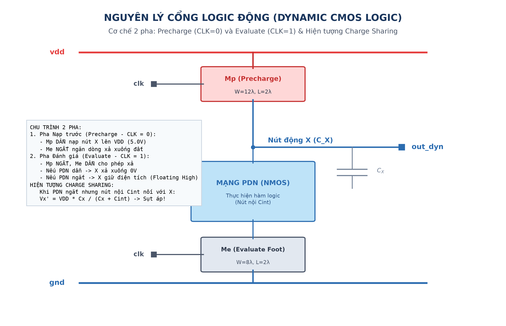
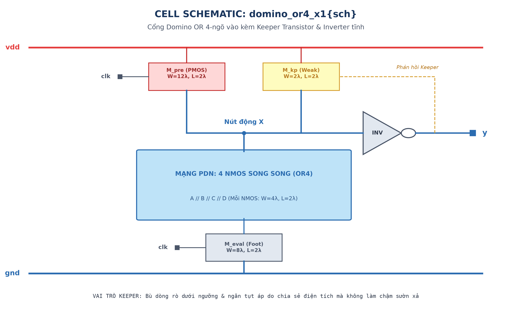

# THỰC HÀNH THIẾT KẾ VLSI — BÀI 7
# KỸ THUẬT LOGIC ĐỘNG VÀ LOGIC DOMINO (DYNAMIC & DOMINO CMOS LOGIC)

---
**Bộ môn:** Điện tử - Viễn thông | **Khoa:** Điện - Điện tử  
**Trường:** Đại học Sư phạm Kỹ thuật – Đại học Đà Nẵng  
**Thời lượng:** 5 tiết thực hành tại phòng máy (kết hợp tự học Pre-lab & hoàn thiện Post-lab)  
**Công cụ sử dụng:** Electric VLSI Design System (v9.07+), LTspice XVII / LTspice 2025  
**Công nghệ tham chiếu:** MOSIS SCMOS SUBMICRON C5N 0.5µm ($\lambda = 0.30\,\mu\text{m}$, 3 Metal layers, $V_{DD} = 5.0\,\text{V}$)  
---

## I. MỤC TIÊU

Sau khi hoàn thành bài thực hành này, sinh viên có khả năng:
1. **Nắm vững nguyên lý hoạt động 2 pha của Dynamic CMOS Logic:** Phân tích cơ chế nạp trước điện tích trong pha Precharge ($CLK = 0$) và cơ chế xả có điều kiện trong pha Evaluate ($CLK = 1$); hiểu rõ ưu điểm giảm tải điện dung ngõ vào ($C_{in}$) và tối ưu diện tích silicon so với logic tĩnh Static CMOS.
2. **Khảo sát chuyên sâu hiện tượng Chia sẻ Điện tích (Charge Sharing):**
   - Thiết lập mô hình giải tích bảo toàn điện tích khi nút nội bộ $C_{int}$ chia sẻ điện tích với nút động $C_X$.
   - Đo đạc thực nghiệm độ sụt áp $\Delta V_X$ trên LTspice và đánh giá nguy cơ gây lật sai trạng thái logic (False Evaluation).
3. **Thiết kế và Định cỡ Transistor Duy trì (Keeper Sizing):**
   - Ứng dụng Weak PMOS Keeper ($M_{kp}$) để triệt tiêu hiện tượng sụt áp do chia sẻ điện tích và bù trừ dòng rò dưới ngưỡng ($I_{sub}$).
   - Phân tích sự đánh đổi kỹ thuật (Trade-off) giữa độ bền nhiễu và hiện tượng tranh chấp dòng điện (Keeper Contention).
4. **Hiểu rõ Tính đơn điệu (Monotonicity) và Cấu trúc Domino Logic:**
   - Chứng minh bằng thực nghiệm tại sao cổng Dynamic thuần không thể ghép chuỗi trực tiếp (nguy cơ lỗi xả sớm Premature Discharge).
   - Nắm vững vai trò của Static Inverter trong việc tạo ra tín hiệu đơn điệu tăng ($0 \to 1$), cho phép ghép chuỗi liên hoàn kiểu Domino.
5. **Thiết kế Schematic và Mask Layout cho Cổng Domino OR 4-ngõ vào (`domino_or4_x1`):** Hiện thực sơ đồ nguyên lý, bố trí mặt nạ hình học với kỹ thuật chia sẻ khuếch tán (Drain Diffusion Sharing), vượt qua kiểm tra luật hình học DRC đạt 0 lỗi và đối soát LVS trùng khớp 100%.
6. **Mô phỏng SPICE và Trích xuất Ký sinh Post-Layout (PEX):** Đo đạc thời gian trễ đánh giá ($t_{pd,eval}$), công suất tiêu tán trung bình và so sánh hiệu năng PPA (Power-Performance-Area) với cổng Static CMOS tương đương.

---

## II. CÔNG CỤ VÀ THƯ VIỆN MÔ HÌNH

1. **Phần mềm thiết kế:**
   - **Electric VLSI Design System:** Phiên bản 9.07 trở lên (công nghệ `mocmos`, $\lambda = 0.30\,\mu\text{m}$).
   - **LTspice:** Phiên bản XVII hoặc LTspice 2025.
2. **Thư viện mô hình SPICE:**
   - Tệp mô hình: `04 - Models_and_Libraries/C5_models.txt` (NMOS: `N`, PMOS: `P`).
3. **Tế bào kế thừa:**
   - Tế bào Inverter tĩnh `INV_X1` (Bài 1).

---

## III. CƠ SỞ LÝ THUYẾT VÀ NGUYÊN LÝ THIẾT KẾ

### 1. Nguyên Lý Chu Trình 2 Pha Của Logic Động (Dynamic CMOS)

Trong khi cổng tĩnh CMOS $N$ ngõ vào cần tới $2N$ transistor, một cổng **Dynamic CMOS** chỉ cần $N$ transistor NMOS trong mạng kéo xuống (PDN) kết hợp với 2 transistor định thời bằng xung nhịp xung nhịp $CLK$:
- **Transistor Nạp trước ($M_{pre}$ - PMOS):** Nối giữa $V_{DD}$ và nút động $X$.
- **Transistor Đánh giá Chân ($M_{eval}$ - Foot NMOS):** Nối giữa mạng PDN và đất $GND$.

*Hình 7.1: Sơ đồ nguyên lý cổng Dynamic CMOS và cơ chế 2 pha Precharge / Evaluate*

Chu trình hoạt động gồm 2 pha tuần hoàn theo xung nhịp $CLK$:
1. **Pha Nạp trước (Precharge - $CLK = 0\,\text{V}$):**
   - $M_{pre}$ (PMOS) BẬT, $M_{eval}$ (Foot NMOS) TẮT.
   - Nút động $X$ được nạp đầy lên mức $V_{DD} = 5.0\,\text{V}$.
   - Chân Foot NMOS ngắt hoàn toàn đường xả xuống đất, đảm bảo không có dòng tĩnh chạy qua mạng PDN.
2. **Pha Đánh giá (Evaluate - $CLK = 5.0\,\text{V}$):**
   - $M_{pre}$ TẮT, $M_{eval}$ BẬT.
   - Nút động $X$ chuyển sang trạng thái "lơ lửng" (Floating High), lưu giữ điện áp dựa trên tụ điện ký sinh $C_X$.
   - Nếu mạng PDN dẫn (có đường thông mạch từ $X$ xuống Foot NMOS): Điện tích trên $C_X$ xả nhanh về $0\,\text{V}$.
   - Nếu mạng PDN ngắt: Nút $X$ giữ nguyên mức điện áp cao $V_{DD}$.

---

### 2. Hiện Tượng Chia Sẻ Điện Tích (Charge Sharing)

Khi mạng PDN có các transistor mắc nối tiếp hoặc phân nhánh phức tạp, tồn tại các điện dung ký sinh tại nút nội $C_{int}$.  
Nếu ở chu kỳ trước nút nội $C_{int}$ bị xả về $0\,\text{V}$, sau đó bước vào pha Evaluate với điều kiện mạng PDN không thông đất (ví dụ transistor trên mở, transistor dưới khóa):

$$\Delta V_X = V_{DD} \left(1 - \frac{C_X}{C_X + C_{int}}\right) = V_{DD} \cdot \frac{C_{int}}{C_X + C_{int}}$$

Điện áp nút động $X$ sau khi chia sẻ:

$$V_X' = V_{DD} \cdot \frac{C_X}{C_X + C_{int}}$$

> [!WARNING]
> Nếu $V_X'$ sụt giảm xuống dưới điện áp ngưỡng chuyển tiếp $V_M \approx 2.45\,\text{V}$ của Inverter đệm, ngõ ra sẽ bị lật giả lên $1$ (False Switching), gây phá hủy hoàn toàn độ tin cậy của vi mạch!

---

### 3. Giải Pháp Transistor Duy Trì (Keeper Transistor)

Để khắc phục hiện tượng Charge Sharing và chống dòng rò dưới ngưỡng ($I_{sub}$) khi mạch chạy ở tần số thấp, một transistor **Keeper PMOS ($M_{kp}$)** kích thước nhỏ (Weak PMOS) được mắc song song với $M_{pre}$, điều khiển hồi tiếp từ ngõ ra $Y$ của cổng Inverter đệm.

- **Khi nút $X = 1 \implies Y = 0$:** Keeper dẫn nhẹ, liên tục bù đắp dòng rò và bơm điện tích giúp nút $X$ giữ chắc chắn mức $5.0\,\text{V}$.
- **Hiện tượng Tranh chấp Keeper (Keeper Contention):** Khi mạng PDN dẫn để xả nút $X$ về $0$, tại thời điểm ban đầu $Y$ vẫn là $0$ nên Keeper vẫn đang dẫn kéo lên $V_{DD}$. Mạng PDN phải chiến đấu để thắng dòng nạp của Keeper.  
  Vì vậy, Keeper phải được định cỡ cực kỳ nhỏ:

  $$W_{kp} \approx 0.10 - 0.15 \times W_{PDN,eq}$$

---

### 4. Kiến Trúc Cổng Domino OR 4-ngõ vào (`domino_or4_x1`)

Cổng Domino Logic là sự kết hợp hoàn hảo giữa **Cổng Dynamic** và **Static Inverter**:
1. Trong pha Precharge ($CLK=0$): $X = 1 \implies Y = \text{NOT}(X) = 0\,\text{V}$. Tín hiệu ngõ ra là $0$, bảo vệ an toàn cho các cổng logic ở tầng tiếp theo không bị xả sớm ngoài ý muốn.
2. Trong pha Evaluate ($CLK=1$): Ngõ ra $Y$ chỉ có thể giữ nguyên $0$ hoặc chuyển từ **$0 \to 1$ (Đơn điệu tăng - Monotonically Rising)**.

*Hình 7.2: Sơ đồ nguyên lý Cổng Domino OR 4-ngõ vào kèm Keeper Transistor (`domino_or4_x1{sch}`)*

#### Bảng thông số kích thước hình học chuẩn (MOSIS C5N 0.5µm, $\lambda = 0.30\,\mu\text{m}$):

| Khối linh kiện | Ký hiệu Transistor | Loại kênh | Rộng $W$ | Dài $L$ | Tỉ lệ $W/\lambda$ | Chức năng kỹ thuật |
| :--- | :---: | :---: | :---: | :---: | :---: | :--- |
| **Precharge PMOS** | $M_{pre}$ | PMOS | $3.60\,\mu\text{m}$ | $0.60\,\mu\text{m}$ | $12\lambda / 2\lambda$ | Nạp trước nút động $X$ lên $V_{DD}$ |
| **Evaluate Foot NMOS** | $M_{eval}$ | NMOS | $2.40\,\mu\text{m}$ | $0.60\,\mu\text{m}$ | $8\lambda / 2\lambda$ | Kích hoạt xả có điều kiện trong Evaluate |
| **Mạng PDN OR4** | $M_A, M_B, M_C, M_D$ | NMOS | $1.20\,\mu\text{m}$ | $0.60\,\mu\text{m}$ | $4\lambda / 2\lambda$ | 4 nhánh song song thực hiện hàm OR |
| **Weak Keeper** | $M_{kp}$ | PMOS | $0.60\,\mu\text{m}$ | $0.60\,\mu\text{m}$ | $2\lambda / 2\lambda$ | Bù dòng rò và khử sụt áp Charge Sharing |
| **Inverter PMOS** | $M_{p,inv}$ | PMOS | $4.80\,\mu\text{m}$ | $0.60\,\mu\text{m}$ | $16\lambda / 2\lambda$ | Kéo sườn lên cực nhanh (High-skew) |
| **Inverter NMOS** | $M_{n,inv}$ | NMOS | $2.40\,\mu\text{m}$ | $0.60\,\mu\text{m}$ | $8\lambda / 2\lambda$ | Kéo sườn xuống |

---

## IV. CHUẨN BỊ TRƯỚC THỰC HÀNH (PRE-LAB)

> [!IMPORTANT]
> Sinh viên phải hoàn thành toàn bộ mục Pre-lab vào vở bài tập và nộp cho giảng viên kiểm tra trước khi được phép vào phòng máy làm In-lab.

### Câu hỏi 1: Tính toán giải tích Chia sẻ điện tích (Charge Sharing)
Một mạch Dynamic CMOS có điện dung nút động $C_X = 20\,\text{fF}$ và điện dung nút nội của nhánh NMOS $C_{int} = 14\,\text{fF}$. Nguồn $V_{DD} = 5.0\,\text{V}$.
1. Tính điện áp nút động $V_X'$ sau khi chia sẻ điện tích trong pha Evaluate khi không có Keeper.
2. Nếu ngưỡng chuyển mạch của Inverter đệm ngõ ra là $V_M = 2.45\,\text{V}$, hãy xác định biên độ an toàn dự phòng mức cao ($NM_H = V_X' - V_M$). Nêu nhận xét về khả năng chịu nhiễu của mạch.

### Câu hỏi 2: Giải thích Tính đơn điệu (Monotonicity) của Domino Logic
Vẽ sơ đồ nối chuỗi 2 cổng Dynamic không có Inverter. Trình bày rõ nguyên nhân tại sao cổng thứ 2 bị xả sớm ngoài ý muốn (Premature discharge) trong pha Evaluate và giải thích tại sao việc thêm một Inverter đệm giải quyết triệt để lỗi này.

### Câu hỏi 3: Viết trước Netlist SPICE mô phỏng Charge Sharing
Soạn thảo trước khung Netlist SPICE gồm 2 khối mạch: (a) Không có Keeper và (b) Có Keeper PMOS $W=0.6\,\mu\text{m}$, thiết lập nguồn kích thích để làm xuất hiện hiện tượng chia sẻ điện tích tại thời điểm $t = 11\,\text{ns}$.

---

## V. NỘI DUNG THỰC HÀNH TẠI PHÒNG LAB (IN-LAB)

### Bài 7.1: Khảo sát Hiện tượng Chia sẻ Điện tích & Vai trò của Keeper trên LTspice

1. Khởi động LTspice, mở tệp `03 - Instructor_Solutions/lab07/dynamic_charge_sharing.sp` hoặc soạn thảo netlist theo hướng dẫn Pre-lab.
2. Thiết lập phân tích Transient `.tran 0.05n 25n`.
3. Chạy mô phỏng và quan sát dạng sóng:
   - Dạng sóng xung nhịp `V(clk)` và các ngõ vào `V(in_top)`, `V(in_bot)`.
   - Dạng sóng điện áp nút động không có keeper `V(x_nokp)` so với có keeper `V(x_kp)`.
   - Dạng sóng điện áp ngõ ra `V(y_nokp)` so với `V(y_kp)`.
4. Xem kết quả đo đạc tự động trong file Log (`Ctrl + L`):
   - Ghi lại giá trị điện áp sụt cực tiểu $V_{min}$ và điện áp gai nhiễu $V_{glitch}$ vào Phiếu báo cáo thực hành.

---

### Bài 7.2: Tạo Schematic Cổng Domino OR 4-ngõ vào trong Electric VLSI

1. Mở thư viện làm việc trong Electric VLSI (`File -> Open Library...`).
2. Tạo Cell mới: `domino_or4_x1{sch}`.
3. Bố trí các linh kiện mức transistor theo đúng Bảng thông số mục III:
   - 1 PMOS nạp trước ($W = 12\lambda = 3.6\,\mu\text{m}, L = 2\lambda = 0.6\,\mu\text{m}$) nối với `vdd` và nút `x`.
   - 1 PMOS Keeper ($W = 2\lambda = 0.6\,\mu\text{m}, L = 2\lambda = 0.6\,\mu\text{m}$) nối giữa `vdd` và `x`.
   - 4 NMOS mạng PDN ($W = 4\lambda = 1.2\,\mu\text{m}, L = 2\lambda = 0.6\,\mu\text{m}$) mắc song song với nhau, cực Máng nối nút `x`, cực Nguồn nối nút nội `n_eval`.
   - 1 Foot NMOS ($W = 8\lambda = 2.4\,\mu\text{m}, L = 2\lambda = 0.6\,\mu\text{m}$) nối giữa `n_eval` và `gnd`.
   - 1 Cổng Inverter đệm ngõ ra nối từ nút `x` ra chân `y`.
   - Cực cổng của Keeper PMOS nối hồi tiếp từ chân `y`.
4. Gán Export cho các chân:
   - Chân ngõ vào: `a`, `b`, `c`, `d`, `clk` (Input).
   - Chân ngõ ra: `y` (Output).
   - Chân nguồn: `vdd` (Power), `gnd` (Ground).
5. Tạo Cell Icon: `domino_or4_x1{ic}`.
6. Xuất Netlist SPICE (`Tools -> Simulation (SPICE) -> Write SPICE Deck...`) và chạy mô phỏng transient kiểm tra 4 chu kỳ xung nhịp theo bảng chân trị logic.

---

### Bài 7.3: Khảo sát Quét Kích Thước Keeper (Keeper Sizing Sweep)

1. Mở tệp netlist `03 - Instructor_Solutions/lab07/keeper_sizing_sweep.sp`.
2. Khảo sát 4 giá trị độ rộng kênh dẫn của Keeper:

   $$W_{kp} \in \{0.6\,\mu\text{m}, 1.2\,\mu\text{m}, 1.8\,\mu\text{m}, 2.4\,\mu\text{m}\}$$

3. Đo đạc thời gian trễ đánh giá $t_{pd,eval}$ cho từng trường hợp.
4. Vẽ đồ thị quan hệ giữa $W_{kp}$ và $t_{pd,eval}$; chỉ ra hiện tượng suy giảm hiệu năng do tranh chấp Keeper gây ra.

---

### Bài 7.4: Thiết kế Mask Layout và Chạy DRC/LVS cho `domino_or4_x1`

1. Tạo View Layout: `domino_or4_x1{lay}`.
2. Áp dụng kỹ thuật chia sẻ cực Máng (Drain Diffusion Sharing) cho 4 NMOS song song:
   - Bố trí 4 cổng Polysilicon song song trên cùng một dải N-Active duy nhất.
   - 2 cực Máng chung nối chập với nhau bằng Metal1 dẫn lên nút động `x`.
   - 3 cực Nguồn chập lại nối xuống chân Foot NMOS.
3. Bố trí dải P-Active cho $M_{pre}$ và Keeper PMOS:
   - Chú ý kích thước Keeper rất hẹp ($W = 2\lambda$), cần tuân thủ khoảng cách tối thiểu giữa các dải Active.
4. Đặt đầy đủ các giếng tiếp xúc Substrate Tap (P-Tap nối `gnd`) và Well Tap (N-Tap nối `vdd`).
5. Chạy kiểm tra luật hình học DRC (`Tools -> DRC -> Check Hierarchically`): Đạt **0 lỗi**.
6. Chạy đối soát sơ đồ mạng LVS (`Tools -> NCC -> Schematic and Layout Views Look the Same`): Đạt kết quả **"Schematic and Layout MATCH"**.

---

### Bài 7.5: Trích Xuất Ký Sinh Post-Layout (PEX) và Đo Trễ Tới Hạn

1. Trích xuất Netlist ký sinh sau Layout (`Tools -> Simulation (SPICE) -> Write SPICE Deck with Parasitics...`).
2. Mở file Netlist trong LTspice, kích hoạt nguồn tín hiệu kiểm tra đường trễ $t_{pd,eval}$ khi ngõ vào $A$ nhảy từ $0 \to 1$.
3. So sánh thời gian trễ giữa Pre-layout và Post-layout; phân tích tác động của điện dung ký sinh nút động $C_X$ lên hiệu năng tổng thể.

---

## VI. BÁO CÁO THỰC HÀNH (MẪU PHIẾU NỘP)

**Họ và tên sinh viên:** ................................................................ **Mã số sinh viên:** ...................................  
**Lớp sinh hoạt:** ........................................................................ **Nhóm thực hành:** ................................  

### 1. Bảng số liệu khảo sát Charge Sharing & Hiệu quả của Keeper

| Trường hợp | $V_{min}$ nút $X$ ($\text{V}$) | Độ sụt áp $\Delta V_X$ ($\text{V}$) | Điện áp gai nhiễu $V_{glitch}$ tại $Y$ | Kết luận trạng thái logic |
| :--- | :---: | :---: | :---: | :--- |
| **Không có Keeper** | | | | |
| **Có Weak Keeper ($W=0.6\mu\text{m}$)** | | | | |

*Nhận xét về vai trò của Keeper:* .................................................................................................................  
...................................................................................................................................................................

### 2. Bảng chân trị và thời gian trễ Cổng Domino OR 4-ngõ vào (`domino_or4_x1`)

| Chu kỳ | $A$ | $B$ | $C$ | $D$ | $V(X)$ đo đạc | $V(Y)$ đo đạc | $t_{pd,eval}$ (Pre-layout) | $t_{pd,eval}$ (Post-layout PEX) |
| :---: | :-: | :-: | :-: | :-: | :---: | :---: | :---: | :---: |
| **1** | 0 | 0 | 0 | 0 | | | — | — |
| **2** | 1 | 0 | 0 | 0 | | | | |
| **3** | 0 | 1 | 0 | 0 | | | | |
| **4** | 0 | 0 | 1 | 0 | | | | |

### 3. Bảng khảo sát quét kích thước Keeper và Tranh chấp dòng điện

| Kích thước Keeper $W_{kp}$ | Trễ đánh giá $t_{pd,eval}$ ($\text{ps}$) | Mức tăng trễ so với chuẩn (\%) | Hiện tượng quan sát được |
| :---: | :---: | :---: | :--- |
| **$0.6\,\mu\text{m}$ ($2\lambda$)** | | $0.0\%$ (Mốc chuẩn) | Hoạt động tối ưu |
| **$1.2\,\mu\text{m}$ ($4\lambda$)** | | | |
| **$1.8\,\mu\text{m}$ ($6\lambda$)** | | | |
| **$2.4\,\mu\text{m}$ ($8\lambda$)** | | | Tranh chấp Keeper nghiêm trọng |

### 4. Kết quả kiểm tra Layout DRC và NCC LVS
- Kết quả kiểm tra DRC: **........... lỗi** (Yêu cầu: 0 lỗi).
- Kết quả đối soát NCC LVS: **.......................................................................** (Yêu cầu: MATCH 100%).
- Đính kèm ảnh chụp màn hình Layout đạt chuẩn có hiển thị rõ tên sinh viên và mã nhóm.

---

## VII. RUBRIC ĐÁNH GIÁ (THANG ĐIỂM 10 — CHUẨN OBE/ABET)

| Tiêu chí đánh giá | Trọng số | Mức Chưa đạt (<50%) | Mức Đạt (50% - 79%) | Mức Giỏi / Xuất sắc (80% - 100%) |
| :--- | :---: | :--- | :--- | :--- |
| **1. Chuẩn bị Pre-lab (CLO1)** | 20% | Không làm hoặc làm thiếu công thức tính $V_X'$; không hiểu tính đơn điệu. | Tính đúng $V_X'$ nhưng chưa giải thích được cơ chế lỗi xả sớm; viết netlist có lỗi nhỏ. | Giải chính xác $100\%$ các bài toán; giải thích sâu sắc tính đơn điệu; netlist hoàn chỉnh. |
| **2. Mô phỏng SPICE In-lab (CLO2)** | 30% | Không chạy được mô phỏng hoặc kết quả Charge sharing bị sai lệch. | Chạy được mô phỏng Charge sharing và Domino OR4 nhưng đo trễ thiếu chính xác. | Đo đạc chuẩn xác $t_{pd,eval}$, quét Keeper chỉ ra rõ hiện tượng tranh chấp dòng điện. |
| **3. Thiết kế Mask Layout & DRC/LVS (CLO3)** | 30% | Layout vi phạm nhiều lỗi DRC; không chạy được LVS hoặc LVS báo sai lệch lớn. | Layout vượt qua DRC (0 lỗi) nhưng LVS còn lỗi gán pin hoặc chưa tối ưu chia sẻ cực Máng. | Layout tối ưu chia sẻ cực Máng hoàn hảo; DRC 0 lỗi; LVS báo MATCH ngay lần chạy đầu tiên. |
| **4. Báo cáo & Vấn đáp tại bàn (CLO4)** | 20% | Nộp muộn; số liệu sơ sài; không trả lời được các câu hỏi bản chất vật lý. | Báo cáo đầy đủ số liệu; trả lời được câu hỏi cơ bản nhưng lúng túng khi hỏi sâu về rò rỉ. | Báo cáo trình bày khoa học; phân tích sâu sắc bản chất vật lý; trả lời xuất sắc câu hỏi vấn đáp. |
