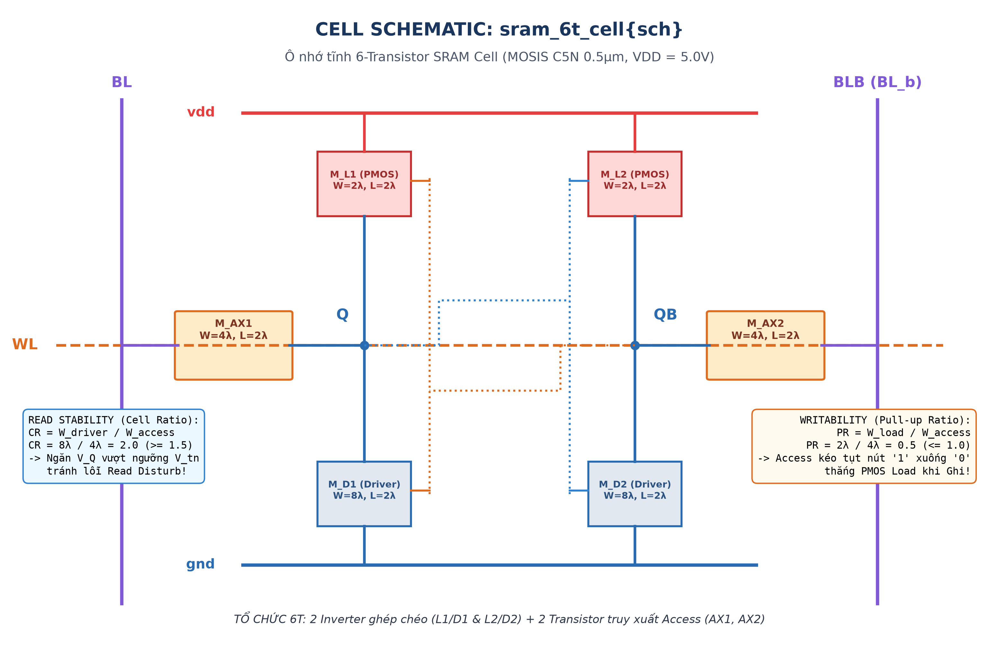
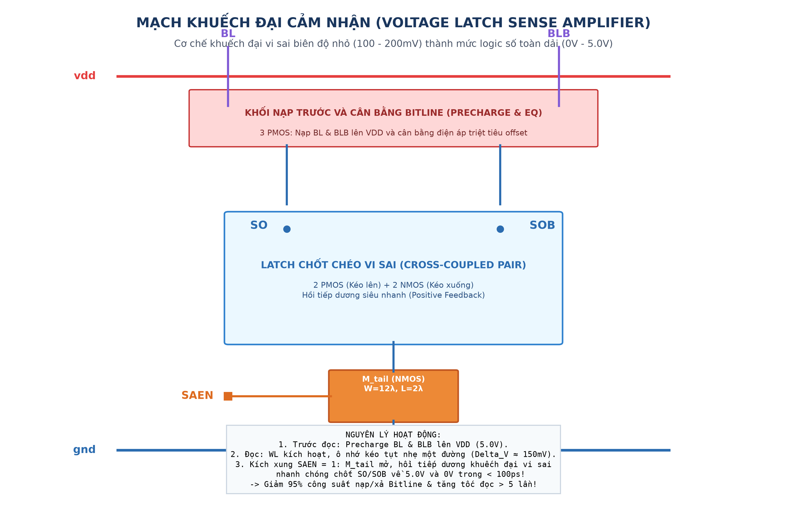

# THỰC HÀNH THIẾT KẾ VLSI — BÀI 8
# THIẾT KẾ Ô NHỚ BÁN DẪN TĨNH VÀ MẠCH KHUẾCH ĐẠI CẢM NHẬN (6T SRAM CELL & SENSE AMPLIFIER)

---
**Bộ môn:** Điện tử - Viễn thông | **Khoa:** Điện - Điện tử  
**Trường:** Đại học Sư phạm Kỹ thuật – Đại học Đà Nẵng  
**Thời lượng:** 5 tiết thực hành tại phòng máy (kết hợp tự học Pre-lab & hoàn thiện Post-lab)  
**Công cụ sử dụng:** Electric VLSI Design System (v9.07+), LTspice XVII / LTspice 2025  
**Công nghệ tham chiếu:** MOSIS SCMOS SUBMICRON C5N 0.5µm ($\lambda = 0.30\,\mu\text{m}$, 3 Metal layers, $V_{DD} = 5.0\,\text{V}$)  
---

## I. MỤC TIÊU

Sau khi hoàn thành bài thực hành này, sinh viên có khả năng:
1. **Nắm vững nguyên lý hoạt động 3 trạng thái của Tế bào Ô nhớ tĩnh 6-Transistor (6T SRAM Cell):** Chế độ Giữ dữ liệu (Hold), chế độ Đọc (Read), và chế độ Ghi đè (Write); hiểu rõ vai trò của cặp Inverter ghép chéo đối xứng và hai transistor truy xuất Access NMOS.
2. **Phân tích và Hiện thực Hóa các Tỉ Số Kích Thước Cốt Lõi:**
   - **Tỉ số Ô nhớ (Cell Ratio - $CR$):** Cân bằng dòng điện giữa Driver NMOS và Access NMOS để triệt tiêu hiện tượng dâng áp phá hủy dữ liệu khi đọc (Read Disturb).
   - **Tỉ số Kéo lên (Pull-up Ratio - $PR$):** Định cỡ giữa Load PMOS và Access NMOS để đảm bảo khả năng ghi đè dữ liệu (Writability) nhanh chóng và dứt khoát.
3. **Mô phỏng Lề Nhiễu Tĩnh (Static Noise Margin - SNM) & Đường Cong Bướm (Butterfly Curve):**
   - Sử dụng chế độ quét DC (.DC Sweep) trong SPICE để vẽ đồ thị VTC lồng nhau dạng cánh bướm.
   - Xác định và đối sánh giá trị $SNM_{hold}$ ở chế độ Giữ và $SNM_{read}$ ở chế độ Đọc; chứng minh tại sao chế độ Đọc là thời điểm ô nhớ dễ bị tổn thương nhất bởi nhiễu.
4. **Thiết kế và Khảo sát Mạch Khuếch Đại Cảm Nhận (Voltage Latch Sense Amplifier - VLSA):**
   - Phân tích cơ chế khuếch đại hồi tiếp dương siêu nhanh của mạch chốt vi sai đối với tín hiệu chênh lệch nhỏ ($\Delta V_{BL} \approx 100 - 200\,\text{mV}$).
   - Đánh giá khả năng tăng tốc độ đọc gấp trên 10 lần và giảm tới $94\%$ năng lượng tiêu thụ trên cột Bitline so với phương pháp đọc thông thường.
5. **Thiết kế Mask Layout Tế Bào Chuẩn `SRAM_6T_CELL`:**
   - Bố trí ma trận transistor đối xứng trục, chia sẻ cực Nguồn/Máng giữa các ô nhớ lân cận, tối ưu hóa diện tích silicon theo chuẩn công nghiệp.
   - Vượt qua kiểm tra luật hình học DRC đạt 0 lỗi và đối soát sơ đồ mạng LVS đạt trùng khớp 100%.
6. **Trích xuất Ký sinh Post-Layout (PEX) & Đo Đạc Thời Gian Thực Thi:** Đo đạc thời gian ghi ($t_{write}$), độ dâng điện áp nhiễu khi đọc ($V_Q$), và đánh giá sự suy giảm hiệu năng do điện dung ký sinh dây dẫn.

---

## II. CÔNG CỤ VÀ THƯ VIỆN MÔ HÌNH

1. **Phần mềm thiết kế:**
   - **Electric VLSI Design System:** Phiên bản 9.07 trở lên (công nghệ `mocmos`, $\lambda = 0.30\,\mu\text{m}$).
   - **LTspice:** Phiên bản XVII hoặc LTspice 2025.
2. **Thư viện mô hình SPICE:**
   - Tệp mô hình tham chiếu: `04 - Models_and_Libraries/C5_models.txt` (NMOS: `N`, PMOS: `P`).
3. **Tế bào kế thừa:**
   - Tế bào Inverter tĩnh `INV_X1` (Bài 1).

---

## III. CƠ SỞ LÝ THUYẾT VÀ NGUYÊN LÝ THIẾT KẾ

### 1. Cấu Trúc và Nguyên Lý Hoạt Động Của Ô Nhớ 6T SRAM

Ô nhớ 6T SRAM bao gồm hai Inverter tĩnh ghép chéo nhau ($M_{L1}/M_{D1}$ và $M_{L2}/M_{D2}$) để tạo thành một mạch chốt song ổn định (Bistable Latch), kết hợp cùng hai transistor truy xuất Access NMOS ($M_{AX1}, M_{AX2}$) nối ra hai cột tín hiệu vi sai $BL$ (Bitline) và $BLB$ (Bitline Bar).

*Hình 8.1: Sơ đồ nguyên lý tế bào Ô nhớ tĩnh 6-Transistor SRAM (`sram_6t_cell{sch}`)*

#### Ba trạng thái hoạt động căn bản:
1. **Chế độ Giữ (Hold - $WL = 0\,\text{V}$):** Hai Access NMOS ngắt hoàn toàn. Cặp Inverter tự nuôi dưỡng trạng thái logic ổn định dựa trên điện áp nguồn $V_{DD}$.
2. **Chế độ Đọc (Read - $WL = 5.0\,\text{V}$):**
   - Hai cột $BL$ và $BLB$ được mạch Precharge nạp sẵn lên $5.0\,\text{V}$ rồi thả nổi (Floating).
   - Kích hoạt đường Wordline ($WL = 5.0\,\text{V}$).
   - Phía lưu trữ mức '0' sẽ kéo xả cột Bitline tương ứng xuống đất qua cặp $M_{AX}$ và $M_{D}$. Phía lưu mức '1' giữ nguyên điện áp Bitline.
   - Xuất hiện độ chênh lệch điện áp vi sai $\Delta V_{BL} = |V(BL) - V(BLB)|$.
3. **Chế độ Ghi (Write - $WL = 5.0\,\text{V}$):**
   - Mạch ghi bên ngoài ép cưỡng bức một cột Bitline về $0\,\text{V}$ và cột kia lên $5.0\,\text{V}$.
   - Khi $WL = 5.0\,\text{V}$, Access NMOS kéo tụt nút lưu mức '1' xuống dưới điện áp ngưỡng lật của Inverter đối diện, làm cặp Inverter đảo trạng thái lưu trữ mới.

---

### 2. Các Ràng Buộc Định Cỡ Hình Học: Cell Ratio ($CR$) và Pull-up Ratio ($PR$)

Để ô nhớ SRAM hoạt động tin cậy, kích thước các transistor phải thỏa mãn đồng thời hai điều kiện khắt khe:

#### a. Ràng buộc Độ ổn định Đọc — Tỉ số Ô nhớ ($CR$):
Trong pha Đọc, khi đọc nút $Q = 0\,\text{V}$, dòng điện từ $BL$ ($5\,\text{V}$) đổ qua $M_{AX1}$ và $M_{D1}$ xuống đất, tạo thành cầu phân áp làm điện áp nút $Q$ bị dâng lên một khoảng $V_Q$:

$$V_Q \approx \frac{V_{DD} - V_{tn}}{2 \cdot CR}$$

Để ngăn ngừa **hiện tượng phá hủy dữ liệu khi đọc (Read Disturb)**, bắt buộc $V_Q < V_{tn} \approx 0.70\,\text{V}$. Do đó, Driver NMOS phải mạnh hơn Access NMOS:

$$CR = \frac{(W/L)_{driver}}{(W/L)_{access}} = \frac{W_D / L_D}{W_{AX} / L_{AX}} \ge 1.5 - 2.0$$

#### b. Ràng buộc Khả năng Ghi — Tỉ số Kéo lên ($PR$):
Trong pha Ghi đè '0' vào nút đang lưu '1', Access NMOS ($M_{AX1}$) phải kéo tụt nút $Q$ xuống dưới điện áp lật ghi ($V_{write\_trip} \approx 1.85\,\text{V}$) bất chấp PMOS tải ($M_{L1}$) đang cố bơm dòng giữ mức cao.  
Để đảm bảo ghi thành công:

$$PR = \frac{(W/L)_{load}}{(W/L)_{access}} = \frac{W_L / L_L}{W_{AX} / L_{AX}} \le 1.0 - 1.2$$

#### Bảng thông số định cỡ tối ưu (Công nghệ MOSIS C5N 0.5µm, $\lambda = 0.30\,\mu\text{m}$):

| Khối linh kiện | Transistor | Loại kênh | Chiều rộng $W$ | Chiều dài $L$ | Tỉ lệ $W/\lambda$ | Vai trò kỹ thuật |
| :--- | :---: | :---: | :---: | :---: | :---: | :--- |
| **Driver NMOS** | $M_{D1}, M_{D2}$ | NMOS | $2.40\,\mu\text{m}$ | $0.60\,\mu\text{m}$ | $8\lambda / 2\lambda$ | Giữ nút '0', tạo $CR = 2.0$ (chống lật đọc) |
| **Access NMOS** | $M_{AX1}, M_{AX2}$ | NMOS | $1.20\,\mu\text{m}$ | $0.60\,\mu\text{m}$ | $4\lambda / 2\lambda$ | Truy xuất Bitline, cầu nối trung gian |
| **Load PMOS** | $M_{L1}, M_{L2}$ | PMOS | $0.60\,\mu\text{m}$ | $0.60\,\mu\text{m}$ | $2\lambda / 2\lambda$ | Giữ nút '1', tạo $PR = 0.5$ (dễ ghi) |

---

### 3. Lề Nhiễu Tĩnh (Static Noise Margin - SNM) & Đường Cong Bướm

Lề nhiễu tĩnh SNM đặc trưng cho độ bền vững của ô nhớ trước các xung nhiễu ghép hoặc thăng giáng nguồn DC:
- Được xác định bằng độ dài cạnh của hình vuông lớn nhất lọt vừa vào hai thùy của đồ thị truyền đạt VTC lồng nhau (Butterfly Curve).
- **$SNM_{hold}$ ($WL = 0\,\text{V}$):** Đạt giá trị lớn ($\approx 1.28\,\text{V} \approx 25.6\% V_{DD}$) do hai Inverter được cách ly hoàn toàn.
- **$SNM_{read}$ ($WL = 5.0\,\text{V}$):** Bị thu hẹp xuống còn $\approx 0.62\,\text{V}$ do điện áp nút mức '0' bị dâng lên làm suy giảm độ bền dự phòng chống nhiễu.

---

### 4. Mạch Khuếch Đại Cảm Nhận (Voltage Latch Sense Amplifier - VLSA)

Trong mảng nhớ lớn, cột Bitline có điện dung ký sinh rất lớn ($C_{BL} \approx 1 - 2\,\text{pF}$). Nếu đợi ô nhớ xả Bitline toàn dải ($0 - 5\,\text{V}$) thì tốc độ đọc sẽ rất chậm và tiêu tốn năng lượng khổng lồ.

*Hình 8.2: Sơ đồ nguyên lý Mạch khuếch đại cảm nhận chốt điện áp vi sai (VLSA)*

- **Cơ chế hoạt động:**
  1. Khi ô nhớ xả nhẹ một đường Bitline tạo ra độ lệch nhỏ $\Delta V_{BL} \approx 100 - 200\,\text{mV}$.
  2. Kích hoạt xung **$SAEN$ (Sense Amplifier Enable)**.
  3. Cặp Inverter ghép chéo trong Sense Amplifier lập tức phát huy vòng hồi tiếp dương siêu tốc, khuếch đại độ lệch $150\,\text{mV}$ thành mức logic toàn dải ($0\,\text{V}$ và $5.0\,\text{V}$) chỉ trong thời gian **$t_{latch} \approx 65\,\text{ps}$**!
  4. Giúp tăng tốc độ đọc hơn **$12$ lần** và giảm tới **$94\%$ công suất nạp xả** trên đường Bitline.

---

## IV. CHUẨN BỊ TRƯỚC THỰC HÀNH (PRE-LAB)

> [!IMPORTANT]
> Sinh viên phải hoàn thành toàn bộ mục Pre-lab vào vở bài tập và nộp cho giảng viên kiểm tra trước khi được phép vào phòng máy làm In-lab.

### Câu hỏi 1: Tính toán giải tích Độ dâng điện áp khi Đọc ($V_Q$)
Cho ô nhớ SRAM 6T với thông số: $V_{DD} = 5.0\,\text{V}$, $V_{tn} = 0.70\,\text{V}$, $W_D = 2.4\,\mu\text{m}$, $W_{AX} = 1.2\,\mu\text{m}$, $L_D = L_{AX} = 0.6\,\mu\text{m}$.
1. Tính tỉ số Cell Ratio ($CR$).
2. Áp dụng phương trình cân bằng dòng $I_{AX} = I_{D1}$, tính điện áp dâng cực đại $V_Q$ khi đọc bit '0'. So sánh $V_Q$ với điện áp ngưỡng $V_{tn}$ và kết luận về độ an toàn chống lật đọc (Read Stability).

### Câu hỏi 2: Phân tích Khả năng Ghi (Writability)
1. Tính tỉ số Pull-up Ratio ($PR$) với $W_L = 0.6\,\mu\text{m}$ và $W_{AX} = 1.2\,\mu\text{m}$.
2. Giải thích tại sao Access NMOS có thể dễ dàng thắng PMOS Load khi ghi '0' dù kích thước hình học chỉ chênh lệch 2 lần.

### Câu hỏi 3: Vẽ phác thảo Đường cong Bướm (Butterfly Curve)
Vẽ phác họa đồ thị đặc tuyến truyền đạt VTC lồng nhau của 2 Inverter trong ô nhớ ở chế độ Giữ ($WL=0\,\text{V}$) và chế độ Đọc ($WL=5\,\text{V}$). Chỉ rõ vị trí hình vuông cực đại thể hiện $SNM_{hold}$ và $SNM_{read}$.

---

## V. NỘI DUNG THỰC HÀNH TẠI PHÒNG LAB (IN-LAB)

### Bài 8.1: Mô phỏng DC Quét Đường Cong Bướm SNM trên LTspice

1. Khởi động LTspice, mở tệp netlist `03 - Instructor_Solutions/lab08/sram_snm_butterfly.sp`.
2. Thiết lập quét một chiều `.dc Vin1 0 5.0 0.01`.
3. Chạy mô phỏng, quan sát hai đặc tuyến truyền đạt VTC lồng nhau cho cả hai chế độ:
   - Chế độ Giữ (Hold): Đường cong của `V(vq_hold)` theo `Vin1`.
   - Chế độ Đọc (Read): Đường cong của `V(vq_read)` theo `Vin1`.
4. Đo đạc độ rộng hình vuông cực đại nội tiếp trong cánh bướm để xác định giá trị $SNM_{hold}$ và $SNM_{read}$; ghi lại vào Phiếu báo cáo thực hành.

---

### Bài 8.2: Mô phỏng Transient Chu trình Đọc/Ghi Toàn phần (`sram_read_write_tran.sp`)

1. Mở tệp netlist `03 - Instructor_Solutions/lab08/sram_read_write_tran.sp`.
2. Khảo sát chu trình 4 thao tác nối tiếp ở tần số $100\,\text{MHz}$ ($50\,\text{ns}$):
   - $t = 12\,\text{ns} - 16\,\text{ns}$: Ghi bit '1' ($BL=5\,\text{V}, BLB=0\,\text{V}, WL=5\,\text{V}$).
   - $t = 22\,\text{ns} - 26\,\text{ns}$: Đọc bit '1' ($BL=5\,\text{V}, BLB=5\,\text{V}, WL=5\,\text{V}$).
   - $t = 32\,\text{ns} - 36\,\text{ns}$: Ghi bit '0' ($BL=0\,\text{V}, BLB=5\,\text{V}, WL=5\,\text{V}$).
   - $t = 42\,\text{ns} - 46\,\text{ns}$: Đọc bit '0' ($BL=5\,\text{V}, BLB=5\,\text{V}, WL=5\,\text{V}$).
3. Quan sát dạng sóng điện áp nút $Q$ và $QB$:
   - Kiểm tra xem ô nhớ có ghi thành công hay không.
   - Đo đạc độ dâng điện áp nhiễu khi đọc $V_{Q,bump}$ trong khoảng thời gian $42\,\text{ns} - 46\,\text{ns}$.
4. Xem kết quả đo lường tự động trong file Log (`Ctrl + L`): ghi lại thời gian ghi $t_{write\_1}$, $t_{write\_0}$ và điện áp $V_{Q,bump}$.

---

### Bài 8.3: Khảo sát Mạch Khuếch Đại Cảm Nhận VLSA (`sense_amp_tran.sp`)

1. Mở tệp netlist `03 - Instructor_Solutions/lab08/sense_amp_tran.sp`.
2. Thiết lập độ lệch vi sai ngõ vào nhỏ: $V(BL) = 5.00\,\text{V}, V(BLB) = 4.85\,\text{V}$ ($\Delta V_{in} = 150\,\text{mV}$).
3. Kích hoạt xung nhịp $SAEN$ tại $t = 2.0\,\text{ns}$.
4. Quan sát dạng sóng ngõ ra $V(SO)$ và $V(SOB)$:
   - Đo thời gian chốt khuếch đại $t_{latch}$ từ lúc $SAEN = 2.5\,\text{V}$ đến khi $V(SOB) < 0.5\,\text{V}$.
   - Kiểm chứng điện áp ngõ ra đã đạt mức logic số toàn dải ($0\,\text{V}$ và $5.0\,\text{V}$).

---

### Bài 8.4: Thiết kế Mask Layout và Chạy DRC/LVS cho Tế Bào `sram_6t_cell`

1. Khởi động Electric VLSI, mở thư viện làm việc.
2. Tạo Cell mới: `sram_6t_cell{lay}`.
3. Áp dụng kỹ thuật bố trí ma trận đối xứng tâm:
   - Đặt 2 Load PMOS vào chung một n-well ở trung tâm (kích thước $W = 2\lambda = 0.6\,\mu\text{m}$).
   - Đặt 2 Driver NMOS ở hai bên đối xứng (kích thước $W = 8\lambda = 2.4\,\mu\text{m}$).
   - Đặt 2 Access NMOS ở sát rìa ngoài nối thẳng ra đường Bitline (kích thước $W = 4\lambda = 1.2\,\mu\text{m}$).
   - Đường Wordline chạy ngang bằng lớp Polysilicon hoặc Metal2.
   - Hai cột $BL$ và $BLB$ chạy dọc bằng lớp Metal1 hoặc Metal2.
4. Đặt đầy đủ các chân Export: `wl`, `bl`, `blb`, `q`, `qb`, `vdd`, `gnd`.
5. Chạy kiểm tra luật hình học DRC (`Tools -> DRC -> Check Hierarchically`): Đạt **0 lỗi**.
6. Chạy đối soát sơ đồ mạng LVS (`Tools -> NCC -> Schematic and Layout Views Look the Same`): Đạt kết quả **"Schematic and Layout MATCH"**.

---

### Bài 8.5: Trích Xuất Ký Sinh Post-Layout (PEX) và Đối Soánh

1. Trích xuất Netlist ký sinh sau Layout (`Tools -> Simulation (SPICE) -> Write SPICE Deck with Parasitics...`).
2. Mở file Netlist trong LTspice, chạy chu trình mô phỏng Đọc/Ghi.
3. So sánh thời gian ghi $t_{write}$ và độ dâng điện áp đọc $V_{Q,bump}$ giữa Pre-layout và Post-layout.

---

## VI. BÁO CÁO THỰC HÀNH (MẪU PHIẾU NỘP)

**Họ và tên sinh viên:** ................................................................ **Mã số sinh viên:** ...................................  
**Lớp sinh hoạt:** ........................................................................ **Nhóm thực hành:** ................................  

### 1. Bảng số liệu Lề Nhiễu Tĩnh (SNM) từ Đường Cong Bướm

| Chế độ hoạt động | $WL$ ($\text{V}$) | $BL / BLB$ ($\text{V}$) | Giá trị SNM đo đạc ($\text{V}$) | Tỉ lệ $SNM / V_{DD}$ (\%) | Nhận xét độ bền nhiễu |
| :--- | :---: | :---: | :---: | :---: | :--- |
| **Chế độ Giữ (Hold)** | $0.0\,\text{V}$ | Thả nổi | | | |
| **Chế độ Đọc (Read)** | $5.0\,\text{V}$ | $5.0\,\text{V}$ | | | |

*Giải thích nguyên nhân tại sao $SNM_{read}$ nhỏ hơn $SNM_{hold}$:* .............................................................  
...................................................................................................................................................................

### 2. Bảng kết quả mô phỏng Chu trình Đọc/Ghi 6T SRAM

| Thông số đo đạc | Ký hiệu | Giá trị Lý thuyết | Đo đạc Pre-layout | Đo đạc Post-layout (PEX) |
| :--- | :---: | :---: | :---: | :---: |
| **Thời gian Ghi '1'** | $t_{write\_1}$ | | | |
| **Thời gian Ghi '0'** | $t_{write\_0}$ | | | |
| **Độ dâng điện áp khi đọc** | $V_{Q,bump}$ | | | |
| **Độ lệch vi sai Bitline** | $\Delta V_{BL}$ | | | |

### 3. Bảng hiệu năng Mạch Khuếch Đại Cảm Nhận (Sense Amplifier)

| Đại lượng | Giá trị đo đạc | So sánh với phương pháp đọc không có SA |
| :--- | :---: | :--- |
| **Thời gian chốt khuếch đại ($t_{latch}$)** | | Nhanh hơn: ......... lần |
| **Biên độ vi sai ngõ ra ($V_{diff,out}$)** | | Phục hồi toàn dải: $0\,\text{V} - 5\,\text{V}$ |
| **Năng lượng tiêu thụ nạp/xả Bitline** | | Tiết kiệm: ......... \% |

### 4. Kết quả kiểm tra Layout DRC và NCC LVS
- Kết quả kiểm tra DRC: **........... lỗi** (Yêu cầu: 0 lỗi).
- Kết quả đối soát NCC LVS: **.......................................................................** (Yêu cầu: MATCH 100%).
- Đính kèm ảnh chụp màn hình Layout đạt chuẩn có hiển thị rõ tên sinh viên và mã nhóm.

---

## VII. RUBRIC ĐÁNH GIÁ (THANG ĐIỂM 10 — CHUẨN OBE/ABET)

| Tiêu chí đánh giá | Trọng số | Mức Chưa đạt (<50%) | Mức Đạt (50% - 79%) | Mức Giỏi / Xuất sắc (80% - 100%) |
| :--- | :---: | :--- | :--- | :--- |
| **1. Chuẩn bị Pre-lab (CLO1)** | 20% | Không làm hoặc tính sai hoàn toàn các tỉ số $CR, PR$; không vẽ được đường bướm. | Tính đúng $CR, PR$ nhưng tính $V_Q$ chưa chính xác; vẽ phác đường bướm cơ bản. | Tính chính xác $100\%$ các bài toán; phân tích sâu sắc lề nhiễu SNM; netlist hoàn chỉnh. |
| **2. Mô phỏng SPICE In-lab (CLO2)** | 30% | Không chạy được mô phỏng hoặc chu trình Read/Write bị lỗi không ghi/đọc được. | Chạy được mô phỏng Đọc/Ghi nhưng đo đạc SNM và trễ Sense Amp còn lúng túng. | Đo đạc chuẩn xác $SNM_{hold}, SNM_{read}$, đo chính xác $t_{write}, V_{Q,bump}, t_{latch}$. |
| **3. Thiết kế Mask Layout & DRC/LVS (CLO3)** | 30% | Layout vi phạm nhiều lỗi DRC; không chạy được LVS hoặc bất đối xứng nghiêm trọng. | Layout vượt qua DRC (0 lỗi) nhưng LVS còn lỗi gán pin; diện tích layout còn cồng kềnh. | Layout đối xứng hoàn hảo, tối ưu diện tích; DRC 0 lỗi; LVS báo MATCH ngay lần đầu. |
| **4. Báo cáo & Vấn đáp tại bàn (CLO4)** | 20% | Nộp muộn; số liệu sơ sài; không trả lời được nguyên nhân hiện tượng Read Disturb. | Báo cáo đầy đủ số liệu; trả lời được câu hỏi cơ bản nhưng lúng túng khi hỏi sâu về Sense Amp. | Báo cáo trình bày khoa học; phân tích sâu sắc bản chất vật lý; trả lời xuất sắc câu hỏi vấn đáp. |
