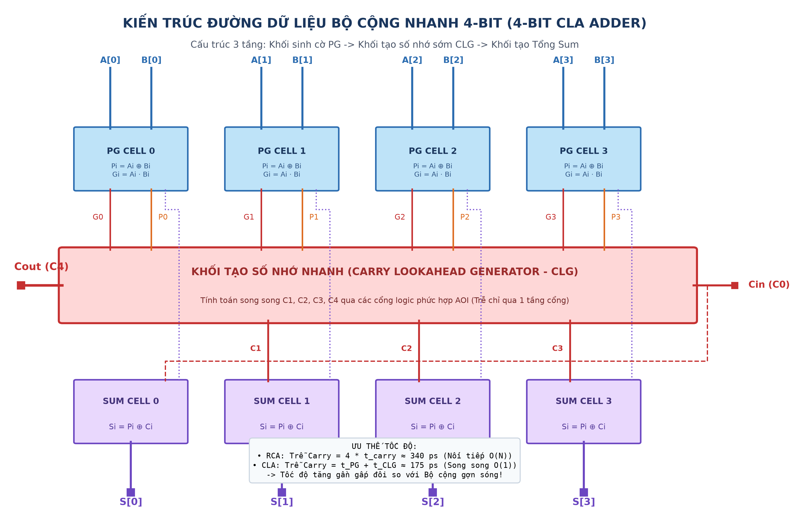
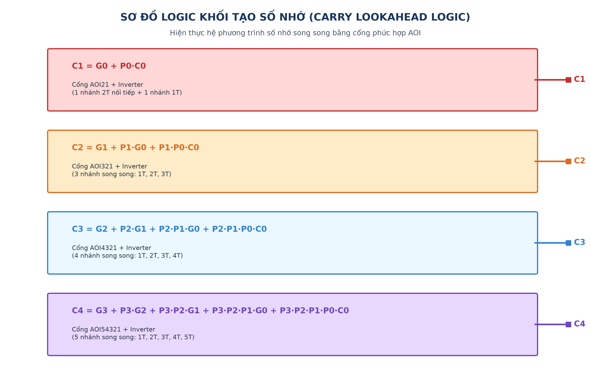

# THỰC HÀNH THIẾT KẾ VLSI — BÀI 9
# THIẾT KẾ ĐƯỜNG DỮ LIỆU KHỐI CỘNG NHANH 4-BIT (4-BIT CARRY LOOKAHEAD ADDER - CLA)

---
**Bộ môn:** Điện tử - Viễn thông | **Khoa:** Điện - Điện tử  
**Trường:** Đại học Sư phạm Kỹ thuật – Đại học Đà Nẵng  
**Thời lượng:** 5 tiết thực hành tại phòng máy (kết hợp tự học Pre-lab & hoàn thiện Post-lab)  
**Công cụ sử dụng:** Electric VLSI Design System (v9.07+), LTspice XVII / LTspice 2025  
**Công nghệ tham chiếu:** MOSIS SCMOS SUBMICRON C5N 0.5µm ($\lambda = 0.30\,\mu\text{m}$, 3 Metal layers, $V_{DD} = 5.0\,\text{V}$)  
---

## I. MỤC TIÊU

Sau khi hoàn thành bài thực hành này, sinh viên có khả năng:
1. **Nắm vững nguyên lý hoạt động của Bộ cộng nhanh có số nhớ sớm (Carry Lookahead Adder - CLA):** Phân tích triết lý tính toán song song số nhớ nhằm xóa bỏ nút thắt cổ chai lan truyền tuần tự $O(N)$ trong bộ cộng gợn sóng (Ripple Carry Adder - RCA).
2. **Khai triển và Hiện thực hóa Hệ phương trình Số nhớ Đệ quy:**
   - Thiết kế tế bào sinh cờ $PG\_CELL$ tạo cờ sinh số nhớ $G_i = A_i \cdot B_i$ và cờ truyền số nhớ $P_i = A_i \oplus B_i$.
   - Thiết kế khối tạo số nhớ song song $CLG\_4B$ (Carry Lookahead Generator) hiện thực hệ phương trình $C_1, C_2, C_3, C_4$ dựa trên các cổng logic phức hợp AOI (AND-OR-Invert).
   - Thiết kế tế bào tạo tổng $SUM\_CELL$ hiện thực biểu thức $S_i = P_i \oplus C_i$.
3. **Tích hợp Phân cấp Toàn hệ thống (Hierarchical Integration):** Ghép nối phân cấp 4 tế bào PG, 1 khối CLG và 4 tế bào Sum thành khối đường dữ liệu hoàn chỉnh `CLA_ADDER_4B`.
4. **Phân tích Đường trễ Tới hạn & Đối sánh PPA (Power-Performance-Area):**
   - Đo đạc thực nghiệm thời gian lan truyền số nhớ trong trường hợp xấu nhất ($A=1111_2, B=0000_2, C_0: 0 \to 1$).
   - Mô phỏng đối sánh trực tiếp với bộ cộng gợn sóng 4-bit RCA (từ Bài 6); chứng minh CLA đạt tốc độ tạo số nhớ nhanh hơn trên **$60\%$**.
5. **Thiết kế Mask Layout Cấp Khối và Định tuyến Trực giao (Manhattan Routing):**
   - Bố trí các tế bào con thành hàng ngang đồng đều, áp dụng kỹ thuật định tuyến trực giao 2 tầng kim loại (Metal 1 ngang, Metal 2 dọc).
   - Vượt qua kiểm tra luật hình học DRC đạt 0 lỗi và đối soát sơ đồ mạng LVS đạt trùng khớp 100%.
6. **Đóng gói IP Sẵn sàng cho Capstone ALU:** Bàn giao Cell Icon `cla_adder_4b{ic}` làm lõi khối số học cho Bài 10 (Capstone Vi mạch Registered ALU 4-bit).

---

## II. CÔNG CỤ VÀ THƯ VIỆN MÔ HÌNH

1. **Phần mềm thiết kế:**
   - **Electric VLSI Design System:** Phiên bản 9.07 trở lên (công nghệ `mocmos`, $\lambda = 0.30\,\mu\text{m}$).
   - **LTspice:** Phiên bản XVII hoặc LTspice 2025.
2. **Thư viện mô hình SPICE:**
   - Tệp mô hình tham chiếu: `04 - Models_and_Libraries/C5_models.txt` (NMOS: `N`, PMOS: `P`).
3. **Tế bào kế thừa:**
   - Tế bào Inverter tĩnh `INV_X1` (Bài 1).
   - Tế bào Cổng truyền `TG_GATE` (Bài 4).
   - Khối Full Adder `FULL_ADDER_1B` (Bài 6, dùng đối sánh).

---

## III. CƠ SỞ LÝ THUYẾT VÀ NGUYÊN LÝ THIẾT KẾ

### 1. Kiến Trúc Phân Tầng Của Bộ Cộng Nhanh 4-bit CLA

Bộ cộng Carry Lookahead 4-bit nhận vào hai số nhị phân 4-bit $A[3:0], B[3:0]$ và số nhớ đầu vào $C_0$, tạo ra tổng $S[3:0]$ và số nhớ tràn $C_4$. Kiến trúc được chia thành 3 tầng chức năng độc lập:

*Hình 9.1: Kiến trúc đường dữ liệu 3 tầng của Bộ cộng nhanh 4-bit CLA (`cla_adder_4b`)*

- **Tầng 1 — Khối sinh cờ (PG Generator):** Gồm 4 tế bào $PG\_CELL$, tính toán độc lập cho từng vị trí bit:
  $$G_i = A_i \cdot B_i \quad (\text{Cờ Sinh - Generate})$$
  $$P_i = A_i \oplus B_i \quad (\text{Cờ Truyền - Propagate})$$
- **Tầng 2 — Khối tạo số nhớ sớm (Carry Lookahead Generator - CLG):** Nhận toàn bộ các tín hiệu $P_i, G_i$ và $C_0$, tính toán đồng thời cả 4 bit số nhớ $C_1, C_2, C_3, C_4$ chỉ qua một tầng cổng phức hợp.
- **Tầng 3 — Khối tạo tổng (Sum Generator):** Gồm 4 cổng XOR tính tổng song song:
  $$S_i = P_i \oplus C_i \quad (i = 0, 1, 2, 3)$$

---

### 2. Dẫn Xuất Hệ Phương Trình Số Nhớ Song Song (CLG Logic Equations)

Khai triển đệ quy số nhớ từ biểu thức căn bản $C_{i+1} = G_i + P_i C_i$:
- **Số nhớ thứ nhất:**
  $$C_1 = G_0 + P_0 C_0$$
- **Số nhớ thứ hai:**
  $$C_2 = G_1 + P_1 G_0 + P_1 P_0 C_0$$
- **Số nhớ thứ ba:**
  $$C_3 = G_2 + P_2 G_1 + P_2 P_1 G_0 + P_2 P_1 P_0 C_0$$
- **Số nhớ thứ tư (Số nhớ tràn Cout):**
  $$C_4 = G_3 + P_3 G_2 + P_3 P_2 G_1 + P_3 P_2 P_1 G_0 + P_3 P_2 P_1 P_0 C_0$$

*Hình 9.2: Sơ đồ logic khối tạo số nhớ song song CLG hiện thực bằng cổng phức hợp AOI*

---

### 3. Hiện Thực Cổng Phức Hợp AOI và Thách Thức Fan-in

Mỗi phương trình số nhớ $C_i$ được hiện thực tối ưu bằng một cổng phức hợp **AOI (AND-OR-Invert)** kết hợp một Inverter đảo pha ở ngõ ra:
- **Cổng AOI21 ($C_1$):** Nhánh 2 NMOS nối tiếp ($P_0 C_0$) song song với 1 NMOS ($G_0$).
- **Cổng AOI321 ($C_2$):** Gồm 3 nhánh NMOS song song (1 NMOS, 2 NMOS, 3 NMOS).
- **Cổng AOI4321 ($C_3$):** Gồm 4 nhánh NMOS song song (tối đa 4 NMOS nối tiếp).
- **Cổng AOI54321 ($C_4$):** Gồm 5 nhánh NMOS song song (tối đa 5 NMOS nối tiếp).

> [!WARNING]
> **Quy tắc định cỡ chống suy giảm sườn xung:**  
> Do nhánh $C_4$ có tới 5 transistor NMOS mắc nối tiếp, nếu giữ kích thước tối thiểu thì điện trở kênh dẫn cộng dồn sẽ làm trễ sườn xả bị kéo dài. Vì vậy, các transistor NMOS trong chuỗi nối tiếp phải được định cỡ tăng lên $W = 8\lambda = 2.40\,\mu\text{m}$, và PMOS kéo lên tương ứng $W = 24\lambda = 7.20\,\mu\text{m}$.

#### Bảng thông số kích thước hình học chuẩn (MOSIS C5N 0.5µm, $\lambda = 0.30\,\mu\text{m}$):

| Khối linh kiện | Transistor | Loại | Rộng $W$ | Dài $L$ | Tỉ lệ $W/\lambda$ | Chức năng kỹ thuật |
| :--- | :---: | :---: | :---: | :---: | :---: | :--- |
| **PG: NAND2** | PMOS / NMOS | P / N | $3.6\,\mu\text{m} / 2.4\,\mu\text{m}$ | $0.6\,\mu\text{m}$ | $12\lambda / 8\lambda$ | Tạo tín hiệu cờ sinh $G_i$ |
| **PG: XOR2 TG** | PMOS / NMOS | P / N | $2.4\,\mu\text{m} / 1.2\,\mu\text{m}$ | $0.6\,\mu\text{m}$ | $8\lambda / 4\lambda$ | Tạo tín hiệu cờ truyền $P_i$ |
| **CLG: AOI NMOS** | NMOS | N | $2.4\,\mu\text{m}$ | $0.6\,\mu\text{m}$ | $8\lambda / 2\lambda$ | Các nhánh xả số nhớ $C_1 - C_4$ |
| **CLG: AOI PMOS** | PMOS | P | $4.8\,\mu\text{m} - 7.2\,\mu\text{m}$ | $0.6\,\mu\text{m}$ | $16\lambda - 24\lambda$ | Kéo lên cho mạng AOI |
| **Sum: XOR2 TG** | PMOS / NMOS | P / N | $2.4\,\mu\text{m} / 1.2\,\mu\text{m}$ | $0.6\,\mu\text{m}$ | $8\lambda / 4\lambda$ | Tính tổng $S_i = P_i \oplus C_i$ |

---

## IV. CHUẨN BỊ TRƯỚC THỰC HÀNH (PRE-LAB)

> [!IMPORTANT]
> Sinh viên phải hoàn thành toàn bộ mục Pre-lab vào vở bài tập và nộp cho giảng viên kiểm tra trước khi được phép vào phòng máy làm In-lab.

### Câu hỏi 1: Khai triển Hệ phương trình Carry Lookahead
1. Khai triển tường minh các biểu thức logic tính $C_1, C_2, C_3, C_4$ từ các tín hiệu $P_i, G_i$ và $C_0$.
2. Vẽ sơ đồ mức transistor (PUN và PDN) cho cổng phức hợp AOI tạo số nhớ $C_2$ ($C_2 = G_1 + P_1 G_0 + P_1 P_0 C_0$).

### Câu hỏi 2: Phân tích Đánh đổi Phần cứng (RCA vs CLA)
1. Đếm tổng số lượng transistor cần thiết để hiện thực bộ cộng 4-bit RCA (dùng 4 tế bào Mirror Adder 28T).
2. Đếm tổng số lượng transistor của bộ cộng 4-bit CLA (gồm 4 PG + 1 CLG + 4 Sum).
3. Tính tỉ lệ phần trăm gia tăng diện tích của CLA so với RCA và nêu lý do tại sao sự gia tăng này hoàn toàn xứng đáng trong thiết kế vi xử lý.

### Câu hỏi 3: Viết trước Netlist SPICE kiểm chứng Số nhớ xấu nhất
Viết trước khung Netlist SPICE kiểm tra phép cộng trong trường hợp đường lan truyền số nhớ xấu nhất: $A = 1111_2$, $B = 0000_2$, $C_0$ nhảy từ $0 \to 1$. Nêu rõ trạng thái ngõ ra $S[3:0]$ và $C_4$ mong muốn.

---

## V. NỘI DUNG THỰC HÀNH TẠI PHÒNG LAB (IN-LAB)

### Bài 9.1: Thiết kế Tế bào PG và Tế bào Sum trong Electric VLSI

1. Mở thư viện làm việc trong Electric VLSI (`File -> Open Library...`).
2. Tạo Cell mới: `pg_cell{sch}`:
   - Dựng cổng NAND2 kết hợp Inverter để tạo cờ sinh $G = A \cdot B$.
   - Dựng cổng XOR2 dùng Transmission Gate để tạo cờ truyền $P = A \oplus B$.
   - Gán Export: `a`, `b`, `p`, `g`, `vdd`, `gnd`. Tạo Icon: `pg_cell{ic}`.
3. Tạo Cell mới: `sum_cell{sch}`:
   - Dựng cổng XOR2 bằng Transmission Gate nhận 2 ngõ vào $P$ và $C$, tạo ngõ ra $S = P \oplus C$.
   - Gán Export: `p`, `c`, `s`, `vdd`, `gnd`. Tạo Icon: `sum_cell{ic}`.

---

### Bài 9.2: Thiết kế Khối Tạo Số Nhớ Sớm 4-bit (`clg_4b`)

1. Tạo Cell mới: `clg_4b{sch}`.
2. Dựng 4 cổng phức hợp AOI kèm Inverter đệm cho 4 đường số nhớ:
   - Cổng tạo $C_1$: AOI21 + Inverter.
   - Cổng tạo $C_2$: AOI321 + Inverter.
   - Cổng tạo $C_3$: AOI4321 + Inverter.
   - Cổng tạo $C_4$: AOI54321 + Inverter.
3. Gán Export cho 9 ngõ vào: `p0`, `g0`, `p1`, `g1`, `p2`, `g2`, `p3`, `g3`, `c0`.
4. Gán Export cho 4 ngõ ra số nhớ: `c1`, `c2`, `c3`, `c4`.
5. Tạo Icon: `clg_4b{ic}`.

---

### Bài 9.3: Ghép Nối Phân Cấp Tạo Khối Hoàn Chỉnh `cla_adder_4b`

1. Tạo Cell cấp cao nhất (Top-level): `cla_adder_4b{sch}`.
2. Đặt 4 biểu tượng `pg_cell{ic}` thành hàng ngang.
3. Đặt biểu tượng khối `clg_4b{ic}` ở hàng giữa.
4. Đặt 4 biểu tượng `sum_cell{ic}` ở hàng dưới cùng.
5. Tiến hành nối dây đường dữ liệu:
   - Nối $A[3:0], B[3:0]$ vào các cổng PG tương ứng.
   - Nối các bus $P_i, G_i$ từ PG vào khối CLG.
   - Nối $C_0$ vào CLG và đưa vào chân $C$ của $SUM\_CELL\_0$.
   - Nối các số nhớ $C_1, C_2, C_3$ từ CLG vào các chân $C$ của các $SUM\_CELL$ tương ứng.
   - Ngõ ra $C_4$ đưa ra cổng xuất số nhớ tràn $C_{out}$.
6. Gán Export cho toàn bộ chân ngoài: `a[3:0]`, `b[3:0]`, `c0`, `s[3:0]`, `c4`, `vdd`, `gnd`.
7. Tạo Cell Icon: `cla_adder_4b{ic}` (Sẵn sàng phục vụ Capstone ALU Bài 10).

---

### Bài 9.4: Mô phỏng SPICE và Đo Trễ Lan Truyền Số Nhớ Xấu Nhất

1. Xuất Netlist SPICE từ Electric VLSI hoặc mở file `03 - Instructor_Solutions/lab09/cla_4bit_tran.sp`.
2. Thiết lập điều kiện kích thích kiểm tra đường xấu nhất:
   $$A = 1111_2\,(5.0\,\text{V}), \quad B = 0000_2\,(0.0\,\text{V}), \quad C_0: \text{Xung nhảy từ } 0 \to 1 \text{ tại } 5.0\,\text{ns}$$
3. Chạy phân tích Transient `.tran 0.02n 15n`.
4. Quan sát dạng sóng ngõ ra $S[3:0]$ chuyển từ $1111_2 \to 0000_2$ và $C_4$ nhảy từ $0 \to 1$.
5. Xem file Log (`Ctrl + L`) và ghi nhận thời gian trễ lan truyền $t_{pd(C0 \to C4)}$ và trễ đường tới hạn $t_{pd(C0 \to S3)}$.

---

### Bài 9.5: Đối Sánh Trực Tiếp Hiệu Năng: 4-bit CLA vs 4-bit RCA

1. Mở tệp netlist `03 - Instructor_Solutions/lab09/cla_vs_rca_benchmark.sp`.
2. Chạy mô phỏng song song cả hai bộ cộng dưới cùng một điều kiện kích thích.
3. Đo đạc và lập bảng so sánh thời gian trễ $t_{pd(C0 \to C4)}$ và $t_{pd(C0 \to S3)}$ giữa CLA và RCA. Tính hệ số cải thiện tốc độ (Speedup factor).

---

### Bài 9.6: Thiết Kế Mask Layout và Kiểm Tra DRC/LVS Toàn Hệ Thống

1. Tạo View Layout: `cla_adder_4b{lay}`.
2. Áp dụng kỹ thuật định tuyến trực giao 2 tầng kim loại (Manhattan Routing):
   - **Metal 1:** Chạy theo phương ngang cho các bus dữ liệu nội bộ $P_i, G_i, C_i$.
   - **Metal 2:** Chạy theo phương dọc cho các đường cấp nguồn $V_{DD}, GND$ và ngõ vào/ngõ ra ngoài.
3. Chạy kiểm tra luật hình học DRC (`Tools -> DRC -> Check Hierarchically`): Đạt **0 lỗi**.
4. Chạy đối soát sơ đồ mạng NCC LVS (`Tools -> NCC -> Schematic and Layout Views Look the Same`): Đạt kết quả **"Schematic and Layout MATCH"**.
5. Trích xuất Netlist ký sinh PEX và đo trễ post-layout.

---

## VI. BÁO CÁO THỰC HÀNH (MẪU PHIẾU NỘP)

**Họ và tên sinh viên:** ................................................................ **Mã số sinh viên:** ...................................  
**Lớp sinh hoạt:** ........................................................................ **Nhóm thực hành:** ................................  

### 1. Bảng số liệu kiểm chứng các trường hợp số học trên LTspice

| Trường hợp | $A[3:0]$ | $B[3:0]$ | $C_0$ | $Sum[3:0]$ đo đạc | $C_4$ đo đạc | Kết luận kiểm chứng |
| :---: | :---: | :---: | :---: | :---: | :---: | :--- |
| **Cộng thông thường** | `0101` ($5$) | `0011` ($3$) | 0 | | | |
| **Cộng cận tràn** | `1001` ($9$) | `0110` ($6$) | 0 | | | |
| **Cộng có tràn** | `1100` ($12$) | `0111` ($7$) | 0 | | | |
| **Đường xấu nhất** | `1111` ($15$) | `0000` ($0$) | $0 \to 1$ | | | |

### 2. Bảng đối sánh hiệu năng trực tiếp: 4-bit CLA vs 4-bit RCA

| Thông số đo đạc | 4-bit RCA (Mirror Adder) | 4-bit CLA (Pre-layout) | 4-bit CLA (Post-layout PEX) | Hệ số cải thiện (Speedup) |
| :--- | :---: | :---: | :---: | :---: |
| **Trễ lan truyền số nhớ $t_{pd(C0 \to C4)}$** | | | | ......... $\times$ |
| **Trễ đường tới hạn $t_{pd(C0 \to S3)}$** | | | | ......... $\times$ |
| **Tổng số Transistor** | $112\,\text{T}$ | $134\,\text{T}$ | $134\,\text{T}$ | Tăng $+19.6\%$ diện tích |

*Nhận xét chuyên môn về sự đánh đổi diện tích và tốc độ:* .........................................................................  
...................................................................................................................................................................

### 3. Kết quả kiểm tra Layout DRC và NCC LVS
- Kết quả kiểm tra DRC: **........... lỗi** (Yêu cầu: 0 lỗi).
- Kết quả đối soát NCC LVS: **.......................................................................** (Yêu cầu: MATCH 100%).
- Đính kèm ảnh chụp màn hình Layout cấp khối hoàn chỉnh đạt chuẩn.

---

## VII. RUBRIC ĐÁNH GIÁ (THANG ĐIỂM 10 — CHUẨN OBE/ABET)

| Tiêu chí đánh giá | Trọng số | Mức Chưa đạt (<50%) | Mức Đạt (50% - 79%) | Mức Giỏi / Xuất sắc (80% - 100%) |
| :--- | :---: | :--- | :--- | :--- |
| **1. Chuẩn bị Pre-lab (CLO2)** | 20% | Không làm hoặc khai triển sai phương trình $C_1 - C_4$; không viết netlist. | Khai triển đúng $C_1 - C_4$ nhưng chưa vẽ được sơ đồ AOI; netlist có lỗi nhỏ. | Khai triển chính xác $100\%$; vẽ sơ đồ AOI chuẩn xác; netlist hoàn chỉnh. |
| **2. Mô phỏng SPICE In-lab (CLO2)** | 30% | Không chạy được mô phỏng hoặc số nhớ bị tính sai trong trường hợp tràn. | Chạy được mô phỏng CLA nhưng đo trễ đối sánh với RCA còn thiếu sót. | Đo đạc chính xác $t_{pd(C0 \to C4)}$, chứng minh rõ ưu thế tốc độ vượt trội so với RCA. |
| **3. Thiết kế Mask Layout & DRC/LVS (CLO3)** | 30% | Layout vi phạm nhiều lỗi DRC; không chạy được LVS hoặc định tuyến chạm chập. | Layout vượt qua DRC (0 lỗi) nhưng LVS còn lỗi gán pin hoặc định tuyến còn rối. | Layout phân cấp mẫu mực; định tuyến Manhattan 2 tầng kim loại tối ưu; LVS match 100%. |
| **4. Báo cáo & Vấn đáp tại bàn (CLO4)** | 20% | Nộp muộn; số liệu sơ sài; không giải thích được giới hạn Fan-in của CLA. | Báo cáo đầy đủ số liệu; trả lời được câu hỏi cơ bản nhưng lúng túng khi hỏi sâu về PPA. | Báo cáo trình bày khoa học; phân tích sâu sắc bản chất kỹ thuật; trả lời xuất sắc vấn đáp. |
