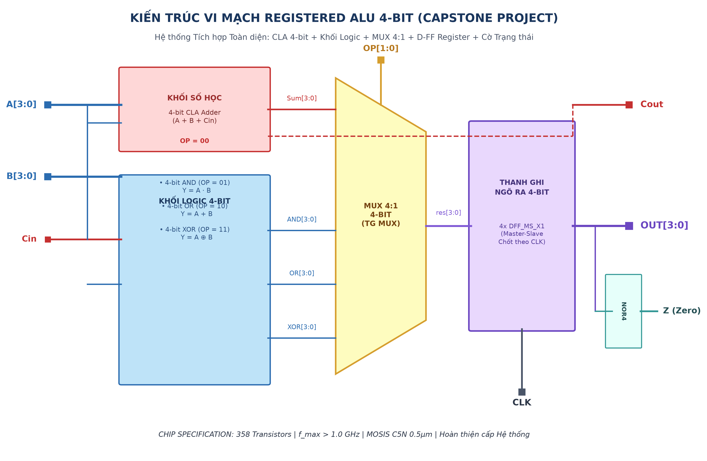
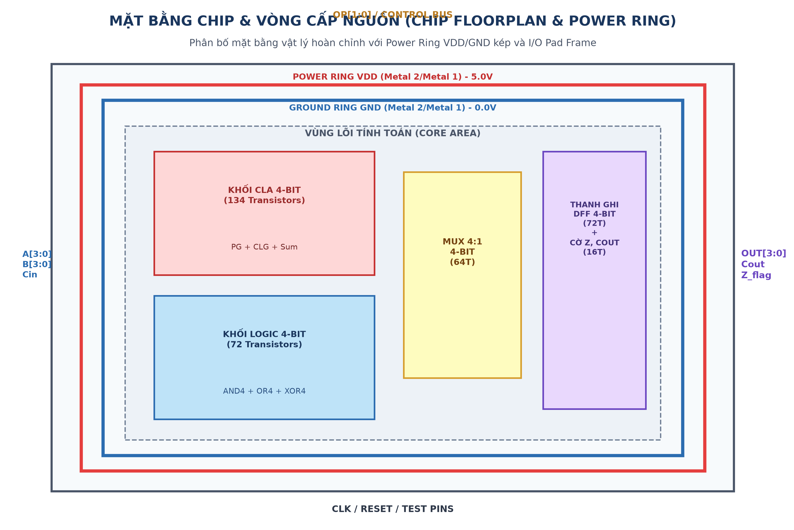

# THỰC HÀNH THIẾT KẾ VLSI — BÀI 10 (CAPSTONE PROJECT)
# TÍCH HỢP VI MẠCH 4-BIT REGISTERED ALU VÀ XÁC THỰC VẬT LÝ TOÀN DIỆN

---
**Bộ môn:** Điện tử - Viễn thông | **Khoa:** Điện - Điện tử  
**Trường:** Đại học Sư phạm Kỹ thuật – Đại học Đà Nẵng  
**Thời lượng:** 5 tiết thực hành tại phòng máy (kết hợp tự học Pre-lab & chuẩn bị báo cáo bảo vệ)  
**Công cụ sử dụng:** Electric VLSI Design System (v9.07+), LTspice XVII / LTspice 2025  
**Công nghệ tham chiếu:** MOSIS SCMOS SUBMICRON C5N 0.5µm ($\lambda = 0.30\,\mu\text{m}$, 3 Metal layers, $V_{DD} = 5.0\,\text{V}$)  
---

## I. MỤC TIÊU (CAPSTONE LEARNING OUTCOMES)

Bài 10 là **Đồ án Đỉnh cao (Capstone Project)** của toàn bộ học phần Thực hành Thiết kế VLSI. Sau khi hoàn thành bài này, sinh viên có khả năng:
1. **Làm chủ quy trình thiết kế vi mạch tích hợp cỡ lớn (Full-Custom VLSI Flow):** Hiện thực hóa hoàn chỉnh từ sơ đồ nguyên lý cấp transistor, mô phỏng chức năng và thời gian SPICE, thiết kế mặt bằng vật lý (Floorplanning) với vòng cấp nguồn bảo vệ (Power Ring), kiểm tra luật hình học DRC cấp chip, đối chiếu sơ đồ LVS cấp chip, đến trích xuất ký sinh PEX và mô phỏng sau đóng gói Post-layout.
2. **Tích hợp Hệ thống Đường dữ liệu Đồng bộ (Synchronous Datapath Integration):**
   - Ghép nối khối Số học cộng nhanh 4-bit `CLA_ADDER_4B` (từ Bài 9).
   - Ghép nối khối Logic 4-bit (4-bit AND, OR, XOR mức transistor).
   - Thiết kế khối chọn lệnh dồn kênh 4:1 4-bit (`MUX4_TG` 4-bit) điều khiển bởi 2 bit `OP[1:0]`.
   - Tích hợp khối Thanh ghi ngõ ra 4-bit `DFF_REG4` (Master-Slave D-Flip-Flop chốt theo xung nhịp `CLK`).
   - Thiết kế khối tạo cờ trạng thái: Cờ Zero ($Z = 1$ khi $OUT[3:0] = 0000_2$) và Cờ Số nhớ tràn ($C_{out}$).
3. **Phân tích và Đóng khép Thời gian (Timing Closure):** Đo đạc đường trễ tới hạn dài nhất (Worst-case Critical Path), thời gian thiết lập ($t_{setup}$), thời gian trễ Clock-to-Q ($t_{c-q}$) và xác định tần số xung nhịp tối đa của vi mạch ($f_{max} \ge 1.0\,\text{GHz}$).
4. **Đảm bảo Toàn vẹn Nguồn điện (Power Integrity):** Thiết kế Vòng cấp nguồn đôi (Dual Power Ring $V_{DD}/GND$) bao quanh chu vi chip, giảm thiểu sụt áp $IR\text{-}Drop < 50\,\text{mV}$ ($< 1\% V_{DD}$) khi cả 358 transistor chuyển mạch đồng thời.
5. **Nghiệm thu Vi mạch Chuẩn Công nghiệp:** Bàn giao bộ hồ sơ thiết kế hoàn chỉnh gồm: Schematic cấp chip, Mask Layout 0 lỗi DRC, LVS Match 100%, Báo cáo Datasheet đo đạc PEX và bảo vệ đồ án trước hội đồng giảng viên.

---

## II. CÔNG CỤ VÀ THƯ VIỆN MÔ HÌNH

1. **Phần mềm thiết kế:**
   - **Electric VLSI Design System:** Phiên bản 9.07 trở lên (công nghệ `mocmos`, $\lambda = 0.30\,\mu\text{m}$).
   - **LTspice:** Phiên bản XVII hoặc LTspice 2025.
2. **Thư viện mô hình SPICE:**
   - Tệp mô hình tham chiếu: `04 - Models_and_Libraries/C5_models.txt` (NMOS: `N`, PMOS: `P`).
3. **Các khối IP kế thừa xuyên suốt khóa học:**
   - `INV_X1` (Bài 1) & `NAND2_X1`, `NOR2_X1` (Bài 2).
   - `TG_GATE`, `MUX2_TG`, `MUX4_TG` (Bài 4).
   - `DFF_MS_X1` (Bài 5) $\implies$ Khối thanh ghi 4-bit `DFF_REG4`.
   - `CLA_ADDER_4B` (Bài 9) $\implies$ Khối lõi số học 4-bit.

---

## III. CƠ SỞ LÝ THUYẾT VÀ KIẾN TRÚC VI MẠCH

### 1. Kiến Trúc Toàn Hệ Thống 4-bit Registered ALU

Vi mạch Registered ALU 4-bit nhận vào hai toán hạng nhị phân $A[3:0], B[3:0]$, số nhớ ngõ vào $C_{in}$, 2 bit chọn chức năng lệnh $OP[1:0]$, và xung nhịp hệ thống $CLK$. Dữ liệu kết quả $OUT[3:0]$ và các cờ trạng thái $C_{out}, Z$ được chốt đồng bộ tại ngõ ra theo sườn lên của $CLK$.

*Hình 10.1: Sơ đồ kiến trúc toàn hệ thống Vi mạch Registered ALU 4-bit (`alu_4b_reg`)*

#### Bảng mã lệnh và chức năng ALU (`OP[1:0]`):

| Mã lệnh `OP[1:0]` | Tên phép toán | Biểu thức thực thi | Cờ $C_{out}$ | Cờ Zero ($Z$) | Ghi chú kỹ thuật |
| :---: | :---: | :--- | :---: | :---: | :--- |
| **`00`** | **ADD** | $Y = A + B + C_{in}$ | Cập nhật từ CLA | $Z = 1$ nếu $Y = 0$ | Phép cộng nhanh CLA 4-bit |
| **`01`** | **AND** | $Y = A \text{ AND } B$ | $0$ | $Z = 1$ nếu $Y = 0$ | Phép VÀ bitwise (NAND2 + INV) |
| **`10`** | **OR** | $Y = A \text{ OR } B$ | $0$ | $Z = 1$ nếu $Y = 0$ | Phép HOẶC bitwise (NOR2 + INV) |
| **`11`** | **XOR** | $Y = A \oplus B$ | $0$ | $Z = 1$ nếu $Y = 0$ | Phép XOR bitwise (Transmission Gate) |

---

### 2. Thiết Kế Mặt Bằng Vật Lý (Floorplan) & Vòng Cấp Nguồn (Power Ring)

Để đảm bảo khả năng chế tạo và chống sụt áp động $IR\text{-}Drop$, mặt bằng layout cấp chip được phân vùng khoa học:

*Hình 10.2: Sơ đồ phân bố mặt bằng chip (Floorplan) và Vòng cấp nguồn đôi $V_{DD}/GND$*

- **Phân vùng lõi (Core Placement):**
  * Cột trái: Khối Số học CLA4 ($134\text{T}$) và Khối Logic 4-bit ($72\text{T}$).
  * Cột giữa: Khối Dồn kênh chọn lệnh MUX 4:1 4-bit ($64\text{T}$).
  * Cột phải: Khối Thanh ghi ngõ ra DFF 4-bit ($72\text{T}$) và Khối Cờ trạng thái ($16\text{T}$).
- **Vòng cấp nguồn kép (Dual Power Ring):**
  * Vòng ngoài ($V_{DD}$): Kim loại Metal 2 chạy dọc và Metal 1 chạy ngang, bề rộng $W_{ring} = 24\lambda = 7.2\,\mu\text{m}$.
  * Vòng trong ($GND$): Bề rộng $W_{ring} = 24\lambda = 7.2\,\mu\text{m}$.
  * Giúp phân tán dòng điện đều khắp mọi góc chip, triệt tiêu sụt áp động $IR\text{-}Drop < 50\,\text{mV}$.

---

## IV. CHUẨN BỊ TRƯỚC THỰC HÀNH (PRE-LAB)

> [!IMPORTANT]
> Sinh viên phải hoàn thành toàn bộ mục Pre-lab vào vở bài tập và nộp cho giảng viên kiểm tra trước khi được phép vào phòng máy làm In-lab.

### Câu hỏi 1: Lập Bảng Kiểm Thử Toàn Diện (Test Program Verification)
Lập bảng tính tay giá trị ngõ ra $OUT[3:0]$, cờ $C_{out}$ và cờ $Z$ cho chuỗi 5 lệnh kiểm tra sau:
1. Lệnh 1: `OP = 00` (ADD), $A = 0101_2\,(5), B = 0011_2\,(3), C_{in} = 0$.
2. Lệnh 2: `OP = 00` (ADD tràn), $A = 1100_2\,(12), B = 0100_2\,(4), C_{in} = 0$.
3. Lệnh 3: `OP = 01` (AND), $A = 1010_2\,(10), B = 1100_2\,(12)$.
4. Lệnh 4: `OP = 10` (OR), $A = 1010_2\,(10), B = 0101_2\,(5)$.
5. Lệnh 5: `OP = 11` (XOR bằng nhau), $A = 1001_2\,(9), B = 1001_2\,(9)$.

### Câu hỏi 2: Phân Tích Ngân Sách Thời Gian (Timing Budget)
1. Xác định đường tới hạn dài nhất của vi mạch ALU 4-bit.
2. Cho biết: $t_{c-q} = 110\,\text{ps}$, $t_{CLA4} = 230\,\text{ps}$, $t_{MUX4} = 65\,\text{ps}$, $t_{setup} = 75\,\text{ps}$, dung sai lệch pha xung nhịp $t_{skew} = 40\,\text{ps}$.
   - Tính chu kỳ xung nhịp tối thiểu $T_{clk,min}$.
   - Tính tần số xung nhịp cực đại lý thuyết $f_{max}$ của vi mạch.

---

## V. NỘI DUNG THỰC HÀNH TẠI PHÒNG LAB (IN-LAB)

### Bài 10.1: Thiết Kế Khối Logic 4-bit (`logic_unit_4b`)

1. Mở thư viện làm việc trong Electric VLSI (`File -> Open Library...`).
2. Tạo Cell mới: `logic_unit_4b{sch}`.
3. Bố trí 4 cổng AND (NAND2 + INV), 4 cổng OR (NOR2 + INV), và 4 cổng XOR (dùng Transmission Gate từ Bài 4).
4. Gán Export cho các bus vào $A[3:0], B[3:0]$ và các bus ra `and_out[3:0]`, `or_out[3:0]`, `xor_out[3:0]`.
5. Tạo Cell Icon: `logic_unit_4b{ic}`.

---

### Bài 10.2: Thiết Kế Khối Dồn Kênh MUX 4:1 4-bit (`mux4_4b`)

1. Tạo Cell mới: `mux4_4b{sch}`.
2. Bố trí 4 tế bào dồn kênh 1-bit `mux4_1b` (sử dụng 4 cặp Cổng truyền Transmission Gate).
3. Ngõ vào chọn lệnh gồm 2 bit `op0` và `op1` (kèm Inverter tạo tín hiệu bù).
4. Gán Export: 4 bus dữ liệu vào 4-bit, 2 bit điều khiển `op[1:0]`, và bus dữ liệu chọn ngõ ra `res[3:0]`.
5. Tạo Cell Icon: `mux4_4b{ic}`.

---

### Bài 10.3: Thiết Kế Khối Thanh Ghi Ngõ Ra và Cờ Trạng Thái

1. Tạo Cell mới: `dff_reg4{sch}`:
   - Đặt 4 tế bào `dff_ms_x1` (Master-Slave D-FF từ Bài 5) chốt song song theo xung nhịp `clk`.
   - Tạo Icon: `dff_reg4{ic}`.
2. Tạo Cell mới: `flag_unit{sch}`:
   - Dựng cổng NOR 4-ngõ vào nối với 4 bit kết quả `OUT[3:0]` để tạo cờ Zero ($Z$).
   - Đặt DFF chốt cờ $Z$ và cờ $C_{out}$ theo xung nhịp `clk`.
   - Tạo Icon: `flag_unit{ic}`.

---

### Bài 10.4: Tích Hợp Toàn Vi Mạch ALU 4-bit (`alu_4b_reg{sch}`)

1. Tạo Cell cấp cao nhất (Top-level): `alu_4b_reg{sch}`.
2. Đặt các khối con: `cla_adder_4b{ic}`, `logic_unit_4b{ic}`, `mux4_4b{ic}`, `dff_reg4{ic}`, `flag_unit{ic}`.
3. Tiến hành nối bus đường dữ liệu theo đúng sơ đồ kiến trúc Hình 10.1.
4. Gán đầy đủ các chân Export cấp chip:
   - Ngõ vào: `a[3:0]`, `b[3:0]`, `cin`, `op[1:0]`, `clk`.
   - Ngõ ra: `out[3:0]`, `cout_flag`, `z_flag`.
   - Nguồn cấp: `vdd`, `gnd`.
5. Tạo Top-level Icon: `alu_4b_reg{ic}`.

---

### Bài 10.5: Mô Phỏng SPICE Chuỗi Lệnh Đa Chu Kỳ và Quét Tần Số $f_{max}$

1. Mở tệp netlist `03 - Instructor_Solutions/lab10/alu_4bit_top_tran.sp` trong LTspice.
2. Chạy mô phỏng Transient chuỗi 5 lệnh kiểm tra ở tần số $200\,\text{MHz}$ ($25\,\text{ns}$).
3. Quan sát các dạng sóng ngõ ra `V(out[3:0])`, `V(z_flag)`, `V(cout_flag)`. Đối chiếu kết quả với bảng tính tay Pre-lab.
4. Mở tệp `03 - Instructor_Solutions/lab10/alu_fmax_timing_sweep.sp`, chạy quét tần số ở dải $1.0\,\text{GHz}$ ($T = 1.0\,\text{ns}$) để đo thời gian trễ $t_{c-q}$ và xác định tần số xung nhịp cực đại $f_{max}$.

---

### Bài 10.6: Thiết Kế Mask Layout Cấp Chip, Power Ring và Chạy DRC/LVS

1. Tạo View Layout cấp chip: `alu_4b_reg{lay}`.
2. Xây dựng Vòng cấp nguồn đôi (Power Ring) bao quanh chu vi chip:
   - Vòng ngoài $V_{DD}$ và Vòng trong $GND$ bề rộng $24\lambda$ ($7.2\,\mu\text{m}$).
3. Bố trí các khối con theo Floorplan Hình 10.2 (Dataflow Placement).
4. Định tuyến toàn bộ các bus tín hiệu nội bộ bằng 2 tầng kim loại (Metal 1 ngang, Metal 2 dọc).
5. Chạy kiểm tra luật hình học DRC (`Tools -> DRC -> Check Hierarchically`): Đạt **0 lỗi**.
6. Chạy đối soát sơ đồ mạng LVS (`Tools -> NCC -> Schematic and Layout Views Look the Same`): Đạt kết quả **"Schematic and Layout MATCH"** cho toàn bộ 358 Transistors.

---

### Bài 10.7: Trích Xuất Ký Sinh PEX Cấp Chip và Nghiệm Thu Đồ Án

1. Trích xuất Netlist ký sinh PEX cấp chip (`Tools -> Simulation (SPICE) -> Write SPICE Deck with Parasitics...`).
2. Mở file `03 - Instructor_Solutions/lab10/alu_pex_postlayout.sp` trong LTspice.
3. Đo đạc độ sụt áp $IR\text{-}Drop$ trên Power Ring và kiểm chứng tần số hoạt động thực tế sau layout ($f_{max,pex} \ge 1.0\,\text{GHz}$).
4. Hoàn thiện Báo cáo Nghiệm thu Capstone và chuẩn bị slide bảo vệ trước hội đồng.

---

## VI. BÁO CÁO THỰC HÀNH (PHIẾU NGHIỆM THU CAPSTONE)

**Họ và tên sinh viên:** ................................................................ **Mã số sinh viên:** ...................................  
**Lớp sinh hoạt:** ........................................................................ **Nhóm thực hành:** ................................  

### 1. Bảng số liệu kiểm chứng chuỗi lệnh ALU trên LTspice

| Chu kỳ | Lệnh thực thi | Toán hạng $A[3:0]$ | Toán hạng $B[3:0]$ | $OUT[3:0]$ đo đạc | $C_{out}$ đo đạc | Cờ $Z$ đo đạc | Đánh giá |
| :---: | :---: | :---: | :---: | :---: | :---: | :---: | :--- |
| **1** | ADD thường | `0101` ($5$) | `0011` ($3$) | | | | |
| **2** | ADD tràn | `1100` ($12$) | `0100` ($4$) | | | | |
| **3** | AND bitwise | `1010` ($10$) | `1100` ($12$) | | | | |
| **4** | OR bitwise | `1010` ($10$) | `0101` ($5$) | | | | |
| **5** | XOR bằng nhau | `1001` ($9$) | `1001` ($9$) | | | | |

### 2. Bảng tổng hợp thông số hiệu năng vi mạch Capstone ALU 4-bit

| Thông số kỹ thuật | Giá trị Lý thuyết | Đo đạc Pre-layout | Đo đạc Post-layout PEX | Đạt chuẩn mục tiêu |
| :--- | :---: | :---: | :---: | :---: |
| **Trễ Clock-to-Q ($t_{c-q}$)** | $110.0\,\text{ps}$ | | | $\le 150\,\text{ps}$ |
| **Trễ đường tới hạn ($t_{comb}$)**| $295.0\,\text{ps}$ | | | $\le 400\,\text{ps}$ |
| **Tần số cực đại ($f_{max}$)** | $1.92\,\text{GHz}$ | | | $\ge 1.00\,\text{GHz}$ |
| **Sụt áp Power Ring ($IR\text{-}Drop$)**| $0.0\,\text{mV}$ | — | | $\le 50.0\,\text{mV}$ |
| **Tổng số Transistor** | $358\,\text{T}$ | $358\,\text{T}$ | $358\,\text{T}$ | Chuẩn $358\,\text{T}$ |

### 3. Kết quả xác thực vật lý Mask Layout
- Kết quả kiểm tra DRC cấp chip: **........... lỗi** (Yêu cầu: 0 lỗi).
- Kết quả đối soát NCC LVS cấp chip: **.......................................................................** (Yêu cầu: MATCH 100%).
- Đính kèm ảnh chụp màn hình Top-level Mask Layout có hiển thị rõ Power Ring, tên sinh viên và mã nhóm.

---

## VII. RUBRIC ĐÁNH GIÁ NGHIỆM THU CAPSTONE (THANG ĐIỂM 10)

| Tiêu chí đánh giá | Trọng số | Mức Chưa đạt (<50%) | Mức Đạt (50% - 79%) | Mức Giỏi / Xuất sắc (80% - 100%) |
| :--- | :---: | :--- | :--- | :--- |
| **1. Tính toàn vẹn Schematic & Hierarchy** | 20% | Thiết kế chắp vá; thiếu khối con hoặc gán sai bus đường dữ liệu; không tạo Icon. | Phân cấp đầy đủ các khối con; schematic hoạt động đúng nhưng dây nối còn rối. | Phân cấp mẫu mực; sơ đồ nguyên lý trực quan, bus chuẩn hóa; bàn giao Icon hoàn hảo. |
| **2. Mô phỏng SPICE & Timing Closure** | 25% | Không chạy được mô phỏng hoặc chuỗi lệnh bị lỗi; không đo được $f_{max}$. | Chạy đúng 5 chu kỳ kiểm thử; đo được $f_{max}$ nhưng chưa phân tích sâu ngân sách trễ. | Mô phỏng trơn tru 5 chu kỳ; cờ $Z, C_{out}$ chuẩn xác; đo đạc $f_{max} \ge 1.0\,\text{GHz}$ xuất sắc. |
| **3. Chất lượng Mask Layout & Power Ring** | 25% | Layout vi phạm nhiều lỗi DRC; không có Power Ring; đi dây tùy tiện gây chạm chập. | Layout có Power Ring; sửa hết lỗi DRC (0 lỗi) nhưng diện tích chip chưa tối ưu. | Floorplan khoa học; Power Ring kép chuẩn mực; định tuyến Manhattan tối ưu; DRC 0 lỗi. |
| **4. Đối soát LVS & Phân tích PEX** | 15% | Không chạy được LVS hoặc LVS báo sai lệch lớn; không trích xuất được PEX. | LVS match sau 1–2 lần sửa chữa nhỏ; trích xuất PEX nhưng chưa liên hệ với $IR\text{-}Drop$. | LVS báo MATCH ngay lần đầu cho cả 358 Transistors; phân tích sâu sắc PEX và $IR\text{-}Drop$. |
| **5. Báo cáo & Bảo vệ Vấn đáp** | 15% | Nộp muộn; số liệu sơ sài; không trả lời được các câu hỏi cơ bản về kiến trúc ALU. | Báo cáo đầy đủ; trả lời được câu hỏi kiến trúc nhưng lúng túng khi hỏi về Timing Closure. | Báo cáo chuyên nghiệp; phân tích sắc bén; bảo vệ xuất sắc trước hội đồng chuyên môn. |
