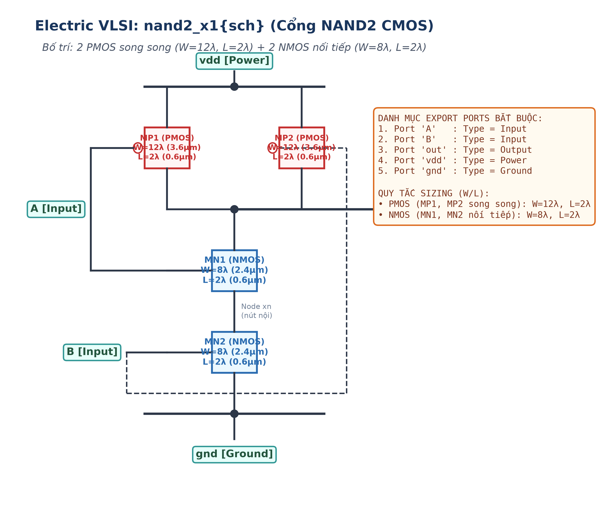
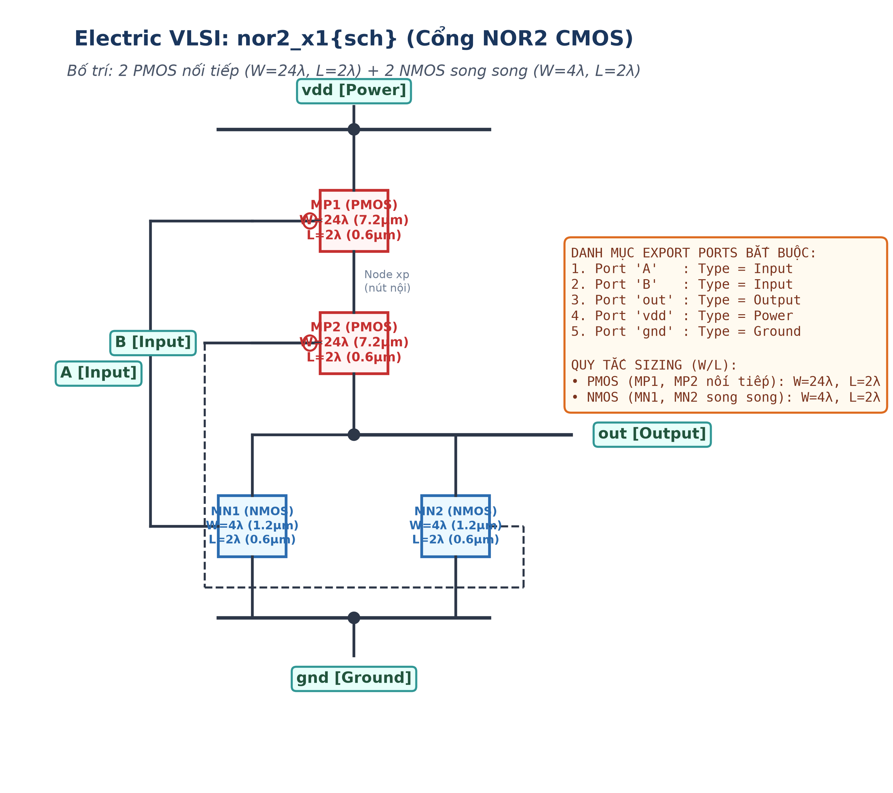

# THỰC HÀNH THIẾT KẾ VLSI — BÀI 2
# THIẾT KẾ CỔNG LOGIC TĨNH NAND2 VÀ NOR2 CMOS

---
**Bộ môn:** Điện tử - Viễn thông | **Khoa:** Điện - Điện tử  
**Trường:** Đại học Sư phạm Kỹ thuật – Đại học Đà Nẵng  
**Thời lượng:** 135 phút (3 tiết tiêu chuẩn trên phòng máy) + Tự học Pre-lab & Hoàn thiện Post-lab  
**Công cụ sử dụng:** Electric VLSI Design System (v9.07+), LTspice XVII / LTspice 2025  
**Công nghệ tham chiếu:** MOSIS SCMOS SUBMICRON C5N 0.5µm ($\lambda_{DR} = 0,30\,\mu\text{m}$, 3 Metal layers, $V_{DD} = 5,0\,\text{V}$)  
**Thư mục làm việc chuẩn:** `D:\lab_vlsi\lab02_MSSV_HoTen\`  
---

## 1. MỤC TIÊU BÀI THỰC HÀNH

Sau khi hoàn thành bài thực hành này, sinh viên có khả năng:
1. **Nắm vững nguyên lý đối ngẫu (Duality Principle):** Hiểu rõ mối liên hệ topo học giữa mạng kéo lên (PUN) dùng PMOS và mạng kéo xuống (PDN) dùng NMOS trong cấu trúc logic CMOS tĩnh chuẩn; phân tích hàm truyền đạt logic và bảng chân lý của cổng NAND2 và NOR2 (CLO1).
2. **Thành thạo phương pháp định kích thước theo trường hợp xấu nhất (Worst-Case Sizing):** Tính toán chính xác độ rộng kênh $(W/L)$ cho các transistor mắc nối tiếp và song song, bảo đảm điện trở tương đương tổng $R_{eq,N} \approx R_{on,n0} \approx 969\,\Omega$ và $R_{eq,P} \approx R_{on,p0} \approx 992\,\Omega$ tương đương với Inverter chuẩn `INV_X1` đã thiết kế ở Bài 1 (CLO1).
3. **Áp dụng Phương pháp Đường đi Euler (Euler Path):** Tìm đường đi Euler chung trên đồ thị mạch để bố trí dải Polysilicon liên tục; thực hiện kỹ thuật chia sẻ vùng khuếch tán (Diffusion Abutment), loại bỏ khoảng ngắt khuếch tán nhằm thu nhỏ diện tích và triệt tiêu điện dung ký sinh cực má (CLO4).
4. **Khảo sát Trễ phụ thuộc Vector ngõ vào (Input-Pattern Dependent Delay):** Đo đạc thực nghiệm thời gian trễ $t_{pHL}$ và $t_{pLH}$ ở 3 kịch bản chuyển mạch (ngõ vào A chuyển mạch, ngõ vào B chuyển mạch, và cả hai cùng chuyển mạch); quan sát và lý giải cơ chế tích lũy điện tích tại nút nội ($X_n$) ở hai mức tải dung $C_L = 10\,\text{fF}$ và $C_L = 50\,\text{fF}$ (CLO2).
5. **Thiết kế Mặt nạ Vật lý (Physical Layout):** Thiết kế Layout hoàn chỉnh cho ô tế bào `nand2_x1` trên Electric VLSI; áp dụng chuẩn xác luật hình học DRC đạt 0 lỗi và đối chiếu LVS (NCC) đạt trùng khớp sơ đồ 100% (CLO4).
6. **Đánh giá So sánh Toàn diện Diện tích & Hiệu năng:** Đo đạc trích xuất ký sinh (PEX); đối sánh định lượng các chỉ số $\sum W$, diện tích layout, điện dung ngõ vào $C_{in}$ và độ trễ giữa NAND2 và NOR2; giải thích sâu sắc bản chất vật lý vì sao cổng NAND luôn là khối cơ sở chủ đạo trong thư viện tế bào chuẩn công nghiệp (CLO2, CLO4).
7. **Đóng gói Thư viện Chuẩn:** Tạo tế bào chuẩn `nand2_x1` và `nor2_x1` kèm Icon View chuẩn IEEE để bàn giao làm linh kiện thành phần cho Bài 3 (Cổng phức hợp AOI/OAI) và Bài 6 (Bộ cộng 1-bit Full Adder) (CLO4).

---

## 2. KẾ THỪA VÀ SẢN PHẨM BÀN GIAO

### 2.1 Kế thừa từ Bài 0 và Bài 1
- **Thư viện mô hình MOSFET:** Tệp mô hình MOSIS C5N Level 3 [C5_models.txt](file:///d:/tam/VLSI_Spice/04%20-%20Models_and_Libraries/C5_models.txt) ($V_{DD} = 5,0\,\text{V}, V_{tn0} = 0,70\,\text{V}, |V_{tp0}| = 0,80\,\text{V}, K'_n = 120\,\mu\text{A/V}^2, K'_p = 40\,\mu\text{A/V}^2$).
- **Tế bào chuẩn Inverter cơ sở (`INV_X1`):** $W_n = 4\lambda_{DR} = 1,20\,\mu\text{m}$, $W_p = 12\lambda_{DR} = 3,60\,\mu\text{m}$, $L = 2\lambda_{DR} = 0,60\,\mu\text{m}$, điện trở dẫn danh định $R_{on,n0} \approx 969\,\Omega, R_{on,p0} \approx 992\,\Omega$.
- **Kỹ năng thiết kế & Kiểm chứng:** Thao tác vẽ Schematic, đóng gói Icon, tạo Layout, kiểm tra DRC, NCC LVS và trích xuất PEX trong Electric VLSI kết hợp mô phỏng LTspice.

### 2.2 Sản phẩm bàn giao sau buổi thực hành
1. **Thư viện Electric:** `D:\lab_vlsi\lab02_MSSV_HoTen\lab02_MSSV.jelib` chứa đủ các cell:
   - `nand2_x1{sch}`: Sơ đồ nguyên lý cổng NAND2 2 ngõ vào.
   - `nand2_x1{ic}`: Icon ký hiệu cổng NAND2 chuẩn IEEE.
   - `nand2_x1{lay}`: Mặt nạ Layout cổng NAND2 đạt 0 lỗi DRC và 100% LVS MATCH.
   - `nor2_x1{sch}`: Sơ đồ nguyên lý cổng NOR2 2 ngõ vào.
   - `nor2_x1{ic}`: Icon ký hiệu cổng NOR2 chuẩn IEEE.
2. **Tập tin Netlist mô phỏng SPICE:**
   - `nand2_vtc.sp`: Phân tích DC quét VTC và điểm ngưỡng $V_M$.
   - `nand2_tran.sp`: Đo trễ quá độ 3 kịch bản và khảo sát nút nội $X_n$.
   - `nor2_tran.sp`: Đo trễ quá độ cổng NOR2 với ngõ vào tĩnh nối đất $0\,\text{V}$.
3. **Báo cáo thực hành cá nhân:** Điền đầy đủ các bảng số liệu đo, biểu đồ phân tích và câu hỏi thảo luận chuyên sâu.

---

## 3. CƠ SỞ LÝ THUYẾT NGẮN GỌN

### 3.1 Cấu trúc Cổng Logic Tĩnh NAND2 và NOR2
Một cổng logic CMOS tĩnh chuẩn gồm hai mạng chuyển mạch đối ngẫu bù trừ nhau:
- **Mạng kéo lên (Pull-Up Network - PUN):** Gồm các PMOS mắc giữa nguồn $V_{DD}$ và ngõ ra $Out$, dẫn điện khi biểu thức hàm logic ngõ ra đạt mức '1'.
- **Mạng kéo xuống (Pull-Down Network - PDN):** Gồm các NMOS mắc giữa ngõ ra $Out$ và đất $GND$, dẫn điện khi biểu thức hàm bù $\bar{Y}$ thỏa mãn (ngõ ra ở mức '0').

Theo định lý De Morgan:
- Với cổng NAND2 ($Y = \overline{A \cdot B}$): Mạng PDN gồm 2 NMOS mắc nối tiếp ($A \cdot B$); mạng PUN đối ngẫu gồm 2 PMOS mắc song song ($A + B$).
- Với cổng NOR2 ($Y = \overline{A + B}$): Mạng PDN gồm 2 NMOS mắc song song ($A + B$); mạng PUN đối ngẫu gồm 2 PMOS mắc nối tiếp ($A \cdot B$).

```
             CỔNG NAND2 (Y = !(A * B))                      CỔNG NOR2 (Y = !(A + B))
                    VDD (5V)                                      VDD (5V)
                 ┌─────┴─────┐                                       │
                 │           │                                   ┌───┴───┐
             ┌───┴───┐   ┌───┴───┐                               │  MP1  │ (A, 24λ)
             │  MP1  │   │  MP2  │                               └───┬───┘
         A ──┤ (12λ) │ B─┤ (12λ) │                                   │ (Nút nội Xp)
             └───┬───┘   └───┬───┘                               ┌───┴───┐
                 └─────┬─────┘                                   │  MP2  │ (B, 24λ)
                       ├──────────── Out                         └───┬───┘
                 ┌─────┴─────┐                                       ├──────────── Out
                 │  MN1 (8λ) │ (A)                               ┌───┴───┐
                 └───┬───────┘                               ┌───┴───┐   ┌───┴───┐
                     │ (Nút nội Xn)                          │  MN1  │   │  MN2  │
                 ┌───┴───────┐                           A ──┤ (4λ)  │ B─┤ (4λ)  │
                 │  MN2 (8λ) │ (B)                           └───┬───┘   └───┬───┘
                 └───┬───────┘                                   └─────┬─────┘
                     │                                                 │
                    GND                                               GND
```

*Sơ đồ nguyên lý chuẩn của tế bào NAND2 và NOR2. Xem chi tiết hình ảnh đồ họa tại:*
- [nand2_schematic.png](file:///d:/tam/VLSI_Spice/02%20-%20Student%20Workbook/images/nand2_schematic.png)
- [nor2_schematic.png](file:///d:/tam/VLSI_Spice/02%20-%20Student%20Workbook/images/nor2_schematic.png)

---

### 3.2 Phương pháp Định kích thước theo Trường hợp xấu nhất (Worst-Case Sizing)
Để các cổng logic đa ngõ vào có khả năng tải dòng và thời gian trễ không bị suy thoái so với Inverter chuẩn `INV_X1`, ta áp dụng nguyên tắc tương đương điện trở dẫn:

#### a. Cổng NAND2 ($Y = \overline{A \cdot B}$)
- **Mạng PDN (2 NMOS nối tiếp):** Khi cả $A=1$ và $B=1$, dòng xả đi qua 2 NMOS nối tiếp. Để tổng điện trở tương đương bằng $R_{on,n0}$ của Inverter chuẩn ($969\,\Omega$):
  $$R_{eq,N} = R_{on,NA} + R_{on,NB} = 2 \times \left(\frac{R_{\Box,n}}{W_n / L}\right) = \frac{R_{\Box,n}}{W_{n,inv} / L} \implies W_n = 2 \times W_{n,inv} = 2 \times 4\lambda_{DR} = \mathbf{8\lambda_{DR} = 2,40\,\mu\text{m}}$$
- **Mạng PUN (2 PMOS song song):** Tình huống xấu nhất xảy ra khi chỉ có **1 PMOS dẫn** (ví dụ $A=0, B=1$ hoặc $A=1, B=0$). Để trễ sườn lên đạt chuẩn:
  $$W_p = W_{p,inv} = \mathbf{12\lambda_{DR} = 3,60\,\mu\text{m}}$$
  *(Khi cả hai PMOS cùng dẫn $A=0, B=0$, điện trở tương đương giảm còn một nửa $R_{eq,P} = R_{on,p0}/2 \approx 496\,\Omega$, trễ $t_{pLH}$ nhanh gấp đôi).*

#### b. Cổng NOR2 ($Y = \overline{A + B}$)
- **Mạng PDN (2 NMOS song song):** Tình huống xấu nhất khi chỉ có **1 NMOS dẫn**:
  $$W_n = W_{n,inv} = \mathbf{4\lambda_{DR} = 1,20\,\mu\text{m}}$$
- **Mạng PUN (2 PMOS nối tiếp):** Bắt buộc cả 2 PMOS phải cùng dẫn để kéo lên nguồn $V_{DD}$. Do độ linh động lỗ trống yếu hơn electron 3 lần ($\mu_p \approx \mu_n / 3$), việc mắc nối tiếp 2 PMOS đòi hỏi mỗi transistor phải rộng gấp đôi PMOS chuẩn:
  $$R_{eq,P} = R_{on,PA} + R_{on,PB} = 2 \times \left(\frac{R_{\Box,p}}{W_p / L}\right) = R_{on,p0} \implies W_p = 2 \times W_{p,inv} = 2 \times 12\lambda_{DR} = \mathbf{24\lambda_{DR} = 7,20\,\mu\text{m}}$$

> [!NOTE]
> **Điểm mấu chốt về trễ lý thuyết:**  
> Khi được định cỡ theo nguyên tắc trên, cả NAND2 và NOR2 đều có điện trở kéo xấu nhất bằng đúng Inverter chuẩn ($R_{eq,N} \approx 969\,\Omega, R_{eq,P} \approx 992\,\Omega$). Do đó, ở cùng một tải dung ngoài cố định $C_L = 50\,\text{fF}$, trễ lý thuyết $t_{pd,worst} = 0,69 \cdot R_{eq} \cdot C_L \approx 33,8\,\text{ps}$ của NAND2 và NOR2 **hoàn toàn bằng nhau**!

---

### 3.3 Bản chất Vật lý So sánh PPA giữa NAND và NOR
Nếu trễ lý thuyết tại tải cố định bằng nhau, tại sao trong công nghiệp vi mạch, **cổng NAND luôn được ưu tiên hoàn toàn so với cổng NOR**?

1. **Tổng bề rộng kênh và Diện tích Silicon:**
   - NAND2: $\sum W = 2(8\lambda) + 2(12\lambda) = 40\lambda_{DR} = 12,0\,\mu\text{m}$.
   - NOR2: $\sum W = 2(4\lambda) + 2(24\lambda) = 56\lambda_{DR} = 16,8\,\mu\text{m}$.
   - Cổng NOR2 có tổng chiều rộng cổng lớn hơn **$+40,0\%$**, dẫn tới diện tích Layout lớn hơn từ $40\%$ đến $50\%$.
2. **Điện dung ngõ vào ($C_{in}$) và Tải đối với tầng trước:**
   - Điện dung cổng ngõ vào: $C_{in} = C_{ox} L (W_n + W_p)$.
   - $\text{INV\_X1}$: $(4 + 12)\lambda = 16\lambda_{DR} \cdot C_{ox} L$ (quy ước $1,0 \times C_{in,inv}$).
   - NAND2: $(8 + 12)\lambda = 20\lambda_{DR} \cdot C_{ox} L = 1,25 \times C_{in,inv}$ (Logical Effort $g = 5/4 = 1,25$).
   - NOR2: $(4 + 24)\lambda = 28\lambda_{DR} \cdot C_{ox} L = 1,75 \times C_{in,inv}$ (Logical Effort $g = 7/4 = 1,75$).
   - Cổng NOR2 làm tầng trước phải lái tải dung nặng hơn **$+40,0\%$**, làm chậm tốc độ của toàn bộ đường truyền tín hiệu phía trước!
3. **Hiệu ứng thân (Body Effect) trên PMOS nối tiếp của NOR2:**
   - Trong chuỗi PMOS của NOR2, transistor $M_{PB}$ có cực nguồn nối vào nút nội $X_p$ (thay vì nối lên $V_{DD}$). Khi điện thế nút $X_p < V_{DD}$, điện áp nguồn-thân $V_{SB} > 0$ làm tăng điện áp ngưỡng $|V_{thp}|$ từ $0,80\,\text{V}$ lên $\approx 1,1 - 1,2\,\text{V}$, làm suy giảm đáng kể dòng nạp và tăng trễ sườn lên thực tế.
4. **Điện dung ký sinh cực má tại nút ngõ ra:**
   - Vì $W_p = 24\lambda_{DR}$, diện tích vùng khuếch tán cực má của NOR2 rất lớn, làm điện dung ký sinh nút ngõ ra tăng vọt, khiến trễ sau trích xuất Layout (PEX) của NOR2 suy thoái nặng nề hơn NAND2.

---

### 3.4 Hiệu ứng Nút nội ($X_n$) và Trễ phụ thuộc Vector Chuyển mạch
Xét chuỗi 2 NMOS nối tiếp của cổng NAND2 với nút nội trung gian $X_n$:
- Điện dung ký sinh tại nút nội: $C_{int} = C_{db,MN2} + C_{sb,MN1} \approx 3 - 5\,\text{fF}$.

```
                 Out (CL)
                    |
              +-----+-----+
              |    MN1    | (Chân A: gần ngõ ra nhất)
              +-----+-----+
                    |
                 Xn (Cint ~ 5 fF)
                    |
              +-----+-----+
              |    MN2    | (Chân B: gần đất nhất)
              +-----+-----+
                    |
                   GND
```

**Phân tích bằng mô hình trễ Elmore:**
- **Kịch bản 1 (Ca 1: Ngõ $A$ chuyển $0 \to 1$, ngõ $B = 5,0\,\text{V}$ static):**  
  Vì $B=1$ từ trước, $M_{N2}$ đã mở sẵn, nút $X_n$ đã được xả sạch điện tích về $0\,\text{V}$. Khi $A$ nhảy lên $1$, dòng qua $M_{N1}$ chỉ cần xả một mình tụ tải ngõ ra $C_L$:
  $$t_{pd,Ca1} \approx 0,69 \cdot (R_{on,MN1} + R_{on,MN2}) \cdot C_L$$
- **Kịch bản 2 (Ca 2: Ngõ $B$ chuyển $0 \to 1$, ngõ $A = 5,0\,\text{V}$ static):**  
  Trước thời điểm chuyển mạch ($A=1, B=0$), ngõ ra đang ở mức cao $5,0\,\text{V}$. Transistor $M_{N1}$ dẫn, nạp điện tích từ ngõ ra vào nút nội $X_n$ lên điện áp:
  $$V(X_n) = V_{DD} - V_{thn}(V_X) \approx 3,7 - 3,9\,\text{V} \quad \text{(có xét hiệu ứng thân)}$$
  Khi $B$ nhảy lên $1$, transistor $M_{NB}$ phải xả đồng thời cả tụ tải $C_L$ lẫn lượng điện tích tích trữ trên tụ nút nội $C_{int}$:
  $$t_{pd,Ca2} \approx 0,69 \cdot \left[ (R_{on,MN1} + R_{on,MN2}) C_L + R_{on,MN2} C_{int} \right]$$
  $$\Delta t_{pHL} = t_{pd,Ca2} - t_{pd,Ca1} \approx 0,69 \cdot R_{on,MN2} \cdot C_{int}$$

> [!IMPORTANT]
> **Quy luật phụ thuộc tải dung ngõ ra:**  
> - Với tải lớn $C_L = 50\,\text{fF}$, độ trễ tăng thêm do nút nội chỉ chiếm tỉ lệ nhỏ: $\Delta t / t \approx 0,5 \cdot C_{int} / C_L \approx 5\%$.
> - Với tải nhỏ $C_L = 10\,\text{fF}$, độ trễ tăng thêm chiếm tới **$20\% - 25\%$**!  
> **Quy tắc thiết kế vàng trong VLSI:** Tín hiệu đến muộn nhất trên đường tới hạn (Critical Path) luôn phải được nối vào chân cổng gần ngõ ra nhất ($A$) để tận dụng việc nút nội đã được xả điện tích từ trước!

---

### 3.5 Phương pháp Đường đi Euler và Bố trí Mặt nạ Layout Liền mạch
Khi thiết kế Layout cho tế bào logic nhiều transistor, nếu sắp xếp ngẫu nhiên các vùng Active, ta sẽ phải cắt rời dải khuếch tán, tạo nhiều khoảng cách ly ($3\lambda_{DR}$) và tốn nhiều dây nối kim loại Metal 1, làm tăng diện tích và điện dung ký sinh.

**Các bước tối ưu bằng Phương pháp Đường đi Euler:**
1. Lập đồ thị mạng PUN và PDN: Mỗi transistor là một cạnh nối giữa hai nút điện thế.
2. Tìm chu trình hoặc đường đi Euler (đi qua mỗi cạnh đúng 1 lần) sao cho **thứ tự các biến cổng trên PUN trùng khớp hoàn toàn với thứ tự trên PDN**: thứ tự tối ưu là **$A - B$** (hoặc $B - A$).
3. Đặt các dải Polysilicon thẳng đứng liên tục cắt qua cả dải P-Active và N-Active.
4. **Kỹ thuật chia sẻ vùng khuếch tán (Abutment):**
   - Các transistor cạnh nhau có chung nút điện thế (cực má chung nối ra $Out$) được nối liền trong một dải khuếch tán duy nhất, loại bỏ việc cắt dải.
   - Nút nội $X_n$ giữa 2 NMOS được hình thành tự nhiên bên trong dải N-Active mà không cần bất kỳ contact hay kim loại nào!

```
                  SƠ ĐỒ QUE (STICK DIAGRAM) TỐI ƯU CHO CỔNG NAND2_X1
     VDD ───────────────────────────────────────────────────────────── (Metal 1)
                  │ (Contact)                      │ (Contact)
             ┌────┴────────────────────────────────┴────┐
             │            P-Diffusion (Active)          │  (N-Well)
             └────┬──────────────────┬──────────────────┘
                  │ (Gate A)         │ (Gate B)
                  │                  │
     In_A ────────┼                  │                  (Poly A)
                  │                  │
     In_B ────────┼──────────────────┼                  (Poly B)
                  │                  │
                  │ (Gate A)         │ (Gate B)
             ┌────┴──────────────────┴──────────────────┐
             │   (Drain: Out)      (Xn)     (Source: GND)│  N-Diffusion
             └────┬─────────────────────────────────────┘
                  │ (Contact)                      │ (Contact)
                 Out                              GND (Metal 1)
```

> [!WARNING]
> **Luật khoảng cách hình học DRC quan trọng:**  
> - Tại vùng có Contact kim loại ở giữa hai dải Poly (như cực má chung của PMOS nối ra `out`): khoảng cách giữa 2 dải Poly tối thiểu phải là:
>   $$\text{Khoảng cách} \ge 2\lambda_{DR} \text{ (Poly đến Contact)} + 2\lambda_{DR} \text{ (Bề rộng Contact)} + 2\lambda_{DR} \text{ (Contact đến Poly)} = \mathbf{6\lambda_{DR} = 1,80\,\mu\text{m}}$$
> - Tại vùng khuếch tán liền không có Contact (nút nội $X_n$ giữa 2 NMOS): khoảng cách giữa 2 dải Poly chỉ cần thỏa mãn luật cách ly Poly tối thiểu: $\ge 3\lambda_{DR} = 0,90\,\mu\text{m}$.  
> **Sinh viên không được đặt khoảng cách giữa 2 dải Poly là $3\lambda_{DR}$ tại nơi có đặt Contact ngõ ra, vì sẽ gây lỗi chạm DRC ngay lập tức!**

---

## 4. CÂU HỎI CHUẨN BỊ TRƯỚC KHI ĐẾN LỚP (PRE-LAB)

> [!IMPORTANT]
> Toàn bộ nội dung chuẩn bị Pre-lab phải được sinh viên tính toán và vẽ hoàn chỉnh vào vở hoặc Phiếu báo cáo trước khi bước vào phòng thực hành. Cán bộ hướng dẫn sẽ kiểm tra và ký xác nhận ở 15 phút đầu giờ.

### Câu hỏi 1: Tính toán Tham số Kích thước và Điện trở Kéo
1. Điền các công thức và giá trị tính toán cho bảng kích thước của cổng NAND2 và NOR2:
   - Chiều dài kênh cho mọi transistor: $L = 2\lambda_{DR} = 0,60\,\mu\text{m}$.
   - Kích thước $(W/L)$ theo $\lambda_{DR}$ và theo $\mu\text{m}$ cho 4 transistor của `nand2_x1` và 4 transistor của `nor2_x1`.
   - Tính điện trở dẫn hiệu dụng trường hợp xấu nhất: $R_{eq,N}$ và $R_{eq,P}$.
2. Tính tổng chiều rộng kênh $\sum W$ của mỗi cổng và tỉ lệ chênh lệch $\frac{\sum W_{NOR2} - \sum W_{NAND2}}{\sum W_{NAND2}} \times 100\%$.
3. Tính điện dung ngõ vào tương đối $C_{in}$ cho từng chân ngõ vào (theo tỉ số với $C_{in,inv}$) và suy ra hệ số Logical Effort $g$ của mỗi cổng.

### Câu hỏi 2: Ước lượng Thời gian Trễ Lý thuyết ($C_L = 50\,\text{fF}$ và $C_L = 10\,\text{fF}$)
1. Áp dụng công thức trễ $t_{pd} = \ln(2) \cdot R_{eq} \cdot C_L \approx 0,693 \cdot R_{eq} \cdot C_L$:
   - Với NAND2: Tính $t_{pHL}$, $t_{pLH,worst}$ (1 PMOS dẫn), $t_{pLH,best}$ (2 PMOS cùng dẫn) và $t_{pd,worst}$ tại $C_L = 50\,\text{fF}$.
   - Với NOR2: Tính $t_{pLH}$, $t_{pHL,worst}$ (1 NMOS dẫn), $t_{pHL,best}$ (2 NMOS cùng dẫn) và $t_{pd,worst}$ tại $C_L = 50\,\text{fF}$.
2. So sánh $t_{pd,worst}$ giữa NAND2 và NOR2 tại tải $50\,\text{fF}$ và giải thích ý nghĩa của kết quả so sánh.
3. Dự đoán độ tăng trễ $\Delta t_{pHL}$ của NAND2 khi kích ngõ B so với kích ngõ A theo mô hình Elmore với $C_{int} \approx 5\,\text{fF}$ ở hai mức tải: $C_L = 50\,\text{fF}$ và $C_L = 10\,\text{fF}$.

### Câu hỏi 3: Đồ thị Euler và Bản vẽ Stick Diagram
1. Vẽ đồ thị mạng PUN và PDN cho cổng NAND2 và NOR2.
2. Tìm chu trình Euler chung và ghi lại thứ tự các dải Polysilicon tối ưu.
3. Vẽ phác thảo sơ đồ que Stick Diagram hoàn chỉnh cho tế bào `nand2_x1` trên giấy ô ly (thể hiện rõ đường ray $V_{DD}, GND$, dải P-Active, N-Active, 2 dải Poly, tiếp xúc Contact và nhãn chân).

### Câu hỏi 4: Soạn thảo Kịch bản Đo đạc SPICE
Viết các khối lệnh kích thích nguồn và câu lệnh `.MEAS` trong LTspice cho 3 kịch bản:
- **Cổng NAND2 ($Y = \overline{A \cdot B}$):**
  - Ca 1: Ngõ $B = 5,0\,\text{V}$ static, ngõ $A$ phát xung $0 \to 5\text{V}$.
  - Ca 2: Ngõ $A = 5,0\,\text{V}$ static, ngõ $B$ phát xung $0 \to 5\text{V}$.
  - Ca 3: Cả hai ngõ $A$ và $B$ phát xung đồng thời ($A = B$).
- **Cổng NOR2 ($Y = \overline{A + B}$):**
  - Ca 1: Ngõ $B = 0,0\,\text{V}$ static, ngõ $A$ phát xung $0 \to 5\text{V}$. *(Giải thích vì sao ngõ tĩnh của NOR2 phải là $0\,\text{V}$ mà không phải $5\,\text{V}$)*.
  - Ca 2: Ngõ $A = 0,0\,\text{V}$ static, ngõ $B$ phát xung $0 \to 5\text{V}$.
  - Ca 3: Cả hai ngõ $A$ và $B$ phát xung đồng thời ($A = B$).

---

## 5. KẾ HOẠCH PHÂN BỔ THỜI LƯỢNG IN-LAB (135 PHÚT)

| Mốc thời gian | Thời lượng | Nội dung thực hiện chính | Sản phẩm nghiệm thu tại chỗ |
| :---: | :---: | :--- | :--- |
| **00 – 15'** | 15 phút | Điểm danh, kiểm tra Pre-lab tại bàn máy, thống nhất quy định an toàn và thư mục làm việc. | Chữ ký xác nhận Pre-lab vào Phiếu báo cáo. |
| **15 – 45'** | 30 phút | **Ex2.1:** Dựng Schematic `nand2_x1{sch}`, gán Export, xuất SPICE quét VTC và đo ngưỡng $V_M$ (1 ngõ vs 2 ngõ). | Đo đúng $V_M$; sơ đồ sạch 0 warning F5. |
| **45 – 75'** | 30 phút | **Ex2.2:** Mô phỏng quá độ Transient cổng NAND2, đo trễ 3 kịch bản ở 2 mức tải $C_L = 50\,\text{fF}$ và $10\,\text{fF}$. | Đọc đủ $t_{pHL}, t_{pLH}$ bằng `.MEAS`, ghi số liệu. |
| **75 – 100'** | 25 phút | **Ex2.3:** Dựng Schematic `nor2_x1{sch}`, mô phỏng đo trễ sườn lên/sườn xuống trường hợp xấu nhất/tốt nhất. | Sơ đồ NOR2 chuẩn $W_p = 24\lambda$, đo đủ số liệu. |
| **100 – 125'** | 25 phút | **Ex2.4:** Thiết kế Layout `nand2_x1{lay}`, kiểm tra DRC đạt 0 lỗi, chạy NCC LVS đạt "MATCH 100%". | Cửa sổ NCC thông báo so khớp đồng bộ. |
| **125 – 135'** | 10 phút | Nghiệm thu sản phẩm tại bàn, ký sổ thực hành, lưu trữ dữ liệu và dọn dẹp vệ sinh phòng máy. | Chữ ký nghiệm thu In-lab của Giảng viên. |

---

## 6. NỘI DUNG THỰC HÀNH TẠI LỚP (IN-LAB)

### 6.1 Bài tập Ex2.1: Thiết kế Schematic và Khảo sát Đặc tuyến VTC Cổng NAND2



1. **Khởi tạo Cell Schematic:**
   - Trong Electric VLSI, mở thư viện `lab02_MSSV.jelib`.
   - Chọn menu `Cell -> New Cell...` (`Ctrl + N`), đặt tên `nand2_x1`, chọn kiểu `schematic`.
2. **Bố trí linh kiện và gán kích thước chuẩn:**
   - Đặt 2 PMOS (`mocmos:P-Transistor`): $W = 12\lambda_{DR} = 3,60\,\mu\text{m}$, $L = 2\lambda_{DR} = 0,60\,\mu\text{m}$.
   - Đặt 2 NMOS (`mocmos:N-Transistor`): $W = 8\lambda_{DR} = 2,40\,\mu\text{m}$, $L = 2\lambda_{DR} = 0,60\,\mu\text{m}$.
   - Đấu nối mạch theo đúng sơ đồ nguyên lý:
     * Nguồn và Thân của cả 2 PMOS nối lên `vdd`.
     * Cực má của cả 2 PMOS nối chập ra ngõ ra `out`.
     * Cực má của $M_{N1}$ nối ra ngõ ra `out`; cực nguồn nối với cực má của $M_{N2}$ (nút nội $X_n$).
     * Cực nguồn và Thân của $M_{N2}$ nối xuống đất `gnd`. Thân của $M_{N1}$ cũng nối xuống `gnd`.
     * Cực cổng $M_{P1}$ và $M_{N1}$ nối chung làm ngõ vào `A`.
     * Cực cổng $M_{P2}$ và $M_{N2}$ nối chung làm ngõ vào `B`.
3. **Tạo 5 chân Export chuẩn (`Ctrl + E`):**
   - Chân `A` (Input), chân `B` (Input), chân `out` (Output), chân `vdd` (Power), chân `gnd` (Ground).
4. Nhấn phím `F5` kiểm tra mạch (yêu cầu **0 errors, 0 warnings**).
5. Đóng gói Cell Icon `nand2_x1{ic}` theo chuẩn ký hiệu cổng NAND 2 ngõ vào IEEE.
6. **Mô phỏng DC VTC trên LTspice (`nand2_vtc.sp`):**
   - **Trường hợp 1 ngõ vào quét:** Cấp nguồn DC tĩnh $5,0\,\text{V}$ cho ngõ $B$ (`Vb B 0 DC 5.0`). Quét điện áp ngõ $A$ từ $0 \to 5\,\text{V}$ với bước $5\,\text{mV}$: `.dc Va 0 5 0.005`.
   - Đo điện áp ngưỡng chuyển mạch $V_M$ tại giao điểm $V(out) = V(A)$.
   - **Trường hợp 2 ngõ vào quét đồng thời:** Nối chung $A = B = V_{in}$ và quét $V_{in}$ từ $0 \to 5\,\text{V}$.
   - Ghi lại độ dịch chuyển của điểm $V_M$ và giải thích nguyên nhân vật lý vào phiếu báo cáo.

---

### 6.2 Bài tập Ex2.2: Khảo sát Trễ Quá độ và Hiệu ứng Nút nội trên NAND2
1. Thiết lập nguồn xung vuông tần số $50\,\text{MHz}$ (`PULSE(0 5.0 0 100p 100p 9.9n 20n)`) và cấu hình mô phỏng quá độ: `.tran 1p 40n`.
2. **Khảo sát tại mức tải tiêu chuẩn $C_L = 50\,\text{fF}$:**
   - **Ca 1 (Ngõ vào $A$ chuyển mạch, $B = 5,0\,\text{V}$ static):**
     Sử dụng lệnh `.meas` đo trễ sườn xuống $t_{pHL(A)}$ và trễ sườn lên $t_{pLH(A)}$.
   - **Ca 2 (Ngõ vào $B$ chuyển mạch, $A = 5,0\,\text{V}$ static):**
     Đo trễ sườn xuống $t_{pHL(B)}$ và trễ sườn lên $t_{pLH(B)}$.
   - **Ca 3 (Cả 2 ngõ vào $A, B$ cùng chuyển mạch đồng thời $0 \to 5\,\text{V}$):**
     Đo trễ sườn lên trường hợp tốt nhất $t_{pLH(AB)}$ khi cả hai PMOS cùng dẫn song song.
3. **Khảo sát tại mức tải nhỏ $C_L = 10\,\text{fF}$:**
   - Thay đổi giá trị tụ tải thành $C_L = 10\,\text{fF}$ và chạy lại kịch bản Ca 1 và Ca 2.
   - So sánh tỉ lệ tăng trễ sườn xuống:
     $$\Delta\% = \frac{t_{pHL(Ca2)} - t_{pHL(Ca1)}}{t_{pHL(Ca1)}} \times 100\%$$
   - Ghi nhận xem ở mức tải nào hiệu ứng nút nội $X_n$ làm chậm mạch rõ nét nhất.

---

### 6.3 Bài tập Ex2.3: Thiết kế Schematic và Khảo sát Trễ Cổng NOR2



1. **Khởi tạo Cell Schematic:**
   - Trong Electric VLSI, tạo cell mới `nor2_x1{sch}`.
2. **Bố trí 2 PMOS nối tiếp và 2 NMOS song song:**
   - Đặt 2 PMOS: kích thước kênh **$W = 24\lambda_{DR} = 7,20\,\mu\text{m}$**, $L = 2\lambda_{DR} = 0,60\,\mu\text{m}$.
   - Đặt 2 NMOS: kích thước kênh **$W = 4\lambda_{DR} = 1,20\,\mu\text{m}$**, $L = 2\lambda_{DR} = 0,60\,\mu\text{m}$.
   - Đấu nối 2 PMOS nối tiếp giữa `vdd` và `out` (tạo nút nội $X_p$).
   - Đấu nối 2 NMOS song song giữa `out` và `gnd`.
   - Gán 5 chân Export chuẩn: `A`, `B`, `out`, `vdd`, `gnd`.
3. Nhấn `F5` kiểm tra đạt 0 errors, 0 warnings. Đóng gói Cell Icon `nor2_x1{ic}`.
4. **Mô phỏng đo trễ quá độ trên LTspice (`nor2_tran.sp`):**
   - Đặt tải ngõ ra $C_L = 50\,\text{fF}$.
   - **Ca 1 (Ngõ vào $A$ chuyển mạch, $B = 0,0\,\text{V}$ static):** Đo trễ sườn lên $t_{pLH(A)}$ và trễ sườn xuống $t_{pHL(A)}$ (trường hợp 1 NMOS dẫn).
   - **Ca 2 (Ngõ vào $B$ chuyển mạch, $A = 0,0\,\text{V}$ static):** Đo trễ sườn lên $t_{pLH(B)}$ và trễ sườn xuống $t_{pHL(B)}$.
   - **Ca 3 (Cả 2 ngõ vào $A, B$ cùng chuyển mạch đồng thời):** Đo trễ sườn xuống trường hợp tốt nhất $t_{pHL(AB)}$ khi cả hai NMOS cùng dẫn song song kéo điện áp về đất.

---

### 6.4 Bài tập Ex2.4: Thiết kế Mask Layout và Chạy DRC & LVS cho Cổng NAND2
1. Trong Electric VLSI, tạo cell mới kiểu layout: `nand2_x1{lay}`.
2. Bố trí hai đường ray nguồn Metal 1 nằm ngang `vdd` (ở đỉnh) và `gnd` (ở đáy) với bề rộng $\ge 6\lambda_{DR} = 1,80\,\mu\text{m}$, khoảng cách chiều cao ô chuẩn $H_{cell} = 40\lambda_{DR} = 12,0\,\mu\text{m}$.
3. Đặt dải P-Active liên tục ở nửa trên ô chuẩn (bề rộng $12\lambda_{DR}$) nằm gọn trong vùng N-Well.
4. Đặt dải N-Active liên tục ở nửa dưới ô chuẩn (bề rộng $8\lambda_{DR}$).
5. **Vẽ 2 dải Polysilicon thẳng đứng tương ứng ngõ vào A và B:**
   - **Khoảng cách hình học:** Đặt khoảng cách giữa 2 dải Poly tại cực má chung là **$6\lambda_{DR} = 1,80\,\mu\text{m}$** (để đủ không gian đặt Contact và duy trì khoảng cách ly $2\lambda_{DR}$ tới mỗi dải Poly).
6. **Thực hiện kỹ thuật Abutment:**
   - Đặt Contact tại cực má giữa 2 PMOS, nối bằng Metal 1 sang cực má của NMOS trên ra chân `out`.
   - Đặt Contact tại 2 đầu ngoài của dải P-Active nối lên ray nguồn `vdd`.
   - Nút nội $X_n$ giữa 2 NMOS nằm liền mạch trong dải N-Active, không đặt Contact. Cực nguồn ngoài cùng của NMOS dưới đặt Contact nối xuống `gnd`.
7. Đặt tiếp xúc phân cực phiến: $N^+$-Well Tap nối lên `vdd` và $P^+$-Substrate Tap nối xuống `gnd`.
8. Gán đầy đủ 5 nhãn chân Export trên lớp kim loại tương ứng (`A`, `B`, `out`, `vdd`, `gnd`).
9. Nhấn phím `F5` kiểm tra DRC. Khắc phục toàn bộ các lỗi hình học để đạt **0 errors found**.
10. Chạy công cụ NCC LVS (*Tools -> NCC -> Schematic and Layout Comparison*). Đối chiếu cell `nand2_x1{lay}` với `nand2_x1{sch}`. Xác nhận kết quả hiển thị thông báo **"MATCH 100%"**.

---

## 7. HƯỚNG DẪN HOÀN THIỆN SAU BUỔI HỌC (POST-LAB)

### 7.1 Hoàn thiện Layout Cổng NOR2 & Trích xuất Ký sinh PEX
1. **Thiết kế Layout `nor2_x1{lay}`:**
   - Bố trí 2 PMOS nối tiếp ở hàng P-Active ($W_p = 24\lambda_{DR}$) và 2 NMOS song song ở hàng N-Active ($W_n = 4\lambda_{DR}$).
   - Chạy kiểm tra DRC đạt 0 lỗi và chạy NCC LVS đạt "MATCH 100%".
2. **Trích xuất ký sinh PEX & Đo đạc Post-layout:**
   - Bật tùy chọn trích xuất tụ ký sinh trong Electric, xuất file Netlist Post-layout cho cả `nand2_x1` và `nor2_x1`.
   - Chạy mô phỏng quá độ tại $C_L = 50\,\text{fF}$ và đo đạc độ tăng trễ hậu thiết kế (Post-layout vs Pre-layout).

### 7.2 Bảng So sánh Toàn diện Diện tích & Hiệu năng giữa NAND2 và NOR2

Sinh viên hoàn thành bảng tổng hợp sau vào Báo cáo kỹ thuật:

| Tiêu chí so sánh | Cổng NAND2 (`nand2_x1`) | Cổng NOR2 (`nor2_x1`) | Tỉ lệ khác biệt (NOR2 so với NAND2) | Nhận xét phân tích |
| :--- | :---: | :---: | :---: | :--- |
| **Tổng bề rộng kênh $\sum W$** | $40\lambda_{DR}$ ($12,0\,\mu\text{m}$) | $56\lambda_{DR}$ ($16,8\,\mu\text{m}$) | $+40,0\%$ | NOR2 tốn diện tích silicon hơn |
| **Điện dung ngõ vào Pin A ($C_{in}$)** | $20\lambda_{DR} \cdot C'$ | $28\lambda_{DR} \cdot C'$ | $+40,0\%$ | NOR2 nặng tải hơn cho tầng trước |
| **Hệ số Logical Effort ($g$)** | $1,250$ ($5/4$) | $1,750$ ($7/4$) | $+40,0\%$ | NAND2 tối ưu hơn trên đường truyền |
| **Diện tích Layout ($W \times H$)** | `..............` $\mu\text{m}^2$ | `..............` $\mu\text{m}^2$ | `..............` $\%$ | So sánh kích thước mặt nạ thực tế |
| **Trễ trung bình Pre-layout ($t_{pd}$)** | `..............` ps | `..............` ps | `..............` $\%$ | Tại tải ngoài $C_L = 50\,\text{fF}$ |
| **Trễ trung bình Post-layout ($t_{pd}$)** | `..............` ps | `..............` ps | `..............` $\%$ | Sau khi trích xuất ký sinh PEX |
| **Độ tăng trễ Post-layout ($\Delta t_{pd}$)** | `..............` $\%$ | `..............` $\%$ | `..............` | Ảnh hưởng của tụ ký sinh cực má |

### 7.3 Câu hỏi Phân tích Chuyên sâu Post-lab
1. **Ưu thế của cổng NAND trong công nghiệp:**  
   Dựa vào các chỉ số $\sum W$, $C_{in}$, và trễ Post-layout, hãy giải thích cặn kẽ tại sao trong quy trình thiết kế mạch tích hợp chuyên dụng (ASIC flow), các kỹ sư tổng hợp luận lý (Logic Synthesis) luôn tìm cách tối ưu mạch về dạng lưới cổng NAND thay vì cổng NOR?
2. **Vai trò của Kỹ thuật Chia sẻ Khuếch tán (Abutment):**  
   Kỹ thuật Abutment giúp cải thiện những thông số vật lý nào của tế bào vi mạch? Nếu sinh viên không nối liền dải Active mà cắt rời 2 transistor ra thì diện tích và điện dung ký sinh tại nút ngõ ra sẽ tăng lên ra sao?
3. **Thách thức khi mở rộng cổng logic lên nhiều ngõ vào (NAND4):**  
   Nếu phải thiết kế cổng NAND 4 ngõ vào (NAND4):
   - Kích thước chiều rộng kênh $W_n$ của 4 NMOS mắc nối tiếp sẽ bằng bao nhiêu $\lambda_{DR}$ để giữ nguyên khả năng kéo dòng?
   - Tại sao trong thiết kế CMOS tĩnh, người ta luôn khuyến cáo **không nên mắc nối tiếp quá 4 transistor** trong một cổng logic? Hãy giải thích dựa trên mô hình trễ Elmore và hiệu ứng thân (Body Effect).

### 7.4 Cấu trúc Thư mục Nộp bài Chuẩn (`lab02_MSSV_HoTen/`)
```
lab02_MSSV_HoTen/
│
├── schematics/             # Các tệp mô phỏng schematic (.asc)
│   ├── nand2_vtc.asc
│   ├── nand2_tran.asc
│   └── nor2_tran.asc
│
├── netlists/               # Các tệp Netlist SPICE (.sp)
│   ├── nand2_vtc.sp
│   ├── nand2_tran.sp
│   ├── nor2_tran.sp
│   └── nand2_pex.sp
│
├── waveforms/              # Ảnh chụp dạng sóng và kết quả đo
│   ├── nand2_vtc_plot.png
│   ├── nand2_tran_50fF.png
│   ├── nand2_tran_10fF.png
│   ├── nor2_tran_plot.png
│   ├── nand2_drc_clean.png
│   └── nand2_ncc_match.png
│
├── lab02_MSSV.jelib        # Thư viện Electric chứa nand2_x1 (sch, ic, lay) và nor2_x1
├── C5_models.txt           # Thư viện mô hình công nghệ
└── Bao_Cao_Lab02_MSSV.pdf  # Báo cáo kỹ thuật tổng kết (từ 3 đến 4 trang)
```

---

## 8. BẢNG KIỂM CHỨNG VÀ ĐỐI CHUẨN KỸ THUẬT (BENCHMARK)

Bảng đối chuẩn kỹ thuật giúp sinh viên tự rà soát kết quả trước khi nộp sản phẩm:

| STT | Hạng mục kiểm tra kỹ thuật | Tiêu chí đạt chuẩn | Trạng thái (Đạt / Chưa đạt) |
| :---: | :--- | :--- | :---: |
| 1 | **Schematic NAND2 & NOR2** | 0 lỗi DRC kết nối mạng; gán đủ 5 Export; Icon chuẩn IEEE. | `[        ]` |
| 2 | **Ngưỡng chuyển mạch $V_M$ NAND2** | Quét 1 ngõ: $2,42 - 2,52\,\text{V}$; Quét 2 ngõ chung: dời lên $2,65 - 2,78\,\text{V}$. | `[        ]` |
| 3 | **Trễ quá độ Pre-layout ($C_L = 50\,\text{fF}$)** | $t_{pHL}, t_{pLH}$ trường hợp xấu nhất nằm trong dải $45 - 65\,\text{ps}$. | `[        ]` |
| 4 | **Hiệu ứng nút nội $X_n$ ở $C_L = 10\,\text{fF}$** | Trễ $t_{pHL}$ khi kích ngõ B chậm hơn ngõ A từ $15\%$ đến $25\%$. | `[        ]` |
| 5 | **Mặt nạ Layout NAND2** | Chiều cao $40\lambda_{DR}$; ray nguồn $\ge 6\lambda_{DR}$; khoảng cách Poly $\ge 6\lambda_{DR}$ qua Contact. | `[        ]` |
| 6 | **DRC & LVS NAND2** | DRC đạt **0 errors found**; LVS NCC báo **MATCH** đồng bộ. | `[        ]` |
| 7 | **Báo cáo & Phân tích PPA** | Điền đủ các bảng số liệu, giải thích rõ cơ chế vật lý chênh lệch giữa NAND và NOR. | `[        ]` |

---

## 9. HƯỚNG DẪN TỰ CHẨN ĐOÁN LỖI THƯỜNG GẶP

1. **Lỗi DRC vi phạm khoảng cách Poly-to-Poly trên Layout:**
   - *Hiện tượng:* Electric báo lỗi vi phạm khoảng cách tối thiểu giữa 2 dải Polysilicon.
   - *Nguyên nhân:* Sinh viên áp dụng máy móc quy tắc khoảng cách cách ly $3\lambda_{DR}$ vào vị trí có đặt Contact kim loại ngõ ra `out`.
   - *Khắc phục:* Tại vị trí có Contact chia sẻ cực má, khoảng cách hai dải Poly bắt buộc phải $\ge 6\lambda_{DR} = 1,80\,\mu\text{m}$ (Rule 3.2.b).
2. **Mạch NOR2 không chuyển trạng thái (ngõ ra luôn bị kẹp ở mức 0V):**
   - *Hiện tượng:* Khi mô phỏng quá độ cổng NOR2, ngõ ra $Out$ luôn bằng $0\,\text{V}$ phẳng lỳ.
   - *Nguyên nhân:* Sinh viên sao chép kịch bản của NAND2 sang, cấp nguồn DC tĩnh $5,0\,\text{V}$ cho ngõ vào không chuyển mạch. Với cổng NOR2, chỉ cần 1 ngõ vào bằng $1$ là NMOS tương ứng mở, dìm ngõ ra xuống đất!
   - *Khắc phục:* Đấu ngõ vào tĩnh của NOR2 xuống đất $0,0\,\text{V}$ (`0.0V DC`).
3. **Công cụ NCC báo "MISMATCH" khi chạy LVS:**
   - *Hiện tượng:* Báo lỗi bất tương đồng giữa Schematic và Layout.
   - *Nguyên nhân:* Đặt sai tên nhãn chân Export (chú ý phân biệt chữ hoa/chữ thường như `A`, `B`, `out`); hoặc nối nhầm cực nguồn của PMOS với cực má.
   - *Khắc phục:* Mở cửa sổ thông báo chi tiết của NCC, xem thành phần transistor nào bị đánh dấu `Unmatched`, sửa lại nối dây trên Layout.
4. **Không quan sát thấy sự chênh lệch trễ do nút nội $X_n$ trên NAND2:**
   - *Hiện tượng:* Đo $t_{pHL}$ khi kích ngõ A và ngõ B cho kết quả gần như y hệt nhau (chênh lệch $< 2\%$).
   - *Nguyên nhân:* Sinh viên chỉ mô phỏng ở tải dung quá lớn ($C_L = 50\,\text{fF}$ hoặc $100\,\text{fF}$), khiến thành phần trễ xả tải ngoài lấn át hoàn toàn trễ xả nút nội.
   - *Khắc phục:* Giảm tải dung xuống $C_L = 10\,\text{fF}$ hoặc $5\,\text{fF}$ để thấy rõ mức chênh lệch $15\% - 25\%$.

---

## 10. RUBRIC ĐÁNH GIÁ (THANG ĐIỂM 10)

| Tiêu chí đánh giá | Trọng số | Chuẩn đầu ra | Mức Xuất sắc (8.5 – 10) | Mức Khá (7.0 – 8.4) | Mức Đạt (5.0 – 6.9) | Mức Không đạt (< 5.0) |
| :--- | :---: | :---: | :--- | :--- | :--- | :--- |
| **1. Chuẩn bị Pre-lab** | **20%** | CLO1 | Tính toán chính xác $100\%$ kích thước $W/L$, điện trở $R_{on}$, trễ lý thuyết; vẽ đúng đồ thị Euler và sơ đồ que Stick Diagram có chú thích lớp. | Tính đúng các công thức chính; sơ đồ que đúng cấu trúc nhưng chú thích chưa đầy đủ. | Tính toán còn sai lệch số học; sơ đồ que sơ sài, thiếu tiếp xúc Taps. | Không làm Pre-lab hoặc sao chép bài người khác. |
| **2. Schematic & VTC NAND2** | **20%** | CLO2 | Dựng Schematic chuẩn kích thước, 0 lỗi F5; đo chính xác $V_M$ ca 1 ngõ và 2 ngõ nối chung; giải thích đúng bản chất dời ngưỡng. | Dựng đúng mạch; đo được $V_M$; giải thích bản chất còn đôi chỗ chưa rõ. | Dựng được mạch nhưng thao tác đo $V_M$ chậm, cần trợ giúp. | Không dựng được mạch hoặc sơ đồ báo lỗi cú pháp. |
| **3. Đo trễ & Hiệu ứng nút nội** | **20%** | CLO2 | Sử dụng thành thạo câu lệnh `.MEAS` khảo sát đủ 3 kịch bản; đo đạc và chỉ rõ độ lệch trễ nút nội ở cả 2 mức tải $50\,\text{fF}$ và $10\,\text{fF}$. | Đo đủ 3 kịch bản trễ ở $50\,\text{fF}$; quan sát được hiệu ứng nút nội. | Đo trễ thủ công bằng con trỏ do chưa viết được câu lệnh `.MEAS`. | Không đo được trễ hoặc số liệu sai lệch nghiêm trọng. |
| **4. Schematic & Đo trễ NOR2** | **15%** | CLO2 | Dựng đúng NOR2 ($W_p = 24\lambda$); thiết lập đúng nguồn tĩnh $0\,\text{V}$; đo đủ trễ trường hợp xấu nhất và tốt nhất. | Dựng đúng NOR2; đo được trễ trường hợp xấu nhất. | Dựng được mạch nhưng nhầm lẫn kích thước hoặc đấu nhầm nguồn tĩnh. | Không hoàn thành mạch NOR2. |
| **5. Physical Layout, DRC & LVS** | **15%** | CLO4 | Layout NAND2 gọn gàng, chia sẻ khuếch tán triệt để, khoảng cách Poly $\ge 6\lambda$; 0 lỗi DRC; LVS MATCH 100% độc lập. | Layout đúng chuẩn, 0 lỗi DRC; LVS match sau 1 lần chỉnh sửa nhỏ nhãn chân. | Layout cồng kềnh, vi phạm một vài lỗi DRC khoảng cách nhưng tự sửa được. | Vi phạm nhiều lỗi DRC nghiêm trọng; LVS không match; bỏ dở layout. |
| **6. Báo cáo, Đối sánh & Vấn đáp** | **10%** | CLO1, CLO4 | Bảng so sánh PPA hoàn chỉnh; trả lời xuất sắc 3 câu hỏi biện luận chuyên sâu và câu hỏi vấn đáp tại bàn của giảng viên. | Điền đủ số liệu; trả lời đúng các câu hỏi lý thuyết chính. | Báo cáo hoàn thành nhưng phần phân tích ưu thế của NAND còn sơ sài. | Báo cáo để trống nhiều phần; không trả lời được vấn đáp. |

---

## 11. TÀI LIỆU THAM KHẢO

1. **Giáo trình chính:** J. M. Rabaey, A. Chandrakasan, B. Nikolić, *Digital Integrated Circuits: A Design Perspective*, 2nd ed., Prentice Hall, 2003 (Chương 6: Designing Combinational Logic Gates in CMOS).
2. **Sách tham khảo chuẩn:** N. H. E. Weste, D. M. Harris, *CMOS VLSI Design: A Circuits and Systems Perspective*, 4th ed., Addison-Wesley, 2011 (Chương 2: MOS Transistor Theory; Chương 9: Combinational Circuit Design).
3. **Thư viện mô hình:** MOSIS SCMOS Submicron C5N 0.5µm Model Parameters ([C5_models.txt](file:///d:/tam/VLSI_Spice/04%20-%20Models_and_Libraries/C5_models.txt)).
4. **Tài liệu công cụ:** Electric VLSI Design System User Manual, Version 9.07+, Static Free Software.
