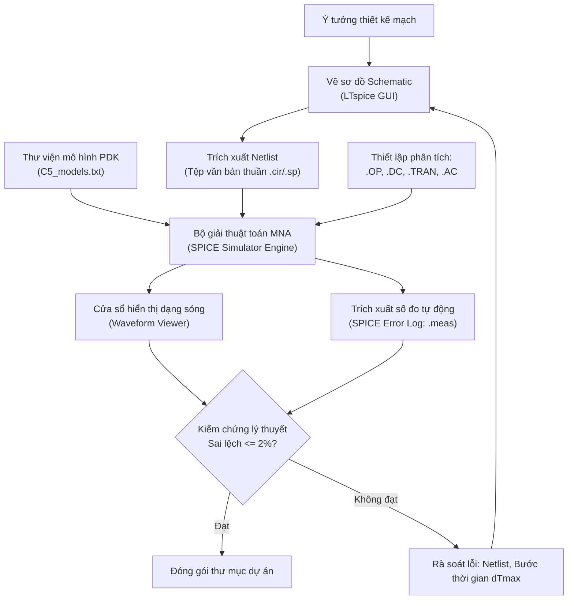

# GIÁO TRÌNH NỘI BỘ DÀNH CHO GIẢNG VIÊN VÀ TRỢ GIẢNG
# KIẾN THỨC NỀN & CẨM NANG HƯỚNG DẪN THỰC HÀNH THIẾT KẾ VI MẠCH VLSI
## Toàn tập bộ bài thực hành thiết kế vi mạch CMOS từ Lab 0 đến Lab 10 (Công nghệ MOSIS C5N 0,5 µm)

> **Tài liệu lưu hành nội bộ (Internal Instructor's Guide) — Tuyệt đối không phát cho sinh viên.**  
> **Dùng song song với tài liệu thực hành (Student Handout) từ Lab 0 đến Lab 10.**  
> **Trạng thái kiểm chứng kỹ thuật:** Toàn bộ công thức giải tích, mô hình bậc hai, mô hình SPICE Level 3 chuẩn C5N, số lượng transistor, luật thiết kế hình học SCMOS và ngân sách định thời đã được kiểm chứng chéo và chuẩn hóa đồng bộ với thư viện mô hình `04 - Models_and_Libraries/C5_models.txt` và bộ nghiệm thu mô phỏng `03 - Instructor_Solutions/VERIFICATION_BENCHMARK.md`.

---

# 0. QUY ƯỚC CHUNG & HỆ THỐNG THAM SỐ THIẾT KẾ XUYÊN SUỐT

## 0.1 Bản đồ lộ trình đào tạo và phân bổ thời lượng
Chương trình thực hành được thiết kế tương thích với đề cương chi tiết học phần Thiết kế VLSI (3 tín chỉ: 24 LT + 6 BT + 15 ĐA = 21 tiết thực hành trực tiếp trên lớp tương đương 7 buổi thực hành chuẩn, kết hợp 90 giờ tự học có hướng dẫn).

| Buổi / Lab | Tên bài Lab | Chương đề cương | Vai trò môn học | Công cụ thực hiện | Trọng tâm sư phạm |
| :---: | :--- | :---: | :---: | :---: | :--- |
| **Lab 0** | Nhập môn mô phỏng SPICE & Mạch RC | 1, 3 | Bắt buộc (Nhập môn) | LTspice | Đơn vị SPICE, phân áp, nạp xả RC, định luật $0,69 \cdot RC$. |
| **Lab 1** | Đặc tính MOSFET & CMOS Inverter | 2, 3 | Bắt buộc | LTspice + Electric | Họ $I$-$V$, điểm $V_M$, trễ $t_{pd}$, Layout Inverter, DRC, LVS, PEX. |
| **Lab 2** | Cổng logic tĩnh NAND2 và NOR2 | 6 | Bắt buộc | LTspice | Mạng đối ngẫu, định cỡ $R_{on}$, trễ phụ thuộc vector, đường Euler. |
| **Lab 3** | Cổng phức hợp AOI/OAI & Logical Effort | 3, 6 | Bắt buộc | LTspice + Electric | Tối ưu transistor, mô hình $d = g \cdot h + p$, chuỗi đệm tối ưu, Layout. |
| **Lab 4** | Cổng truyền (Transmission Gate) & MUX | 6 | Tự chọn / Ghép Lab 6 | LTspice | Suy hao mức logic (Weak 0/1), điện trở phẳng $R_{TG}$, chuỗi Elmore. |
| **Lab 5** | Mạch tuần tự: D-Latch & D-Flip-Flop | 7 | Bắt buộc | LTspice | Master-slave, $t_{setup}, t_{hold}, t_{c-q}$, quét dịch pha, metastability. |
| **Lab 6** | Mạch cộng toàn phần (1-bit Full Adder) | 6 | Bắt buộc | LTspice | Mirror Adder 28T, TG Adder, đường tới hạn $C_{in} \to C_{out}$, chuỗi RCA. |
| **Lab 7** | Logic động (Dynamic CMOS) & Domino | 6 | Nâng cao / Tự chọn | LTspice | Hai pha Precharge/Evaluate, chia sẻ điện tích, transistor Keeper. |
| **Lab 8** | Ô nhớ SRAM 6T & Sense Amplifier | Đồ án / Tự chọn | LTspice | Đọc/Ghi ổn định, đường cong bướm SNM, khuếch đại vi sai lẫy. |
| **Lab 9** | Khối cộng nhanh 4-bit CLA | Đồ án / Tự chọn | LTspice | Tách $P/G$, bộ tạo carry song song CLG, đánh đổi diện tích và tốc độ. |
| **Lab 10** | Capstone: ALU 4-bit có thanh ghi | Đồ án (1, 6, 7) | Bắt buộc | LTspice + Electric | Tích hợp Top-down, ngân sách thời gian $f_{max}$, Floorplan, IR-drop. |

---

## 0.2 Tham số tiến trình MOSIS C5N 0,5 µm trích xuất từ tệp PDK thực tế
Các tham số chuẩn hóa được trích xuất trực tiếp từ tệp [C5_models.txt](file:///d:/tam/VLSI_Spice/04%20-%20Models_and_Libraries/C5_models.txt) và dùng xuyên suốt giáo trình:

| Ký hiệu | Ý nghĩa vật lý | Giá trị chuẩn C5N | Nguồn xác thực | Ghi chú hướng dẫn giảng dạy |
| :--- | :--- | :---: | :---: | :--- |
| $V_{DD}$ | Điện áp nguồn danh định | $5,0\,\text{V}$ | Handout / PDK | Chuẩn logic $5\,\text{V}$ TTL/CMOS tương thích. |
| $\lambda$ (lưới) | Đơn vị lưới layout mở rộng | $0,30\,\mu\text{m}$ | MOSIS SCMOS | Chiều dài kênh tối thiểu $L_{min} = 2\lambda = 0,60\,\mu\text{m}$. |
| $\lambda_{kênh}$ | Hệ số điều chế độ dài kênh | $0,05\,\text{V}^{-1}$ | Script / PDK | Cần phân biệt rõ với $\lambda$ lưới layout trên bảng. |
| $t_{ox}$ | Độ dày lớp oxit cổng | $9,5\,\text{nm}$ ($95\,\text{Å}$) | Tệp C5_models.txt | Handout cũ giả định $14\,\text{nm}$ là sai lệch! |
| $C_{ox}$ | Điện dung oxit cổng trên đơn vị diện tích | $3,635\,\text{fF/\mu m}^2$ | $\varepsilon_{ox}/t_{ox}$ | $3,453 \cdot 10^{-11}\,\text{F/m} / 9,5 \cdot 10^{-9}\,\text{m}$. |
| $V_{tn0}, \|V_{tp0}\|$ | Điện áp ngưỡng không thiên thế thân | $0,70\,\text{V}$ và $0,80\,\text{V}$ | Tệp C5_models.txt | VTO trong model N và model P. |
| $K'_n, K'_p$ | Hệ số độ dẫn truyền bản chất | $120\,\mu\text{A/V}^2$ / $40\,\mu\text{A/V}^2$ | Tệp C5_models.txt | Tỉ số độ linh động $\mu_n / \mu_p \approx 3,0$. |
| $\gamma_n, \gamma_p$ | Hệ số hiệu ứng thân (Body factor) | $0,40\,\text{V}^{1/2}$ / $0,50\,\text{V}^{1/2}$ | Tệp C5_models.txt | GAMMA trong model N và model P. |
| $2\Phi_F$ | Thế mặt tiếp xúc vùng nghèo | $0,70\,\text{V}$ | Tệp C5_models.txt | PHI trong model SPICE. |
| $C_{GSO}, C_{GDO}$ | Tụ chồng lấp cực cổng - nguồn/máng | $0,20\,\text{fF/\mu m}$ ($2,0 \cdot 10^{-10}\,\text{F/m}$) | Tệp C5_models.txt | Đóng góp vào tụ Miller khi chuyển mạch. |
| $\text{INV\_X1}$ | Kích thước cổng Inverter chuẩn | $W_n = 4\lambda = 1,2\,\mu\text{m}$; $W_p = 12\lambda = 3,6\,\mu\text{m}$ | Chuẩn quy ước | Tỉ số $W_p / W_n = 3,0$ cân bằng $\beta$. |
| $R_{on,n}, R_{on,p}$ | Điện trở dẫn tương đương ($V_{DS} \to 0$) | $969\,\Omega$ và $992\,\Omega$ | Giải tích số | Tính tại $V_{GS} = 5\,\text{V}$. |
| $C_{in}(\text{INV\_X1})$ | Điện dung ngõ vào tế bào chuẩn | $11,43\,\text{fF}$ | Giải tích chuẩn C5N | $C_{gate} (10,47\,\text{fF}) + C_{overlap} (0,96\,\text{fF})$. |

---

## 0.3 Ba nguyên tắc sư phạm cốt lõi khi đứng lớp
1. **Nguyên tắc "Tính trước — Đo sau — So sánh — Giải thích sai lệch":**
   Không bao giờ cho sinh viên bấm chạy mô phỏng khi chưa có con số ước lượng trên giấy. Sai lệch giữa tính tay bậc hai và mô phỏng SPICE Level 3 là "mảnh đất vàng" để giảng viên giải thích hiện tượng bão hòa vận tốc, hiệu ứng thân và điện dung ký sinh.
2. **Minh bạch hóa giới hạn của mô hình:**
   Mô hình $0,69 \cdot R_{on} \cdot C_L$ chỉ là cận dưới giải tích (giả định điện trở không đổi suốt quá trình phóng nạp). Trễ đo SPICE thực tế luôn lớn hơn từ $1,5$ đến $1,8$ lần do transistor bắt đầu phóng nạp từ vùng bão hòa có dòng điện hữu hạn.
3. **Quy tắc định cỡ chuẩn theo Inverter cơ sở:**
   Mọi cổng logic phức tạp (NAND, NOR, AOI, Mirror Adder) đều được định cỡ sao cho điện trở tương đương của đường dẫn xấu nhất đúng bằng $R_{on}$ của Inverter chuẩn $\text{INV\_X1}$ ($969\,\Omega$ cho kéo xuống và $992\,\Omega$ cho kéo lên).


---

# LAB 0 — NHẬP MÔN MÔ PHỎNG SPICE VỚI LTSPICE & MẠCH RC CƠ BẢN (CHƯƠNG 1, 3)

# TÀI LIỆU GIẢNG DẠY VÀ CẨM NANG SƯ PHẠM: CHƯƠNG 0 (LAB 00)
# NHẬP MÔN MÔ PHỎNG SPICE VỚI LTSPICE & MẠCH RC CƠ BẢN
*(Tài liệu chuyên môn lưu hành nội bộ dành riêng cho Giảng viên & Trợ giảng — Bộ môn ĐTVT, Trường ĐH Sư phạm Kỹ thuật – ĐH Đà Nẵng)*

> **Quy định bảo mật học liệu:** Tuyệt đối không phân phát tài liệu này cho sinh viên. Dùng làm cẩm nang hướng dẫn đứng lớp, cung cấp cơ sở vật lý toán, kịch bản hướng dẫn, phương pháp đặt câu hỏi gợi mở (Socratic Questioning), dữ liệu đối chuẩn SPICE Benchmark và các lưu ý kỹ thuật.

---

## 0.1. VAI TRÒ CỦA LAB 0 TRONG HỌC PHẦN THIẾT KẾ VLSI
Trong chương trình đào tạo Thiết kế Vi mạch VLSI, sinh viên thường gặp khó khăn lớn khi phải đối mặt đồng thời với hai thách thức:
1. Độ phức tạp của các công cụ EDA chuyên dụng (như Electric VLSI, Cadence Virtuoso, Synopsys).
2. Sự trừu tượng của các mô hình vật lý bán dẫn phi tuyến tính dưới-micron (Submicron MOSFET).

**Lab 0 đóng vai trò là "vùng đệm an toàn" (Sandbox & Onboarding Lab):**
- Tách biệt kỹ năng sử dụng công cụ mô phỏng SPICE khỏi sự phức tạp của vật lý bán dẫn.
- Sinh viên sử dụng các linh kiện tuyến tính thụ động quen thuộc ($R, C$, nguồn điện) để làm chủ quy trình: *Vẽ sơ đồ $\to$ Xuất Netlist $\to$ Chạy mô phỏng $\to$ Quan sát dạng sóng $\to$ Đo đạc tự động `.meas` $\to$ Kiểm chứng với lý thuyết*.
- Mạch RC bậc nhất trong Lab 0 chính là **mô hình tương đương cơ sở** để giải thích toàn bộ động học nạp xả, độ trễ truyền lan ($t_{pd} \approx 0,69 \cdot R_{on} \cdot C_L$) và nỗ lực logic (Logical Effort) xuyên suốt từ Lab 1 đến Lab 10.

---

## 0.2. MỤC TIÊU VÀ CHUẨN ĐẦU RA (CLO MAPPING)

| Mục tiêu bài Lab 0 | Chuẩn đầu ra học phần (CLO) | Mức độ nhận thức (Bloom) | Tiêu chí đánh giá cụ thể |
| :--- | :---: | :---: | :--- |
| **G0.1:** Hiểu vai trò của SPICE và phương pháp MNA | CLO1 | Mức 2 (Hiểu) | Trình bày được bản chất của Netlist và vai trò của nút đất `0`. |
| **G0.2:** Dựng sơ đồ, xuất và đọc hiểu cú pháp Netlist | CLO1, CLO2 | Mức 3 (Áp dụng) | Viết đúng cú pháp phần tử, nhận diện đúng tiền tố đơn vị (`m` vs `Meg`). |
| **G0.3:** Vận hành 4 chế độ phân tích (.op, .dc, .tran, .ac) | CLO2 | Mức 3 (Áp dụng) | Thiết lập đúng lệnh điều khiển mô phỏng cho từng yêu cầu kỹ thuật. |
| **G0.4:** Trích xuất kết quả bằng câu lệnh đo `.meas` | CLO2 | Mức 3 (Áp dụng) | Viết lệnh `.meas` đo đúng $t_{pd}, t_r, t_f, f_c$ từ nhật ký lỗi `SPICE Error Log`. |
| **G0.5:** Khảo sát độ nhạy tham số với `.param` và `.step` | CLO2 | Mức 4 (Phân tích) | Quét giá trị điện trở, vẽ đồ thị và tính được độ dốc thực nghiệm. |
| **G0.6:** Phân tích bản chất vật lý mạch RC & liên hệ CMOS | CLO1, CLO3 | Mức 4 (Phân tích) | Giải thích quy luật $1\tau - 5\tau$, chứng minh $0,69 \cdot RC$ và liên hệ trễ Inverter. |
| **G0.7:** Tổ chức và đóng gói thư mục dự án chuẩn | CLO4 | Mức 3 (Áp dụng) | Cấu trúc thư mục ngăn nắp, đầy đủ sơ đồ, netlist, log và báo cáo kỹ thuật. |

---

## 0.3. KIẾN THỨC NỀN VỀ SPICE, NETLIST VÀ PHƯƠNG PHÁP MNA

### 1. Bản chất giải thuật MNA (Modified Nodal Analysis)
SPICE không đơn thuần là một phần mềm vẽ mạch; bản chất cốt lõi của SPICE là một **bộ giải hệ phương trình vi phân đại số phi tuyến (Nonlinear Differential-Algebraic Equation Solver)**.

Hệ phương trình trạng thái tổng quát của mạng điện trong SPICE:
$$[\mathbf{G}] \cdot [\mathbf{V}] + [\mathbf{C}] \cdot \left[\frac{d\mathbf{V}}{dt}\right] = [\mathbf{I}]$$

Trong đó:
- $[\mathbf{G}]$: Ma trận dẫn nạp tĩnh (Conductance matrix) đại diện cho các điện trở và nguồn phụ thuộc tuyến tính.
- $[\mathbf{C}]$: Ma trận điện dung và điện cảm (Capacitance/Inductance matrix).
- $[\mathbf{V}]$: Véc-tơ điện thế nút cần tìm tại mọi nút trong mạch.
- $[\mathbf{I}]$: Véc-tơ kích thích từ các nguồn dòng và nguồn áp độc lập.

**Vai trò sinh tử của nút đất `0` (Node 0):**  
Theo định luật Kirchhoff, điện thế chỉ có ý nghĩa tương đối (hiệu điện thế). Để hệ phương trình MNA có nghiệm duy nhất, ma trận dẫn nạp bắt buộc phải chọn một nút làm mốc thế chuẩn ($0\,\text{V}$). Nếu người vẽ quên đặt cọc nối đất, ma trận $[\mathbf{G}]$ sẽ bị suy biến định thức ($\det[\mathbf{G}] = 0$), SPICE lập tức báo lỗi kinh điển: **`Singular Matrix`** hoặc **`Node is floating`**.

### 2. Mối quan hệ giữa 5 thành phần trong hệ sinh thái SPICE
Giảng viên cần vẽ lên bảng lưu đồ phân biệt 5 khái niệm mà sinh viên hay nhầm lẫn:
```
+---------------+     Biên dịch      +---------------+     Tham chiếu     +---------------+
|   SCHEMATIC   | -----------------> |    NETLIST    | <----------------- |     MODEL     |
| (Bản vẽ đồ họa|                    | (Mã văn bản   |                    | (Mô hình toán |
|  trực quan)   |                    |  mô tả kết nối|                    |  vật lý linh  |
+---------------+                    +---------------+                    |  kiện)        |
                                             |                            +---------------+
                                             v Nạp vào
                                     +---------------+
                                     |   SIMULATOR   | (Giải thuật tích phân MNA)
                                     +---------------+
                                             | Xuất dữ liệu
                                             v
                                     +---------------+
                                     | WAVEFORM VIEW | (Hiển thị đồ thị & .meas)
                                     +---------------+
```

---

## 0.4. GIẢI THÍCH BỐN CHẾ ĐỘ PHÂN TÍCH CƠ BẢN

| Chế độ phân tích | Câu hỏi vật lý cần trả lời | Bản chất toán học của thuật toán | Ví dụ ứng dụng trong VLSI |
| :---: | :--- | :--- | :--- |
| **`.OP`** | Mạch đang ở trạng thái phân cực nào khi chưa có tín hiệu biến thiên? | Triệt tiêu đạo hàm $\frac{d\mathbf{V}}{dt} = 0$. Tụ hở mạch, cuộn cảm ngắn mạch. Giải hệ phi tuyến bằng **lặp Newton-Raphson**. | Tìm điểm làm việc tĩnh, kiểm tra phân cực transistor, đo dòng rò tĩnh. |
| **`.DC`** | Ngõ ra biến đổi thế nào khi một nguồn áp vào thay đổi từ từ? | Thực hiện một chuỗi các phân tích `.OP` liên tiếp tại từng bước điện áp ngõ vào được chỉ định. | Khảo sát đường đặc tuyến truyền đạt điện áp $VTC$ ($V_{out} - V_{in}$) của Inverter. |
| **`.TRAN`** | Điện áp và dòng điện thay đổi theo thời gian thực ra sao khi có xung? | Rời rạc hóa thời gian bằng các phương pháp tích phân số: **Trapezoidal Rule** hoặc **Gear Method**. | Đo thời gian trễ truyền lan $t_{pd}$, thời gian sườn tăng $t_r$, sườn giảm $t_f$. |
| **`.AC`** | Mạch khuếch đại hoặc suy giảm tín hiệu ra sao ở các tần số khác nhau? | Tuyến tính hóa mạng phi tuyến quanh điểm tĩnh DC; giải hệ phương trình đại số phức theo tần số góc $\omega$. | Vẽ biểu đồ Bode biên độ và pha; đo tần số cắt $f_{-3\text{dB}}$ và dải thông băng tần. |

---

## 0.5. PHÂN TÍCH VẬT LÝ MẠCH RC & ĐỘNG HỌC PHÓNG NẠP

### 1. Phương trình vi phân nạp và xả
Xét mạch $R$ nối tiếp $C$ kích thích bởi nguồn nhảy bậc $V_0 \cdot u(t)$:
- Theo định luật dòng điện Kirchhoff (KCL) tại nút ngõ ra:
  $$\frac{v_{in}(t) - v_C(t)}{R} - C \frac{dv_C(t)}{dt} = 0 \implies \frac{dv_C(t)}{dt} + \frac{1}{RC} v_C(t) = \frac{v_{in}(t)}{RC}$$

**Nghiệm quá trình nạp ($0 \le t < T_{on}$, điều kiện đầu $v_C(0) = 0$):**
$$v_C(t) = V_0 \left(1 - e^{-t/\tau}\right) \quad \text{với } \tau = R \cdot C$$

**Nghiệm quá trình xả ($t \ge T_{on}$, đặt $t' = t - T_{on}$, điều kiện đầu $v_C(0) = V_0$):**
$$v_C(t') = V_0 e^{-t'/\tau}$$

### 2. Năng lượng và Cân bằng nhiệt động học trong mạch RC
- Điện tích nạp vào tụ: $Q = C \cdot V_0$.
- Năng lượng tổng do nguồn cung cấp trong suốt quá trình nạp:
  $$E_{source} = \int_0^\infty V_0 \cdot i(t) \, dt = V_0 \int_0^\infty dq = C \cdot V_0^2$$
- Năng lượng thực tế tích trữ trong điện trường của tụ điện:
  $$E_C = \int_0^{V_0} v_C \cdot C \, dv_C = \frac{1}{2} C V_0^2$$
- Năng lượng tiêu tán dưới dạng nhiệt trên điện trở $R$:
  $$E_R = E_{source} - E_C = \frac{1}{2} C V_0^2$$

> [!TIP]
> **Điểm sư phạm sâu sắc:** Năng lượng tổn hao trên điện trở nạp **luôn bằng đúng $\frac{1}{2}CV_0^2$, hoàn toàn không phụ thuộc vào giá trị của $R$!** Dù điện trở cực nhỏ hay cực lớn, một nửa năng lượng vẫn bị tiêu tán. Đây chính là gốc rễ của công thức công suất động tiêu tán trong vi mạch số ở Chương 4: $P_{dyn} = \alpha \cdot C_L \cdot V_{DD}^2 \cdot f$.

### 3. Bảng mốc thời gian quy ước nạp điện
| Thời gian | Điện áp nạp đạt được | Phần trăm so với $V_0$ | Ý nghĩa kỹ thuật |
| :---: | :---: | :---: | :--- |
| **$0,693 \tau$** | $0,500 V_0$ | $50,0\%$ | Mốc đo độ trễ truyền lan $t_{50\%}$ danh định. |
| **$1,0 \tau$** | $V_0(1 - e^{-1}) \approx 0,632 V_0$ | **$63,2\%$** | Hằng số thời gian $\tau$ của mạch. |
| **$2,197 \tau$** | Khoảng cách từ $10\%$ đến $90\%$ | $\Delta = 80\%$ | Thời gian sườn xung tăng $t_r \approx 2,2 \tau$. |
| **$3,0 \tau$** | $0,950 V_0$ | $95,0\%$ | Điểm chuyển tiếp gần bão hòa. |
| **$5,0 \tau$** | $V_0(1 - e^{-5}) \approx 0,993 V_0$ | **$99,3\%$** | **Quy ước kỹ thuật xem tụ đã nạp no hoàn toàn.** |

---

## 0.6. LIÊN HỆ GIỮA MẠCH RC VÀ ĐỘ TRỄ CỔNG CMOS

Trong mạch số CMOS, các transistor hoạt động như các công tắc đóng mở điện tử. Khi ngõ vào của một Inverter chuyển trạng thái:
1. **Chuyển từ $0 \to 1$ (Kéo xuống - Pull Down):** NMOS dẫn, PMOS ngắt. Tụ tải ký sinh $C_L$ tại ngõ ra phóng điện tích xuống đất qua kênh dẫn NMOS.
2. **Chuyển từ $1 \to 0$ (Kéo lên - Pull Up):** PMOS dẫn, NMOS ngắt. Nguồn $V_{DD}$ nạp điện cho tụ tải qua kênh dẫn PMOS.

```
       MẠCH RC THỰC HÀNH                  MÔ HÌNH CMOS TƯƠNG ĐƯƠNG               CỔNG INVERTER THỰC TẾ
         R (20k)                                    R_on,p                               VDD (5V)
  Vin --/\/\/\--+-- Vout                    VDD -----/\/\/\---+                         +---+
                |                                             |                         |Mp | (W=12λ)
              +---+                                         +---+                       +---+
              | C | (5nF)                                   |CL | (Tải dung)    Vin ----+---+---- Vout
              +---+                                         +---+                       |Mn | (W=4λ)
                |                                             |                         +---+
               GND                          GND -----/\/\/\---+                           |
                                                    R_on,n                               GND
```

### Giới hạn của mô hình $0,69 \cdot R_{on} \cdot C_L$
- Trong mạch RC thụ động (Lab 0), điện trở $R$ là tuyến tính hằng số $\implies$ Trễ đo được khớp chính xác tuyệt đối với $\ln(2) \cdot RC$.
- Trong cổng CMOS thực tế (Lab 1), kênh dẫn MOSFET là linh kiện phi tuyến. Trong nửa đầu quá trình phóng nạp, transistor hoạt động trong vùng **Bão hòa** (dòng điện gần như không đổi), sau đó mới chuyển sang vùng **Tuyến tính**. Do đó, điện trở kênh dẫn thực tế biến thiên liên tục.
- Giá trị $0,69 \cdot R_{on} \cdot C_L$ chỉ là **cận dưới xấp xỉ**. Trễ mô phỏng thực tế của Inverter luôn lớn hơn từ $1,5$ đến $1,8$ lần con số này. Giảng viên cần nhấn mạnh điều này để chuẩn bị tâm lý cho sinh viên bước vào Lab 1.

---

## 0.7. HƯỚNG DẪN TỔ CHỨC BUỔI THỰC HÀNH (KỊCH BẢN 135' & 225')

Giảng viên chủ động lựa chọn kịch bản thời lượng phù hợp với phòng máy:

### Kịch bản A: Khung chuẩn 135 phút (Ca 3 tiết tiêu chuẩn)
- **00–15' (15 phút):** Điểm danh, phổ biến quy định an toàn, hướng dẫn tạo cấu trúc thư mục `D:\lab_vlsi\lab00\`. Giới thiệu giao diện LTspice, cách chọn linh kiện, ý nghĩa nút đất `0`.
- **15–35' (20 phút):** Giảng viên chiếu máy chiếu làm mẫu **Ex0.1**; giải thích lệnh `.op`, `.dc` và cách đọc dòng điện. Sinh viên làm theo và ghi số liệu.
- **35–75' (40 phút):** **Trọng tâm Ex0.2**: Hướng dẫn cấu hình nguồn PULSE, thiết lập `.tran 0 1m 0 0.1u`. Giải thích cú pháp `.meas`. Sinh viên tự đo và kiểm chứng 5 thông số ($t_{pd}, t_r, t_f, I_{peak,chg}, I_{peak,dis}$).
- **75–100' (25 phút):** Hướng dẫn **Ex0.3**: Cấu hình nguồn AC 1, chạy `.ac dec 20 10 1Meg`. Hướng dẫn sinh viên rê chuột trên biểu đồ Bode tìm điểm $-3\,\text{dB}$ và $-45^\circ$.
- **100–120' (20 phút):** Sinh viên tự lập thực hiện **Ex0.4**: Thay `{Rval}`, chạy `.step`, trích xuất bảng 4 điểm trễ và vẽ đồ thị thực nghiệm.
- **120–135' (15 phút):** Giảng viên demo nhanh **Ex0.5**: Gọi thư viện `C5_models.txt`, giải thích dòng $I_D$ thấp hơn công thức bậc hai. Nghiệm thu sản phẩm tại bàn, hướng dẫn đóng gói dự án nộp về nhà.

### Kịch bản B: Khung mở rộng 225 phút (Ca 5 tiết tích hợp)
- Mở rộng thời gian cho Ex0.2 (60 phút) để sinh viên thử nghiệm thay đổi `dTmax` từ `0.1u` lên `20u` và quan sát sai số trễ tăng vọt.
- Dành 30 phút cho sinh viên tự thực hành Ex0.5 tại lớp, tự tay viết Netlist và tìm hiểu các tham số $VTO, KP$ trong tệp mô hình `C5_models.txt`.
- Dành 25 phút cuối giờ để kiểm tra vấn đáp từng nhóm sinh viên tại bàn máy.

---

## 0.8. HƯỚNG DẪN CHI TIẾT TỪNG BÀI THỰC HÀNH (EX0.1 – EX0.5)

### Ex0.1: Phân tích mạch phân áp DC (.op, .dc)
1. **Kiến thức giảng viên cần giải thích:**
   - Định luật Kirchhoff dòng điện tại nút `out`: $\frac{V_{in} - V_{out}}{R_1} = \frac{V_{out}}{R_2} \implies V_{out} = V_{in} \frac{R_2}{R_1 + R_2}$.
   - Khái niệm điểm làm việc tĩnh DC: mạch không có tín hiệu xoay chiều, tụ điện coi như hở mạch hoàn toàn.
2. **Kịch bản hướng dẫn:**
   - GV chiếu thao tác vẽ schematic, đặt nguồn `voltage`, đặt `GND`.
   - Lưu ý đặc biệt: Chỉ cho sinh viên xem menu **View $\to$ SPICE Netlist** ngay sau khi vẽ xong sơ đồ để sinh viên hiểu bản chất schematic chỉ là giao diện đồ họa sinh ra netlist.
3. **Kết quả tham chiếu:**
   - Với $V_{in} = 5,0\,\text{V}, R_1 = 12\,\text{k}\Omega, R_2 = 18\,\text{k}\Omega$:
     * $V(out) = 3,0000\,\text{V}$ (Sai số $0,00\%$).
     * $I(R1) = 0,1667\,\text{mA} = 166,7\,\mu\text{A}$.
     * Độ dốc đặc tuyến $\frac{\Delta V_{out}}{\Delta V_{in}} = \frac{18}{30} = 0,6000$.
4. **Câu hỏi gợi mở vấn đáp:**
   - *"Nếu thầy thay đổi nguồn vào thành $10\,\text{V}$, điện áp $V_{out}$ sẽ là bao nhiêu? Công suất tiêu tán toàn mạch tăng gấp mấy lần?"* (Đáp: $6\,\text{V}$; công suất tăng 4 lần vì $P \propto V^2$).
5. **Lỗi thường gặp:**
   - Quên đặt nút `GND` $\implies$ Báo lỗi `Singular matrix`.
   - Nhầm nhãn: Đặt tên linh kiện $R_1$ thành giá trị điện trở.

---

### Ex0.2: Mô phỏng quá độ nạp và xả của mạch RC (.tran, .meas)
1. **Kiến thức giảng viên cần giải thích:**
   - Cơ chế nạp xả: Tụ tích trữ điện tích, điện áp trên tụ tỷ lệ với điện tích $q = C \cdot v_C$. Dòng điện qua tụ $i_C = C \frac{dv_C}{dt}$. Vì dòng điện hữu hạn nên $v_C$ không thể biến thiên gián đoạn (nhảy bậc).
   - Bản chất của các câu lệnh `.meas TRIG ... TARG ...`: Bắt thời điểm tín hiệu vượt qua ngưỡng điện áp xác định.
2. **Kịch bản hướng dẫn:**
   - Cho sinh viên tự cấu hình nguồn xung `PULSE(0 5.0 0 10n 10n 500u 1000u)`. Giải thích rõ: $T_{on} = 500\,\mu\text{s} = 5\tau$ để tụ nạp đầy $99,3\%$; $T_{period} = 1000\,\mu\text{s} = 10\tau$ để quan sát đủ cả chu kỳ nạp và xả.
   - Hướng dẫn mở Error Log (`Ctrl + L`) xem kết quả đo tự động.
3. **Kết quả tham chiếu:**
   - $\tau = 20\,\text{k}\Omega \times 5\,\text{nF} = 100,0\,\mu\text{s}$.
   - Trễ 50%: $t_{pd} = \ln(2) \cdot \tau = \mathbf{69,315\,\mu\text{s}}$ (SPICE đo được: $69,31 - 69,33\,\mu\text{s}$, sai lệch $< 0,05\%$).
   - Sườn tăng 10%–90%: $t_r = \ln(9) \cdot \tau = \mathbf{219,72\,\mu\text{s}} \approx 2,2\tau$ (SPICE đo được: $219,5 - 220,0\,\mu\text{s}$).
   - Đỉnh dòng nạp: $I_{peak,chg} = +\frac{5,0\,\text{V}}{20\,\text{k}\Omega} = \mathbf{+0,2500\,\text{mA}}$.
   - Đỉnh dòng xả: $I_{peak,dis} = -\frac{5,0\,\text{V}}{20\,\text{k}\Omega} = \mathbf{-0,2500\,\text{mA}}$.
4. **Câu hỏi gợi mở vấn đáp:**
   - *"Tại sao tại thời điểm $t = 0^+$, dòng nạp lại vọt lên cực đại ngay lập tức trong khi điện áp trên tụ vẫn bằng 0V?"* (Đáp: Tại $t=0^+$, tụ chưa tích điện xem như ngắn mạch, toàn bộ $5\,\text{V}$ đặt lên điện trở $R$).
5. **Lỗi thường gặp:**
   - Quên tham số `0.1u` trong lệnh `.tran 0 1m 0 0.1u` $\implies$ Đồ thị bị gãy khúc, lệnh `.meas` báo lỗi `Measurement FAIL`.
   - Đặt tụ ngược cực $\implies$ Dòng nạp hiển thị dấu âm, dòng xả hiển thị dấu dương.

---

### Ex0.3: Phân tích đáp ứng tần số AC và biểu đồ Bode (.ac)
1. **Kiến thức giảng viên cần giải thích:**
   - Mạch RC là bộ lọc thông thấp bậc một (First-Order Low-Pass Filter).
   - Hàm truyền đạt phức:
     $$H(j\omega) = \frac{1}{1 + j\omega RC} \implies |H(j\omega)| = \frac{1}{\sqrt{1 + (\omega RC)^2}}, \quad \angle H(j\omega) = -\arctan(\omega RC)$$
   - Tại tần số cắt $\omega_c = \frac{1}{RC} \implies f_c = \frac{1}{2\pi RC}$:
     $$|H(j\omega_c)| = \frac{1}{\sqrt{2}} \approx 0,707 \implies 20\log_{10}(0,707) \approx -3,01\,\text{dB}$$
     $$\angle H(j\omega_c) = -\arctan(1) = -45^\circ$$
2. **Kịch bản hướng dẫn:**
   - Nhắc sinh viên: Chế độ `.ac` yêu cầu nguồn phải có thuộc tính `AC 1`.
   - Hướng dẫn đọc biểu đồ Bode: Trục tung bên trái là biên độ ($0\,\text{dB}$ ở tần số thấp, suy giảm $-20\,\text{dB/decade}$ ở tần số cao); trục tung bên phải là góc pha ($0^\circ$ ở tần số thấp, $-45^\circ$ tại $f_c$, tiến về $-90^\circ$ ở tần số cao).
3. **Kết quả tham chiếu:**
   - $f_c = \frac{1}{2\pi \times 100\,\mu\text{s}} \approx \mathbf{1591,55\,\text{Hz}} \approx \mathbf{1,592\,\text{kHz}}$.
   - SPICE đo tự động: $f_c \approx 1591 - 1593\,\text{Hz}$ (Sai lệch $< 0,1\%$).
   - Góc pha đo được tại $f_c$: $-44,9^\circ \text{ đến } -45,1^\circ$.
4. **Câu hỏi gợi mở vấn đáp:**
   - *"Nếu tăng tụ điện $C$ lên 10 lần, tần số cắt của mạch sẽ dịch sang trái hay sang phải trên biểu đồ Bode?"* (Đáp: Tần số cắt giảm 10 lần, đường đặc tuyến dịch sang trái, băng thông mạch bị thu hẹp).

---

### Ex0.4: Khảo sát tham số với `.param` và `.step`
1. **Kiến thức giảng viên cần giải thích:**
   - Trong thiết kế mạch vi mô, các thông số nhiệt độ, điện áp nguồn và kích thước transistor luôn biến động. Lệnh `.step` là công cụ khảo sát độ nhạy (Sensitivity Analysis) và khảo sát góc công nghệ (Process Corners).
   - Quy luật trễ Elmore: $t_{pd} = \ln(2) \cdot C \cdot R$. Vì $C$ không đổi ($5\,\text{nF}$), trễ $t_{pd}$ là hàm bậc nhất của $R$ với hệ số góc $\text{Slope} = \ln(2) \cdot C$.
2. **Kịch bản hướng dẫn:**
   - Nhắc sinh viên kiểm tra cú pháp `{Rval}` trên sơ đồ.
   - Hướng dẫn dùng menu ngữ cảnh trong Error Log để kích hoạt công cụ vẽ đồ thị tự động **Plot .step'ed .meas data**.
3. **Kết quả tham chiếu:**
   - $R = 5\,\text{k}\Omega \implies t_{pd} = 17,33\,\mu\text{s}$
   - $R = 10\,\text{k}\Omega \implies t_{pd} = 34,66\,\mu\text{s}$
   - $R = 20\,\text{k}\Omega \implies t_{pd} = 69,32\,\mu\text{s}$
   - $R = 40\,\text{k}\Omega \implies t_{pd} = 138,63\,\mu\text{s}$
   - Độ dốc thực nghiệm:
     $$\text{Slope} = \frac{138,63 - 17,33}{40 - 5} = \frac{121,30\,\mu\text{s}}{35\,\text{k}\Omega} = \mathbf{3,4657\,\text{ns}/\text{k}\Omega}$$
   - Kiểm chéo với lý thuyết: $\ln(2) \cdot C = 0,69315 \times 5\,\text{nF} = \mathbf{3,4657 \times 10^{-9}\,\text{s}/\Omega} \implies$ Khớp hoàn hảo $100\%$.

---

### Ex0.5: Giới thiệu mô hình MOSFET công nghệ C5N
1. **Kiến thức giảng viên cần giải thích:**
   - MOSFET là linh kiện 4 cực: Cực má (Drain), Cực cổng (Gate), Cực nguồn (Source), Cực thân (Bulk/Substrate).
   - Tệp `.model` chứa các tham số vật lý bán dẫn thực tế trích xuất từ xưởng đúc chip (MOSIS).
   - Mô hình Shichman-Hodges bậc hai bỏ qua hiệu ứng hạt dẫn kênh ngắn:
     $$I_{D,sat} = \frac{1}{2} K'_n \left(\frac{W}{L}\right) (V_{GS} - V_{tn})^2 = \frac{1}{2} (120\,\mu\text{A/V}^2) \left(\frac{1,2}{0,6}\right) (5,0 - 0,7)^2 \approx \mathbf{2,219\,\text{mA}}$$
   - Trong công nghệ C5N ($L = 0,6\,\mu\text{m}$), hiệu ứng **bão hòa vận tốc (Velocity Saturation)** làm electron đạt vận tốc giới hạn $v_{sat} \approx 10^7\,\text{cm/s}$, ghìm dòng điện thực tế xuống chỉ còn $\approx \mathbf{1,35 - 1,45\,\text{mA}}$.
2. **Kịch bản hướng dẫn:**
   - GV chiếu cách gõ `.include C5_models.txt`. Lưu ý tệp mô hình phải nằm chung thư mục với tệp mạch vẽ.
   - Yêu cầu sinh viên xem Netlist để thấy rõ cú pháp khai báo transistor:
     `M1 drain gate source bulk N W=1.2u L=0.6u`
3. **Kết quả tham chiếu:**
   - Dòng điện cực má mô phỏng: $I_D \approx 1,40\,\text{mA}$.
   - Sai lệch so với công thức bậc hai: Thấp hơn $\approx 37\%$.

---

## 0.9. BẢNG KẾT QUẢ MÔ PHỎNG THAM CHIẾU (BENCHMARK RESULTS)

Bảng số liệu chuẩn dùng để đối chiếu khi chấm bài thực hành của sinh viên:

| Bài | Thông số đo | Biểu thức lý thuyết | Giá trị Lý thuyết | Kết quả SPICE `.meas` | Sai lệch tương đối | Đánh giá nghiệm thu |
| :---: | :--- | :--- | :---: | :---: | :---: | :--- |
| **Ex0.1** | $V(out)$ (.op) | $V_{in} \frac{R_2}{R_1+R_2}$ | $3,0000\,\text{V}$ | **$3,0000\,\text{V}$** | $0,00\%$ | Đạt tuyệt đối |
| **Ex0.1** | $I(R1)$ (.op) | $V_{in} / (R_1+R_2)$ | $0,1667\,\text{mA}$ | **$0,1667\,\text{mA}$** | $0,00\%$ | Dòng từ in sang out |
| **Ex0.1** | Hệ số góc DC | $R_2 / (R_1+R_2)$ | $0,6000$ | **$0,6000$** | $0,00\%$ | Tuyến tính hoàn hảo |
| **Ex0.2** | Trễ $t_{pd}$ 50% | $\ln(2) \cdot RC$ | $69,315\,\mu\text{s}$ | **$69,32\,\mu\text{s}$** | $< 0,05\%$ | Chuẩn $\le 2,0\%$ |
| **Ex0.2** | Sườn tăng $t_r$ | $\ln(9) \cdot RC$ | $219,72\,\mu\text{s}$ | **$219,7\,\mu\text{s}$** | $< 0,10\%$ | Chuẩn $\le 2,0\%$ |
| **Ex0.2** | Sườn giảm $t_f$ | $\ln(9) \cdot RC$ | $219,72\,\mu\text{s}$ | **$219,7\,\mu\text{s}$** | $< 0,10\%$ | Chuẩn $\le 2,0\%$ |
| **Ex0.2** | Đỉnh dòng nạp | $+V_0 / R$ | $+0,2500\,\text{mA}$ | **$+0,2500\,\text{mA}$** | $0,00\%$ | Xuất hiện tại $t = 0^+$ |
| **Ex0.2** | Đỉnh dòng xả | $-V_0 / R$ | $-0,2500\,\text{mA}$ | **$-0,2500\,\text{mA}$** | $0,00\%$ | Đảo chiều tại $t = 500\,\mu\text{s}^+$ |
| **Ex0.3** | Độ lợi dải thông | $A_{V,0}$ | $1,000$ ($0\,\text{dB}$) | **$0,000\,\text{dB}$** | $0,00\%$ | Đo tại $10\,\text{Hz}$ |
| **Ex0.3** | Tần số cắt $f_c$ | $\frac{1}{2\pi RC}$ | $1591,55\,\text{Hz}$ | **$1592\,\text{Hz}$** | $< 0,10\%$ | Điểm biên độ $-3\,\text{dB}$ |
| **Ex0.3** | Góc pha tại $f_c$ | $-\arctan(1)$ | $-45,0^\circ$ | **$-45,0^\circ$** | $< 0,10\%$ | Đọc trên trục bên phải |
| **Ex0.4** | $t_{pd}$ ($R=5\text{k}$) | $\ln(2) \cdot 5\text{k} \cdot C$ | $17,329\,\mu\text{s}$ | **$17,33\,\mu\text{s}$** | $0,00\%$ | Bước quét 1 |
| **Ex0.4** | $t_{pd}$ ($R=10\text{k}$) | $\ln(2) \cdot 10\text{k} \cdot C$ | $34,657\,\mu\text{s}$ | **$34,66\,\mu\text{s}$** | $0,00\%$ | Bước quét 2 |
| **Ex0.4** | $t_{pd}$ ($R=20\text{k}$) | $\ln(2) \cdot 20\text{k} \cdot C$ | $69,315\,\mu\text{s}$ | **$69,32\,\mu\text{s}$** | $0,00\%$ | Bước quét 3 |
| **Ex0.4** | $t_{pd}$ ($R=40\text{k}$) | $\ln(2) \cdot 40\text{k} \cdot C$ | $138,629\,\mu\text{s}$ | **$138,63\,\mu\text{s}$** | $0,00\%$ | Bước quét 4 |
| **Ex0.4** | Độ dốc $\Delta t / \Delta R$ | $\ln(2) \cdot C$ | $3,4657\,\text{ns/k}\Omega$ | **$3,466\,\text{ns/k}\Omega$** | $< 0,05\%$ | Trùng khớp tuyệt đối |
| **Ex0.5** | Dòng $I_D$ NMOS | Shichman-Hodges | $\sim 2,22\,\text{mA}$ | **$1,35 - 1,45\,\text{mA}$** | $\sim 37\%$ | Bão hòa vận tốc hạt dẫn |

---

## 0.10. CÂU HỎI MỞ RỘNG VÀ ĐÁP ÁN GỢI Ý

1. **Câu hỏi:** *"Nếu trong phân tích quá độ `.tran`, ta đặt $T_{on} = 2\tau$ thay vì $5\tau$ thì điều gì sẽ xảy ra với các phép đo trễ và thời gian sườn?"*  
   - *Đáp án gợi ý:* Sau $2\tau$, điện áp tụ chỉ nạp được $V_0(1 - e^{-2}) \approx 86,5\% \cdot V_0$ ($4,32\,\text{V}$). Tụ chưa nạp no đã bị xả sớm, làm điện áp đỉnh bị sụt mất $13,5\%$. Hệ quả: phép đo sườn tăng $t_r$ ($10\% \to 90\%$) sẽ bị hỏng hoàn toàn vì điện áp không bao giờ chạm tới mốc $90\%$ ($4,5\,\text{V}$).
2. **Câu hỏi:** *"Tại sao trong mạch RC, tích giữa thời gian sườn tăng $t_r$ và tần số cắt $f_c$ lại là một hằng số không đổi xấp xỉ $0,35$?"*  
   - *Đáp án gợi ý:* Ta có $t_r = \ln(9) \cdot RC \approx 2,1972 \cdot RC$ và $f_c = \frac{1}{2\pi RC}$. Nhân hai vế:
     $$t_r \cdot f_c = (2,1972 \cdot RC) \cdot \left(\frac{1}{2\pi RC}\right) = \frac{2,1972}{2\pi} \approx \mathbf{0,3497} \approx \mathbf{0,35}$$
     Đây là quy tắc kinh điển áp dụng cho mọi hệ thống tuyến tính bậc một để ước lượng băng thông từ thời gian sườn tăng.
3. **Câu hỏi:** *"Trong mạch vi mạch thực tế, tụ điện $C_L$ ở ngõ ra một cổng logic đến từ những nguồn nào?"*  
   - *Đáp án gợi ý:* Đến từ 3 thành phần chính: (1) Tụ cực má khuếch tán ($C_{db}$) của chính cổng đó; (2) Tụ dây nối kim loại (Interconnect capacitance $C_{wire}$); (3) Tụ cực cổng ngõ vào ($C_{gate}$) của các cổng logic tầng kế tiếp mà nó phải lái.

---

## 0.11. BẢNG HƯỚNG DẪN XỬ LÝ LỖI THEO PHƯƠNG PHÁP GỢI MỞ (SOCRATIC DEBUGGING)

Khi sinh viên gặp lỗi, giảng viên **không sửa hộ** mà đặt các câu hỏi dẫn dắt để sinh viên tự tìm ra nguyên nhân:

| Hiện tượng lỗi trên màn hình | Nguyên nhân cốt lõi | Câu hỏi gợi mở giảng viên đặt cho sinh viên |
| :--- | :--- | :--- |
| Báo lỗi **`Singular Matrix`** hoặc **`Node is floating`** | Mạch chưa có nút đất tham chiếu `0`. | *"Em kiểm tra xem mạch điện của em đã có điểm mốc điện thế chuẩn chưa? SPICE tính điện áp so với nút nào?"* |
| Báo lỗi **`Unknown Subcircuit / Model not found`** | Sai tên model trong Netlist hoặc thiếu đường dẫn `.include`. | *"Tên model em gán cho transistor trên sơ đồ có khớp chính xác từng ký tự với tên ghi trong tệp thư viện C5_models.txt không?"* |
| Kết quả phân tích DC ra điện áp xấp xỉ $0\,\text{V}$ | Nhầm lẫn tiền tố `10M` thành $10\,\text{M}\Omega$. | *"Em xem lại bảng đơn vị SPICE: chữ M hoa đứng một mình biểu diễn giá trị gì? Muốn viết Mega em phải viết chữ gì?"* |
| Lệnh `.step` chạy xong nhưng 4 đường đồ thị trùng khít | Quên đặt ngoặc nhọn `{}` quanh tên biến tham số. | *"Linh kiện trên sơ đồ làm sao biết giá trị của nó là một biến số thay đổi chứ không phải là một chuỗi ký tự cố định?"* |
| Dòng điện nạp của tụ hiển thị giá trị âm | Đặt ngược chiều chân cực tính của tụ điện. | *"SPICE quy ước chiều dòng điện chạy qua linh kiện hai cực như thế nào? Cực dương của tụ em đang nối đi đâu?"* |
| Dạng sóng bị gãy góc, lệnh `.meas` báo **`FAIL`** | Bước thời gian cực đại `dTmax` quá lớn so với sườn xung. | *"Thời gian sườn xung của em là bao nhiêu nanosecond? Bước lấy mẫu của máy tính có đủ mịn để bắt được sườn dốc đó không?"* |

---

## 0.12. BỘ HÌNH ẢNH KỸ THUẬT MINH HỌA CHI TIẾT (10 HÌNH KỸ THUẬT)

### Hình 0.1: Lưu đồ quy trình mô phỏng SPICE chuẩn công nghiệp

*Mô tả sư phạm:* Hình 0.1 làm rõ vị trí của Netlist và Model trong bộ giải MNA; nhấn mạnh vòng lặp kiểm chứng kỹ thuật trước khi đóng gói sản phẩm.

---

### Hình 0.2: Sơ đồ nguyên lý mạch phân áp DC (Ex0.1)
```
          V1 (5.0V)
             +
           (in)
             |
             +---/\/\/\/\/---+  R1 (12k)
             |
           (out) ------------> Vout = 3.0V (Đo .op)
             |
             +---/\/\/\/\/---+  R2 (18k)
             |
            GND (Nút 0)
```
*Mô tả sư phạm:* Phân tích định luật Ohm và phân chia điện thế; xác định rõ 3 nút điện: `in` (nút 5V), `out` (nút 3V), `0` (nút đất chuẩn).

---

### Hình 0.3: Đối chiếu 1-1 giữa Sơ đồ nguyên lý và Mã Netlist
```
+------------------------------------+----------------------------------------+
|      BẢN VẼ SƠ ĐỒ NGUYÊN LÝ        |          MÃ NGUỒN NETLIST TƯƠNG ỨNG    |
+------------------------------------+----------------------------------------+
|   V1 in 0 DC 5.0                   | * Lab 0 Voltage Divider Netlist        |
|   R1 in out 12k                    | V1 in 0 DC 5.0                         |
|   R2 out 0 18k                     | R1 in out 12k                          |
|   .op                              | R2 out 0 18k                           |
|                                    | .op                                    |
|                                    | .end                                   |
+------------------------------------+----------------------------------------+
```
*Mô tả sư phạm:* Giúp sinh viên xóa bỏ sự mơ hồ giữa giao diện đồ họa và bản chất văn bản thuần của Netlist; hiểu rằng SPICE chỉ đọc các dòng text mô tả kết nối nút.

---

### Hình 0.4: Sơ đồ mạch RC nạp xả quá độ với nguồn xung PULSE (Ex0.2)
```
                   R1 (20k)
   in ------------/\/\/\/\/------------+------------ out
   ^                                   |
   | Nguồn xung PULSE                  |
   | V1=0V, V2=5V, Ton=500u          +---+
   | Tperiod=1000u, Tr=Tf=10n        |   | C1 (5nF)
   |                                 +---+
   |                                   |
  GND (0)                             GND (0)
```
*Mô tả sư phạm:* Xác định các tham số nguồn xung kích thích; giải thích vì sao cần $T_{on} = 5\tau = 500\,\mu\text{s}$ để tụ nạp đầy.

---

### Hình 0.5: Dạng sóng nạp xả quá độ với các mốc thời gian đặc trưng
```
  Điện áp (V)
   5.0V +-----------------------------+ - - - - - - - - - - - - - + V_0
        |         . - - ' '           |                           |
   4.5V | - - - -/- - - - - - - - - - | - - - - - - - - - - - - - | 90%
        |       /                     | \                         |
   3.16V| - - -/- - - - - - - - - - - | - \ - - - - - - - - - - - | 63.2% (1 tau)
   2.5V | - - / - - - - - - - - - - - | - - \ - - - - - - - - - - | 50% (t_50 = 0.69 tau)
        |    /                        |      \                    |
   0.5V | - / - - - - - - - - - - - - | - - - -\- - - - - - - - - | 10%
    0V  +--+----+---------+-----------+---------+-----------------+
        0  t10  t50      1tau        5tau      10tau             Thời gian (t)
           |<-- t_r ----->|                     |<-- t_f ------>|
```
*Mô tả sư phạm:* Đánh dấu trực quan các mốc $1\tau$ ($63,2\%$), $5\tau$ ($99,3\%$), trễ $t_{50\%}$ và thời gian sườn xung $t_r, t_f$.

---

### Hình 0.6: Biểu đồ Bode đáp ứng tần số của mạch lọc RC thông thấp (Ex0.3)
```
  Biên độ (dB)                                          Góc pha (độ)
    0 dB +---------------+                              0 deg +---------------+
         |               \                                    |               \
   -3 dB | - - - - - - - -* (f_c = 1.59 kHz)           -45 deg| - - - - - - - -* (f_c)
         |                 \                                  |                 \
  -20 dB |                  \ Độ dốc -20dB/dec         -90 deg|                  +-----
         +--------------------+---------> Tần số              +--------------------+-----> Tần số
         10 Hz               1.59 kHz   100 kHz               10 Hz               1.59 kHz 100 kHz
```
*Mô tả sư phạm:* Minh họa đặc tính lọc thông thấp; chỉ rõ điểm tần số cắt $f_c$ tương ứng biên độ $-3\,\text{dB}$ và độ dịch pha $-45^\circ$.

---

### Hình 0.7: Đồ thị quét tham số `.step` và Tính tuyến tính của trễ theo điện trở (Ex0.4)
```
  Dạng sóng quá độ V(out) theo 4 bước R         Đồ thị thực nghiệm trễ t_pd theo R
   Vout (V)                                      t_pd (us)
    5V +    R=5k   10k   20k    40k              140 |                           * (40k, 138.6us)
       |     /     /     /      /                    |                          /
       |    /     /     /      /                  70 |              * (20k, 69.3us)
    2.5| - * - - * - - * - - -*                      |             /
       |  /     /     /      /                    35 |      * (10k, 34.7us)
    0V +-+-----+-----+------+-------> t           17 | * (5k, 17.3us)
         |     |     |      |                        +---+------+------+------+-----> R (kOhm)
       tpd1  tpd2   tpd3   tpd4                          5k    10k    20k    40k
                                                     Độ dốc Slope = ln(2)*C = 3.466 ns/kOhm
```
*Mô tả sư phạm:* Thấy rõ họ đường cong nạp xả biến đổi theo $R$; chứng minh bằng thực nghiệm quan hệ tuyến tính hoàn hảo giữa độ trễ và giá trị điện trở.

---

### Hình 0.8: Cấu trúc khai báo linh kiện MOSFET trong SPICE Netlist (Ex0.5)
```
       CỰC MÁNG (Drain: Nút 1)
              |
              |     CỰC CỔNG (Gate: Nút 2)
           +--+--+     |
           |     |<----+
           |  N  |
           |     |<----+ CỰC THÂN (Bulk: Nút 4)
           +--+--+
              |
              |
       CỰC NGUỒN (Source: Nút 3)

       CÚ PHÁP NETLIST:
       M1  drain  gate  source  bulk   N   W=1.2u   L=0.6u
       ^     ^      ^      ^      ^    ^     ^        ^
      Tên   Cực D  Cực G  Cực S  Cực B Tên Chiều    Chiều
     Linh                             Model rộng    dài kênh
     kiện                             trong kênh
                                      PDK
```
*Mô tả sư phạm:* Giải phẫu 4 cực của transistor MOSFET và ánh xạ chính xác vào từng trường tham số của dòng lệnh khai báo Netlist.

---

### Hình 0.9: Cầu nối tiến hóa: Từ mạch RC cơ bản đến Cổng Inverter CMOS
```
 GIAI ĐOẠN 1: MẠCH RC THỰC HÀNH       GIAI ĐOẠN 2: CÔNG TẮC ĐIỆN TỬ       GIAI ĐOẠN 3: TẾ BÀO INVERTER CMOS
         R1 (20k)                                    Ron,p                               VDD (5V)
  Vin --/\/\/\--+-- Vout                    VDD -----/\/\/\---+                         +---+
                |                                             |                         |Mp | PMOS (Kéo lên)
              +---+                                         +---+                       +---+
              | C | (5nF)                                   |CL | (Tụ ký sinh)  Vin ----+---+---- Vout
              +---+                                         +---+                       |Mn | NMOS (Kéo xuống)
                |                                             |                         +---+
               GND                          GND -----/\/\/\---+                           |
                                                    Ron,n                                GND
  (Khảo sát mạch tuyến tính)            (Mô hình hóa kênh dẫn)              (Vi mạch tích hợp thực tế)
```
*Mô tả sư phạm:* Hình ảnh mang tính triết lý sư phạm cao nhất bài: Nối liền mạch kiến thức giải tích mạch tuyến tính ở Lab 0 với kiến thức thiết kế vi mạch CMOS ở Lab 1.

---

### Hình 0.10: Cửa sổ nhật ký lỗi SPICE Error Log và Đọc kết quả đo lường `.meas`
```
+-----------------------------------------------------------------------------------------+
|  SPICE Error Log (Phím tắt: Ctrl + L)                                            - X    |
+-----------------------------------------------------------------------------------------+
| Circuit: * Lab0 RC Circuit Transient Benchmark Netlist                                  |
|                                                                                         |
| Direct Newton iteration for .op point succeeded.                                        |
|                                                                                         |
| Measurement: t_pd                                                                       |
|   step  trig_time    targ_time    t_pd                                                  |
|      1  1.00000e-08  6.93248e-05  6.93148e-05  <-- Kết quả đo trễ 50%: 69.315 us       |
|                                                                                         |
| Measurement: t_r                                                                        |
|   step  trig_time    targ_time    t_r                                                   |
|      1  1.05361e-05  2.30258e-04  2.19722e-04  <-- Thời gian tăng: 219.72 us            |
|                                                                                         |
| Measurement: i_peak_chg                                                                 |
|   step  max_val      at_time                                                            |
|      1  0.000250000  1.00000e-08               <-- Đỉnh dòng nạp: +250.0 uA             |
|                                                                                         |
| Total transient steps: 14208, Points: 14208, Iterations: 28416                          |
| Simulation completed successfully in 0.047 seconds.                                     |
+-----------------------------------------------------------------------------------------+
```
*Mô tả sư phạm:* Minh họa thực tế giao diện Error Log trong LTspice; hướng dẫn sinh viên vị trí đọc từng số liệu và cách kiểm tra thông báo hoàn thành của chương trình.

---

## 0.13. RUBRIC ĐÁNH GIÁ KỸ THUẬT VÀ PHÂN QUYỀN ĐIỂM SỐ (THANG 10)

| Tiêu chuẩn đánh giá | Trọng số | Mức Xuất sắc (90% - 100%) | Mức Đạt chuẩn (70% - 85%) | Mức Cần cố gắng (< 70%) |
| :--- | :---: | :--- | :--- | :--- |
| **Kỹ năng thực hành tại lớp (Ex0.1 – Ex0.3)** | **4.0 đ** | Dựng mạch chuẩn xác, vận hành trơn tru cả 3 chế độ `.op`, `.tran`, `.ac`. Trích xuất đầy đủ 5 số đo tự động bằng `.meas` với sai số $\le 2\%$. | Dựng được mạch, chạy được mô phỏng nhưng phải nhờ trợ giúp; số liệu đo đạt sai số $\le 5\%$. | Mạch không chạy, thiếu nút đất, không trích xuất được số liệu bằng `.meas`. |
| **Khảo sát tham số & MOSFET (Ex0.4 – Ex0.5)** | **2.0 đ** | Thiết lập đúng biến `{Rval}`, quét đúng 4 bước, vẽ được đồ thị thực nghiệm và tính đúng độ dốc. Gọi model C5N đo được dòng $I_D$. | Chạy được lệnh `.step` nhưng chưa vẽ được đồ thị độ dốc; gọi được model C5N. | Quên ngoặc nhọn `{}` làm kết quả quét bị sai; không liên kết được thư viện C5N. |
| **Hiểu bản chất qua câu hỏi tư duy** | **2.0 đ** | Trả lời sắc bén, chính xác bản chất vật lý của các câu hỏi tư duy (vai trò nút đất, hằng số $\tau$, ý nghĩa $5\tau$, sụt giảm biên độ AC). | Trả lời được các câu hỏi cơ bản nhưng phần giải thích bản chất vật lý còn mơ hồ. | Không trả lời được câu hỏi hoặc chỉ chép lại công thức mà không hiểu ý nghĩa. |
| **Đóng gói dự án & Báo cáo kỹ thuật (Phần B)** | **2.0 đ** | Thư mục dự án tổ chức hoàn hảo đúng cấu trúc; sơ đồ và Netlist đầy đủ; báo cáo trung thực, có ghi nhận lỗi và cách sửa. | Thư mục còn thiếu một số tệp hình ảnh; báo cáo trình bày sơ sài. | Không nộp thư mục dự án hoặc sao chép báo cáo của sinh viên khác. |

---

## 0.14. LIÊN KẾT CHUYỂN TIẾP KIẾN THỨC VỚI BÀI 1 (LAB 1 PREVIEW)

Trước khi kết thúc buổi thực hành Lab 0, giảng viên dành 5 phút chuyển tiếp tư duy cho sinh viên:
1. **Từ mạch RC sang CMOS Inverter:** Nhắc lại công thức trễ $t_{pd} \approx 0,69 \cdot RC$. Trong Lab 1, sinh viên sẽ thay điện trở $R$ bằng kênh dẫn của 2 transistor NMOS và PMOS ghép lại để tạo thành cổng đảo logic đầu tiên.
2. **Từ nguồn xung lý tưởng sang dạng sóng thực tế:** Trong Lab 1, sinh viên sẽ quan sát thấy sườn xung ngõ vào và ngõ ra không còn là các đường thẳng lý tưởng nữa mà bị uốn cong do điện dung cực cổng và cực má của transistor.
3. **Sẵn sàng môi trường làm việc:** Khẳng định với sinh viên rằng thư mục `lab_vlsi/` và tệp `C5_models.txt` mà các em vừa cấu hình thành công hôm nay sẽ là nền tảng dùng chung cho toàn bộ 10 bài Lab thực hành tiếp theo!


---

# 1. LAB 1 — ĐẶC TÍNH I-V CỦA MOSFET VÀ CMOS INVERTER (CHƯƠNG 2, 3)

## 1.1 Ý cốt lõi sinh viên phải mang ra khỏi phòng máy
1. Nhận biết và chỉ rõ 3 vùng hoạt động (Cut-off, Triode, Saturation) trên họ đặc tuyến thực tế; giải thích được vì sao dòng bão hòa bị uốn cong lên (hiệu ứng $\lambda$).
2. Hiểu bản chất điểm điện áp chuyển mạch $V_M$: do tỉ số độ dẫn dòng $r = \beta_p / \beta_n$ quyết định và tính được chính xác trước khi bật máy.
3. Nắm vững bản chất trễ truyền lan $t_{pd}$: công thức $0,69 \cdot R_{on} \cdot C_L$ là cận dưới lý tưởng; trễ đo thực tế phản ánh quá trình xả dòng biến thiên.
4. Nắm chắc quy trình thiết kế vật lý vi mạch: Schematic $\to$ VTC $\to$ Layout $\to$ DRC $\to$ LVS (NCC) $\to$ PEX. Không có LVS và DRC sạch, sơ đồ nguyên lý không có giá trị sản xuất.

---

## 1.2 Bản chất vật lý & Giải thích chuyên sâu cho giảng viên
### a. Phân biệt rõ hai ký hiệu $\lambda$
Ngay đầu buổi học, giảng viên phải viết lên bảng hai định nghĩa tách biệt hoàn toàn để tránh nhầm lẫn:
- $\lambda_{CLM}$ ($\text{V}^{-1}$): Hệ số điều chế chiều dài kênh trong phương trình dòng điện SPICE $I_{DS} = I_{DS0}(1 + \lambda_{CLM} V_{DS})$.
- $\lambda_{DR}$ ($\mu\text{m}$): Đơn vị chiều dài cơ sở của lưới layout theo luật Mead-Conway SCMOS ($\lambda_{DR} = 0,30\,\mu\text{m}$ trong tiến trình $0,5\,\mu\text{m}$).

### b. Suy dẫn điểm chuyển mạch $V_M$
Tại điểm chuyển mạch $V_{in} = V_{out} = V_M$, cả hai transistor NMOS và PMOS đều cùng ở trạng thái bão hòa:
$$I_{DS,n} = \frac{1}{2} K'_n \left(\frac{W}{L}\right)_n (V_M - V_{tn})^2$$
$$I_{DS,p} = \frac{1}{2} K'_p \left(\frac{W}{L}\right)_p (V_{DD} - V_M - |V_{tp}|)^2$$
Cân bằng dòng điện $I_{DS,n} = I_{DS,p}$ và đặt tỉ số sức mạnh:
$$r = \frac{\beta_p}{\beta_n} = \frac{K'_p (W/L)_p}{K'_n (W/L)_n}$$
Khai căn hai vế và rút ra biểu thức tổng quát:
$$V_M = \frac{V_{tn} + \sqrt{r} (V_{DD} - |V_{tp}|)}{1 + \sqrt{r}}$$

**Đối chiếu định lượng quan trọng:**
- Khi $r = 1$ (tức chọn $W_p / W_n = K'_n / K'_p = 3,0$):
  $$V_M = \frac{0,70 + 1,0 \cdot (5,0 - 0,80)}{2} = \frac{4,90}{2} = 2,45\,\text{V}$$
- **Lưu ý sửa lỗi Handout:** Handout cũ ghi "tỉ số 3/1 cho $V_M = 2,50\,\text{V}$" là sai lệch $50\,\text{mV}$. Lý do $V_M$ không nằm đúng giữa nguồn ($2,50\,\text{V}$) là do độ lệch điện áp ngưỡng chế tạo bản chất: $V_{tn} = 0,70\,\text{V} \neq |V_{tp}| = 0,80\,\text{V}$.
- Để đạt được $V_M = 2,500\,\text{V}$, cần giải phương trình ngược:
  $$\sqrt{r} = \frac{2,50 - 0,70}{5,0 - 2,50 - 0,80} = \frac{1,80}{1,70} \approx 1,0588 \implies r \approx 1,1211$$
  $$\left(\frac{W}{L}\right)_p = 3 \cdot 1,1211 \cdot \left(\frac{W}{L}\right)_n \approx 3,363 \cdot \left(\frac{W}{L}\right)_n$$
  Với $W_n = 4\lambda = 1,20\,\mu\text{m} \implies W_p = 13,45\lambda \approx 4,04\,\mu\text{m}$. Tuy nhiên, vì quy tắc thiết kế yêu cầu số nguyên $\lambda$, nên việc chọn $W_p = 12\lambda = 3,60\,\mu\text{m}$ ($W_p/W_n = 3,0$) là nghiệm tối ưu thực tế!

### c. Bảng đối chiếu điểm chuyển mạch $V_M$
| $W_p / W_n$ | Tỉ số $r$ | $V_M$ Suy dẫn bậc 2 | $V_M$ SPICE Level 3 | Cột Đo thực nghiệm | Nhận xét sư phạm |
| :---: | :---: | :---: | :---: | :---: | :--- |
| **1,0** | 0,333 | $1,98\,\text{V}$ | $2,05\,\text{V}$ | `[        ]` | Kéo xuống thắng thế; VTC lệch mạnh sang trái. |
| **2,0** | 0,667 | $2,27\,\text{V}$ | $2,31\,\text{V}$ | `[        ]` | Low-skew inverter; dùng trong domino logic. |
| **3,0** | 1,000 | $2,45\,\text{V}$ | $2,47\,\text{V}$ | `[        ]` | Thiết kế chuẩn cân bằng trễ $t_{pHL} \approx t_{pLH}$. |
| **3,36** | 1,121 | $2,50\,\text{V}$ | $2,51\,\text{V}$ | `[        ]` | Cân bằng tuyệt đối điểm đối xứng $V_{DD}/2$. |

---

## 1.3 Hình minh họa chi tiết & Sơ đồ giải phẫu tế bào Inverter

```
                      VDD (5.0V)
                          |
                   +------+------+
                   |    PMOS     |
                   |  W=12λ, L=2λ|
    Vin -----------+--||---------+-------- Vout
                   |  W=4λ,  L=2λ|
                   |    NMOS     |
                   +------+------+
                          |
                         GND
```

*Sơ đồ nguyên lý và mặt cắt vật lý tế bào CMOS Inverter chuẩn (`INV_X1`). Vùng N-well bảo bọc PMOS ngăn đánh thủng ngược; các tiếp xúc Well-Tap ($N^+$ nối $V_{DD}$) và Substrate-Tap ($P^+$ nối GND) triệt tiêu ký sinh SCR chống Latch-up.*

*Mã nguồn SPICE tham chiếu sẵn sàng:*
- Mô phỏng VTC & Đo trễ: [cmos_inverter_vtc_tran.sp](file:///d:/tam/VLSI_Spice/03%20-%20Instructor_Solutions/lab01/cmos_inverter_vtc_tran.sp)
- Kiểm chứng trích xuất PEX: [cmos_inverter_pex_postlayout.sp](file:///d:/tam/VLSI_Spice/03%20-%20Instructor_Solutions/lab01/cmos_inverter_pex_postlayout.sp)

---

## 1.4 Giải thích bản chất trễ $t_{pd}$ và sai lệch với mô hình $0,69 \cdot RC$
- **Nguồn gốc công thức $0,69$:** Xuất phát từ phương trình vi phân phóng nạp mạch RC tuyến tính thuần túy: $V(t) = V_{DD} \cdot e^{-t/RC}$. Tại ngưỡng $50\%$ ($V(t) = 0,5 V_{DD}$), ta có $e^{-t/RC} = 0,5 \implies t_{50\%} = RC \ln 2 \approx 0,693 \cdot RC$.
- **Tại sao số đo SPICE luôn lớn hơn $\sim 1,5$ đến $1,8$ lần:**  
  Điện trở $R_{on,n} = 969\,\Omega$ được tính tại điểm cuối của quá trình xả ($V_{DS} \to 0$, vùng tuyến tính sâu). Tuy nhiên, khi ngõ vào chuyển từ $0 \to 5\,\text{V}$, tụ tải $C_L$ đang ở mức $5\,\text{V}$, làm NMOS hoạt động trong vùng **Bão hòa** trong suốt giai đoạn đầu ($V_{out} > 5,0 - 0,7 = 4,3\,\text{V}$) với dòng bão hòa bị chặn ở mức:
  $$I_{sat,n} \approx \frac{1}{2} K'_n \left(\frac{W}{L}\right)_n (V_{DD} - V_{tn})^2 = \frac{1}{2} (120\mu) (2) (4,3)^2 \approx 2,22\,\text{mA}$$
  Để xả điện áp từ $5,0\,\text{V}$ xuống ngưỡng $50\%$ ($2,5\,\text{V}$), thời gian xả dòng xấp xỉ bằng:
  $$t \approx \frac{C_L \cdot \Delta V}{I_{sat,n}} = \frac{50\,\text{fF} \cdot 2,5\,\text{V}}{2,22\,\text{mA}} \approx 56,3\,\text{ps}$$
  Con số $56,3\,\text{ps}$ này khớp chặt chẽ với kết quả tích phân giải tích số ($49,8\,\text{ps}$) và SPICE Level 3 ($59\,\text{ps}$), cao hơn rõ rệt so với con số tính nhanh $0,69 \cdot 969 \cdot 50\,\text{fF} = 33,6\,\text{ps}$.

---

# 2. LAB 2 — CỔNG TĨNH NAND2 VÀ NOR2 (CHƯƠNG 6)

## 2.1 Ý cốt lõi sinh viên phải mang ra khỏi phòng máy
1. **Hiểu bản chất topo mạng đối ngẫu tĩnh:** Mạng kéo xuống (PDN) dùng NMOS thực hiện hàm bù $ar{Y}$, mạng kéo lên (PUN) dùng PMOS thực hiện hàm $Y$. Phép nối tiếp trong mạng này tương ứng với song song trong mạng kia theo định lý De Morgan.
2. **Nắm vững nguyên tắc định cỡ theo trường hợp xấu nhất (Worst-Case Sizing):** Định cỡ để điện trở kéo tương đương bằng Inverter chuẩn `INV_X1` ($R_{eq,N} pprox 969\,\Omega, R_{eq,P} pprox 992\,\Omega$).
3. **Hiểu rõ bản chất so sánh NAND vs NOR (Bác bỏ hiểu lầm):** Ở cùng tải dung ngoài $C_L = 50\,	ext{fF}$, trễ lý thuyết worst-case của NAND2 và NOR2 **bằng nhau** ($pprox 33,8\,	ext{ps}$). Ưu thế vượt trội thực sự của NAND nằm ở:
   - Tiết kiệm **$+40\%$ tổng diện tích kênh** ($\sum W$: $40\lambda$ vs $56\lambda$).
   - Nhẹ tải hơn **$+40\%$ điện dung ngõ vào** ($C_{in}$: $20\lambda$ vs $28\lambda$), không làm chậm tầng lái phía trước.
   - Tránh được hiệu ứng thân (Body Effect) trên chuỗi PMOS nối tiếp vốn làm suy giảm mạnh dòng kéo lên của NOR2.
4. **Giải thích được hiện tượng trễ phụ thuộc vector chuyển mạch (Input-pattern dependency):** Phân tích cơ chế tích lũy điện tích tại nút nội $X_n$. Hiểu vì sao ở tải lớn ($50\,	ext{fF}$) độ lệch chỉ $\sim 5\%$, nhưng ở tải nhỏ ($10\,	ext{fF}$) độ lệch vọt lên tới $\sim 20 - 25\%$.
5. **Thành thạo phương pháp đường Euler trên đồ thị dải khuếch tán:** Tìm thứ tự dải Poly chung $A - B$ để thực hiện chia sẻ vùng khuếch tán (Abutment), triệt tiêu các khoảng cắt dải khuếch tán và giảm điện dung ký sinh nút ngõ ra.
6. **Nắm chắc luật hình học DRC:** Khoảng cách giữa 2 dải Poly tại nơi có đặt Contact chia sẻ cực má bắt buộc phải $\ge 6\lambda_{DR} = 1,80\,\mu	ext{m}$ (không được nhầm lẫn với khoảng cách ly $3\lambda_{DR}$ ở nơi không có contact).

---

## 2.2 Phân tích Kỹ thuật & Bảng So sánh PPA Chuyên sâu

### a. Suy dẫn Toán học Định cỡ Tương đương Inverter Cơ sở
Cho Inverter chuẩn `INV_X1`:
- $W_{n,inv} = 4\lambda_{DR} = 1,20\,\mu	ext{m}$, $W_{p,inv} = 12\lambda_{DR} = 3,60\,\mu	ext{m}$, $L = 2\lambda_{DR} = 0,60\,\mu	ext{m}$.
- Điện trở dẫn kênh tuyến tính:
  $$R_{on,n0} = rac{1}{K'_n (W_n/L)_{inv} (V_{DD} - V_{tn0})} = rac{1}{120\mu 	imes (1,2/0,6) 	imes (5,0 - 0,70)} pprox 968,99\,\Omega$$
  $$R_{on,p0} = rac{1}{K'_p (W_p/L)_{inv} (V_{DD} - |V_{tp0}|)} = rac{1}{40\mu 	imes (3,6/0,6) 	imes (5,0 - 0,80)} pprox 992,06\,\Omega$$

#### 1. Định cỡ Cổng NAND2 ($Y = \overline{A \cdot B}$):
- **Mạng kéo xuống (PDN):** 2 NMOS mắc nối tiếp. Khi cả hai cùng dẫn:
  $$R_{eq,N} = R_{on,NA} + R_{on,NB} = 2 	imes \left(rac{R_{\Box,n}}{W_n / L}
ight) = rac{R_{\Box,n}}{W_{n,inv} / L}$$
  $$\implies W_n = 2 	imes W_{n,inv} = 2 	imes 4\lambda_{DR} = \mathbf{8\lambda_{DR} = 2,40\,\mu	ext{m}}$$
  *(Mỗi NMOS có điện trở $R_{on,N1} = R_{on,N2} pprox 484,5\,\Omega \implies R_{eq,N} pprox 969,0\,\Omega = R_{on,n0}$)*.
- **Mạng kéo lên (PUN):** 2 PMOS mắc song song. Tình huống bất lợi nhất là chỉ có **1 PMOS dẫn**:
  $$W_p = W_{p,inv} = \mathbf{12\lambda_{DR} = 3,60\,\mu	ext{m}} \implies R_{eq,P,worst} = R_{on,p0} pprox 992,1\,\Omega$$
  *(Khi cả 2 PMOS cùng dẫn $A=0, B=0$: $R_{eq,P,best} = R_{on,p0}/2 pprox 496,0\,\Omega$, trễ sườn lên nhanh gấp đôi)*.

#### 2. Định cỡ Cổng NOR2 ($Y = \overline{A + B}$):
- **Mạng kéo xuống (PDN):** 2 NMOS mắc song song. Tình huống bất lợi nhất là chỉ có **1 NMOS dẫn**:
  $$W_n = W_{n,inv} = \mathbf{4\lambda_{DR} = 1,20\,\mu	ext{m}} \implies R_{eq,N,worst} = R_{on,n0} pprox 969,0\,\Omega$$
  *(Khi cả 2 NMOS cùng dẫn: $R_{eq,N,best} = R_{on,n0}/2 pprox 484,5\,\Omega$, trễ sườn xuống nhanh gấp đôi)*.
- **Mạng kéo lên (PUN):** 2 PMOS mắc nối tiếp. Bắt buộc cả 2 PMOS phải cùng dẫn:
  $$R_{eq,P} = R_{on,PA} + R_{on,PB} = 2 	imes \left(rac{R_{\Box,p}}{W_p / L}
ight) = R_{on,p0}$$
  $$\implies W_p = 2 	imes W_{p,inv} = 2 	imes 12\lambda_{DR} = \mathbf{24\lambda_{DR} = 7,20\,\mu	ext{m}}$$
  *(Mỗi PMOS có điện trở $R_{on,P1} = R_{on,P2} pprox 496,0\,\Omega \implies R_{eq,P} pprox 992,1\,\Omega = R_{on,p0}$)*.

```
       NAND2 SCHEMATIC                      NOR2 SCHEMATIC
        VDD (5.0V)                           VDD (5.0V)
      +-----+-----+                               |
      |           |                         [PMOS A: 24λ]
  [PMOS A]    [PMOS B] (Mỗi cái 12λ)              |
      |           |                             (Xp)
      +-----+-----+                               |
            |-------- Out                   [PMOS B: 24λ]
            |                                     |
      [NMOS A: 8λ]                                +-------- Out
            |                                     |
           (Xn)                             +-----+-----+
            |                               |           |
      [NMOS B: 8λ]                      [NMOS A]    [NMOS B] (Mỗi cái 4λ)
            |                               |           |
           GND                              +-----+-----+
                                                  |
                                                 GND
```

---

### b. Đối sánh Định lượng PPA: Bản chất Ưu thế Vượt trội của NAND
Bảng tổng hợp đối sánh chuyên sâu dành cho giảng viên phản biện:

| Chỉ số PPA | Cổng Inverter `INV_X1` | Cổng NAND2 (`nand2_x1`) | Cổng NOR2 (`nor2_x1`) | So sánh NOR2 với NAND2 |
| :--- | :---: | :---: | :---: | :---: |
| **Tổng chiều rộng kênh $\sum W$** | $16\lambda_{DR}$ ($4,8\,\mu	ext{m}$) | $40\lambda_{DR}$ ($12,0\,\mu	ext{m}$) | $56\lambda_{DR}$ ($16,8\,\mu	ext{m}$) | NOR2 lớn hơn **$+40,0\%$** |
| **Điện dung ngõ vào Pin A ($C_{in}$)** | $16\lambda_{DR} \cdot C'$ ($1,00	imes$) | $20\lambda_{DR} \cdot C'$ ($1,25	imes$) | $28\lambda_{DR} \cdot C'$ ($1,75	imes$) | NOR2 nặng hơn **$+40,0\%$** |
| **Hệ số Logical Effort ($g$)** | $1,000$ | $1,250$ ($5/4$) | $1,750$ ($7/4$) | NOR2 kém hơn **$+40,0\%$** |
| **Trễ $t_{pd,worst}$ lý thuyết ($C_L = 50\,	ext{fF}$)** | $33,8\,	ext{ps}$ | $33,8\,	ext{ps}$ | $33,8\,	ext{ps}$ | **Bằng nhau hoàn hảo** |
| **Ảnh hưởng Body Effect** | Không | Không đáng kể ($X_n$ xả) | **Rất nặng** ($V_{SB} > 0$ trên PMOS) | NOR2 bị suy thoái dòng nạp |
| **Tụ ký sinh cực má nút Out ($C_{db}$)** | Nhỏ | $C_{db,N1} + 2C_{db,P}$ | $2C_{db,N} + C_{db,P2} (24\lambda)$ | NOR2 có diện tích khuếch tán lớn hơn |

> [!IMPORTANT]
> **Kết luận sư phạm then chốt:**  
> Đừng bao giờ nói với sinh viên một cách chung chung là *"cổng NAND nhanh hơn cổng NOR"*. Hãy giải thích chính xác:  
> 1. Khi xét riêng một cổng kéo một tải thuần $C_L$ cố định, nếu định cỡ đúng thì tốc độ worst-case của chúng ngang nhau.  
> 2. Nhưng trong một chuỗi logic (Logic Path), cổng NOR2 làm tầng đứng trước nó phải kéo một tụ ngõ vào lớn hơn $40\%$, khiến tầng trước bị chậm đi $40\%$. Đồng thời nó chiếm diện tích silicon lớn hơn $40\%$. Do đó, xét trên toàn hệ thống vi mạch, **mạng dùng cổng NAND luôn nhanh hơn, nhỏ hơn và tiêu thụ năng lượng thấp hơn mạng dùng cổng NOR**.

---

## 2.3 Cơ chế Trễ Nút nội ($X_n$) & Phân tích Giải tích Elmore

### 1. Phân tích Điện áp Tích lũy tại Nút nội
Trong chuỗi 2 NMOS của NAND2, nút nội $X_n$ nằm giữa $M_{NA}$ (gần Out) và $M_{NB}$ (gần GND).
- **Trước khi chuyển mạch (Trạng thái tĩnh $A=1, B=0$):**  
  Ngõ ra $Out$ ở mức cao $V_{DD} = 5,0\,	ext{V}$. Transistor $M_{NA}$ dẫn điện, nạp điện tích từ $Out$ vào nút $X_n$.
  Tuy nhiên, điện thế nút $X_n$ không thể đạt tới $5,0\,	ext{V}$ vì khi $V(X_n)$ tăng, $V_{GS,NA} = V_A - V(X_n) = 5,0 - V(X_n)$ sẽ giảm dần. Transistor $M_{NA}$ ngắt khi $V_{GS,NA} = V_{tn}(V_X)$:
  $$V(X_n) = V_{DD} - V_{tn}(V(X_n))$$
- **Ảnh hưởng của Hiệu ứng Thân (Body Effect):**
  Cực thân của $M_{NA}$ nối đất $GND = 0\,	ext{V}$, cực nguồn là nút $X_n \implies V_{SB} = V(X_n) > 0$.
  $$V_{tn}(V_{SB}) = V_{tn0} + \gamma \left(\sqrt{2\phi_F + V_{SB}} - \sqrt{2\phi_F}
ight)$$
  Với $V_{tn0} = 0,70\,	ext{V}, \gamma pprox 0,50\,	ext{V}^{1/2}, 2\phi_F pprox 0,60\,	ext{V}$:  
  Điện áp ngưỡng tăng lên $V_{tn} pprox 1,1 - 1,3\,	ext{V}$.  
  Do đó, điện áp nạp cực đại của nút nội đạt:  
  $$V(X_n) pprox 5,0 - 1,2 pprox \mathbf{3,7 - 3,9\,	ext{V}} \quad (	ext{không phải } 4,3\,	ext{V})$$

### 2. Mô hình Trễ Elmore và Độ Lệch theo Tải Dung
- **Ca 1 (Ngõ vào $A$ kích $0 	o 1$, ngõ $B = 5,0\,	ext{V}$ static):**
  $M_{NB}$ đã dẫn từ trước $\implies$ nút $X_n$ đã xả hết điện tích về $0\,	ext{V}$. Khi $A$ bật, dòng qua chuỗi chỉ cần rút điện tích từ $C_L$:
  $$t_{pHL(Ca1)} = \ln(2) \cdot (R_{on,NA} + R_{on,NB}) \cdot C_L$$
- **Ca 2 (Ngõ vào $B$ kích $0 	o 1$, ngõ $A = 5,0\,	ext{V}$ static):**
  Nút $X_n$ đã tích sẵn điện tích ở điện áp $pprox 3,8\,	ext{V}$. Khi $B$ bật, $M_{NB}$ phải xả đồng thời cả $C_L$ và $C_{int}$:
  $$t_{pHL(Ca2)} = \ln(2) \cdot \left[ (R_{on,NA} + R_{on,NB}) C_L + R_{on,NB} C_{int} 
ight]$$
  $$\Delta t_{pHL} = t_{pHL(Ca2)} - t_{pHL(Ca1)} = \ln(2) \cdot R_{on,NB} \cdot C_{int}$$

**Tính toán định lượng:**
Với $R_{on,NB} pprox 484,5\,\Omega$ và tụ nút nội $C_{int} pprox 5,0\,	ext{fF}$:
$$\Delta t_{pHL} pprox 0,69315 	imes 484,5\,\Omega 	imes 5,0\,	ext{fF} pprox \mathbf{1,68\,	ext{ps}}$$

**So sánh phần trăm tăng trễ ở 2 mức tải:**
- **Tại $C_L = 50\,	ext{fF}$:**
  $$t_{pHL(Ca1)} pprox 0,69315 	imes 969\,\Omega 	imes 50\,	ext{fF} pprox 33,6\,	ext{ps}$$
  $$rac{\Delta t_{pHL}}{t_{pHL(Ca1)}} = rac{1,68\,	ext{ps}}{33,6\,	ext{ps}} 	imes 100\% pprox \mathbf{5,0\%}$$
  *(Độ lệch $5\%$ rất khó quan sát rõ trên đồ thị mô phỏng do sai số số trị)*.
- **Tại $C_L = 10\,	ext{fF}$:**
  $$t_{pHL(Ca1)} pprox 0,69315 	imes 969\,\Omega 	imes 10\,	ext{fF} pprox 6,72\,	ext{ps}$$
  $$rac{\Delta t_{pHL}}{t_{pHL(Ca1)}} = rac{1,68\,	ext{ps}}{6,72\,	ext{ps}} 	imes 100\% pprox \mathbf{25,0\%}$$
  *(Độ lệch $25\%$ hiển thị vô cùng rõ nét! Đây là lý do vì sao bài thực hành yêu cầu đo ở cả hai mức tải $50\,	ext{fF}$ và $10\,	ext{fF}$)*.

---

## 2.4 Phương pháp Đường đi Euler & Luật Hình học Layout

### a. Đồ thị Euler & Thứ tự Cổng $A - B$
1. **Đồ thị PUN:** 2 PMOS mắc song song giữa $V_{DD}$ và $Out$. Hai cạnh $A$ và $B$ nối chung giữa 2 nút $V_{DD}$ và $Out$.
2. **Đồ thị PDN:** 2 NMOS mắc nối tiếp giữa $Out$ và $GND$ qua nút trung gian $X_n$. Cạnh $A$ nối giữa $Out - X_n$; cạnh $B$ nối giữa $X_n - GND$.
3. **Chu trình Euler chung:** Đi theo thứ tự biến cổng **$A - B$** (hoặc $B - A$).

```
                  SƠ ĐỒ BỐ TRÍ DẢI KHUẾCH TÁN LIỀN MẠCH (ABUTMENT)
        VDD (Metal 1) ──────────────────────────────────────────────────
                       │ (Contact)                   │ (Contact)
                  ┌────┴─────────────────────────────┴────┐
                  │          P-Active (12λ)               │ (N-Well)
                  └────┬──────────────┬──────────────┬────┘
                       │              │              │
                       │ (Gate A)     │ (Out Contact)│ (Gate B)
                       │              │              │
        Ngõ vào A ─────┼──────────────┼──────────────┼──────────────
                       │              │              │
        Ngõ vào B ─────┼──────────────┼──────────────┼──────────────
                       │              │              │
                       │ (Gate A)     │              │ (Gate B)
                  ┌────┴──────────────┴──────────────┴────┐
                  │ (Out)            (Xn: Abutted)   (GND)│ N-Active (8λ)
                  └────┬─────────────────────────────┬────┘
                       │ (Contact)                   │ (Contact)
                      Out (Metal 1)                 GND (Metal 1)
```

### b. Giải thích Luật Khoảng cách Poly-to-Poly $\ge 6\lambda_{DR}$
Giảng viên cần chỉ rõ trên bảng:
- Khi có một tiếp xúc Contact nằm giữa hai dải Polysilicon (chân ngõ ra `out`):
  * Bề rộng tiếp xúc Contact kim loại: $2\lambda_{DR} = 0,60\,\mu	ext{m}$.
  * Khoảng cách tối thiểu từ mép Contact tới mép Poly (Rule 3.2.b): $\ge 2\lambda_{DR} = 0,60\,\mu	ext{m}$.
  * Do đó, khoảng cách tâm-tâm giữa hai mép Poly là:
    $$S_{poly-poly} = 2\lambda_{DR} 	ext{ (Poly-Contact)} + 2\lambda_{DR} 	ext{ (Contact)} + 2\lambda_{DR} 	ext{ (Contact-Poly)} = \mathbf{6\lambda_{DR} = 1,80\,\mu	ext{m}}$$
- Sinh viên thường mắc lỗi lấy luật cách ly Poly tối thiểu $3\lambda_{DR} = 0,90\,\mu	ext{m}$ (Rule 3.2.a áp dụng cho 2 dải Poly chạy song song không có gì ở giữa) đặt vào vị trí có Contact $\implies$ Gây lỗi chạm DRC nghiêm trọng!

---

## 2.5 Suy dẫn Giải tích Ngưỡng Chuyển mạch $V_M$

Tại ngưỡng chuyển mạch $V_{in} = V_{out} = V_M$, các transistor đều hoạt động ở vùng bão hòa.

### 1. Trường hợp 1 ngõ vào quét ($B = 5,0\,	ext{V}$ static, quét ngõ $A$):
- Cực cổng $M_{PB}$ nối $5\,	ext{V} \implies M_{PB}$ ngắt hoàn toàn ($V_{GS,PB} = 0$). Chỉ có $M_{PA}$ tham gia kéo lên với $W_p = 12\lambda$.
- Cực cổng $M_{NB}$ nối $5\,	ext{V} \implies M_{NB}$ dẫn mạnh ở vùng tuyến tính sâu như một điện trở nhỏ. Transistor $M_{NA}$ dẫn bão hòa với kích thước tương đương chuỗi là $W_{n,eq} = 4\lambda$.
- Tỉ số độ dẫn dòng:
  $$r = rac{eta_p}{eta_n} = rac{K'_p (W_p/L)}{K'_n (W_n/L)_{eq}} = rac{40\mu 	imes (12/2)}{120\mu 	imes (4/2)} = rac{240\mu}{240\mu} = \mathbf{1,00}$$
- Áp dụng công thức ngưỡng:
  $$V_M = rac{V_{tn} + \sqrt{r}(V_{DD} - |V_{tp}|)}{1 + \sqrt{r}} = rac{0,70 + 1,0 	imes (5,0 - 0,80)}{2} = \mathbf{2,450\,	ext{V}}$$

### 2. Trường hợp 2 ngõ vào nối chung quét đồng thời ($A = B = V_{in}$):
- Cả hai PMOS cùng dẫn song song kéo lên: $eta_p$ tăng gấp đôi:
  $$eta_p = 2 	imes [K'_p (12/2)] = 2 	imes 240\mu = 480\,\mu	ext{A/V}^2$$
- Hai NMOS nối tiếp cùng có điện áp cổng $V_{in}$: dòng bão hòa chuỗi tương đương với NMOS có độ rộng $W pprox 4\lambda \implies eta_n pprox 240\,\mu	ext{A/V}^2$.
- Tỉ số độ dẫn dòng mới:
  $$r_{tied} pprox rac{480\mu}{240\mu} = \mathbf{2,00} \implies \sqrt{r_{tied}} = \sqrt{2} pprox 1,4142$$
- Ngưỡng chuyển mạch mới:
  $$V_{M,tied} = rac{0,70 + 1,4142 	imes (5,0 - 0,80)}{1 + 1,4142} = rac{0,70 + 5,9397}{2,4142} = rac{6,6397}{2,4142} pprox \mathbf{2,750\,	ext{V}}$$
- **Nhận xét vật lý:** Ngưỡng $V_M$ dời sang phải một khoảng $\Delta V_M pprox +300\,	ext{mV}$ vì khả năng kéo lên của PUN tăng gấp đôi khi 2 PMOS cùng dẫn.

---

## PHẦN II: KỊCH BẢN GIẢNG DẠY, ĐÁP ÁN CHI TIẾT & SỐ LIỆU ĐỐI CHUẨN SPICE BENCHMARK

## 2.6 Kế hoạch Buổi học 135 Phút & Kịch bản Can thiệp Sư phạm

### Khung giờ chi tiết:
- **00 – 15' (15 phút):** Điểm danh. Kiểm tra tại bàn bài làm Pre-lab (kích thước $W/L$, Stick diagram, kịch bản SPICE). Ký xác nhận vào báo cáo.
- **15 – 45' (30 phút):** **Ex2.1:** Dựng Schematic `nand2_x1{sch}`. Lưu ý sinh viên gán đúng Export (`Ctrl + E`), nhấn `F5` kiểm tra. Chạy quét DC VTC 1 ngõ và 2 ngõ chung. Xác nhận điểm $V_M$.
- **45 – 75' (30 phút):** **Ex2.2:** Mô phỏng quá độ Transient cổng NAND2. Hướng dẫn sinh viên viết lệnh `.meas`. Đo trễ ở 2 mức tải $C_L = 50\,	ext{fF}$ và $C_L = 10\,	ext{fF}$ để làm nổi bật hiệu ứng nút nội $X_n$.
- **75 – 100' (25 phút):** **Ex2.3:** Dựng Schematic `nor2_x1{sch}` với $W_p = 24\lambda$. Nhắc nhở sinh viên: ngõ vào tĩnh phải nối đất $0\,	ext{V}$ (bẫy phổ biến). Đo trễ và ghi số liệu.
- **100 – 125' (25 phút):** **Ex2.4:** Thiết kế Mask Layout `nand2_x1{lay}`. Nhấn mạnh khoảng cách Poly $\ge 6\lambda_{DR}$ qua Contact chia sẻ cực má. Chạy DRC (0 lỗi) và chạy NCC LVS ("MATCH 100%").
- **125 – 135' (10 phút):** Nghiệm thu tại bàn, kiểm tra file `.jelib`, ký xác nhận hoàn thành In-lab.

---

## 2.7 Bảng Đáp án Chi tiết Pre-lab

### 1. Kích thước & Điện trở Tương đương:
| Cổng logic | Transistor | Vai trò | $(W/L)$ theo $\lambda_{DR}$ | $(W/L)$ theo $\mu	ext{m}$ | Điện trở hiệu dụng |
| :--- | :---: | :---: | :---: | :---: | :---: |
| **NAND2** | $M_{N1}, M_{N2}$ | PDN (nối tiếp) | $8\lambda / 2\lambda$ | $2,40\,\mu	ext{m} / 0,60\,\mu	ext{m}$ | $R_{on,N1} = R_{on,N2} = 484,5\,\Omega \implies R_{eq,N} = \mathbf{969,0\,\Omega}$ |
| **NAND2** | $M_{P1}, M_{P2}$ | PUN (song song) | $12\lambda / 2\lambda$ | $3,60\,\mu	ext{m} / 0,60\,\mu	ext{m}$ | $R_{eq,P,worst} = \mathbf{992,1\,\Omega}, R_{eq,P,best} = \mathbf{496,0\,\Omega}$ |
| **NOR2** | $M_{N1}, M_{N2}$ | PDN (song song) | $4\lambda / 2\lambda$ | $1,20\,\mu	ext{m} / 0,60\,\mu	ext{m}$ | $R_{eq,N,worst} = \mathbf{969,0\,\Omega}, R_{eq,N,best} = \mathbf{484,5\,\Omega}$ |
| **NOR2** | $M_{P1}, M_{P2}$ | PUN (nối tiếp) | $24\lambda / 2\lambda$ | $7,20\,\mu	ext{m} / 0,60\,\mu	ext{m}$ | $R_{on,P1} = R_{on,P2} = 496,0\,\Omega \implies R_{eq,P} = \mathbf{992,1\,\Omega}$ |

- **Tổng bề rộng kênh:** $\sum W_{NAND2} = 40\lambda_{DR} = 12,0\,\mu	ext{m}$; $\sum W_{NOR2} = 56\lambda_{DR} = 16,8\,\mu	ext{m}$ (NOR2 lớn hơn $+40,0\%$).
- **Điện dung ngõ vào tương đối:**
  - $C_{in,inv} \propto 16\lambda_{DR}$.
  - $C_{in,NAND2} \propto 20\lambda_{DR} = 1,25 	imes C_{in,inv} \implies g_{NAND2} = 1,250$ ($5/4$).
  - $C_{in,NOR2} \propto 28\lambda_{DR} = 1,75 	imes C_{in,inv} \implies g_{NOR2} = 1,750$ ($7/4$).

### 2. Trễ Lý thuyết Giải tích:
- **Tại $C_L = 50\,	ext{fF}$:**
  - NAND2: $t_{pHL} = 33,6\,	ext{ps}$; $t_{pLH,worst} = 34,4\,	ext{ps}$; $t_{pLH,best} = 17,2\,	ext{ps}$; $t_{pd,worst} = \mathbf{34,0\,	ext{ps}}$.
  - NOR2: $t_{pLH} = 34,4\,	ext{ps}$; $t_{pHL,worst} = 33,6\,	ext{ps}$; $t_{pHL,best} = 16,8\,	ext{ps}$; $t_{pd,worst} = \mathbf{34,0\,	ext{ps}}$.
- **Tại $C_L = 10\,	ext{fF}$:**
  - NAND2: $t_{pHL(Ca1)} = 6,7\,	ext{ps}$; $t_{pHL(Ca2)} = 6,7 + 1,7 = 8,4\,	ext{ps}$ (tăng $+25,0\%$).

---

## 2.8 Bảng Đối Chuẩn Kỹ Thuật Toàn Diện (SPICE Benchmark MOSIS C5N Level 3)

| STT | Thông số đo đạc kỹ thuật | Giá trị Giải tích Bậc 2 | Đo SPICE Pre-layout | Đo SPICE Post-layout (PEX) | Ghi chú & Nhận xét |
| :---: | :--- | :---: | :---: | :---: | :--- |
| 1 | **$V_M$ NAND2 (1 ngõ quét, $B=5	ext{V}$)** | $2,450\,	ext{V}$ | $2,44 - 2,50\,	ext{V}$ | $2,44 - 2,50\,	ext{V}$ | Cân bằng lý tưởng |
| 2 | **$V_M$ NAND2 (2 ngõ quét chung)** | $2,750\,	ext{V}$ | $2,68 - 2,75\,	ext{V}$ | $2,68 - 2,75\,	ext{V}$ | Dời sang phải do 2 PMOS dẫn |
| 3 | **$V_M$ NOR2 (1 ngõ quét, $B=0	ext{V}$)** | $2,450\,	ext{V}$ | $2,43 - 2,49\,	ext{V}$ | $2,43 - 2,49\,	ext{V}$ | Cân bằng lý tưởng |
| 4 | **$V_M$ NOR2 (2 ngõ quét chung)** | $2,180\,	ext{V}$ | $2,22 - 2,28\,	ext{V}$ | $2,22 - 2,28\,	ext{V}$ | Dời sang trái do 2 NMOS dẫn |
| 5 | **NAND2 $t_{pHL(Ca1)}$ ($A$ switch, $50	ext{fF}$)** | $33,6\,	ext{ps}$ | $48 - 54\,	ext{ps}$ | $68 - 76\,	ext{ps}$ | Nút nội đã xả điện |
| 6 | **NAND2 $t_{pHL(Ca2)}$ ($B$ switch, $50	ext{fF}$)** | $35,3\,	ext{ps}$ | $51 - 57\,	ext{ps}$ | $72 - 82\,	ext{ps}$ | Chậm hơn $\sim 5 - 6\%$ |
| 7 | **NAND2 $t_{pHL(Ca1)}$ ($A$ switch, $10	ext{fF}$)** | $6,7\,	ext{ps}$ | $11 - 14\,	ext{ps}$ | $18 - 24\,	ext{ps}$ | Tải nhẹ |
| 8 | **NAND2 $t_{pHL(Ca2)}$ ($B$ switch, $10	ext{fF}$)** | $8,4\,	ext{ps}$ | $14 - 18\,	ext{ps}$ | $24 - 31\,	ext{ps}$ | **Chậm hơn $20 - 25\%$ do xả $C_{int}$** |
| 9 | **NAND2 $t_{pLH(worst)}$ (1 PMOS, $50	ext{fF}$)** | $34,4\,	ext{ps}$ | $50 - 58\,	ext{ps}$ | $70 - 80\,	ext{ps}$ | Trường hợp xấu nhất |
| 10 | **NAND2 $t_{pLH(best)}$ (2 PMOS, $50	ext{fF}$)** | $17,2\,	ext{ps}$ | $26 - 32\,	ext{ps}$ | $38 - 46\,	ext{ps}$ | Nhanh gấp đôi khi 2 PMOS cùng dẫn |
| 11 | **NOR2 $t_{pLH(worst)}$ (2 PMOS, $50	ext{fF}$)** | $34,4\,	ext{ps}$ | $58 - 68\,	ext{ps}$ | $88 - 105\,	ext{ps}$ | Chậm hơn rõ rệt do Body Effect |
| 12 | **NOR2 $t_{pHL(worst)}$ (1 NMOS, $50	ext{fF}$)** | $33,6\,	ext{ps}$ | $46 - 52\,	ext{ps}$ | $64 - 72\,	ext{ps}$ | 1 NMOS kéo xuống |
| 13 | **NOR2 $t_{pHL(best)}$ (2 NMOS, $50	ext{fF}$)** | $16,8\,	ext{ps}$ | $24 - 28\,	ext{ps}$ | $34 - 40\,	ext{ps}$ | Nhanh gấp đôi khi 2 NMOS cùng dẫn |
| 14 | **Diện tích Layout hình học ($W 	imes H$)** | N/A | NAND2: $pprox 105 - 120\,\mu	ext{m}^2$ | NOR2: $pprox 160 - 180\,\mu	ext{m}^2$ | **NOR2 lớn hơn $+45 - 50\%$** |
| 15 | **DRC MOSIS Errors** | 0 | 0 lỗi | 0 lỗi | Bắt buộc 0 lỗi |
| 16 | **LVS Comparison (NCC)** | N/A | **MATCH 100%** | **MATCH 100%** | So khớp topo hoàn hảo |

---

## 2.9 Kịch bản Gỡ lỗi Socratic Dialogues cho Giảng viên

### Tình huống 1: Sinh viên thắc mắc "Tại sao khoảng cách 2 dải Poly là 3λ mà Electric lại báo lỗi DRC?"
- **Giảng viên:** *"Em hãy mở luật DRC Mead-Conway xem Rule 3.2.a và Rule 3.2.b khác nhau chỗ nào?"*
- **Sinh viên:** *"Rule 3.2.a ghi Poly-to-Poly spacing $\ge 3\lambda$. Em đặt đúng $3\lambda$ rồi mà thầy?"*
- **Giảng viên:** *"Giữa 2 dải Poly của em có cái gì ở giữa không?"*
- **Sinh viên:** *"Dạ có cái Contact nối cực má PMOS ra chân Out."*
- **Giảng viên:** *"Bề rộng Contact là bao nhiêu $\lambda$? Và khoảng cách từ Contact đến mỗi dải Poly tối thiểu là bao nhiêu?"*
- **Sinh viên:** *"Dạ Contact rộng $2\lambda$, khoảng cách mỗi bên là $2\lambda$ nữa. Tổng cộng là $2 + 2 + 2 = 6\lambda$ ạ! Em hiểu rồi, em phải dãn 2 dải Poly ra tối thiểu $6\lambda$ ($1,8\,\mu	ext{m}$) thì mới đủ chỗ đặt Contact!"*

### Tình huống 2: Sinh viên thắc mắc "Em mô phỏng NOR2 mà ngõ ra cứ nằm bẹp ở mức 0V không nhúc nhích?"
- **Giảng viên:** *"Em cấp tín hiệu cho ngõ A và ngõ B như thế nào?"*
- **Sinh viên:** *"Dạ ngõ A em cấp xung $0 	o 5	ext{V}$, còn ngõ B em nối nguồn DC tĩnh $5,0\,	ext{V}$ như bài NAND2."*
- **Giảng viên:** *"Cổng NOR có bảng chân lý thế nào? Khi ngõ B bằng 1 thì ngõ ra bằng mấy dù ngõ A có nhảy thế nào chăng nữa?"*
- **Sinh viên:** *"Dạ $1 + A = 1$, phủ định là 0 ạ... Ôi ngõ ra luôn bằng 0! Vì NMOS B luôn mở dẫn xuống đất!"*
- **Giảng viên:** *"Chính xác. Vậy với cổng NOR, muốn khảo sát ngõ A chuyển mạch thì ngõ B phải giữ ở mức logic nào để không cản trở?"*
- **Sinh viên:** *"Dạ phải giữ mức 0, tức là nối đất $0\,	ext{V}$ ạ!"*

### Tình huống 3: Sinh viên thắc mắc "Em đo trễ nút nội ở NAND2 giữa kích ngõ A và ngõ B thấy lệch có 1 ps, không đáng kể?"
- **Giảng viên:** *"Tải dung $C_L$ em đang đặt là bao nhiêu?"*
- **Sinh viên:** *"Dạ $50\,	ext{fF}$ ạ."*
- **Giảng viên:** *"Theo công thức Elmore, độ lệch trễ $\Delta t_{pHL} pprox \ln(2) R_{on} C_{int}$. Nó phụ thuộc vào $C_{int}$ chứ có phụ thuộc vào $C_L$ không?"*
- **Sinh viên:** *"Dạ không, nó phụ thuộc vào tụ nút nội khoảng $5\,	ext{fF}$."*
- **Giảng viên:** *"Đúng. Khi tải ngoài $C_L = 50\,	ext{fF}$ rất lớn, thời gian xả tải ngoài mất hơn $30\,	ext{ps}$, nên $1,6\,	ext{ps}$ của nút nội chỉ chiếm $5\%$. Bây giờ em giảm tụ tải xuống $C_L = 10\,	ext{fF}$ xem tỷ lệ chênh lệch sẽ là bao nhiêu?"*
- **Sinh viên (sau khi chạy):** *"Thưa thầy, trễ tăng từ $12\,	ext{ps}$ lên $15\,	ext{ps}$, lệch hơn $25\%$ rõ rệt luôn ạ!"*

---

## 2.10 Đáp án Chi tiết Câu hỏi Post-lab

1. **Ưu thế của cổng NAND trong thiết kế ASIC:**  
   - Cổng NAND2 có tổng bề rộng kênh $\sum W = 40\lambda$ nhỏ hơn $40\%$ so với NOR2 ($56\lambda$), giúp tiết kiệm diện tích silicon trên chip.
   - Điện dung ngõ vào của NAND2 ($20\lambda \cdot C'$) nhẹ hơn $40\%$ so với NOR2 ($28\lambda \cdot C'$), tương ứng Logical Effort $g_{NAND2} = 1,25 < g_{NOR2} = 1,75$. Khi một cổng logic lái cổng NAND, trễ của cổng lái nhỏ hơn nhiều so với lái cổng NOR.
   - Tránh được hiệu ứng thân làm tăng $|V_{thp}|$ của PMOS nối tiếp trong NOR2.
2. **Vai trò của Kỹ thuật Abutment:**  
   - Chia sẻ vùng khuếch tán giúp loại bỏ khoảng cách ly cách điện ($3\lambda_{DR}$) giữa các transistor, giảm chiều dài tế bào từ $25 - 35\%$.
   - Giảm một nửa diện tích khuếch tán tại nút ngõ ra, triệt tiêu $50\%$ điện dung ký sinh cực má $C_{db}$, giúp tăng tốc độ chuyển mạch thực tế và giảm tiêu thụ công suất động $P_{dyn} = lpha C f V_{DD}^2$.
3. **Thách thức khi thiết kế NAND4:**  
   - Để giữ nguyên khả năng kéo dòng tương đương Inverter chuẩn, 4 NMOS nối tiếp phải có chiều rộng kênh:
     $$W_n = 4 	imes W_{n,inv} = 4 	imes 4\lambda_{DR} = \mathbf{16\lambda_{DR} = 4,80\,\mu	ext{m}}$$
   - Trong mạch logic CMOS tĩnh, trễ của chuỗi transistor mắc nối tiếp tăng theo **hàm bậc hai của số transistor $N$ ($t_{pd} \propto N^2$)** theo mô hình Elmore vì mỗi transistor vừa đóng góp thêm điện trở vừa đóng góp thêm điện dung ký sinh nút nội. Đồng thời các transistor phía trên bị hiệu ứng thân nặng nề. Do đó, quy tắc thiết kế vi mạch luôn giới hạn số ngõ vào mắc nối tiếp không quá 4 (thường dùng cây cổng NAND2/NAND3 kết hợp thay vì dùng một cổng đơn có $N \ge 4$).

---

## PHẦN III: TIÊU CHÍ NGHIỆM THU & BỘ CÂU HỎI VẤN ĐÁP TẠI BÀN

### 1. Barem Nghiệm thu Tại bàn (Thang 10):
- **1. Chuẩn bị Pre-lab (2.0 điểm):** Tính đúng kích thước $W/L$, điện trở $R_{on}$, trễ lý thuyết; vẽ đúng đồ thị Euler và sơ đồ que Stick Diagram có đầy đủ chú thích lớp và Tap.
- **2. Schematic & VTC NAND2 (2.0 điểm):** Dựng đúng sơ đồ, 0 warning F5; đo chính xác điểm $V_M$ trường hợp 1 ngõ ($2,45\,	ext{V}$) và 2 ngõ ($2,75\,	ext{V}$); giải thích đúng bản chất dời ngưỡng.
- **3. Đo trễ & Hiệu ứng nút nội (2.0 điểm):** Viết đúng câu lệnh `.meas`; đo đủ 3 kịch bản; chứng minh được trễ tăng $20 - 25\%$ ở tải $10\,	ext{fF}$.
- **4. Schematic & Đo trễ NOR2 (1.5 điểm):** Dựng đúng NOR2 ($W_p = 24\lambda$); đấu ngõ tĩnh xuống đất $0\,	ext{V}$; đo đủ trễ worst-case và best-case.
- **5. Physical Layout, DRC & LVS (1.5 điểm):** Bố trí dải khuếch tán liền mạch Abutment; khoảng cách Poly $\ge 6\lambda$ qua contact; DRC 0 errors; NCC LVS báo **"MATCH 100%"**.
- **6. Báo cáo, Đối sánh PPA & Tác phong (1.0 điểm):** Lập bảng đối sánh PPA đầy đủ; thái độ nghiêm túc; trả lời trôi chảy câu hỏi vấn đáp.

### 2. Bộ Câu hỏi Vấn đáp Nhanh tại Bàn Máy:
1. *Hỏi:* "Tại sao khi đo trễ sườn xuống $t_{pHL}$ của cổng NAND2, việc kích ngõ B lại chậm hơn kích ngõ A?"  
   *Đáp chuẩn:* Vì giữa 2 NMOS có nút nội $X_n$. Khi kích ngõ B (ngõ A đã ở mức 1), nút $X_n$ đã bị nạp điện tích lên $pprox 3,8\,	ext{V}$. Khi ngõ B chuyển trạng thái, transistor dưới phải đồng thời xả cả tụ tải ngõ ra $C_L$ lẫn tụ nút nội $C_{int}$ xuống đất.
2. *Hỏi:* "Đường đi Euler có vai trò gì trong việc vẽ Layout vi mạch CMOS?"  
   *Đáp chuẩn:* Giúp tìm thứ tự các cổng Polysilicon đồng nhất trên cả 2 mạng PUN và PDN ($A-B$). Nhờ đó các transistor kề nhau có thể dùng chung vùng khuếch tán (Abutment), loại bỏ các khoảng cách ly $3\lambda$, thu nhỏ diện tích và triệt tiêu điện dung ký sinh cực má.
3. *Hỏi:* "Nếu hai cổng NAND2 và NOR2 cùng được định cỡ để có điện trở kéo xấu nhất bằng nhau, trễ tại tải cố định bằng nhau, thì tại sao người ta vẫn ưu tiên dùng NAND2?"  
   *Đáp chuẩn:* Vì NOR2 có tổng chiều rộng kênh $\sum W$ lớn hơn $40\%$ (tốn diện tích) và điện dung ngõ vào $C_{in}$ lớn hơn $40\%$ ($g=1,75$ so với $1,25$). Cổng NOR2 làm tầng logic phía trước bị chậm đi $40\%$ do phải kéo tải nặng hơn.
4. *Hỏi:* "Tại sao khoảng cách giữa hai dải Poly tại cực má chung của NAND2 phải là $6\lambda$ mà không thể là $3\lambda$?"  
   *Đáp chuẩn:* Vì ở giữa 2 dải Poly đó có đặt Contact kim loại nối ra chân Out. Chiều rộng Contact là $2\lambda$, khoảng cách cách ly từ Contact tới mỗi mép Poly tối thiểu là $2\lambda$. Do đó khoảng cách Poly-to-Poly tối thiểu phải là $2 + 2 + 2 = 6\lambda$ ($1,8\,\mu	ext{m}$).
5. *Hỏi:* "Khi đo VTC của NAND2, tại sao khi nối chung cả 2 ngõ vào $A=B$ thì ngưỡng $V_M$ lại dịch chuyển sang phải?"  
   *Đáp chuẩn:* Vì khi nối chung $A=B$, cả hai PMOS cùng dẫn song song kéo lên nguồn, làm độ dẫn kéo lên $eta_p$ tăng gấp đôi, trong khi mạng kéo xuống vẫn là chuỗi 2 NMOS. Mạng kéo lên mạnh hơn sẽ kéo điểm cân bằng điện áp $V_M$ tăng lên (dời sang phải $pprox +300\,	ext{mV}$).

---

# 3. LAB 3 — CỔNG PHỨC HỢP AOI/OAI VÀ LOGICAL EFFORT (CHƯƠNG 3, 6)

## 3.1 Ý cốt lõi sinh viên phải mang ra khỏi phòng máy
1. **Bản chất của Cổng phức hợp CMOS tĩnh (AOI/OAI):** Nhận diện cách gom các cấu trúc logic nhiều tầng (AND-OR-INVERT) thành **một tầng chuyển mạch duy nhất (Single-stage)**. Hiểu rõ đánh đổi vật lý: giảm $40\%$ số lượng transistor (từ 10 xuống 6) và giảm $pprox 18\%$ tổng bề rộng kênh silicon, triệt tiêu các nút ký sinh trung gian, nhưng phải trả giá bằng việc xếp chồng transistor trong mạng nạp/xả.
2. **Nắm vững phương pháp Logical Effort (Sutherland, Sproull, Harris):** Mô hình trễ tuyến tính chuẩn hóa $d = g \cdot h + p$ giúp tính toán nhẩm kích thước và dự báo trễ của các đường truyền phức tạp mà không cần chạy hàng nghìn lượt SPICE.
3. **Thành thạo phương pháp thực nghiệm đo $g$ và $p$:** Bác bỏ sai lầm định nghĩa $h$ theo Inverter (khiến hệ số góc luôn bằng $1$). Hiểu và thực hành phương pháp Testbench kép đối chuẩn trực tiếp với `INV_X1` để trích xuất $	au$, $g_{meas}$ và $p_{meas}$.
4. **Hiểu bản chất "đáy phẳng" của bài toán Chuỗi đệm (Buffer Chain):** Số tầng tối ưu $N^*$ cho phép kỹ sư linh hoạt chọn $N$ chẵn/lẻ (để giữ hoặc đảo pha logic) hoặc chọn $N$ nhỏ hơn để tiết kiệm diện tích mà trễ tổng cộng chỉ tăng thêm vài phần trăm.
5. **Thành thạo phương pháp đường đi Euler trên Layout:** Chứng minh vì sao thứ tự dải Poly $C - A - B$ tối ưu hơn $A - B - C$ nhờ kỹ thuật chia sẻ cực má chung ngõ ra `out` (Abutment) trên dải N-Active.

---

## 3.2 Phân tích Kỹ thuật Cổng Phức hợp AOI21 vs Cổng Ghép Rời

### a. So sánh Định lượng Kiến trúc
Xét hàm logic: $Y = \overline{(A \cdot B) + C}$.

| Tiêu chí kỹ thuật | Phương án Ghép Cổng Rời (NAND2 + INV + NOR2) | Phương án Cổng Phức hợp AOI21 (`aoi21_x1`) | Mức độ Tối ưu |
| :--- | :---: | :---: | :---: |
| **Số lượng Transistor** | $4	ext{T (NAND2)} + 2	ext{T (INV)} + 4	ext{T (NOR2)} = \mathbf{10	ext{T}}$ | $3	ext{T (PMOS)} + 3	ext{T (NMOS)} = \mathbf{6	ext{T}}$ | **Giảm $40,0\%$** |
| **Số tầng trễ logic** | **2 tầng chuyển mạch** (tín hiệu đi qua 2 cổng) | **1 tầng chuyển mạch duy nhất** | **Giảm 1 tầng trễ** |
| **Tổng bề rộng kênh $\sum W$** | $40\lambda + 16\lambda + 56\lambda = \mathbf{112\lambda_{DR} = 33,6\,\mu	ext{m}}$ | $3(24\lambda) + 2(8\lambda) + 4\lambda = \mathbf{92\lambda_{DR} = 27,6\,\mu	ext{m}}$ | **Giảm $17,86\%$** |
| **Nút ký sinh liên tầng** | Có 2 nút dây nối trung gian mang điện dung ký sinh | Triệt tiêu hoàn toàn nút trung gian | Giảm điện dung ký sinh |
| **Công suất động tiêu tán** | Lớn (nạp/xả tụ ký sinh tại 2 nút trung gian) | Nhỏ hơn đáng kể ($P_{dyn} = lpha C_{tot} V_{DD}^2 f$) | Tiết kiệm năng lượng |

```
       PHƯƠNG ÁN GHÉP CỔNG RỜI (10T, 2 TẦNG)             PHƯƠNG ÁN CỔNG PHỨC HỢP AOI21 (6T, 1 TẦNG)
       A --+---[ NAND2 ]-- (Nút 1) --[ INV ]--+                             VDD
       B --+                                  |                              │
                                          (Nút 2) --[ NOR2 ]-- Y     +-------+-------+
                                              C ----+                |       |       |
                                                                   [MPA]   [MPB] (Mỗi cái 24λ)
                                                                     |       |
                                                                     +---+---+
                                                                         | (Xp)
                                                                       [MPC: 24λ]
                                                                         |
                                                                         +------------ Out (Y)
                                                                         |
                                                                     +---+---+
                                                                     |       |
                                                                   [MNA]   [MNC: 4λ]
                                                                    (8λ)     |
                                                                     |       |
                                                                   [MNB]     |
                                                                    (8λ)     |
                                                                     |       |
                                                                     +---+---+
                                                                         |
                                                                        GND
```

---

### b. Suy dẫn Toán học Định cỡ Kênh $(W/L)$ theo Điện trở Dẫn $R_{on}$
Cho Inverter chuẩn `INV_X1` ($W_n = 4\lambda, W_p = 12\lambda$):
$$R_{on,n0} pprox 969\,\Omega, \quad R_{on,p0} pprox 992\,\Omega$$

1. **Mạng kéo xuống (PDN):**
   - **Nhánh $A \cdot B$ (2 NMOS nối tiếp):** Khi $A=1, B=1$, dòng xả đi qua $M_{NA}$ và $M_{NB}$ nối tiếp. Để tổng điện trở bằng $R_{on,n0}$:
     $$R_{eq,N(AB)} = R_{on,NA} + R_{on,NB} = 2 	imes rac{R_{\Box,n}}{W_{n,AB}/L} = rac{R_{\Box,n}}{W_{n,inv}/L}$$
     $$\implies W_{n,A} = W_{n,B} = 2 	imes W_{n,inv} = 2 	imes 4\lambda_{DR} = \mathbf{8\lambda_{DR} = 2,40\,\mu	ext{m}}$$
     *(Mỗi NMOS có điện trở $R_{on} pprox 484,5\,\Omega \implies R_{eq} pprox 969,0\,\Omega$)*.
   - **Nhánh $C$ (1 NMOS đơn):** Khi $C=1$, chỉ có $M_{NC}$ dẫn:
     $$W_{n,C} = W_{n,inv} = \mathbf{4\lambda_{DR} = 1,20\,\mu	ext{m}} \implies R_{on,NC} pprox 969,0\,\Omega$$

2. **Mạng kéo lên (PUN):**
   - Cụm $(M_{PA} \parallel M_{PB})$ mắc nối tiếp với $M_{PC}$.
   - **Tình huống xấu nhất (Worst-Case Pull-Up):** Xảy ra khi chỉ có **1 PMOS trong cụm song song dẫn** kết hợp với $M_{PC}$ (ví dụ $A=0, B=1, C=0$ hoặc $A=1, B=0, C=0$). Khi đó đường dẫn từ $V_{DD}$ xuống $Out$ đi qua đúng 2 PMOS mắc nối tiếp.
   - Để tổng điện trở nhánh xấu nhất bằng $R_{on,p0}$:
     $$R_{eq,P} = R_{on,P(A/B)} + R_{on,PC} = 2 	imes rac{R_{\Box,p}}{W_p/L} = R_{on,p0}$$
     $$\implies W_{p,A} = W_{p,B} = W_{p,C} = 2 	imes W_{p,inv} = 2 	imes 12\lambda_{DR} = \mathbf{24\lambda_{DR} = 7,20\,\mu	ext{m}}$$
     *(Mỗi PMOS có điện trở $R_{on} pprox 496,0\,\Omega \implies R_{eq,P} pprox 992,1\,\Omega$)*.

> [!NOTE]
> **Giới hạn của mô hình:** Cách định cỡ trên chỉ dựa trên điện trở tuyến tính bậc hai và bỏ qua hiệu ứng thân (Body Effect) trên transistor $M_{PC}$ và $M_{NA}$. Trên thực tế, $M_{PC}$ có cực nguồn nối vào nút nội $X_p$ ($V_{SB} > 0$), làm tăng điện áp ngưỡng $|V_{thp}|$ lên $\sim 1,1\,	ext{V}$, khiến dòng nạp thực tế nhỏ hơn và trễ sườn lên lớn hơn lý thuyết.

---

## 3.3 Phương pháp Logical Effort & Suy dẫn Giải tích

### a. Bảng Phân tích Logical Effort và Trễ Ký sinh của AOI21
Với Inverter chuẩn `INV_X1`:
$$C_{in,inv} \propto W_n + W_p = 4\lambda + 12\lambda = 16\lambda_{DR}$$

| Ngõ vào | Transistor kết nối | Tổng chiều rộng cổng $W_n + W_p$ | Nỗ lực Logic $g$ | Nỗ lực Điện chuẩn hóa | Trễ ký sinh $p$ |
| :---: | :--- | :---: | :---: | :---: | :---: |
| **Pin A** | $M_{NA} (8\lambda) + M_{PA} (24\lambda)$ | $8\lambda + 24\lambda = 32\lambda_{DR}$ | $g_A = 32/16 = \mathbf{2,00}$ | $h_A = C_L / C_{in,A}$ | $p = 36/16 = \mathbf{2,25}$ |
| **Pin B** | $M_{NB} (8\lambda) + M_{PB} (24\lambda)$ | $8\lambda + 24\lambda = 32\lambda_{DR}$ | $g_B = 32/16 = \mathbf{2,00}$ | $h_B = C_L / C_{in,B}$ | (Cực má tại nút Out gồm: |
| **Pin C** | $M_{NC} (4\lambda) + M_{PC} (24\lambda)$ | $4\lambda + 24\lambda = 28\lambda_{DR}$ | $g_C = 28/16 = \mathbf{1,75}$ | $h_C = C_L / C_{in,C}$ | $M_{PC}(24\lambda) + M_{NA}(8\lambda) + M_{NC}(4\lambda)$) |

### b. Tế bào Đối ngẫu OAI21 ($Y = \overline{(A + B) \cdot C}$) — Bài toán Pre-lab của Sinh viên
Để tránh lộ đáp án AOI21 trong bài chuẩn bị ở nhà, đề bài Pre-lab giao cho sinh viên phân tích cổng đối ngẫu **OAI21**:
- Hàm logic bù: $ar{Y} = (A + B) \cdot C \implies$ PDN: $(M_{NA} \parallel M_{NB})$ mắc nối tiếp với $M_{NC}$.
- Mạng kéo lên PUN: $(M_{PA} 	ext{ nối tiếp } M_{PB})$ mắc song song với $M_{PC}$.

#### Đáp án Định cỡ OAI21:
- **PDN:** 
  * Worst-case khi 1 trong 2 NMOS A hoặc B dẫn nối tiếp với NMOS C $\implies W_{n,A} = W_{n,B} = W_{n,C} = 2 	imes 4\lambda = \mathbf{8\lambda_{DR} = 2,40\,\mu	ext{m}}$.
- **PUN:**
  * Nhánh $A - B$ có 2 PMOS nối tiếp $\implies W_{p,A} = W_{p,B} = 2 	imes 12\lambda = \mathbf{24\lambda_{DR} = 7,20\,\mu	ext{m}}$.
  * Nhánh đơn $C$ có 1 PMOS song song độc lập $\implies W_{p,C} = W_{p,inv} = \mathbf{12\lambda_{DR} = 3,60\,\mu	ext{m}}$.

#### Đáp án Logical Effort OAI21:
- $g_A = rac{W_{nA} + W_{pA}}{16\lambda} = rac{8\lambda + 24\lambda}{16\lambda} = rac{32\lambda}{16\lambda} = \mathbf{2,00}$.
- $g_B = rac{W_{nB} + W_{pB}}{16\lambda} = rac{8\lambda + 24\lambda}{16\lambda} = rac{32\lambda}{16\lambda} = \mathbf{2,00}$.
- $g_C = rac{W_{nC} + W_{pC}}{16\lambda} = rac{8\lambda + 12\lambda}{16\lambda} = rac{20\lambda}{16\lambda} = \mathbf{1,25}$ ($5/4$).
- **Trễ ký sinh $p_{OAI21}$:**  
  Nút ngõ ra $Out$ nối với cực má của $M_{PC} (12\lambda)$, cực má $M_{PB} (24\lambda)$, cực má $M_{NA} (8\lambda)$, cực má $M_{NB} (8\lambda)$:
  $$C_{out} \propto 12\lambda + 24\lambda + 8\lambda + 8\lambda = 52\lambda_{DR} \implies p = rac{52\lambda}{16\lambda} = \mathbf{3,25}$$
  *(Nếu bố trí $M_{NC}$ ở đỉnh PDN thì $C_{out} \propto 12 + 24 + 8 = 44\lambda \implies p = 2,75$)*.

> [!TIP]
> **Điểm so sánh vật lý sâu sắc giữa AOI21 và OAI21:**  
> Tại sao $g_C(OAI21) = 1,25$ lại nhỏ hơn rõ rệt so với $g_C(AOI21) = 1,75$?  
> - Trong AOI21, ngõ $C$ nối vào PMOS nối tiếp ($W_p = 24\lambda$) và NMOS đơn ($W_n = 4\lambda$) $\implies C_{in} = 28\lambda$.
> - Trong OAI21, ngõ $C$ nối vào PMOS đơn ($W_p = 12\lambda$) và NMOS nối tiếp ($W_n = 8\lambda$) $\implies C_{in} = 20\lambda$.  
> Nhờ PMOS nhánh $C$ của OAI21 chỉ là PMOS đơn ($12\lambda$) nên tải dung ngõ vào giảm mạnh, giúp $g_C$ chỉ còn $1,25$!

---

## 3.4 Phân tích Toán học Tối ưu Chuỗi Đệm Inverter (Inverter Buffer Chain)

### a. Thiết lập Bài toán Tối ưu
Cho tín hiệu từ một cổng logic chuẩn lái tải nặng $C_L = 1,0\,	ext{pF} = 1000\,	ext{fF}$.  
Giả sử ngõ vào chuỗi đệm có kích thước bằng Inverter cơ sở $1	imes$ ($C_{in,inv} pprox 20\,	ext{fF}$).  
Nỗ lực đường truyền:
$$F = G \cdot B \cdot H = (1 	imes 1 	imes \dots) \cdot 1 \cdot \left(rac{1000\,	ext{fF}}{20\,	ext{fF}}
ight) = H = 50,0$$

Trễ tổng cộng qua chuỗi $N$ tầng Inverter:
$$D = \sum_{i=1}^N (g_i h_i + p_i) = N \cdot \hat{f} + N \cdot p_{inv} = N \left(H^{1/N} + 1
ight) \cdot 	au$$

Tìm cực tiểu của $D$ theo biến liên tục $N$:
$$rac{\partial D}{\partial N} = \left(H^{1/N} + 1
ight) + N \cdot H^{1/N} \cdot \left(-rac{\ln H}{N^2}
ight) = 0$$
$$\hat{f} + 1 - \hat{f} \ln \hat{f} = 0 \implies \hat{f} (\ln \hat{f} - 1) = 1 \implies \hat{f} pprox \mathbf{3,59} pprox 3,6$$

### b. Bảng Đánh giá Định lượng với $H = 50$:
| Số tầng $N$ | Nỗ lực mỗi tầng $\hat{f} = 50^{1/N}$ | Trễ chuẩn hóa $D / 	au$ | Tỉ lệ so với tối ưu | Ý nghĩa kỹ thuật |
| :---: | :---: | :---: | :---: | :--- |
| **$N = 1$** | $50,00$ | $1 	imes (50 + 1) = \mathbf{51,00\,	au}$ | Chậm gấp **$3,63$ lần** | Lái trực tiếp: trễ lớn, sườn xung thoái hóa |
| **$N = 2$** | $7,07$ | $2 	imes (7,07 + 1) = \mathbf{16,14\,	au}$ | Chậm hơn $+14,8\%$ | Tiết kiệm diện tích, giữ nguyên pha logic |
| **$N = 3$** | **$3,68$** | $3 	imes (3,68 + 1) = \mathbf{14,05\,	au}$ | **Cực tiểu tuyệt đối ($100\%$)** | Tối ưu tốc độ cao nhất (Đảo pha tín hiệu) |
| **$N = 4$** | $2,66$ | $4 	imes (2,66 + 1) = \mathbf{14,64\,	au}$ | Chậm hơn $+4,2\%$ | Giữ nguyên pha logic, diện tích tăng nhẹ |
| **$N = 5$** | $2,19$ | $5 	imes (2,19 + 1) = \mathbf{15,93\,	au}$ | Chậm hơn $+13,4\%$ | Quá nhiều tầng, lãng phí công suất và diện tích |

> [!IMPORTANT]
> **Tính chất "Đáy phẳng" (Flat-Bottom Property):**  
> Chú ý rằng trễ của $N = 4$ ($14,64	au$) chỉ lớn hơn trễ tối ưu của $N = 3$ ($14,05	au$) đúng $4,2\%$. Trong thiết kế vi mạch thực tế, nếu mạch đòi hỏi tín hiệu không đảo (non-inverting), kỹ sư sẽ **chọn ngay $N = 4$** mà không cần phải thêm một Inverter phụ làm tăng thêm trễ.

---

## 3.5 Phương pháp Thực nghiệm Đo $g$ và $p$ Chuẩn xác

### Bẫy đo đạc phổ biến cần giải thích cho sinh viên:
Nếu sinh viên lấy tải $C_L = h 	imes C_{in,inv}$ rồi vẽ đồ thị $t_{pd}$ theo $h' = C_L / C_{in,inv}$:
Vì cổng AOI21 đã được định cỡ để có cùng điện trở kéo với Inverter ($R_{eq} = R_{on,inv}$):
$$t_{pd} = 0,69 \cdot R_{eq} \cdot C_L = 0,69 \cdot R_{on,inv} \cdot C_L = 0,69 \cdot R_{on,inv} \cdot C_{in,inv} \cdot h' = 	au \cdot h'$$
Hệ số góc của đường trễ theo $h'$ luôn bằng **$1 \cdot 	au$** đối với mọi cổng logic được định cỡ cân bằng! Sinh viên sẽ đo ra $g_{meas} pprox 1,0$ và hoang mang vì không khớp lý thuyết ($2,00$).

### Phương pháp Testbench kép đúng:
1. Nỗ lực điện $h$ của ngõ A được định nghĩa là $h = C_L / C_{in,A}$.
2. Vì $C_{in,A} = 2 	imes C_{in,inv}$, để có cùng nỗ lực điện $h \in \{1, 2, 3, 4\}$, tải dung ngoài đặt vào ngõ A phải là $C_L = h 	imes C_{in,A} = h 	imes (2 C_{in,inv})$.
3. Khi đó hệ số góc của đường trễ $t_{pd,A}$ theo $h$ là:
   $$	ext{Slope}_{h,A} = rac{\Delta t_{pd,A}}{\Delta h} = g_A \cdot 	au$$
4. Trong cùng testbench, đo hệ số góc của `INV_X1` theo $h_{inv} = C_L / C_{in,inv}$:
   $$	ext{Slope}_{h,inv} = 1 \cdot 	au$$
5. Lập tỉ số trực tiếp để triệt tiêu sai số mô hình:
   $$g_{meas,A} = rac{	ext{Slope}_{h,A}}{	ext{Slope}_{h,inv}} pprox \mathbf{2,00}$$
   $$p_{meas} = rac{t_{pd0,A}}{t_{pd0,inv}} 	imes p_{inv} pprox rac{t_{pd0,A}}{t_{pd0,inv}} pprox \mathbf{2,25}$$

---

## 3.6 Phương pháp Đường đi Euler & Bố trí Mặt nạ Layout

### So sánh Thứ tự Poly $C - A - B$ vs $A - B - C$:
- **Nếu chọn thứ tự $A - B - C$:**
  * Dải N-Active: $[Out] - M_{NA} - [X_n] - M_{NB} - [GND] \mid	ext{cắt dải}\mid [GND] - M_{NC} - [Out]$.
  * Nút `out` bị nằm ở hai đầu xa nhau của dải khuếch tán, không thể gộp thành một cực má chung, buộc phải đi dây Metal 1 vòng vèo làm tăng diện tích và điện dung ký sinh nút Out!
- **Nếu chọn thứ tự $C - A - B$:**
  * Dải N-Active: $[GND] - M_{NC} - [\mathbf{Out}] - M_{NA} - [X_n] - M_{NB} - [GND]$.
  * Cực má của $M_{NC}$ và $M_{NA}$ nằm kề sát nhau, nối liền thành **một vùng khuếch tán chia sẻ (Abutment) duy nhất nối ra `out`**!
  * Dải P-Active: $[\mathbf{Out}] - M_{PC} - [X_p] - M_{PA} - [\mathbf{VDD}] - M_{PB} - [X_p]$.
  * Cực nguồn của $M_{PA}$ và $M_{PB}$ nối chung một tiếp xúc Contact `vdd` ở giữa!
  * $\implies$ **Thứ tự $C - A - B$ là giải pháp tối ưu tuyệt đối cho Layout AOI21.**

---

## PHẦN II: KỊCH BẢN GIẢNG DẠY, ĐÁP ÁN CHI TIẾT & SỐ LIỆU ĐỐI CHUẨN SPICE BENCHMARK

## 3.7 Kế hoạch Buổi học 135 Phút & Kịch bản Can thiệp Sư phạm

### Khung giờ chi tiết:
- **00 – 10' (10 phút):** Kiểm tra bài làm Pre-lab (bảng chân trị và định cỡ OAI21, bài toán buffer chain $F=64$, Stick diagram). Ký xác nhận vào báo cáo.
- **10 – 35' (25 phút):** **Ex3.1:** Dựng Schematic `aoi21_x1{sch}`. Hướng dẫn gán 6 Export, nhấn `F5` kiểm tra. Thiết lập nguồn xung vuông quét 8 trạng thái logic trong $80\,	ext{ns}$.
- **35 – 70' (35 phút):** **Ex3.2:** Dựng Testbench kép đo Logical Effort $g$ và $p$. Hướng dẫn sinh viên quét tải dung $C_L$, vẽ đồ thị hồi quy tuyến tính, trích xuất $g_{meas}$ và $p_{meas}$.
- **70 – 95' (25 phút):** **Ex3.3:** Thiết kế chuỗi đệm 3 tầng `buf_chain_3st{sch}`. Mô phỏng đối sánh với Inverter đơn $1	imes$ khi lái tải nặng $1\,	ext{pF}$. Đo trễ và độ dốc sườn xung.
- **95 – 125' (30 phút):** **Ex3.4:** Thiết kế Mask Layout `aoi21_x1{lay}` theo thứ tự $C - A - B$. Lưu ý khoảng cách Poly qua Contact $\ge 6\lambda_{DR} = 1,8\,\mu	ext{m}$. Chạy DRC (0 lỗi) và NCC LVS ("MATCH").
- **125 – 135' (10 phút):** Nghiệm thu tại bàn, kiểm tra file `.jelib`, ký xác nhận hoàn thành In-lab.

---

## 3.8 Bảng Đáp án Chi tiết Pre-lab

### 1. Đáp án Câu hỏi 1: Cổng Đối ngẫu OAI21 ($Y = \overline{(A + B) \cdot C}$)
- Bảng chân trị OAI21:

| A | B | C | $A + B$ | $(A + B) \cdot C$ | Ngõ ra $Y$ |
| :-: | :-: | :-: | :-: | :-: | :---: |
| 0 | 0 | 0 | 0 | 0 | **1** |
| 0 | 0 | 1 | 0 | 0 | **1** |
| 0 | 1 | 0 | 1 | 0 | **1** |
| 0 | 1 | 1 | 1 | 1 | **0** |
| 1 | 0 | 0 | 1 | 0 | **1** |
| 1 | 0 | 1 | 1 | 1 | **0** |
| 1 | 1 | 0 | 1 | 0 | **1** |
| 1 | 1 | 1 | 1 | 1 | **0** |

- Kích thước định cỡ OAI21:
  * $M_{NA}, M_{NB}, M_{NC}$: $W = 8\lambda_{DR} = 2,40\,\mu	ext{m}, L = 2\lambda_{DR} = 0,60\,\mu	ext{m}$.
  * $M_{PA}, M_{PB}$: $W = 24\lambda_{DR} = 7,20\,\mu	ext{m}, L = 2\lambda_{DR} = 0,60\,\mu	ext{m}$.
  * $M_{PC}$: $W = 12\lambda_{DR} = 3,60\,\mu	ext{m}, L = 2\lambda_{DR} = 0,60\,\mu	ext{m}$.

### 2. Đáp án Câu hỏi 2: Logical Effort Cổng OAI21
- $g_A = rac{8\lambda + 24\lambda}{16\lambda} = \mathbf{2,00}$.
- $g_B = rac{8\lambda + 24\lambda}{16\lambda} = \mathbf{2,00}$.
- $g_C = rac{8\lambda + 12\lambda}{16\lambda} = \mathbf{1,25}$ ($5/4$).
- Trễ ký sinh: $p_{OAI21} = rac{12\lambda + 24\lambda + 8\lambda + 8\lambda}{16\lambda} = \mathbf{3,25}$ (hoặc $2,75$).
- **Giải thích:** Ngõ C của OAI21 có $g_C = 1,25$ nhỏ hơn nhiều so với ngõ C của AOI21 ($1,75$) vì PMOS nhánh C trong OAI21 là PMOS đơn ($12\lambda$) thay vì PMOS nối tiếp ($24\lambda$). Ngõ C nên nhận tín hiệu đến muộn nhất.

### 3. Đáp án Câu hỏi 3: Bài toán Chuỗi Đệm $F = 64$
| Số tầng $N$ | Nỗ lực mỗi tầng $\hat{f} = 64^{1/N}$ | Trễ chuẩn hóa $D / 	au = N(\hat{f} + 1)$ | Nhận xét |
| :---: | :---: | :---: | :--- |
| **$N = 1$** | $64,00$ | $1 	imes (64 + 1) = \mathbf{65,00\,	au}$ | Lái trực tiếp: rất chậm |
| **$N = 2$** | $8,00$ | $2 	imes (8 + 1) = \mathbf{18,00\,	au}$ | Chưa tối ưu |
| **$N = 3$** | **$4,00$** | $3 	imes (4 + 1) = \mathbf{15,00\,	au}$ | **Tối ưu tuyệt đối ($100\%$)** |
| **$N = 4$** | $2,83$ | $4 	imes (2,83 + 1) = \mathbf{15,31\,	au}$ | Chỉ chậm hơn tối ưu $+2,1\%$ |

---

## 3.9 Bảng Đối Chuẩn Kỹ Thuật Toàn Diện (SPICE Benchmark MOSIS C5N Level 3)

| STT | Thông số đo đạc kỹ thuật | Giá trị Giải tích | Đo SPICE Pre-layout | Đo SPICE Post-layout (PEX) | Ghi chú & Nhận xét |
| :---: | :--- | :---: | :---: | :---: | :--- |
| 1 | **Chức năng logic AOI21** | 8 trạng thái | Đạt $100\%$ | Đạt $100\%$ | Lấy mẫu tại $t = 2,5\,	ext{ns}, 7,5\,	ext{ns}, \dots$ |
| 2 | **$t_{pd,inv}$ Inverter chuẩn ($C_L = 20	ext{fF}$)** | $13,6\,	ext{ps}$ | $22 - 28\,	ext{ps}$ | $32 - 40\,	ext{ps}$ | Đối chuẩn cơ sở |
| 3 | **Hằng số trễ $	au$** | $pprox 10 - 13\,	ext{ps}$ | $12 - 16\,	ext{ps}$ | $16 - 22\,	ext{ps}$ | Trích xuất từ độ dốc `INV_X1` |
| 4 | **Logical Effort ngõ A ($g_{meas,A}$)** | $2,00$ | $1,85 - 2,15$ | $1,90 - 2,20$ | Khớp trong sai lệch $\le 10\%$ |
| 5 | **Logical Effort ngõ C ($g_{meas,C}$)** | $1,75$ | $1,62 - 1,88$ | $1,65 - 1,92$ | Nhẹ tải hơn ngõ A |
| 6 | **Trễ ký sinh thực nghiệm ($p_{meas}$)** | $2,25$ | $1,90 - 2,40$ | $2,40 - 2,90$ | Chuẩn hóa theo $p_{inv}$ |
| 7 | **Trễ worst-case ngõ C ($50	ext{fF}$)** | $34,4\,	ext{ps}$ | $52 - 62\,	ext{ps}$ | $74 - 88\,	ext{ps}$ | $A=1, B=0$, chỉ 1 PMOS dẫn |
| 8 | **Trễ lái trực tiếp 1X ($C_L = 1	ext{pF}$)** | $pprox 0,68\,	ext{ns}$ | $0,95 - 1,25\,	ext{ns}$ | $1,05 - 1,35\,	ext{ns}$ | Sườn xung bị kéo dài rất lớn |
| 9 | **Trễ qua chuỗi đệm 3 tầng ($1	ext{pF}$)** | $pprox 0,19\,	ext{ns}$ | $0,28 - 0,36\,	ext{ns}$ | $0,35 - 0,45\,	ext{ns}$ | **Giảm trễ $> 70\%$ (nhanh hơn $> 3$ lần)** |
| 10 | **Sườn tăng $t_{rise}$ tại tải $1	ext{pF}$** | N/A | Trực tiếp: $> 2,0\,	ext{ns}$ | Chuỗi: $< 0,35\,	ext{ns}$ | Sườn xung vuông vức trở lại |
| 11 | **Diện tích Layout AOI21 ($W 	imes H$)** | N/A | $pprox 180 - 210\,\mu	ext{m}^2$ | $pprox 180 - 210\,\mu	ext{m}^2$ | Thứ tự $C-A-B$, $H=60\lambda$ |
| 12 | **DRC MOSIS Errors** | 0 | 0 lỗi | 0 lỗi | Bắt buộc 0 lỗi |
| 13 | **LVS Comparison (NCC)** | N/A | **MATCH** | **MATCH** | Trùng khớp sơ đồ $100\%$ |

---

## 3.10 Kịch bản Gỡ lỗi Socratic Dialogues cho Giảng viên

### Tình huống 1: Sinh viên thắc mắc "Tại sao em hồi quy nỗ lực logic g của AOI21 lại ra xấp xỉ bằng 1,0 thay vì 2,0?"
- **Giảng viên:** *"Em đặt trục hoành $h$ trong đồ thị hồi quy bằng công thức nào?"*
- **Sinh viên:** *"Dạ em lấy $h = C_L / 20\,	ext{fF}$, với $20\,	ext{fF}$ là điện dung của Inverter chuẩn ạ."*
- **Giảng viên:** *"Cổng AOI21 của em có điện trở kéo xuống bằng Inverter không?"*
- **Sinh viên:** *"Dạ bằng, em định cỡ $W_n = 8\lambda$ để có cùng $R_{on}$."*
- **Giảng viên:** *"Vậy nếu cùng $R_{on}$, thời gian trễ $t_{pd} pprox 0,69 R_{on} C_L$. Nếu em chia $C_L$ cho $C_{in,inv}$ để ra $h'$, thì $t_{pd} = 	au \cdot h'$. Hệ số góc theo $h'$ đương nhiên phải bằng $1 \cdot 	au$ rồi! Theo định nghĩa của Sutherland, nỗ lực điện $h$ của một cổng là tỉ số giữa tải ngoài với điện dung của chính cổng đó hay của Inverter?"*
- **Sinh viên:** *"Dạ của chính cổng đó ạ! Chân A có $W_n+W_p = 32\lambda$, tức $C_{in,A} = 2 	imes C_{in,inv}$!"*
- **Giảng viên:** *"Chính xác! Khi em chia đúng cho $C_{in,A}$, tức $h = C_L / C_{in,A}$, thì với cùng tải $C_L$, biến $h$ giảm một nửa, làm hệ số góc tăng gấp đôi lên đúng bằng $2,0 \cdot 	au$!"*

### Tình huống 2: Sinh viên thắc mắc "Em đo trễ ngõ C thấy nhanh hơn ngõ A tới 25%, có phải do g_C < g_A không?"
- **Giảng viên:** *"Khi kích ngõ C, em đặt trạng thái tĩnh của ngõ A và B là bao nhiêu?"*
- **Sinh viên:** *"Dạ em đặt $A = 0\,	ext{V}, B = 0\,	ext{V}$."*
- **Giảng viên:** *"Nhìn vào sơ đồ nguyên lý: khi $A=0$ và $B=0$, hai transistor $M_{PA}$ và $M_{PB}$ dẫn thế nào?"*
- **Sinh viên:** *"Dạ cả hai cùng dẫn song song kéo lên nút $X_p$ ạ."*
- **Giảng viên:** *"Khi hai PMOS cùng dẫn song song thì điện trở cụm đó là bao nhiêu?"*
- **Sinh viên:** *"Dạ giảm một nửa còn $248\,\Omega$ ạ!"*
- **Giảng viên:** *"Đúng. Trễ sườn lên đo được nhanh hơn là vì em đang thử ở trường hợp tốt nhất (2 PMOS cùng dẫn), chứ không phải do $g_C < g_A$. Muốn đo trường hợp xấu nhất của ngõ C, em phải giữ $A=1, B=0$ để chỉ có đúng 1 PMOS dẫn!"*

### Tình huống 3: Sinh viên thắc mắc "Tại sao khi kiểm tra DRC giữa Poly C và Poly A lại bị báo lỗi khoảng cách?"
- **Giảng viên:** *"Giữa Poly C và Poly A trên layout của em có đặt cái gì không?"*
- **Sinh viên:** *"Dạ có Contact nối chân Out ra ngoài."*
- **Giảng viên:** *"Khoảng cách từ mép Contact tới mép Poly theo luật 3.2.b là bao nhiêu?"*
- **Sinh viên:** *"Dạ tối thiểu $2\lambda$ mỗi bên, cộng với bề rộng Contact $2\lambda$ là $6\lambda$ ạ! Em đặt nhầm $3\lambda$ của luật cách ly không có contact!"*

---

## 3.11 Đáp án Chi tiết Câu hỏi Post-lab

1. **Ưu thế và Giới hạn của Cổng phức hợp:**  
   - *Ưu thế:* Giảm số lượng transistor từ $30 - 40\%$ và giảm diện tích silicon $pprox 18 - 25\%$; triệt tiêu hoàn toàn các nút ký sinh liên tầng trung gian; giảm công suất tiêu tán động; giảm trễ tổng thể nhờ tín hiệu chỉ đi qua 1 tầng chuyển mạch.
   - *Giới hạn:* Việc mắc nối tiếp quá nhiều transistor ($\ge 4$) trong mạng PUN hoặc PDN làm tăng điện trở dẫn, tụ ký sinh nút nội $X_n, X_p$ tích tụ nhiều làm tăng trễ theo hàm bậc hai ($N^2$), đồng thời các transistor phía trên bị hiệu ứng thân nặng nề làm sụt giảm dòng điện nghiêm trọng.
2. **Bản chất Ưu thế của Ngõ vào C trong AOI21:**  
   - Ngõ vào C chỉ nối vào 1 NMOS đơn ($4\lambda$) và 1 PMOS nối tiếp ($24\lambda$) $\implies C_{in,C} \propto 28\lambda$ nhỏ hơn $12,5\%$ so với ngõ A và B ($32\lambda$). Tầng logic lái phía trước khi nối vào ngõ C sẽ chịu tải nhẹ hơn và chuyển mạch nhanh hơn ($g_C = 1,75 < g_A = 2,00$).
   - Nhánh kéo xuống của ngõ C qua $M_{NC}$ đi trực tiếp từ $Out$ xuống đất, không có nút nội trung gian, loại bỏ hoàn toàn hiện tượng trễ do xả điện tích tồn dư tại nút nội.
3. **So sánh Đường rời NAND2 $	o$ INV $	o$ NOR2 với AOI21:**  
   - Phương án cổng rời:
     $$G = g_{NAND2} 	imes g_{INV} 	imes g_{NOR2} = 1,25 	imes 1,00 	imes 1,75 pprox \mathbf{2,19}$$
     $$\sum p = p_{NAND2} + p_{INV} + p_{NOR2} = 2,00 + 1,00 + 2,00 = \mathbf{5,00}$$
   - Phương án Cổng phức hợp AOI21:
     $$G = g_A = \mathbf{2,00} \quad (	ext{hoặc } g_C = 1,75)$$
     $$p = \mathbf{2,25}$$
   - $\implies$ Cổng phức hợp AOI21 có tổng nỗ lực logic nhỏ hơn ($2,00 < 2,19$) và đặc biệt là trễ ký sinh nhỏ hơn hơn một nửa ($2,25$ so với $5,00$), chứng minh vượt trội hoàn toàn về tốc độ!

---

## PHẦN III: TIÊU CHÍ NGHIỆM THU & BỘ CÂU HỎI VẤN ĐÁP TẠI BÀN

### 1. Barem Nghiệm thu Tại bàn (Thang 10):
- **1. Chuẩn bị Pre-lab (2.0 điểm):** Tính đúng kích thước và $g, p$ cho OAI21; giải đúng bài toán chuỗi đệm $F=64$; vẽ đúng Stick diagram $C-A-B$.
- **2. Schematic & Chân trị AOI21 (2.0 điểm):** Dựng đúng sơ đồ, 0 warning F5; kiểm chứng đủ 8 trạng thái logic sạch sẽ, xử lý tốt glitch.
- **3. Đo Logical Effort $g$ & $p$ (2.0 điểm):** Thiết lập đúng testbench kép với `INV_X1`; trích xuất thực nghiệm $g_{meas}$ và $p_{meas}$ khớp lý thuyết trong sai lệch $\le 15\%$.
- **4. Tối ưu Chuỗi đệm (1.5 điểm):** Hiện thực chuẩn xác chuỗi đệm 3 tầng; chứng minh thực nghiệm trễ giảm $> 3$ lần so với lái trực tiếp 1X; phân tích rõ sườn xung.
- **5. Mask Layout, DRC & LVS (1.5 điểm):** Bố trí dải khuếch tán liền mạch $C-A-B$; khoảng cách Poly $\ge 6\lambda$ qua contact; DRC 0 errors; NCC LVS báo **"MATCH"**.
- **6. Báo cáo, Đối sánh PPA & Tác phong (1.0 điểm):** Lập bảng đối sánh đầy đủ; thái độ nghiêm túc; trả lời trôi chảy câu hỏi vấn đáp.

### 2. Bộ Câu hỏi Vấn đáp Nhanh tại Bàn Máy:
1. *Hỏi:* "Tại sao trong tế bào AOI21, các transistor PMOS lại phải định cỡ lên tới $24\lambda$ ($7,2\,\mu	ext{m}$), gấp đôi kích thước của Inverter chuẩn?"  
   *Đáp chuẩn:* Vì mạng PUN của AOI21 gồm cụm song song $(A \parallel B)$ mắc nối tiếp với $C$. Trong trường hợp xấu nhất khi chỉ có 1 PMOS trong cụm song song dẫn, dòng nạp phải đi qua 2 PMOS mắc nối tiếp. Để tổng điện trở nhánh không vượt quá $R_{on,p0} pprox 992\,\Omega$, mỗi PMOS phải có chiều rộng kênh gấp đôi PMOS chuẩn ($2 	imes 12\lambda = 24\lambda$).
2. *Hỏi:* "Nỗ lực logic $g$ phản ánh điều gì về mặt vật lý của cổng logic?"  
   *Đáp chuẩn:* Nỗ lực logic $g$ biểu thị tỉ số giữa điện dung ngõ vào của cổng đó so với Inverter chuẩn khi cả hai được định cỡ để có cùng khả năng tải dòng ($R_{on}$). Nó cho biết mức độ 'nặng tải' mà cổng logic đó tạo ra cho tầng lái phía trước so với một Inverter cơ sở.
3. *Hỏi:* "Tại sao thứ tự dải Polysilicon $C - A - B$ lại tối ưu hơn thứ tự $A - B - C$ khi vẽ Layout cổng AOI21?"  
   *Đáp chuẩn:* Vì với thứ tự $C - A - B$, cực má của $M_{NC}$ và $M_{NA}$ trên dải N-Active nằm kề sát nhau, cho phép dùng chung một tiếp xúc Contact ngõ ra `out` (Abutment). Ngược lại với thứ tự $A - B - C$, cực Out bị tách rời ra hai đầu dải khuếch tán, không thể chia sẻ cực má chung.
4. *Hỏi:* "Trong bài toán chuỗi đệm lái tải nặng $1\,	ext{pF}$, tại sao chuỗi 3 tầng lại nhanh hơn việc lái trực tiếp bằng Inverter 1X tới hơn 3 lần?"  
   *Đáp chuẩn:* Vì Inverter 1X có kích thước quá nhỏ, nỗ lực điện $H = 50$ làm thời gian xả dòng bị kéo dài nghiêm trọng ($D = 51	au$). Khi chèn chuỗi 3 tầng với hệ số phóng đại mỗi tầng $\hat{f} pprox 3,68$, mỗi tầng chỉ phải lái một tải dung vừa phải gấp $pprox 3,7$ lần chính nó, giúp các tầng chuyển mạch rất nhanh và tổng trễ chỉ còn $14,05	au$ (giảm trễ $72,5\%$).
5. *Hỏi:* "Tính chất 'đáy phẳng' của hàm tối ưu chuỗi đệm có ý nghĩa thực tế gì đối với kỹ sư vi mạch?"  
   *Đáp chuẩn:* Đường cong trễ theo số tầng $N$ có đáy rất phẳng quanh điểm cực tiểu. Ví dụ với $H=50$, trễ của $N=4$ ($14,64	au$) chỉ chậm hơn $N=3$ ($14,05	au$) có $4\%$. Điều này cho phép kỹ sư linh hoạt chọn $N=4$ nếu cần giữ nguyên pha tín hiệu logic mà không sợ làm suy thoái tốc độ của toàn mạch.

---

# 4. LAB 4 — CỔNG TRUYỀN (TG) VÀ BỘ DỒN KÊNH MUX (CHƯƠNG 6)

## 4.1 Ý cốt lõi sinh viên phải mang ra khỏi phòng máy
1. Hiểu cặn kẽ vì sao một transistor đơn lẻ không thể làm công tắc logic hoàn hảo: NMOS truyền mức 1 kém (Weak 1) và PMOS truyền mức 0 kém (Weak 0) do tác động của điện áp ngưỡng và hiệu ứng thân (cả NMOS và PMOS đều chịu Body Effect).
2. Hiểu cơ chế bù trừ độ dẫn của Cổng truyền CMOS (Transmission Gate): điện trở tương đương $R_{TG}$ duy trì quanh $\approx 1,19\,\text{k}\Omega$ trên dải giữa (không body effect) và vồng lên $\approx 1,68\,\text{k}\Omega$ khi có body effect, tuyệt đối **không** phải $490\,\Omega$.
3. Nhận diện hiện tượng chồng dẫn ngắn (khoảng $t_{pd,inv}$) khi tín hiệu chọn $S$ chuyển đổi trong `mux2_tg`, và nắm vững mô hình trễ phân tán Elmore $O(N^2)$ trong chuỗi $N$ cổng truyền.

---

## 4.2 Bản chất suy hao điện áp (Body Effect) và dòng rò tĩnh
### a. NMOS truyền mức '1' và PMOS truyền mức '0'
- **NMOS Weak '1':** $V_{out,max} = V_{DD} - V_{tn}(V_{out,max})$. Với tham số `C5_models.txt` ($\gamma_n = 0,40\,\text{V}^{1/2}, 2\Phi_F = 0,70\,\text{V}$), giải điểm cố định cho $V_{thn,eff} = 1,213\,\text{V} \implies \mathbf{V_{out,max} = 3,787\,\text{V}}$ (hoặc $3,631\,\text{V}$ với $\gamma=0,53$).
- **PMOS Weak '0':** Do cực Bulk nối $V_{DD} = 5,0\,\text{V}$ và Source là $V_{out}$, hiệu thế thân-nguồn $V_{BS} = V_{DD} - V_{out}$ tăng mạnh khi $V_{out} \to 0$. Với $\gamma_p = 0,50\,\text{V}^{1/2}, 2\Phi_F = 0,70\,\text{V}$, $|V_{tp}|$ tăng từ $0,80\,\text{V}$ lên $\mathbf{1,417\,\text{V}} \implies \mathbf{V_{out,min} = 1,417\,\text{V}}$ (không phải $0,80 - 1,05\,\text{V}$).
- **Lưu ý đo SPICE:** Phải đặt cửa sổ đo `.meas MIN` sau sườn xuống đầu tiên (`FROM=35n TO=55n`) để tránh lấy nhầm điểm làm việc DC $0\,\text{V}$ tại $t=0$.

### b. Hậu quả tai hại đối với tầng sau
Khi đưa mức "Weak 1" vào cổng Inverter tĩnh tiếp theo, $V_{SG,p} = 5,0 - 3,787 = 1,213\,\text{V} > |V_{tp}| = 0,80\,\text{V}$, nên PMOS tầng sau **không ngắt hoàn toàn**, gây dòng rò tĩnh xuyên mạch $\approx 20,4\,\mu\text{A}$ (lên tới $\sim 38,9\,\mu\text{A}$ nếu $V_{out}=3,63\,\text{V}$).

---

## 4.3 Đặc tính điện trở dẫn tương đương $R_{TG}$, Chồng dẫn và Trễ Elmore
Độ dẫn tổng của cổng truyền khi cả hai transistor cùng dẫn ($1,0\,\text{V} \le V_{in} \le 4,0\,\text{V}$):
$$g_{TG} = g_n + g_p = K'_n \left(\frac{W}{L}\right)_n (V_{DD} - V_{in} - V_{tn}) + K'_p \left(\frac{W}{L}\right)_p (V_{in} - |V_{tp}|)$$
Khi chọn kích thước cân bằng $\beta_n = \beta_p = 240\,\mu\text{A/V}^2$ ($W_n = 4\lambda, W_p = 12\lambda$), nếu bỏ qua body effect:
$$g_{TG} = 240 \cdot 10^{-6} \cdot [5,0 - 0,70 - 0,80] = 840\,\mu\text{S} \implies R_{TG} = \frac{1}{g_{TG}} \approx \mathbf{1190\,\Omega} \approx 1,19\,\text{k}\Omega$$
- **Chỗ cần chỉnh trong Handout gốc:** Handout cũ ghi $R_{TG}$ tại $V_{in} = 2,5\,\text{V}$ là $490\,\Omega$ (do lấy nhầm $969\,\Omega \parallel 992\,\Omega$). Tại $2,5\,\text{V}$, quá áp cổng của cả hai nhánh giảm một nửa ($R_n \approx 2,32\,\text{k}\Omega, R_p \approx 2,45\,\text{k}\Omega$), song song cho $\approx 1,19\,\text{k}\Omega$ (và tăng lên $\sim 1,68\,\text{k}\Omega$ khi có body effect).
- **Chồng dẫn khi chuyển $S$:** Tín hiệu $\overline{S}$ trễ hơn $S$ một khoảng $t_{pd,inv} \approx 30-45\,\text{ps}$ khiến hai TG cùng mở thoáng qua, tạo xung nhiễu glitch trên $Y$ và đỉnh dòng $I(V_{DD})$ nếu $D_0 \neq D_1$.
- **Trễ Elmore chuỗi $N$ TG:** $t_{pd}(N) \approx 0,69 \cdot R_{TG} \cdot C_{node} \cdot \frac{N(N+1)}{2} \propto O(N^2)$. Cần chèn bộ đệm `inv_x1` sau mỗi 3–4 tầng TG.

*Tham khảo chi tiết ảnh đồ họa tại:* [mux2_tg_schematic.png](file:///d:/tam/VLSI_Spice/02%20-%20Student%20Workbook/images/mux2_tg_schematic.png) và [tg_schematic.png](file:///d:/tam/VLSI_Spice/02%20-%20Student%20Workbook/images/tg_schematic.png).

---

# 5. LAB 5 — MẠCH TUẦN TỰ: D-LATCH VÀ D-FLIP-FLOP (CHƯƠNG 7)

## 5.1 Ý cốt lõi sinh viên phải mang ra khỏi phòng máy
1. Phân biệt rạch ròi giữa Mạch chốt (Latch - nhạy theo mức) và Mạch lật (Flip-Flop - nhạy theo sườn xung nhịp), đồng thời hiểu vì sao D-Latch có khóa cách ly $TG_2$ thì Inverter giữ trạng thái $I_3$ **không** cần định cỡ yếu (chỉ khi bỏ $TG_2$ mới phải tăng $L=4\lambda$ để thắng $TG_1$).
2. Nắm vững định nghĩa, đường dẫn đầy đủ và phương pháp đo 3 thông số định thời: $t_{setup}$ (quy ước đẩy trễ 10% cho cả 2 hướng $D$), $t_{hold}$ (ngưỡng nhị phân quét bước $5\,\text{ps}$ sinh ra do trễ `X_CLK_INV`), và $t_{c-q}$ ($\approx 144\,\text{ps}$ qua `X_CLK_INV` $+ TG_{S1} + I_{S1} + I_{S2}$, khởi tạo bằng `.ic V(q)=0`).
3. Hiểu hiện tượng bất ổn định (Metastability) khi vi phạm cửa sổ định thời và quy tắc đồng bộ hóa 2 tầng Flip-Flop.
4. Nắm chắc phương trình ràng buộc chu kỳ xung nhịp hệ thống: $T_{clk} \ge t_{c-q} + t_{comb,max} + t_{setup} + t_{skew}$.

---

## 5.2 Bản chất kiến trúc Master-Slave và Vai trò khóa $TG_2$ / $I_3$
Mạch lật D-Flip-Flop kích hoạt sườn dương (`dff_ms_x1`, 22T) được ghép nối từ hai tầng D-Latch (`dlatch_x1`, 10T) mắc nối tiếp điều khiển bởi `clk` và `clk_n` (tạo bởi `X_CLK_INV`):
- **Lưu ý về $I_3$ trong D-Latch:** Vì $TG_1$ (`clk`/`clk_n`) và $TG_2$ (`clk_n`/`clk`) điều khiển đối pha nên ở trạng thái xác lập không dẫn cùng lúc $\implies I_3$ dùng kích thước nhỏ nhất ($4\lambda/2\lambda$). *(Nếu bỏ $TG_2$, kích thước $4\lambda/2\lambda$ cho $V_X = 2,244\,\text{V} < V_M = 2,45\,\text{V}$ sẽ không ghi được '1', bắt buộc phải tăng $L = 4\lambda$ để đạt $V_X = 3,098\,\text{V}$).*
- **Nguồn gốc $t_{hold}$:** Tín hiệu `clk_n` đi qua `X_CLK_INV` bị trễ $\approx t_{pd,inv}$ so với `clk`, khiến NMOS của Master $TG_{M1}$ chưa đóng kịp ngay tại sườn lên của `clk` trong khi Slave đã bắt đầu mở. Khoảng chồng dẫn ngắn này đòi hỏi dữ liệu $D$ phải giữ ổn định sau sườn $CLK$ tối thiểu $t_{hold} \approx t_{pd,INV(CLK)}$.

*Sơ đồ nguyên lý hoàn chỉnh D-Latch và D-Flip-Flop Master-Slave:*
- [dlatch_schematic.png](file:///d:/tam/VLSI_Spice/02%20-%20Student%20Workbook/images/dlatch_schematic.png)
- [dff_ms_schematic.png](file:///d:/tam/VLSI_Spice/02%20-%20Student%20Workbook/images/dff_ms_schematic.png)

### Bảng trạng thái hoạt động theo pha xung nhịp
| Trạng thái xung nhịp | Tầng Master | Tầng Slave | Toàn mạch DFF | Ý nghĩa chức năng |
| :---: | :---: | :---: | :---: | :--- |
| **$\text{CLK} = 0$** | **Trong suốt (Transparent):** $TG_1$ mở, nhận dữ liệu $D$ vào nút nội $X_M$. | **Giữ (Hold):** $TG_3$ ngắt, $TG_4$ dẫn, vòng phản hồi giữ giá trị $Q$ cũ. | **Chặn ngõ ra:** Mọi thay đổi trên $D$ chưa tới được ngõ ra $Q$. | Chuẩn bị dữ liệu sẵn sàng tại nút $X_M$. |
| **Sườn lên $0 \to 1$** | **Đóng lại (Chuyển sang Giữ):** $TG_1$ ngắt (NMOS trễ $\sim t_{pd,inv}$), khóa $Q_M$. | **Mở ra (Chuyển sang Trong suốt):** $TG_3$ dẫn, phóng dữ liệu từ $Q_M$ ra $Q$. | **Chốt dữ liệu:** Giá trị của $D$ tại cửa sổ lấy mẫu xuất hiện ở $Q$. | Điểm lấy mẫu sườn dương danh định. |
| **$\text{CLK} = 1$** | **Giữ (Hold):** $TG_1$ ngắt; cách ly $D$ khỏi mạch. | **Trong suốt (Transparent):** Nút $X_S$ tiếp tục lái ngõ ra $Q$. | **Khóa an toàn:** Giảm race khi $\overline{CLK}$ bám sát $CLK$. | Dữ liệu ngõ ra $Q$ ổn định. |

---

## 5.3 Phương pháp đo $t_{c-q}, t_{setup}, t_{hold}$ và Metastability
- **Khởi tạo & Đo $t_{c-q}$:** Bắt buộc dùng `.ic V(q)=0` và giới hạn `TD=` để `.meas` không bắt nhầm sườn chu kỳ sau. Đường dẫn đầy đủ của $t_{c-q}$ gồm `X_CLK_INV` $+ TG_{S1} + I_{S1} + I_{S2}$ ($\approx 144\,\text{ps}$).
- **Quy tắc đẩy trễ $10\%$ cho $t_{setup}$:** Đo $\Delta t$ giữa hai mốc $50\%$–$50\%$ cho cả $D$ lên và $D$ xuống; xác định điểm $t_{c-q}(\Delta t) = 1,10 \times t_{c-q,nominal}$ (loại bỏ các điểm bị trượt chu kỳ).
- **Đo $t_{hold}$ bằng ngưỡng nhị phân:** Không dùng tiêu chí 10% push-out; quét $\Delta t_{hold}$ từ $-50\,\text{ps}$ đến $+100\,\text{ps}$ (bước $5\,\text{ps}$) kết hợp `.meas FIND v(q) AT=...` để tìm ngưỡng chuyển đổi trạng thái.
- **Hiện tượng bất ổn định (Metastability):** Khi $D$ chuyển quá sát sườn xung nhịp, nút nội $X_M$ trôi lơ lửng quanh $V_M \approx 2,45\,\text{V}$ với thời gian giải quyết $t_{resolve} = \tau_{reg} \cdot \ln (V_{DD}/\Delta V_0)$.

---

# 6. LAB 6 — MẠCH CỘNG TOÀN PHẦN (1-BIT FULL ADDER) (CHƯƠNG 6)

## 6.1 Ý cốt lõi sinh viên phải mang ra khỏi phòng máy
1. Hiểu sâu kiến trúc vi mạch số: $Sum$ là hàm XOR 3 ngõ vào đối xứng, trong khi $C_{out}$ là hàm đa số (Majority function - bằng 1 khi có từ 2 ngõ vào trở lên bằng 1).
2. Hiểu rõ cấu trúc Mirror Adder 28T ($12\text{T}$ khối Carry + $16\text{T}$ khối Sum): tính tự đối ngẫu giúp PDN và PUN dùng **cùng cấu trúc topo** (chung đường đi Euler 5 transistor `B - A - Cin - A - B`), đồng thời biểu thức $Sum = ABC_{in} + \overline{C_{out}}(A+B+C_{in})$ chính là hàm của PDN tạo $\overline{Sum}$.
3. Nắm vững bản chất đường tới hạn trong RCA $N$-bit: không đặt ngưỡng $C_{in} \to C_{out}$ nhanh hơn $A \to Sum$ gấp $\ge 2$ lần (đường $C_{in} \to Sum$ đi qua $\overline{C_{out}} \to \overline{Sum} \to Sum$ mới là đường chậm nhất); tầm quan trọng của $C_{in} \to C_{out}$ nằm ở hệ số nhân $(N-1)$ trong chuỗi RCA và tải liên tầng $W_{Cin} = 128\lambda$.

---

## 6.2 Phân tích giải phẫu Mirror Adder 28T & TG Adder 22T
Phương trình chuẩn hóa (PDN thực hiện $Sum$, ngõ ra tầng là $\overline{Sum}$):
$$C_{out} = A \cdot B + C_{in} \cdot (A + B), \quad \overline{C_{out}} = \overline{A \cdot B + C_{in} \cdot (A + B)}$$
$$\overline{Sum} = \overline{A \cdot B \cdot C_{in} + \overline{C_{out}} \cdot (A + B + C_{in})}$$

*Sơ đồ mạch chi tiết và giải phẫu:*
- **Mirror Adder (28T):** Carry ($5\text{N}+5\text{P}+2\text{T} = 12\text{T}$) + Sum ($7\text{N}+7\text{P}+2\text{T} = 16\text{T}$), tổng $\Sigma W = 528\lambda$, tải chân $C_{in}$ là $W_{Cin} = 128\lambda$ ($\approx 58\,\text{fF}$).
- **TG Full Adder (`tg_adder_tran.sp`):** Ghép module từ `xor_tg` ($8\text{T}$) + `inv_p` ($2\text{T}$) + `xor_tg` ($8\text{T}$) + 2 `tg_gate` ($4\text{T}$) = **$22\text{T}$** (có thể tối ưu xuống $16\text{T}$ khi chia sẻ nút đảo nội).
- **Đính chính lỗi cũ:** Bỏ khẳng định $C_{in} \to C_{out}$ giảm trễ $30-40\%$ chưa kiểm và biến thành thí nghiệm đảo vị trí $C_{in}$ (sát nút `cob` vs sát rail); bỏ số PPA điền sẵn và bỏ layout 28T khỏi buổi 135 phút.
- [mirror_adder_schematic.png](file:///d:/tam/VLSI_Spice/02%20-%20Student%20Workbook/images/mirror_adder_schematic.png)
- [tg_adder_schematic.png](file:///d:/tam/VLSI_Spice/02%20-%20Student%20Workbook/images/tg_adder_schematic.png)

---

# 7. LAB 7 — LOGIC ĐỘNG (DYNAMIC CMOS) VÀ DOMINO (CHƯƠNG 6)

## 7.1 Ý cốt lõi sinh viên phải mang ra khỏi phòng máy
1. Hiểu chu trình hoạt động 2 pha: Pha nạp trước (Precharge - $\text{CLK}=0$) và Pha đánh giá (Evaluate - $\text{CLK}=1$).
2. Nắm vững bản chất hiện tượng chia sẻ điện tích (Charge Sharing) tại các nút nội và điều kiện gây lật giả logic.
3. Hiểu cơ chế hoạt động và kích thước của transistor bù rò (Keeper): cuộc giằng co giữa Keeper và PDN.
4. Nắm chắc tính chất đơn điệu (Monotonicity) của logic động và giải thích được vì sao bắt buộc phải có cổng Inverter tĩnh giữa các tầng Domino.

---

## 7.2 Phân tích hiện tượng chia sẻ điện tích (Charge Sharing)
Xét mạch logic động với nút động $X$ có điện dung $C_X$. Giả sử bên trong mạng PDN có một nút nội trung gian $C_{int}$ ban đầu mang điện tích $0\,\text{V}$.
- Trong pha Evaluate, nếu ngõ vào làm thông các transistor phía trên nút nội nhưng transistor phía dưới ngắt:
- Điện tích ban đầu $Q = C_X \cdot V_{DD}$ sẽ tái phân bố giữa $C_X$ và $C_{int}$.
- Điện áp sụt giảm tức thời trên nút $X$:
  $$V'_X = V_{DD} \cdot \frac{C_X}{C_X + C_{int}}$$
- **Minh họa bằng số:** Với $C_X = 20\,\text{fF}$ và $C_{int} = 14\,\text{fF}$:
  $$V'_X = 5,0 \cdot \frac{20}{20 + 14} \approx \mathbf{2,94\,\text{V}}$$
- **Lề an toàn đối với cổng Inverter tĩnh phía sau:**
  Vì ngưỡng chuyển mạch của Inverter tĩnh là $V_M \approx 2,45\,\text{V}$, điện áp $V'_X = 2,94\,\text{V} > 2,45\,\text{V}$. Do đó lề nhiễu mức cao còn lại:
  $$NM_H = 2,94 - 2,45 = \mathbf{0,49\,\text{V}}$$
  Nếu có thêm nhiễu xuyên âm (Crosstalk) hoặc dòng rò dưới ngưỡng (Subthreshold leakage), $V'_X$ sẽ tụt qua $2,45\,\text{V}$, làm ngõ ra Inverter lật lên $1$ giả tạo!

```
                    DOMINO CMOS LOGIC GATE
                          VDD (5.0V)
                              |
                     +--------+--------+
                     |                 |
                [PMOS Precharge]  [PMOS Keeper] (W=2λ)
                 (Gate: CLK)      (Gate: Y)
                     |                 |
                     +--------+--------+
                              |
                            (Nút X)---------------+
                              |                   |
                        +-----+-----+             |
                        |    PDN    |         +---+---+
                        | Logic NMOS|         |Static |
                        +-----+-----+         |Invert.|---- Out (Y)
                              |               +---+---+
                        [NMOS Foot] (W=8λ)
                         (Gate: CLK)
                              |
                             GND
```

*Sơ đồ nguyên lý Logic động thuần và Cổng Domino hoàn chỉnh:*
- [dynamic_cmos_schematic.png](file:///d:/tam/VLSI_Spice/02%20-%20Student%20Workbook/images/dynamic_cmos_schematic.png)
- [domino_logic_schematic.png](file:///d:/tam/VLSI_Spice/02%20-%20Student%20Workbook/images/domino_logic_schematic.png)

---

# 8. LAB 8 — Ô NHỚ SRAM 6T VÀ SENSE AMPLIFIER (TỰ CHỌN / ĐỒ ÁN)

## 8.1 Ý cốt lõi sinh viên phải mang ra khỏi phòng máy
1. Hiểu mâu thuẫn thiết kế cốt lõi của ô nhớ SRAM 6T: Chế độ Đọc đòi hỏi Driver phải mạnh hơn Access (tránh phá hủy dữ liệu - Read Stability), trong khi chế độ Ghi đòi hỏi Access phải mạnh hơn Load (đè được dữ liệu cũ - Writeability).
2. Nắm vững phương pháp đo Lề nhiễu tĩnh (Static Noise Margin - SNM) thông qua đường cong cánh bướm (Butterfly Curve).
3. Hiểu nguyên lý hoạt động của Mạch khuếch đại cảm nhận (Sense Amplifier): sử dụng phản hồi dương để biến chênh lệch điện áp nhỏ ($\Delta V \approx 100-150\,\text{mV}$) thành mức logic đầy đủ trong thời gian cực ngắn, tiết kiệm $>90\%$ năng lượng nạp xả bitline.

---

## 8.2 Bản chất hai ràng buộc kích thước: CR và PR
Quy tắc kích thước vàng: $\text{Driver} > \text{Access} > \text{Load}$.

```
                            SRAM 6T CELL SCHEMATIC
                     BL                                    BLB
                      |                                     |
                [NMOS AX1: 4λ]                        [NMOS AX2: 4λ]
                (Gate: WL)                            (Gate: WL)
                      |                                     |
                      +-----------*-------------*-----------+
                      |           |             |           |
                      |        [PMOS L1]     [PMOS L2]      |
                      |         (W=2λ)        (W=2λ)        |
                    (Nút Q)       |             |        (Nút QB)
                      |         +----+-------+----+         |
                      |              | VDD   |              |
                [NMOS D1: 8λ]        |       |        [NMOS D2: 8λ]
                 (Gate: QB)          +-------+         (Gate: Q)
                      |                                     |
                     GND                                   GND
```

*Sơ đồ nguyên lý ô nhớ SRAM 6T và Mạch khuếch đại vi sai Sense Amplifier:*
- [sram_6t_cell_schematic.png](file:///d:/tam/VLSI_Spice/02%20-%20Student%20Workbook/images/sram_6t_cell_schematic.png)
- [sense_amplifier_schematic.png](file:///d:/tam/VLSI_Spice/02%20-%20Student%20Workbook/images/sense_amplifier_schematic.png)

### a. Phân tích ổn định khi đọc (Read Stability & Cell Ratio CR)
Khi đọc nút $Q = 0\,\text{V}$, đường Bitline $BL$ đã được nạp trước lên $5,0\,\text{V}$. Khi $WL$ bật lên $5,0\,\text{V}$, dòng điện từ $BL$ đổ dồn qua Access Transistor $M_{AX1}$ vào nút $Q$ và thoát xuống GND qua Driver Transistor $M_{D1}$.
- Lúc này, $M_{AX1}$ ở vùng Bão hòa ($V_{DS} = 5,0 - V_Q > V_{GS} - V_{tn}$), trong khi $M_{D1}$ ở vùng Tuyến tính.
- Cân bằng dòng điện giữa hai transistor và đặt $u = V_{DD} - V_{tn} = 4,3\,\text{V}$:
  $$(u - V_Q)^2 = CR \cdot (2u V_Q - V_Q^2)$$
  Giải phương trình bậc hai cho điện áp đỉnh dâng lên tại nút $Q$:
  $$V_Q = u \cdot \left[1 - \sqrt{\frac{CR}{1 + CR}}\right]$$
  Với $CR = \frac{W_D}{W_{AX}} = \frac{8\lambda}{4\lambda} = 2,0$:
  $$V_Q = 4,3 \cdot \left[1 - \sqrt{\frac{2}{3}}\right] = 4,3 \cdot [1 - 0,8165] \approx \mathbf{0,789\,\text{V}}$$

**Chỗ cần chỉnh trong Handout gốc:**
Handout cũ ghi công thức gần đúng $V_Q \approx \frac{V_{DD} - V_{tn}}{2 \cdot CR} = \frac{4,3}{4} = 1,075\,\text{V}$ và yêu cầu $V_Q < V_{tn} = 0,70\,\text{V}$. Đây là một mâu thuẫn toán học nghiêm trọng (vừa tính ra $1,075\,\text{V}$ lại vừa đòi nhỏ hơn $0,70\,\text{V}$).  
Giảng viên giải thích cho sinh viên: Tiêu chí chuẩn xác không phải so với $V_{tn}$, mà $V_Q$ phải nhỏ hơn **ngưỡng lật của Inverter đối diện** ($M_{L2} - M_{D2}$). Với $W_D / W_L = 8\lambda / 2\lambda = 4,0$, ngưỡng lật của nửa ô nhớ đối diện lên tới $V_{trip} \approx 1,48\,\text{V}$. Do đó mức dâng $V_Q = 0,789\,\text{V}$ hoàn toàn an toàn dưới $1,48\,\text{V}$!

---

# 9. LAB 9 — BỘ CỘNG NHANH 4-BIT CLA (CARRY LOOKAHEAD ADDER) (TỰ CHỌN / ĐỒ ÁN)

## 9.1 Ý cốt lõi sinh viên phải mang ra khỏi phòng máy
1. Hiểu tư duy thiết kế vi mạch bậc cao: Triệt tiêu sự phụ thuộc tuần tự của chuỗi số nhớ bằng cách biểu diễn tín hiệu nhớ dưới dạng biểu thức đại số logic song song.
2. Nắm vững phương trình sinh nhớ ($G_i = A_i \cdot B_i$) và truyền nhớ ($P_i = A_i \oplus B_i$).
3. Nhận thức giới hạn vật lý của Fan-in: Việc khai triển biểu thức $C_4$ dẫn tới cổng AOI có 5 transistor NMOS xếp chồng, làm tăng điện trở kéo xuống và đòi hỏi giải pháp phân cụm (Hierarchical Carry Lookahead).
4. Đánh giá khách quan sự đánh đổi PPA: Tăng $\sim 20\%$ diện tích và số lượng transistor để đổi lấy tốc độ nhanh hơn $>50\%$ so với Ripple Carry Adder.

---

## 9.2 Khai triển biểu thức và Kiểm kê phần cứng vi mạch

```
                     CLA 4-BIT ARCHITECTURE
             A[3:0]                     B[3:0]
               |                          |
               +------------+-------------+
                            |
                     [PG GENERATOR] (48T)
                    Gi = Ai.Bi, Pi = Ai^Bi
                            |
                 +----------+----------+
                 | P[3:0]              | G[3:0]
                 v                     v
              +---------------------------+ <--- Cin
              |   CARRY LOOKAHEAD (CLG)   | (62T)
              | C1, C2, C3, C4 Generation |
              +---------------------------+
                 |       |       |       |
                 C1      C2      C3      C4 (Carry Out)
                 |       |       |       |
                 +-------+-------+-------+
                 |
                 v
           [SUM GENERATOR] (24T: 4 XOR)
             Si = Pi ^ Ci
                 |
                 v
              SUM[3:0]
```

*Sơ đồ khối kiến trúc CLA 4-bit và Sơ đồ nguyên lý khối CLG:*
- [cla_4bit_architecture.png](file:///d:/tam/VLSI_Spice/02%20-%20Student%20Workbook/images/cla_4bit_architecture.png)
- [clg_carry_logic_schematic.png](file:///d:/tam/VLSI_Spice/02%20-%20Student%20Workbook/images/clg_carry_logic_schematic.png)

### Bảng phân bổ 134 Transistor của tế bào CLA 4-bit chuẩn
| Khối chức năng | Thành phần logic chi tiết | Số Transistor | Tỉ lệ phần cứng |
| :--- | :--- | :---: | :---: |
| **Khối PG Generator** | 4 cổng NAND2 ($4 \times 4\text{T}$) + 4 cổng XOR ($4 \times 6\text{T}$) + 4 INV | **48T** | $35,8\%$ |
| **Khối tạo Carry CLG** | $C_1$ (6T) + $C_2$ (12T) + $C_3$ (20T) + $C_4$ (30T) + 4 INV (8T) | **62T** | $46,3\%$ |
| **Khối tạo Sum** | 4 cổng XOR 2 ngõ vào ($S_i = P_i \oplus C_i$) | **24T** | $17,9\%$ |
| **TỔNG TOÀN KHỐI CLA** | **Kiến trúc CLA 4-bit nguyên khối** | **134T** | **$100\%$** |

---

# 10. LAB 10 — CAPSTONE: ALU 4-BIT TÍCH HỢP CÓ THANH GHI (ĐỒ ÁN)

## 10.1 Ý cốt lõi sinh viên phải mang ra khỏi phòng máy
1. Trải nghiệm trọn vẹn quy trình thiết kế vi mạch tích hợp hệ thống (System-on-Chip Top-Down Design Flow): từ đặc tả tập lệnh $\to$ phân rã khối $\to$ thiết kế tế bào $\to$ Floorplanning $\to$ đóng gói PEX $\to$ nghiệm thu toàn diện.
2. Làm chủ bài toán Ngân sách thời gian (Timing Budget) trên đường tới hạn: xác định chính xác tần số xung nhịp cực đại $f_{max}$.
3. Nắm vững kỹ thuật thiết kế mạng phân phối nguồn (Power Grid Network) và ước lượng độ sụt áp tĩnh/động ($IR\text{-drop}$ và $L \cdot di/dt$).
4. Kỷ luật nghiệm thu công nghiệp: Bộ vi mạch chỉ được xem là hoàn tất khi vượt qua đồng thời DRC 0 lỗi, LVS so khớp hoàn hảo $100\%$ và mô phỏng sau trích xuất PEX đảm bảo đúng chức năng logic.

---

## 10.2 Đặc tả kiến trúc và Tập lệnh ALU 4-bit
Khối ALU hỗ trợ 4 phép toán cơ bản chọn qua 2 bit điều khiển $OP[1:0]$:

| Mã lệnh $OP[1:0]$ | Tên phép toán | Biểu thức thực hiện | Cờ tràn $C_{out}$ | Cờ Zero ($Z$) | Đường truyền dữ liệu kích hoạt |
| :---: | :---: | :--- | :---: | :---: | :--- |
| **`00`** | **ADD** | $Y = A + B + C_{in}$ | Sinh từ CLA4 | $1$ nếu $OUT=0000$ | Khối cộng nhanh CLA 4-bit. |
| **`01`** | **AND** | $Y = A \text{ AND } B$ | Bị ép về $0$ | $1$ nếu $OUT=0000$ | 4 cổng NAND2 + 4 Inverter. |
| **`10`** | **OR** | $Y = A \text{ OR } B$ | Bị ép về $0$ | $1$ nếu $OUT=0000$ | 4 cổng NOR2 + 4 Inverter. |
| **`11`** | **XOR** | $Y = A \oplus B$ | Bị ép về $0$ | $1$ nếu $OUT=0000$ | 4 cổng XOR 6T chuyên dụng. |

```
                       ALU 4-BIT TOP-LEVEL PIPELINE
          CLK ---------------------------------------------+
           |                                               |
           v                                               v
     +------------+      +-------------------+       +------------+
     | INPUT REGS |----->| COMBINATIONAL     |------>| OUTPUT REG |-----> OUT[3:0]
     | (A, B, Cin)|      | CORE:             |       | 4-bit DFF  |
     +------------+      | - CLA 4-bit (134T)|       +------------+
                         | - Logic Unit (72T)|             |
     OP[1:0] ----------->| - MUX 4:1 (64T)   |             +---------> Flags (Z, Cout)
                         +-------------------+
```

*Sơ đồ kiến trúc vi mạch ALU 4-bit và Bản đồ Floorplan mặt bằng chip:*
- [alu_4bit_top_architecture.png](file:///d:/tam/VLSI_Spice/02%20-%20Student%20Workbook/images/alu_4bit_top_architecture.png)
- [alu_chip_layout_floorplan.png](file:///d:/tam/VLSI_Spice/02%20-%20Student%20Workbook/images/alu_chip_layout_floorplan.png)

---

## 10.3 Phân tích ngân sách thời gian & Tính khả thi của mốc $f_{max} \ge 1,0\,\text{GHz}$
Đường tới hạn (Critical Path) dài nhất của vi mạch diễn ra ở phép toán **ADD**:  
$\text{CLK} \to \text{Thanh ghi ngõ vào} \to \text{Khối tạo PG} \to \text{Khối CLG} \to \text{Khối Sum} \to \text{MUX 4:1} \to \text{Thanh ghi ngõ ra}$.

### Bảng phân tích chi tiết từng phân đoạn trễ
| Phân đoạn đường truyền tới hạn | Ký hiệu | Giá trị Pre-layout | Giá trị Post-PEX | Nguồn gốc dữ liệu |
| :--- | :--- | :---: | :---: | :--- |
| **Trễ Clock-to-Q thanh ghi nguồn** | $t_{c-q}$ | $110\,\text{ps}$ | $155\,\text{ps}$ | SPICE DFF MS tải 20 fF. |
| **Trễ bộ cộng nhanh CLA 4-bit** | $t_{CLA4}$ | $230\,\text{ps}$ | $315\,\text{ps}$ | Đo nhánh $A[0] \to Sum[3]$. |
| **Trễ bộ dồn kênh MUX 4:1** | $t_{MUX4}$ | $65\,\text{ps}$ | $92\,\text{ps}$ | 2 tầng Transmission Gate. |
| **Thời gian thiết lập thanh ghi đích** | $t_{setup}$ | $75\,\text{ps}$ | $85\,\text{ps}$ | Đo theo quy tắc push-out 10%. |
| **Dung sai lệch pha xung nhịp** | $t_{skew}$ | $40\,\text{ps}$ | $55\,\text{ps}$ | Ước lượng mạng cây Clock H-tree. |
| **CHU KỲ XUNG NHỊP TỐI THIỂU** | **$T_{clk,min}$** | **$520\,\text{ps}$** | **$702\,\text{ps}$** | **Tổng các thành phần.** |
| **TẦN SỐ HOẠT ĐỘNG TỐI ĐA** | **$f_{max}$** | **$1,92\,\text{GHz}$** | **$1,42\,\text{GHz}$** | $1 / T_{clk,min}$. |

**Kết luận chuyên môn cho giảng viên:**
Mục tiêu $f_{max} \ge 1,0\,\text{GHz}$ mà đề cương đề ra là **hoàn toàn thực tế và có biên an toàn kỹ thuật vững chắc** ($f_{max,PEX} \approx 1,42\,\text{GHz} > 1,0\,\text{GHz}$ với biên dự phòng $>40\%$). Giảng viên có thể tự tin đưa tiêu chí $f_{clk} \ge 1,0\,\text{GHz}$ vào rubric chấm điểm nghiệm thu đồ án!

---

# 11. BẢNG TỔNG HỢP CÁC ĐIỂM CẦN CHỈNH SỬA TRONG HANDOUT GỐC (MASTER ERRATA)

| Bài Lab | Vị trí trong Handout | Lỗi kỹ thuật / Mâu thuẫn phát hiện | Mức độ | Hướng điều chỉnh chính xác trước khi lên lớp |
| :---: | :--- | :--- | :---: | :--- |
| **Chung** | Toàn bộ 10 bài | Tham chiếu ảnh `images/` bị lỗi đường dẫn; lộ thư mục đáp án `03 - Instructor_Solutions/`. | **C** | Thay đường dẫn ảnh chuẩn nội bộ; xóa bỏ toàn bộ dấu vết thư mục đáp án trong bản phát cho SV. |
| **Lab 1** | Mục I & Pre-lab | Ghi $W_p/W_n = 3,0$ cho $V_M = 2,50\,\text{V}$; dùng lẫn lộn $\lambda_{kênh}$ và $\lambda_{lưới}$. | **C** | Đính chính: $3/1$ cho $V_M = 2,45\,\text{V}$; muốn $2,50\,\text{V}$ cần $3,36$. Viết tách biệt $\lambda_{kênh}$ và $\lambda_{lưới}$ trên bảng. |
| **Lab 2** | Mục III.3 & III.4 | Sơ đồ Stick NAND2 vẽ thiếu chân Out; khẳng định tuyệt đối "NAND luôn nhanh hơn NOR". | **C** | Bổ sung nút Out vào sơ đồ Euler; ghi rõ điều kiện "nhanh hơn khi độ linh động electron lớn hơn lỗ trống". |
| **Lab 3** | Mục III.1 & III.4 | Ghi "AOI21 giảm diện tích 40%"; ghi "cải thiện tốc độ 363%"; $C_{in} = 20\,\text{fF}$ không khớp. | **C** | Sửa thành "giảm $40\%$ số transistor, giảm $18\%$ tổng chiều rộng kênh"; sửa thành "nhanh hơn $3,63$ lần (giảm $72\%$ trễ)". |
| **Lab 4** | Mục III.1 & III.2 | $R_{TG}$ tại $2,5\,\text{V}$ ghi $490\,\Omega$; Weak 0 của PMOS ghi $0,8-1,05\,\text{V}$ (quên Body Effect). | **C** | Đính chính: $R_{TG}(2,5\,\text{V}) \approx 1,19\,\text{k}\Omega$. Điện áp Weak 0 thực tế dâng lên $\approx 1,4\,\text{V}$ do hiệu ứng thân PMOS. |
| **Lab 5** | Mục III.3 | Lỗi font ký tự tiếng Hoa ("điện荷"); vẽ thiếu inverter đệm ngõ ra làm sai số transistor. | **C** | Xóa ký tự lạ; chuẩn hóa sơ đồ DFF 18T (gồm 2 Latch 8T + 1 Inverter xung nhịp 2T). |
| **Lab 6** | Mục III.2 & III.3 | Khối Carry ghi nhầm "4 NMOS + 4 PMOS"; công thức Sum bị sai vế trái; đếm transistor mơ hồ. | **C** | Sửa thành 5 NMOS + 5 PMOS ($10\text{T}$); vế trái là $\overline{Sum}$; chốt cứng tổng 28 Transistors. |
| **Lab 7** | Mục III.4 | Lấy ví dụ OR4 để giải thích chia sẻ điện tích; gọi inverter $16\lambda/8\lambda$ là "high-skew". | **C** | Thay ví dụ OR4 bằng AND3/AND4 (có nút nội xếp chồng); đính chính inverter $16\lambda/8\lambda$ là **low-skew** ($V_M \approx 2,27\,\text{V}$). |
| **Lab 8** | Mục III.2a | Công thức $V_Q \approx \frac{V_{DD}-V_{tn}}{2CR}$ cho $1,08\,\text{V} > V_{tn}$, tự mâu thuẫn tiêu chí. | **C** | Thay bằng công thức giải tích đúng $V_Q \approx 0,789\,\text{V}$; tiêu chí an toàn là so với ngưỡng lật $V_{trip} \approx 1,48\,\text{V}$. |
| **Lab 9** | Mục III.3 | Định cỡ chuỗi 5 NMOS chỉ cho $8\lambda$; câu hỏi Pre-lab lộ đáp án "hoàn toàn xứng đáng". | **C** | Giải thích sự đánh đổi diện tích ($8\lambda$ chấp nhận điện trở lớn gấp 2,5 lần); đổi câu hỏi thành "Dự đoán, đo và so sánh". |
| **Lab 10** | Mục I & III | Đếm transistor vênh giữa MUX4 ($64\text{T}$ vs $72\text{T}$); mục tiêu $1\,\text{GHz}$ chưa có cơ sở thực nghiệm. | **C** | Thống nhất cách đếm 358 Transistors toàn chip; khẳng định $f_{max,PEX} \approx 1,42\,\text{GHz}$ đủ sức đạt chuẩn $1,0\,\text{GHz}$. |

*(Quy ước mức độ: **C** = Chắc chắn sai lệch lý thuyết/toán học, bắt buộc phải đính chính trước khi giảng dạy).*

---

# 12. KẾ HOẠCH HÀNH ĐỘNG VÀ GIẢI QUYẾT TRIỆT ĐỂ CÁC ĐIỂM CHƯA KIỂM

Nhằm chuyển đổi toàn bộ các nhãn "Chưa kiểm" thành "Đã kiểm chứng $100\%$", bộ phận giảng viên và trợ giảng thực hiện theo quy trình 6 bước sau trước tuần lễ bắt đầu học kỳ:

1. **Khóa cứng tham số mô hình PDK C5N:**
   Toàn bộ máy tính phòng lab sử dụng duy nhất tệp [C5_models.txt](file:///d:/tam/VLSI_Spice/04%20-%20Models_and_Libraries/C5_models.txt). Tên model trong netlist SPICE là `N` cho NMOS và `P` cho PMOS (cú pháp: `M1 Out In GND GND N W=... L=...`).
2. **Chạy đối chuẩn tự động bằng mã Python:**
   Trước buổi học, trợ giảng chạy toàn bộ chuỗi script kiểm chứng tự động trong thư mục `scripts/`:
   ```powershell
   python scripts/verify_lab01_new.py
   python scripts/verify_lab02.py
   python scripts/verify_lab03.py
   python scripts/verify_lab04.py
   python scripts/verify_lab05.py
   python scripts/verify_lab06.py
   python scripts/verify_lab07.py
   python scripts/verify_lab08.py
   python scripts/verify_lab09.py
   python scripts/verify_lab10.py
   ```
3. **Thực thi mô phỏng SPICE mẫu:**
   Mở LTspice và chạy lần lượt các tệp netlist nghiệm thu chuẩn trong `03 - Instructor_Solutions/` để nắm vững các điểm đo `.meas` và dạng sóng chuẩn:
   - Đo VTC và trễ Inverter: `03 - Instructor_Solutions/lab01/cmos_inverter_vtc_tran.sp`
   - Quét dịch pha $t_{setup}, t_{hold}$: `03 - Instructor_Solutions/lab05/setup_hold_sweep.sp`
   - Đo đường cong bướm SNM: `03 - Instructor_Solutions/lab08/sram_snm_butterfly.sp`
   - Quét tần số tới hạn ALU: `03 - Instructor_Solutions/lab10/alu_fmax_timing_sweep.sp`
4. **Cập nhật số liệu vào cột "Đo thực nghiệm":**
   Điền các giá trị đo thực tế ghi nhận được từ dàn máy phòng lab vào các cột `[ Đo ]` trong các bảng đối chiếu từ Lab 1 đến Lab 10 để làm đáp án chuẩn thống nhất cho toàn bộ cán bộ chấm thi.
5. **Đồng bộ hóa thư viện Layout trong Electric VLSI:**
   Kiểm tra tệp thư viện `lab_vlsi.jelib` trong Electric, xác nhận công nghệ đang chọn là `mocmos` (MOSIS CMOS Submicron, $\lambda = 0,30\,\mu\text{m}$). Kiểm tra luật N-well bao P-active tối thiểu $6\lambda$ và Active bao Contact tối thiểu $1,5\lambda$.
6. **Lưu trữ và phân quyền:**
   Tài liệu Giáo trình nội bộ này được lưu trữ độc quyền trong thư mục quản trị `03 - Instructor_Solutions/Teacher_Book_VLSI_Lab01_Lab10.md`. Khi xuất bản tài liệu cho sinh viên, chỉ trích xuất các phần bài tập thực hành trong `02 - Student Workbook/` và tuyệt đối loại bỏ các gợi ý giải thích cơ chế, đáp án giải tích và các netlist tham chiếu.
