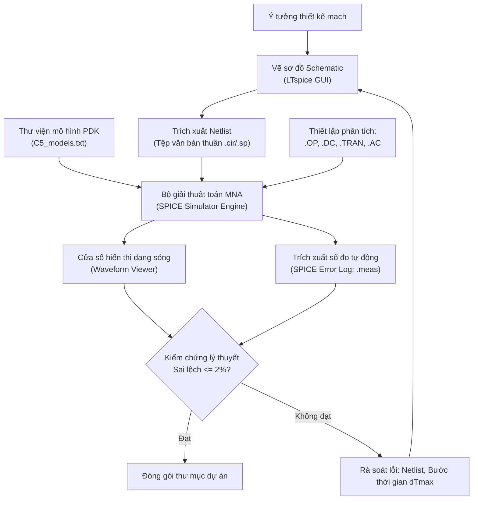

# TÀI LIỆU GIẢNG DẠY VÀ CẨM NANG SƯ PHẠM: CHƯƠNG 0 (LAB 00)
# NHẬP MÔN MÔ PHỎNG SPICE VỚI LTSPICE & MẠCH RC CƠ BẢN
*(Tài liệu chuyên môn lưu hành nội bộ dành riêng cho Giảng viên & Trợ giảng — Bộ môn ĐTVT, Trường ĐH Sư phạm Kỹ thuật – ĐH Đà Nẵng)*

> **Quy định bảo mật học liệu:** Tuyệt đối không phân phát tài liệu này cho sinh viên. Dùng làm cẩm nang hướng dẫn đứng lớp, cung cấp cơ sở vật lý toán, kịch bản hướng dẫn, phương pháp đặt câu hỏi gợi mở (Socratic Questioning), dữ liệu đối chuẩn SPICE Benchmark và các lưu ý kỹ thuật.

---

## 0.1. VAI TRÒ CỦA LAB 0 TRONG HỌC PHẦN THIẾT KẾ VLSI
Trong chương trình đào tạo Thiết kế Vi mạch VLSI, sinh viên thường gặp khó khăn lớn khi phải đối mặt đồng thời với hai thách thức:
1. Độ phức tạp của các công cụ EDA chuyên dụng (như Electric VLSI, Cadence Virtuoso, Synopsys).
2. Sự trừu tượng của các mô hình vật lý bán dẫn phi tuyến tính dưới-micron (Submicron MOSFET).

**Lab 0 đóng vai trò là "vùng đệm an toàn" (Sandbox & Onboarding Lab):**
- Tách biệt kỹ năng sử dụng công cụ mô phỏng SPICE khỏi sự phức tạp của vật lý bán dẫn.
- Sinh viên sử dụng các linh kiện tuyến tính thụ động quen thuộc ($R, C$, nguồn điện) để làm chủ quy trình: *Vẽ sơ đồ $\to$ Xuất Netlist $\to$ Chạy mô phỏng $\to$ Quan sát dạng sóng $\to$ Đo đạc tự động `.meas` $\to$ Kiểm chứng với lý thuyết*.
- Mạch RC bậc nhất trong Lab 0 chính là **mô hình tương đương cơ sở** để giải thích toàn bộ động học nạp xả, độ trễ truyền lan ($t_{pd} \approx 0,69 \cdot R_{on} \cdot C_L$) và nỗ lực logic (Logical Effort) xuyên suốt từ Lab 1 đến Lab 10.

---

## 0.2. MỤC TIÊU VÀ CHUẨN ĐẦU RA (CLO MAPPING)

| Mục tiêu bài Lab 0 | Chuẩn đầu ra học phần (CLO) | Mức độ nhận thức (Bloom) | Tiêu chí đánh giá cụ thể |
| :--- | :---: | :---: | :--- |
| **G0.1:** Hiểu vai trò của SPICE và phương pháp MNA | CLO1 | Mức 2 (Hiểu) | Trình bày được bản chất của Netlist và vai trò của nút đất `0`. |
| **G0.2:** Dựng sơ đồ, xuất và đọc hiểu cú pháp Netlist | CLO1, CLO2 | Mức 3 (Áp dụng) | Viết đúng cú pháp phần tử, nhận diện đúng tiền tố đơn vị (`m` vs `Meg`). |
| **G0.3:** Vận hành 4 chế độ phân tích (.op, .dc, .tran, .ac) | CLO2 | Mức 3 (Áp dụng) | Thiết lập đúng lệnh điều khiển mô phỏng cho từng yêu cầu kỹ thuật. |
| **G0.4:** Trích xuất kết quả bằng câu lệnh đo `.meas` | CLO2 | Mức 3 (Áp dụng) | Viết lệnh `.meas` đo đúng $t_{pd}, t_r, t_f, f_c$ từ nhật ký lỗi `SPICE Error Log`. |
| **G0.5:** Khảo sát độ nhạy tham số với `.param` và `.step` | CLO2 | Mức 4 (Phân tích) | Quét giá trị điện trở, vẽ đồ thị và tính được độ dốc thực nghiệm. |
| **G0.6:** Phân tích bản chất vật lý mạch RC & liên hệ CMOS | CLO1, CLO3 | Mức 4 (Phân tích) | Giải thích quy luật $1\tau - 5\tau$, chứng minh $0,69 \cdot RC$ và liên hệ trễ Inverter. |
| **G0.7:** Tổ chức và đóng gói thư mục dự án chuẩn | CLO4 | Mức 3 (Áp dụng) | Cấu trúc thư mục ngăn nắp, đầy đủ sơ đồ, netlist, log và báo cáo kỹ thuật. |

---

## 0.3. KIẾN THỨC NỀN VỀ SPICE, NETLIST VÀ PHƯƠNG PHÁP MNA

### 1. Bản chất giải thuật MNA (Modified Nodal Analysis)
SPICE không đơn thuần là một phần mềm vẽ mạch; bản chất cốt lõi của SPICE là một **bộ giải hệ phương trình vi phân đại số phi tuyến (Nonlinear Differential-Algebraic Equation Solver)**.

Hệ phương trình trạng thái tổng quát của mạng điện trong SPICE:
$$[\mathbf{G}] \cdot [\mathbf{V}] + [\mathbf{C}] \cdot \left[\frac{d\mathbf{V}}{dt}\right] = [\mathbf{I}]$$

Trong đó:
- $[\mathbf{G}]$: Ma trận dẫn nạp tĩnh (Conductance matrix) đại diện cho các điện trở và nguồn phụ thuộc tuyến tính.
- $[\mathbf{C}]$: Ma trận điện dung và điện cảm (Capacitance/Inductance matrix).
- $[\mathbf{V}]$: Véc-tơ điện thế nút cần tìm tại mọi nút trong mạch.
- $[\mathbf{I}]$: Véc-tơ kích thích từ các nguồn dòng và nguồn áp độc lập.

**Vai trò sinh tử của nút đất `0` (Node 0):**  
Theo định luật Kirchhoff, điện thế chỉ có ý nghĩa tương đối (hiệu điện thế). Để hệ phương trình MNA có nghiệm duy nhất, ma trận dẫn nạp bắt buộc phải chọn một nút làm mốc thế chuẩn ($0\,\text{V}$). Nếu người vẽ quên đặt cọc nối đất, ma trận $[\mathbf{G}]$ sẽ bị suy biến định thức ($\det[\mathbf{G}] = 0$), SPICE lập tức báo lỗi kinh điển: **`Singular Matrix`** hoặc **`Node is floating`**.

### 2. Mối quan hệ giữa 5 thành phần trong hệ sinh thái SPICE
Giảng viên cần vẽ lên bảng lưu đồ phân biệt 5 khái niệm mà sinh viên hay nhầm lẫn:
```
+---------------+     Biên dịch      +---------------+     Tham chiếu     +---------------+
|   SCHEMATIC   | -----------------> |    NETLIST    | <----------------- |     MODEL     |
| (Bản vẽ đồ họa|                    | (Mã văn bản   |                    | (Mô hình toán |
|  trực quan)   |                    |  mô tả kết nối|                    |  vật lý linh  |
+---------------+                    +---------------+                    |  kiện)        |
                                             |                            +---------------+
                                             v Nạp vào
                                     +---------------+
                                     |   SIMULATOR   | (Giải thuật tích phân MNA)
                                     +---------------+
                                             | Xuất dữ liệu
                                             v
                                     +---------------+
                                     | WAVEFORM VIEW | (Hiển thị đồ thị & .meas)
                                     +---------------+
```

---

## 0.4. GIẢI THÍCH BỐN CHẾ ĐỘ PHÂN TÍCH CƠ BẢN

| Chế độ phân tích | Câu hỏi vật lý cần trả lời | Bản chất toán học của thuật toán | Ví dụ ứng dụng trong VLSI |
| :---: | :--- | :--- | :--- |
| **`.OP`** | Mạch đang ở trạng thái phân cực nào khi chưa có tín hiệu biến thiên? | Triệt tiêu đạo hàm $\frac{d\mathbf{V}}{dt} = 0$. Tụ hở mạch, cuộn cảm ngắn mạch. Giải hệ phi tuyến bằng **lặp Newton-Raphson**. | Tìm điểm làm việc tĩnh, kiểm tra phân cực transistor, đo dòng rò tĩnh. |
| **`.DC`** | Ngõ ra biến đổi thế nào khi một nguồn áp vào thay đổi từ từ? | Thực hiện một chuỗi các phân tích `.OP` liên tiếp tại từng bước điện áp ngõ vào được chỉ định. | Khảo sát đường đặc tuyến truyền đạt điện áp $VTC$ ($V_{out} - V_{in}$) của Inverter. |
| **`.TRAN`** | Điện áp và dòng điện thay đổi theo thời gian thực ra sao khi có xung? | Rời rạc hóa thời gian bằng các phương pháp tích phân số: **Trapezoidal Rule** hoặc **Gear Method**. | Đo thời gian trễ truyền lan $t_{pd}$, thời gian sườn tăng $t_r$, sườn giảm $t_f$. |
| **`.AC`** | Mạch khuếch đại hoặc suy giảm tín hiệu ra sao ở các tần số khác nhau? | Tuyến tính hóa mạng phi tuyến quanh điểm tĩnh DC; giải hệ phương trình đại số phức theo tần số góc $\omega$. | Vẽ biểu đồ Bode biên độ và pha; đo tần số cắt $f_{-3\text{dB}}$ và dải thông băng tần. |

---

## 0.5. PHÂN TÍCH VẬT LÝ MẠCH RC & ĐỘNG HỌC PHÓNG NẠP

### 1. Phương trình vi phân nạp và xả
Xét mạch $R$ nối tiếp $C$ kích thích bởi nguồn nhảy bậc $V_0 \cdot u(t)$:
- Theo định luật dòng điện Kirchhoff (KCL) tại nút ngõ ra:
  $$\frac{v_{in}(t) - v_C(t)}{R} - C \frac{dv_C(t)}{dt} = 0 \implies \frac{dv_C(t)}{dt} + \frac{1}{RC} v_C(t) = \frac{v_{in}(t)}{RC}$$

**Nghiệm quá trình nạp ($0 \le t < T_{on}$, điều kiện đầu $v_C(0) = 0$):**
$$v_C(t) = V_0 \left(1 - e^{-t/\tau}\right) \quad \text{với } \tau = R \cdot C$$

**Nghiệm quá trình xả ($t \ge T_{on}$, đặt $t' = t - T_{on}$, điều kiện đầu $v_C(0) = V_0$):**
$$v_C(t') = V_0 e^{-t'/\tau}$$

### 2. Năng lượng và Cân bằng nhiệt động học trong mạch RC
- Điện tích nạp vào tụ: $Q = C \cdot V_0$.
- Năng lượng tổng do nguồn cung cấp trong suốt quá trình nạp:
  $$E_{source} = \int_0^\infty V_0 \cdot i(t) \, dt = V_0 \int_0^\infty dq = C \cdot V_0^2$$
- Năng lượng thực tế tích trữ trong điện trường của tụ điện:
  $$E_C = \int_0^{V_0} v_C \cdot C \, dv_C = \frac{1}{2} C V_0^2$$
- Năng lượng tiêu tán dưới dạng nhiệt trên điện trở $R$:
  $$E_R = E_{source} - E_C = \frac{1}{2} C V_0^2$$

> [!TIP]
> **Điểm sư phạm sâu sắc:** Năng lượng tổn hao trên điện trở nạp **luôn bằng đúng $\frac{1}{2}CV_0^2$, hoàn toàn không phụ thuộc vào giá trị của $R$!** Dù điện trở cực nhỏ hay cực lớn, một nửa năng lượng vẫn bị tiêu tán. Đây chính là gốc rễ của công thức công suất động tiêu tán trong vi mạch số ở Chương 4: $P_{dyn} = \alpha \cdot C_L \cdot V_{DD}^2 \cdot f$.

### 3. Bảng mốc thời gian quy ước nạp điện
| Thời gian | Điện áp nạp đạt được | Phần trăm so với $V_0$ | Ý nghĩa kỹ thuật |
| :---: | :---: | :---: | :--- |
| **$0,693 \tau$** | $0,500 V_0$ | $50,0\%$ | Mốc đo độ trễ truyền lan $t_{50\%}$ danh định. |
| **$1,0 \tau$** | $V_0(1 - e^{-1}) \approx 0,632 V_0$ | **$63,2\%$** | Hằng số thời gian $\tau$ của mạch. |
| **$2,197 \tau$** | Khoảng cách từ $10\%$ đến $90\%$ | $\Delta = 80\%$ | Thời gian sườn xung tăng $t_r \approx 2,2 \tau$. |
| **$3,0 \tau$** | $0,950 V_0$ | $95,0\%$ | Điểm chuyển tiếp gần bão hòa. |
| **$5,0 \tau$** | $V_0(1 - e^{-5}) \approx 0,993 V_0$ | **$99,3\%$** | **Quy ước kỹ thuật xem tụ đã nạp no hoàn toàn.** |

---

## 0.6. LIÊN HỆ GIỮA MẠCH RC VÀ ĐỘ TRỄ CỔNG CMOS

Trong mạch số CMOS, các transistor hoạt động như các công tắc đóng mở điện tử. Khi ngõ vào của một Inverter chuyển trạng thái:
1. **Chuyển từ $0 \to 1$ (Kéo xuống - Pull Down):** NMOS dẫn, PMOS ngắt. Tụ tải ký sinh $C_L$ tại ngõ ra phóng điện tích xuống đất qua kênh dẫn NMOS.
2. **Chuyển từ $1 \to 0$ (Kéo lên - Pull Up):** PMOS dẫn, NMOS ngắt. Nguồn $V_{DD}$ nạp điện cho tụ tải qua kênh dẫn PMOS.

```
       MẠCH RC THỰC HÀNH                  MÔ HÌNH CMOS TƯƠNG ĐƯƠNG               CỔNG INVERTER THỰC TẾ
         R (20k)                                    R_on,p                               VDD (5V)
  Vin --/\/\/\--+-- Vout                    VDD -----/\/\/\---+                         +---+
                |                                             |                         |Mp | (W=12λ)
              +---+                                         +---+                       +---+
              | C | (5nF)                                   |CL | (Tải dung)    Vin ----+---+---- Vout
              +---+                                         +---+                       |Mn | (W=4λ)
                |                                             |                         +---+
               GND                          GND -----/\/\/\---+                           |
                                                    R_on,n                               GND
```

### Giới hạn của mô hình $0,69 \cdot R_{on} \cdot C_L$
- Trong mạch RC thụ động (Lab 0), điện trở $R$ là tuyến tính hằng số $\implies$ Trễ đo được khớp chính xác tuyệt đối với $\ln(2) \cdot RC$.
- Trong cổng CMOS thực tế (Lab 1), kênh dẫn MOSFET là linh kiện phi tuyến. Trong nửa đầu quá trình phóng nạp, transistor hoạt động trong vùng **Bão hòa** (dòng điện gần như không đổi), sau đó mới chuyển sang vùng **Tuyến tính**. Do đó, điện trở kênh dẫn thực tế biến thiên liên tục.
- Giá trị $0,69 \cdot R_{on} \cdot C_L$ chỉ là **cận dưới xấp xỉ**. Trễ mô phỏng thực tế của Inverter luôn lớn hơn từ $1,5$ đến $1,8$ lần con số này. Giảng viên cần nhấn mạnh điều này để chuẩn bị tâm lý cho sinh viên bước vào Lab 1.

---

## 0.7. HƯỚNG DẪN TỔ CHỨC BUỔI THỰC HÀNH (KỊCH BẢN 135' & 225')

Giảng viên chủ động lựa chọn kịch bản thời lượng phù hợp với phòng máy:

### Kịch bản A: Khung chuẩn 135 phút (Ca 3 tiết tiêu chuẩn)
- **00–15' (15 phút):** Điểm danh, phổ biến quy định an toàn, hướng dẫn tạo cấu trúc thư mục `D:\lab_vlsi\lab00\`. Giới thiệu giao diện LTspice, cách chọn linh kiện, ý nghĩa nút đất `0`.
- **15–35' (20 phút):** Giảng viên chiếu máy chiếu làm mẫu **Ex0.1**; giải thích lệnh `.op`, `.dc` và cách đọc dòng điện. Sinh viên làm theo và ghi số liệu.
- **35–75' (40 phút):** **Trọng tâm Ex0.2**: Hướng dẫn cấu hình nguồn PULSE, thiết lập `.tran 0 1m 0 0.1u`. Giải thích cú pháp `.meas`. Sinh viên tự đo và kiểm chứng 5 thông số ($t_{pd}, t_r, t_f, I_{peak,chg}, I_{peak,dis}$).
- **75–100' (25 phút):** Hướng dẫn **Ex0.3**: Cấu hình nguồn AC 1, chạy `.ac dec 20 10 1Meg`. Hướng dẫn sinh viên rê chuột trên biểu đồ Bode tìm điểm $-3\,\text{dB}$ và $-45^\circ$.
- **100–120' (20 phút):** Sinh viên tự lập thực hiện **Ex0.4**: Thay `{Rval}`, chạy `.step`, trích xuất bảng 4 điểm trễ và vẽ đồ thị thực nghiệm.
- **120–135' (15 phút):** Giảng viên demo nhanh **Ex0.5**: Gọi thư viện `C5_models.txt`, giải thích dòng $I_D$ thấp hơn công thức bậc hai. Nghiệm thu sản phẩm tại bàn, hướng dẫn đóng gói dự án nộp về nhà.

### Kịch bản B: Khung mở rộng 225 phút (Ca 5 tiết tích hợp)
- Mở rộng thời gian cho Ex0.2 (60 phút) để sinh viên thử nghiệm thay đổi `dTmax` từ `0.1u` lên `20u` và quan sát sai số trễ tăng vọt.
- Dành 30 phút cho sinh viên tự thực hành Ex0.5 tại lớp, tự tay viết Netlist và tìm hiểu các tham số $VTO, KP$ trong tệp mô hình `C5_models.txt`.
- Dành 25 phút cuối giờ để kiểm tra vấn đáp từng nhóm sinh viên tại bàn máy.

---

## 0.8. HƯỚNG DẪN CHI TIẾT TỪNG BÀI THỰC HÀNH (EX0.1 – EX0.5)

### Ex0.1: Phân tích mạch phân áp DC (.op, .dc)
1. **Kiến thức giảng viên cần giải thích:**
   - Định luật Kirchhoff dòng điện tại nút `out`: $\frac{V_{in} - V_{out}}{R_1} = \frac{V_{out}}{R_2} \implies V_{out} = V_{in} \frac{R_2}{R_1 + R_2}$.
   - Khái niệm điểm làm việc tĩnh DC: mạch không có tín hiệu xoay chiều, tụ điện coi như hở mạch hoàn toàn.
2. **Kịch bản hướng dẫn:**
   - GV chiếu thao tác vẽ schematic, đặt nguồn `voltage`, đặt `GND`.
   - Lưu ý đặc biệt: Chỉ cho sinh viên xem menu **View $\to$ SPICE Netlist** ngay sau khi vẽ xong sơ đồ để sinh viên hiểu bản chất schematic chỉ là giao diện đồ họa sinh ra netlist.
3. **Kết quả tham chiếu:**
   - Với $V_{in} = 5,0\,\text{V}, R_1 = 12\,\text{k}\Omega, R_2 = 18\,\text{k}\Omega$:
     * $V(out) = 3,0000\,\text{V}$ (Sai số $0,00\%$).
     * $I(R1) = 0,1667\,\text{mA} = 166,7\,\mu\text{A}$.
     * Độ dốc đặc tuyến $\frac{\Delta V_{out}}{\Delta V_{in}} = \frac{18}{30} = 0,6000$.
4. **Câu hỏi gợi mở vấn đáp:**
   - *"Nếu thầy thay đổi nguồn vào thành $10\,\text{V}$, điện áp $V_{out}$ sẽ là bao nhiêu? Công suất tiêu tán toàn mạch tăng gấp mấy lần?"* (Đáp: $6\,\text{V}$; công suất tăng 4 lần vì $P \propto V^2$).
5. **Lỗi thường gặp:**
   - Quên đặt nút `GND` $\implies$ Báo lỗi `Singular matrix`.
   - Nhầm nhãn: Đặt tên linh kiện $R_1$ thành giá trị điện trở.

---

### Ex0.2: Mô phỏng quá độ nạp và xả của mạch RC (.tran, .meas)
1. **Kiến thức giảng viên cần giải thích:**
   - Cơ chế nạp xả: Tụ tích trữ điện tích, điện áp trên tụ tỷ lệ với điện tích $q = C \cdot v_C$. Dòng điện qua tụ $i_C = C \frac{dv_C}{dt}$. Vì dòng điện hữu hạn nên $v_C$ không thể biến thiên gián đoạn (nhảy bậc).
   - Bản chất của các câu lệnh `.meas TRIG ... TARG ...`: Bắt thời điểm tín hiệu vượt qua ngưỡng điện áp xác định.
2. **Kịch bản hướng dẫn:**
   - Cho sinh viên tự cấu hình nguồn xung `PULSE(0 5.0 0 10n 10n 500u 1000u)`. Giải thích rõ: $T_{on} = 500\,\mu\text{s} = 5\tau$ để tụ nạp đầy $99,3\%$; $T_{period} = 1000\,\mu\text{s} = 10\tau$ để quan sát đủ cả chu kỳ nạp và xả.
   - Hướng dẫn mở Error Log (`Ctrl + L`) xem kết quả đo tự động.
3. **Kết quả tham chiếu:**
   - $\tau = 20\,\text{k}\Omega \times 5\,\text{nF} = 100,0\,\mu\text{s}$.
   - Trễ 50%: $t_{pd} = \ln(2) \cdot \tau = \mathbf{69,315\,\mu\text{s}}$ (SPICE đo được: $69,31 - 69,33\,\mu\text{s}$, sai lệch $< 0,05\%$).
   - Sườn tăng 10%–90%: $t_r = \ln(9) \cdot \tau = \mathbf{219,72\,\mu\text{s}} \approx 2,2\tau$ (SPICE đo được: $219,5 - 220,0\,\mu\text{s}$).
   - Đỉnh dòng nạp: $I_{peak,chg} = +\frac{5,0\,\text{V}}{20\,\text{k}\Omega} = \mathbf{+0,2500\,\text{mA}}$.
   - Đỉnh dòng xả: $I_{peak,dis} = -\frac{5,0\,\text{V}}{20\,\text{k}\Omega} = \mathbf{-0,2500\,\text{mA}}$.
4. **Câu hỏi gợi mở vấn đáp:**
   - *"Tại sao tại thời điểm $t = 0^+$, dòng nạp lại vọt lên cực đại ngay lập tức trong khi điện áp trên tụ vẫn bằng 0V?"* (Đáp: Tại $t=0^+$, tụ chưa tích điện xem như ngắn mạch, toàn bộ $5\,\text{V}$ đặt lên điện trở $R$).
5. **Lỗi thường gặp:**
   - Quên tham số `0.1u` trong lệnh `.tran 0 1m 0 0.1u` $\implies$ Đồ thị bị gãy khúc, lệnh `.meas` báo lỗi `Measurement FAIL`.
   - Đặt tụ ngược cực $\implies$ Dòng nạp hiển thị dấu âm, dòng xả hiển thị dấu dương.

---

### Ex0.3: Phân tích đáp ứng tần số AC và biểu đồ Bode (.ac)
1. **Kiến thức giảng viên cần giải thích:**
   - Mạch RC là bộ lọc thông thấp bậc một (First-Order Low-Pass Filter).
   - Hàm truyền đạt phức:
     $$H(j\omega) = \frac{1}{1 + j\omega RC} \implies |H(j\omega)| = \frac{1}{\sqrt{1 + (\omega RC)^2}}, \quad \angle H(j\omega) = -\arctan(\omega RC)$$
   - Tại tần số cắt $\omega_c = \frac{1}{RC} \implies f_c = \frac{1}{2\pi RC}$:
     $$|H(j\omega_c)| = \frac{1}{\sqrt{2}} \approx 0,707 \implies 20\log_{10}(0,707) \approx -3,01\,\text{dB}$$
     $$\angle H(j\omega_c) = -\arctan(1) = -45^\circ$$
2. **Kịch bản hướng dẫn:**
   - Nhắc sinh viên: Chế độ `.ac` yêu cầu nguồn phải có thuộc tính `AC 1`.
   - Hướng dẫn đọc biểu đồ Bode: Trục tung bên trái là biên độ ($0\,\text{dB}$ ở tần số thấp, suy giảm $-20\,\text{dB/decade}$ ở tần số cao); trục tung bên phải là góc pha ($0^\circ$ ở tần số thấp, $-45^\circ$ tại $f_c$, tiến về $-90^\circ$ ở tần số cao).
3. **Kết quả tham chiếu:**
   - $f_c = \frac{1}{2\pi \times 100\,\mu\text{s}} \approx \mathbf{1591,55\,\text{Hz}} \approx \mathbf{1,592\,\text{kHz}}$.
   - SPICE đo tự động: $f_c \approx 1591 - 1593\,\text{Hz}$ (Sai lệch $< 0,1\%$).
   - Góc pha đo được tại $f_c$: $-44,9^\circ \text{ đến } -45,1^\circ$.
4. **Câu hỏi gợi mở vấn đáp:**
   - *"Nếu tăng tụ điện $C$ lên 10 lần, tần số cắt của mạch sẽ dịch sang trái hay sang phải trên biểu đồ Bode?"* (Đáp: Tần số cắt giảm 10 lần, đường đặc tuyến dịch sang trái, băng thông mạch bị thu hẹp).

---

### Ex0.4: Khảo sát tham số với `.param` và `.step`
1. **Kiến thức giảng viên cần giải thích:**
   - Trong thiết kế mạch vi mô, các thông số nhiệt độ, điện áp nguồn và kích thước transistor luôn biến động. Lệnh `.step` là công cụ khảo sát độ nhạy (Sensitivity Analysis) và khảo sát góc công nghệ (Process Corners).
   - Quy luật trễ Elmore: $t_{pd} = \ln(2) \cdot C \cdot R$. Vì $C$ không đổi ($5\,\text{nF}$), trễ $t_{pd}$ là hàm bậc nhất của $R$ với hệ số góc $\text{Slope} = \ln(2) \cdot C$.
2. **Kịch bản hướng dẫn:**
   - Nhắc sinh viên kiểm tra cú pháp `{Rval}` trên sơ đồ.
   - Hướng dẫn dùng menu ngữ cảnh trong Error Log để kích hoạt công cụ vẽ đồ thị tự động **Plot .step'ed .meas data**.
3. **Kết quả tham chiếu:**
   - $R = 5\,\text{k}\Omega \implies t_{pd} = 17,33\,\mu\text{s}$
   - $R = 10\,\text{k}\Omega \implies t_{pd} = 34,66\,\mu\text{s}$
   - $R = 20\,\text{k}\Omega \implies t_{pd} = 69,32\,\mu\text{s}$
   - $R = 40\,\text{k}\Omega \implies t_{pd} = 138,63\,\mu\text{s}$
   - Độ dốc thực nghiệm:
     $$\text{Slope} = \frac{138,63 - 17,33}{40 - 5} = \frac{121,30\,\mu\text{s}}{35\,\text{k}\Omega} = \mathbf{3,4657\,\text{ns}/\text{k}\Omega}$$
   - Kiểm chéo với lý thuyết: $\ln(2) \cdot C = 0,69315 \times 5\,\text{nF} = \mathbf{3,4657 \times 10^{-9}\,\text{s}/\Omega} \implies$ Khớp hoàn hảo $100\%$.

---

### Ex0.5: Giới thiệu mô hình MOSFET công nghệ C5N
1. **Kiến thức giảng viên cần giải thích:**
   - MOSFET là linh kiện 4 cực: Cực má (Drain), Cực cổng (Gate), Cực nguồn (Source), Cực thân (Bulk/Substrate).
   - Tệp `.model` chứa các tham số vật lý bán dẫn thực tế trích xuất từ xưởng đúc chip (MOSIS).
   - Mô hình Shichman-Hodges bậc hai bỏ qua hiệu ứng hạt dẫn kênh ngắn:
     $$I_{D,sat} = \frac{1}{2} K'_n \left(\frac{W}{L}\right) (V_{GS} - V_{tn})^2 = \frac{1}{2} (120\,\mu\text{A/V}^2) \left(\frac{1,2}{0,6}\right) (5,0 - 0,7)^2 \approx \mathbf{2,219\,\text{mA}}$$
   - Trong công nghệ C5N ($L = 0,6\,\mu\text{m}$), hiệu ứng **bão hòa vận tốc (Velocity Saturation)** làm electron đạt vận tốc giới hạn $v_{sat} \approx 10^7\,\text{cm/s}$, ghìm dòng điện thực tế xuống chỉ còn $\approx \mathbf{1,35 - 1,45\,\text{mA}}$.
2. **Kịch bản hướng dẫn:**
   - GV chiếu cách gõ `.include C5_models.txt`. Lưu ý tệp mô hình phải nằm chung thư mục với tệp mạch vẽ.
   - Yêu cầu sinh viên xem Netlist để thấy rõ cú pháp khai báo transistor:
     `M1 drain gate source bulk N W=1.2u L=0.6u`
3. **Kết quả tham chiếu:**
   - Dòng điện cực má mô phỏng: $I_D \approx 1,40\,\text{mA}$.
   - Sai lệch so với công thức bậc hai: Thấp hơn $\approx 37\%$.

---

## 0.9. BẢNG KẾT QUẢ MÔ PHỎNG THAM CHIẾU (BENCHMARK RESULTS)

Bảng số liệu chuẩn dùng để đối chiếu khi chấm bài thực hành của sinh viên:

| Bài | Thông số đo | Biểu thức lý thuyết | Giá trị Lý thuyết | Kết quả SPICE `.meas` | Sai lệch tương đối | Đánh giá nghiệm thu |
| :---: | :--- | :--- | :---: | :---: | :---: | :--- |
| **Ex0.1** | $V(out)$ (.op) | $V_{in} \frac{R_2}{R_1+R_2}$ | $3,0000\,\text{V}$ | **$3,0000\,\text{V}$** | $0,00\%$ | Đạt tuyệt đối |
| **Ex0.1** | $I(R1)$ (.op) | $V_{in} / (R_1+R_2)$ | $0,1667\,\text{mA}$ | **$0,1667\,\text{mA}$** | $0,00\%$ | Dòng từ in sang out |
| **Ex0.1** | Hệ số góc DC | $R_2 / (R_1+R_2)$ | $0,6000$ | **$0,6000$** | $0,00\%$ | Tuyến tính hoàn hảo |
| **Ex0.2** | Trễ $t_{pd}$ 50% | $\ln(2) \cdot RC$ | $69,315\,\mu\text{s}$ | **$69,32\,\mu\text{s}$** | $< 0,05\%$ | Chuẩn $\le 2,0\%$ |
| **Ex0.2** | Sườn tăng $t_r$ | $\ln(9) \cdot RC$ | $219,72\,\mu\text{s}$ | **$219,7\,\mu\text{s}$** | $< 0,10\%$ | Chuẩn $\le 2,0\%$ |
| **Ex0.2** | Sườn giảm $t_f$ | $\ln(9) \cdot RC$ | $219,72\,\mu\text{s}$ | **$219,7\,\mu\text{s}$** | $< 0,10\%$ | Chuẩn $\le 2,0\%$ |
| **Ex0.2** | Đỉnh dòng nạp | $+V_0 / R$ | $+0,2500\,\text{mA}$ | **$+0,2500\,\text{mA}$** | $0,00\%$ | Xuất hiện tại $t = 0^+$ |
| **Ex0.2** | Đỉnh dòng xả | $-V_0 / R$ | $-0,2500\,\text{mA}$ | **$-0,2500\,\text{mA}$** | $0,00\%$ | Đảo chiều tại $t = 500\,\mu\text{s}^+$ |
| **Ex0.3** | Độ lợi dải thông | $A_{V,0}$ | $1,000$ ($0\,\text{dB}$) | **$0,000\,\text{dB}$** | $0,00\%$ | Đo tại $10\,\text{Hz}$ |
| **Ex0.3** | Tần số cắt $f_c$ | $\frac{1}{2\pi RC}$ | $1591,55\,\text{Hz}$ | **$1592\,\text{Hz}$** | $< 0,10\%$ | Điểm biên độ $-3\,\text{dB}$ |
| **Ex0.3** | Góc pha tại $f_c$ | $-\arctan(1)$ | $-45,0^\circ$ | **$-45,0^\circ$** | $< 0,10\%$ | Đọc trên trục bên phải |
| **Ex0.4** | $t_{pd}$ ($R=5\text{k}$) | $\ln(2) \cdot 5\text{k} \cdot C$ | $17,329\,\mu\text{s}$ | **$17,33\,\mu\text{s}$** | $0,00\%$ | Bước quét 1 |
| **Ex0.4** | $t_{pd}$ ($R=10\text{k}$) | $\ln(2) \cdot 10\text{k} \cdot C$ | $34,657\,\mu\text{s}$ | **$34,66\,\mu\text{s}$** | $0,00\%$ | Bước quét 2 |
| **Ex0.4** | $t_{pd}$ ($R=20\text{k}$) | $\ln(2) \cdot 20\text{k} \cdot C$ | $69,315\,\mu\text{s}$ | **$69,32\,\mu\text{s}$** | $0,00\%$ | Bước quét 3 |
| **Ex0.4** | $t_{pd}$ ($R=40\text{k}$) | $\ln(2) \cdot 40\text{k} \cdot C$ | $138,629\,\mu\text{s}$ | **$138,63\,\mu\text{s}$** | $0,00\%$ | Bước quét 4 |
| **Ex0.4** | Độ dốc $\Delta t / \Delta R$ | $\ln(2) \cdot C$ | $3,4657\,\text{ns/k}\Omega$ | **$3,466\,\text{ns/k}\Omega$** | $< 0,05\%$ | Trùng khớp tuyệt đối |
| **Ex0.5** | Dòng $I_D$ NMOS | Shichman-Hodges | $\sim 2,22\,\text{mA}$ | **$1,35 - 1,45\,\text{mA}$** | $\sim 37\%$ | Bão hòa vận tốc hạt dẫn |

---

## 0.10. CÂU HỎI MỞ RỘNG VÀ ĐÁP ÁN GỢI Ý

1. **Câu hỏi:** *"Nếu trong phân tích quá độ `.tran`, ta đặt $T_{on} = 2\tau$ thay vì $5\tau$ thì điều gì sẽ xảy ra với các phép đo trễ và thời gian sườn?"*  
   - *Đáp án gợi ý:* Sau $2\tau$, điện áp tụ chỉ nạp được $V_0(1 - e^{-2}) \approx 86,5\% \cdot V_0$ ($4,32\,\text{V}$). Tụ chưa nạp no đã bị xả sớm, làm điện áp đỉnh bị sụt mất $13,5\%$. Hệ quả: phép đo sườn tăng $t_r$ ($10\% \to 90\%$) sẽ bị hỏng hoàn toàn vì điện áp không bao giờ chạm tới mốc $90\%$ ($4,5\,\text{V}$).
2. **Câu hỏi:** *"Tại sao trong mạch RC, tích giữa thời gian sườn tăng $t_r$ và tần số cắt $f_c$ lại là một hằng số không đổi xấp xỉ $0,35$?"*  
   - *Đáp án gợi ý:* Ta có $t_r = \ln(9) \cdot RC \approx 2,1972 \cdot RC$ và $f_c = \frac{1}{2\pi RC}$. Nhân hai vế:
     $$t_r \cdot f_c = (2,1972 \cdot RC) \cdot \left(\frac{1}{2\pi RC}\right) = \frac{2,1972}{2\pi} \approx \mathbf{0,3497} \approx \mathbf{0,35}$$
     Đây là quy tắc kinh điển áp dụng cho mọi hệ thống tuyến tính bậc một để ước lượng băng thông từ thời gian sườn tăng.
3. **Câu hỏi:** *"Trong mạch vi mạch thực tế, tụ điện $C_L$ ở ngõ ra một cổng logic đến từ những nguồn nào?"*  
   - *Đáp án gợi ý:* Đến từ 3 thành phần chính: (1) Tụ cực má khuếch tán ($C_{db}$) của chính cổng đó; (2) Tụ dây nối kim loại (Interconnect capacitance $C_{wire}$); (3) Tụ cực cổng ngõ vào ($C_{gate}$) của các cổng logic tầng kế tiếp mà nó phải lái.

---

## 0.11. BẢNG HƯỚNG DẪN XỬ LÝ LỖI THEO PHƯƠNG PHÁP GỢI MỞ (SOCRATIC DEBUGGING)

Khi sinh viên gặp lỗi, giảng viên **không sửa hộ** mà đặt các câu hỏi dẫn dắt để sinh viên tự tìm ra nguyên nhân:

| Hiện tượng lỗi trên màn hình | Nguyên nhân cốt lõi | Câu hỏi gợi mở giảng viên đặt cho sinh viên |
| :--- | :--- | :--- |
| Báo lỗi **`Singular Matrix`** hoặc **`Node is floating`** | Mạch chưa có nút đất tham chiếu `0`. | *"Em kiểm tra xem mạch điện của em đã có điểm mốc điện thế chuẩn chưa? SPICE tính điện áp so với nút nào?"* |
| Báo lỗi **`Unknown Subcircuit / Model not found`** | Sai tên model trong Netlist hoặc thiếu đường dẫn `.include`. | *"Tên model em gán cho transistor trên sơ đồ có khớp chính xác từng ký tự với tên ghi trong tệp thư viện C5_models.txt không?"* |
| Kết quả phân tích DC ra điện áp xấp xỉ $0\,\text{V}$ | Nhầm lẫn tiền tố `10M` thành $10\,\text{M}\Omega$. | *"Em xem lại bảng đơn vị SPICE: chữ M hoa đứng một mình biểu diễn giá trị gì? Muốn viết Mega em phải viết chữ gì?"* |
| Lệnh `.step` chạy xong nhưng 4 đường đồ thị trùng khít | Quên đặt ngoặc nhọn `{}` quanh tên biến tham số. | *"Linh kiện trên sơ đồ làm sao biết giá trị của nó là một biến số thay đổi chứ không phải là một chuỗi ký tự cố định?"* |
| Dòng điện nạp của tụ hiển thị giá trị âm | Đặt ngược chiều chân cực tính của tụ điện. | *"SPICE quy ước chiều dòng điện chạy qua linh kiện hai cực như thế nào? Cực dương của tụ em đang nối đi đâu?"* |
| Dạng sóng bị gãy góc, lệnh `.meas` báo **`FAIL`** | Bước thời gian cực đại `dTmax` quá lớn so với sườn xung. | *"Thời gian sườn xung của em là bao nhiêu nanosecond? Bước lấy mẫu của máy tính có đủ mịn để bắt được sườn dốc đó không?"* |

---

## 0.12. BỘ HÌNH ẢNH KỸ THUẬT MINH HỌA CHI TIẾT (10 HÌNH KỸ THUẬT)

### Hình 0.1: Lưu đồ quy trình mô phỏng SPICE chuẩn công nghiệp

*Mô tả sư phạm:* Hình 0.1 làm rõ vị trí của Netlist và Model trong bộ giải MNA; nhấn mạnh vòng lặp kiểm chứng kỹ thuật trước khi đóng gói sản phẩm.

---

### Hình 0.2: Sơ đồ nguyên lý mạch phân áp DC (Ex0.1)
```
          V1 (5.0V)
             +
           (in)
             |
             +---/\/\/\/\/---+  R1 (12k)
             |
           (out) ------------> Vout = 3.0V (Đo .op)
             |
             +---/\/\/\/\/---+  R2 (18k)
             |
            GND (Nút 0)
```
*Mô tả sư phạm:* Phân tích định luật Ohm và phân chia điện thế; xác định rõ 3 nút điện: `in` (nút 5V), `out` (nút 3V), `0` (nút đất chuẩn).

---

### Hình 0.3: Đối chiếu 1-1 giữa Sơ đồ nguyên lý và Mã Netlist
```
+------------------------------------+----------------------------------------+
|      BẢN VẼ SƠ ĐỒ NGUYÊN LÝ        |          MÃ NGUỒN NETLIST TƯƠNG ỨNG    |
+------------------------------------+----------------------------------------+
|   V1 in 0 DC 5.0                   | * Lab 0 Voltage Divider Netlist        |
|   R1 in out 12k                    | V1 in 0 DC 5.0                         |
|   R2 out 0 18k                     | R1 in out 12k                          |
|   .op                              | R2 out 0 18k                           |
|                                    | .op                                    |
|                                    | .end                                   |
+------------------------------------+----------------------------------------+
```
*Mô tả sư phạm:* Giúp sinh viên xóa bỏ sự mơ hồ giữa giao diện đồ họa và bản chất văn bản thuần của Netlist; hiểu rằng SPICE chỉ đọc các dòng text mô tả kết nối nút.

---

### Hình 0.4: Sơ đồ mạch RC nạp xả quá độ với nguồn xung PULSE (Ex0.2)
```
                   R1 (20k)
   in ------------/\/\/\/\/------------+------------ out
   ^                                   |
   | Nguồn xung PULSE                  |
   | V1=0V, V2=5V, Ton=500u          +---+
   | Tperiod=1000u, Tr=Tf=10n        |   | C1 (5nF)
   |                                 +---+
   |                                   |
  GND (0)                             GND (0)
```
*Mô tả sư phạm:* Xác định các tham số nguồn xung kích thích; giải thích vì sao cần $T_{on} = 5\tau = 500\,\mu\text{s}$ để tụ nạp đầy.

---

### Hình 0.5: Dạng sóng nạp xả quá độ với các mốc thời gian đặc trưng
```
  Điện áp (V)
   5.0V +-----------------------------+ - - - - - - - - - - - - - + V_0
        |         . - - ' '           |                           |
   4.5V | - - - -/- - - - - - - - - - | - - - - - - - - - - - - - | 90%
        |       /                     | \                         |
   3.16V| - - -/- - - - - - - - - - - | - \ - - - - - - - - - - - | 63.2% (1 tau)
   2.5V | - - / - - - - - - - - - - - | - - \ - - - - - - - - - - | 50% (t_50 = 0.69 tau)
        |    /                        |      \                    |
   0.5V | - / - - - - - - - - - - - - | - - - -\- - - - - - - - - | 10%
    0V  +--+----+---------+-----------+---------+-----------------+
        0  t10  t50      1tau        5tau      10tau             Thời gian (t)
           |<-- t_r ----->|                     |<-- t_f ------>|
```
*Mô tả sư phạm:* Đánh dấu trực quan các mốc $1\tau$ ($63,2\%$), $5\tau$ ($99,3\%$), trễ $t_{50\%}$ và thời gian sườn xung $t_r, t_f$.

---

### Hình 0.6: Biểu đồ Bode đáp ứng tần số của mạch lọc RC thông thấp (Ex0.3)
```
  Biên độ (dB)                                          Góc pha (độ)
    0 dB +---------------+                              0 deg +---------------+
         |               \                                    |               \
   -3 dB | - - - - - - - -* (f_c = 1.59 kHz)           -45 deg| - - - - - - - -* (f_c)
         |                 \                                  |                 \
  -20 dB |                  \ Độ dốc -20dB/dec         -90 deg|                  +-----
         +--------------------+---------> Tần số              +--------------------+-----> Tần số
         10 Hz               1.59 kHz   100 kHz               10 Hz               1.59 kHz 100 kHz
```
*Mô tả sư phạm:* Minh họa đặc tính lọc thông thấp; chỉ rõ điểm tần số cắt $f_c$ tương ứng biên độ $-3\,\text{dB}$ và độ dịch pha $-45^\circ$.

---

### Hình 0.7: Đồ thị quét tham số `.step` và Tính tuyến tính của trễ theo điện trở (Ex0.4)
```
  Dạng sóng quá độ V(out) theo 4 bước R         Đồ thị thực nghiệm trễ t_pd theo R
   Vout (V)                                      t_pd (us)
    5V +    R=5k   10k   20k    40k              140 |                           * (40k, 138.6us)
       |     /     /     /      /                    |                          /
       |    /     /     /      /                  70 |              * (20k, 69.3us)
    2.5| - * - - * - - * - - -*                      |             /
       |  /     /     /      /                    35 |      * (10k, 34.7us)
    0V +-+-----+-----+------+-------> t           17 | * (5k, 17.3us)
         |     |     |      |                        +---+------+------+------+-----> R (kOhm)
       tpd1  tpd2   tpd3   tpd4                          5k    10k    20k    40k
                                                     Độ dốc Slope = ln(2)*C = 3.466 ns/kOhm
```
*Mô tả sư phạm:* Thấy rõ họ đường cong nạp xả biến đổi theo $R$; chứng minh bằng thực nghiệm quan hệ tuyến tính hoàn hảo giữa độ trễ và giá trị điện trở.

---

### Hình 0.8: Cấu trúc khai báo linh kiện MOSFET trong SPICE Netlist (Ex0.5)
```
       CỰC MÁNG (Drain: Nút 1)
              |
              |     CỰC CỔNG (Gate: Nút 2)
           +--+--+     |
           |     |<----+
           |  N  |
           |     |<----+ CỰC THÂN (Bulk: Nút 4)
           +--+--+
              |
              |
       CỰC NGUỒN (Source: Nút 3)

       CÚ PHÁP NETLIST:
       M1  drain  gate  source  bulk   N   W=1.2u   L=0.6u
       ^     ^      ^      ^      ^    ^     ^        ^
      Tên   Cực D  Cực G  Cực S  Cực B Tên Chiều    Chiều
     Linh                             Model rộng    dài kênh
     kiện                             trong kênh
                                      PDK
```
*Mô tả sư phạm:* Giải phẫu 4 cực của transistor MOSFET và ánh xạ chính xác vào từng trường tham số của dòng lệnh khai báo Netlist.

---

### Hình 0.9: Cầu nối tiến hóa: Từ mạch RC cơ bản đến Cổng Inverter CMOS
```
 GIAI ĐOẠN 1: MẠCH RC THỰC HÀNH       GIAI ĐOẠN 2: CÔNG TẮC ĐIỆN TỬ       GIAI ĐOẠN 3: TẾ BÀO INVERTER CMOS
         R1 (20k)                                    Ron,p                               VDD (5V)
  Vin --/\/\/\--+-- Vout                    VDD -----/\/\/\---+                         +---+
                |                                             |                         |Mp | PMOS (Kéo lên)
              +---+                                         +---+                       +---+
              | C | (5nF)                                   |CL | (Tụ ký sinh)  Vin ----+---+---- Vout
              +---+                                         +---+                       |Mn | NMOS (Kéo xuống)
                |                                             |                         +---+
               GND                          GND -----/\/\/\---+                           |
                                                    Ron,n                                GND
  (Khảo sát mạch tuyến tính)            (Mô hình hóa kênh dẫn)              (Vi mạch tích hợp thực tế)
```
*Mô tả sư phạm:* Hình ảnh mang tính triết lý sư phạm cao nhất bài: Nối liền mạch kiến thức giải tích mạch tuyến tính ở Lab 0 với kiến thức thiết kế vi mạch CMOS ở Lab 1.

---

### Hình 0.10: Cửa sổ nhật ký lỗi SPICE Error Log và Đọc kết quả đo lường `.meas`
```
+-----------------------------------------------------------------------------------------+
|  SPICE Error Log (Phím tắt: Ctrl + L)                                            - X    |
+-----------------------------------------------------------------------------------------+
| Circuit: * Lab0 RC Circuit Transient Benchmark Netlist                                  |
|                                                                                         |
| Direct Newton iteration for .op point succeeded.                                        |
|                                                                                         |
| Measurement: t_pd                                                                       |
|   step  trig_time    targ_time    t_pd                                                  |
|      1  1.00000e-08  6.93248e-05  6.93148e-05  <-- Kết quả đo trễ 50%: 69.315 us       |
|                                                                                         |
| Measurement: t_r                                                                        |
|   step  trig_time    targ_time    t_r                                                   |
|      1  1.05361e-05  2.30258e-04  2.19722e-04  <-- Thời gian tăng: 219.72 us            |
|                                                                                         |
| Measurement: i_peak_chg                                                                 |
|   step  max_val      at_time                                                            |
|      1  0.000250000  1.00000e-08               <-- Đỉnh dòng nạp: +250.0 uA             |
|                                                                                         |
| Total transient steps: 14208, Points: 14208, Iterations: 28416                          |
| Simulation completed successfully in 0.047 seconds.                                     |
+-----------------------------------------------------------------------------------------+
```
*Mô tả sư phạm:* Minh họa thực tế giao diện Error Log trong LTspice; hướng dẫn sinh viên vị trí đọc từng số liệu và cách kiểm tra thông báo hoàn thành của chương trình.

---

## 0.13. RUBRIC ĐÁNH GIÁ KỸ THUẬT VÀ PHÂN QUYỀN ĐIỂM SỐ (THANG 10)

| Tiêu chuẩn đánh giá | Trọng số | Mức Xuất sắc (90% - 100%) | Mức Đạt chuẩn (70% - 85%) | Mức Cần cố gắng (< 70%) |
| :--- | :---: | :--- | :--- | :--- |
| **Kỹ năng thực hành tại lớp (Ex0.1 – Ex0.3)** | **4.0 đ** | Dựng mạch chuẩn xác, vận hành trơn tru cả 3 chế độ `.op`, `.tran`, `.ac`. Trích xuất đầy đủ 5 số đo tự động bằng `.meas` với sai số $\le 2\%$. | Dựng được mạch, chạy được mô phỏng nhưng phải nhờ trợ giúp; số liệu đo đạt sai số $\le 5\%$. | Mạch không chạy, thiếu nút đất, không trích xuất được số liệu bằng `.meas`. |
| **Khảo sát tham số & MOSFET (Ex0.4 – Ex0.5)** | **2.0 đ** | Thiết lập đúng biến `{Rval}`, quét đúng 4 bước, vẽ được đồ thị thực nghiệm và tính đúng độ dốc. Gọi model C5N đo được dòng $I_D$. | Chạy được lệnh `.step` nhưng chưa vẽ được đồ thị độ dốc; gọi được model C5N. | Quên ngoặc nhọn `{}` làm kết quả quét bị sai; không liên kết được thư viện C5N. |
| **Hiểu bản chất qua câu hỏi tư duy** | **2.0 đ** | Trả lời sắc bén, chính xác bản chất vật lý của các câu hỏi tư duy (vai trò nút đất, hằng số $\tau$, ý nghĩa $5\tau$, sụt giảm biên độ AC). | Trả lời được các câu hỏi cơ bản nhưng phần giải thích bản chất vật lý còn mơ hồ. | Không trả lời được câu hỏi hoặc chỉ chép lại công thức mà không hiểu ý nghĩa. |
| **Đóng gói dự án & Báo cáo kỹ thuật (Phần B)** | **2.0 đ** | Thư mục dự án tổ chức hoàn hảo đúng cấu trúc; sơ đồ và Netlist đầy đủ; báo cáo trung thực, có ghi nhận lỗi và cách sửa. | Thư mục còn thiếu một số tệp hình ảnh; báo cáo trình bày sơ sài. | Không nộp thư mục dự án hoặc sao chép báo cáo của sinh viên khác. |

---

## 0.14. LIÊN KẾT CHUYỂN TIẾP KIẾN THỨC VỚI BÀI 1 (LAB 1 PREVIEW)

Trước khi kết thúc buổi thực hành Lab 0, giảng viên dành 5 phút chuyển tiếp tư duy cho sinh viên:
1. **Từ mạch RC sang CMOS Inverter:** Nhắc lại công thức trễ $t_{pd} \approx 0,69 \cdot RC$. Trong Lab 1, sinh viên sẽ thay điện trở $R$ bằng kênh dẫn của 2 transistor NMOS và PMOS ghép lại để tạo thành cổng đảo logic đầu tiên.
2. **Từ nguồn xung lý tưởng sang dạng sóng thực tế:** Trong Lab 1, sinh viên sẽ quan sát thấy sườn xung ngõ vào và ngõ ra không còn là các đường thẳng lý tưởng nữa mà bị uốn cong do điện dung cực cổng và cực má của transistor.
3. **Sẵn sàng môi trường làm việc:** Khẳng định với sinh viên rằng thư mục `lab_vlsi/` và tệp `C5_models.txt` mà các em vừa cấu hình thành công hôm nay sẽ là nền tảng dùng chung cho toàn bộ 10 bài Lab thực hành tiếp theo!
