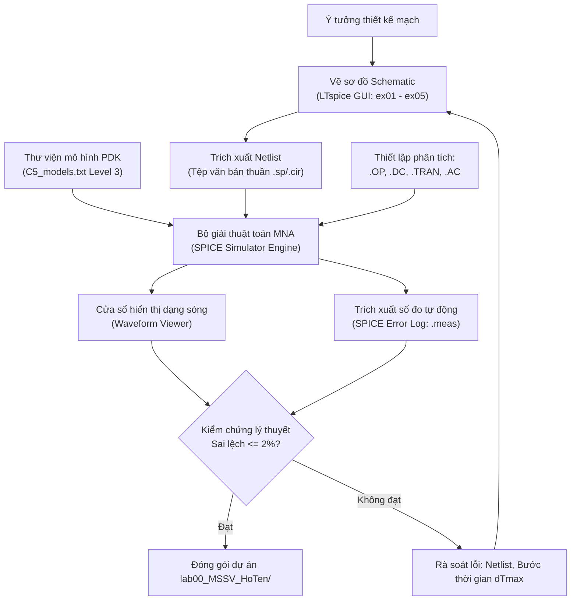

# TÀI LIỆU GIẢNG DẠY VÀ CẨM NANG SƯ PHẠM: CHƯƠNG 0 (LAB 00)
# NHẬP MÔN MÔ PHỎNG SPICE VỚI LTSPICE & MẠCH RC CƠ BẢN
*(Tài liệu chuyên môn lưu hành nội bộ dành riêng cho Giảng viên & Trợ giảng — Bộ môn ĐTVT, Trường ĐH Sư phạm Kỹ thuật – ĐH Đà Nẵng)*

> **Quy định bảo mật học liệu:** Không phân phát tài liệu này cho sinh viên. Dùng làm cẩm nang hướng dẫn đứng lớp, cung cấp cơ sở vật lý toán, kịch bản hướng dẫn, phương pháp đặt câu hỏi gợi mở (Socratic Questioning), dữ liệu đối chuẩn SPICE Benchmark và các lưu ý kỹ thuật.

---

## 0.1. VAI TRÒ CỦA LAB 0 TRONG HỌC PHẦN THIẾT KẾ VLSI
Trong chương trình đào tạo Thiết kế Vi mạch VLSI, sinh viên thường gặp khó khăn lớn khi phải đối mặt đồng thời với hai thách thức:
1. Độ phức tạp của các công cụ EDA chuyên dụng (như Electric VLSI, Cadence Virtuoso, Synopsys).
2. Sự trừu tượng của các mô hình vật lý bán dẫn phi tuyến tính dưới-micron (Submicron MOSFET).

**Lab 0 đóng vai trò là "vùng đệm an toàn" (Sandbox & Onboarding Lab):**
- Tách biệt kỹ năng sử dụng công cụ mô phỏng SPICE khỏi sự phức tạp của vật lý bán dẫn.
- Sinh viên sử dụng các linh kiện tuyến tính thụ động quen thuộc ($R, C$, nguồn điện) để làm chủ quy trình khoa học: *Tính trước $\to$ Dựng sơ đồ $\to$ Xuất Netlist $\to$ Chạy mô phỏng $\to$ Đo đạc tự động `.meas` $\to$ So sánh và giải thích sai lệch*.
- Mạch RC bậc nhất trong Lab 0 chính là **mô hình tương đương cơ sở** để giải thích toàn bộ động học nạp xả, độ trễ truyền lan ($t_{pd} \approx 0,69 \cdot R_{on} \cdot C_L$) và nỗ lực logic (Logical Effort) xuyên suốt từ Lab 1 đến Lab 10.

---

## 0.2. MỤC TIÊU VÀ CHUẨN ĐẦU RA (CLO MAPPING)

| Mục tiêu bài Lab 0 | Chuẩn đầu ra học phần (CLO) | Mức độ nhận thức (Bloom) | Tiêu chí đánh giá cụ thể |
| :--- | :---: | :---: | :--- |
| **G0.1:** Đọc hiểu cú pháp Netlist SPICE và giải thuật MNA | CLO1, CLO2 | Mức 2 (Hiểu) | Trình bày được bản chất của Netlist, giải thuật MNA và vai trò của nút đất mốc chuẩn `0`. |
| **G0.2:** Dựng sơ đồ, xuất netlist và nhận diện tiền tố đơn vị | CLO1, CLO2 | Mức 3 (Áp dụng) | Vẽ đúng sơ đồ, xuất netlist sạch sẽ, nhận diện chuẩn xác bẫy tiền tố (`m` vs `Meg`, `1F` vs `1f`). |
| **G0.3:** Vận hành 4 chế độ phân tích (.op, .dc, .tran, .ac) | CLO2 | Mức 3 (Áp dụng) | Thiết lập đúng lệnh điều khiển mô phỏng cho từng yêu cầu kỹ thuật (DC, transient, tần số). |
| **G0.4:** Trích xuất kết quả bằng câu lệnh đo `.meas` tham số hóa | CLO2 | Mức 3 (Áp dụng) | Viết lệnh `.meas` đo đúng $t_{pd}, t_r, t_f, I_{peak}, f_c$ với sai lệch $\le 2,0$% so với lý thuyết. |
| **G0.5:** Khảo sát độ nhạy tham số với `.param` và `.step` | CLO2 | Mức 4 (Phân tích) | Quét giá trị điện trở, vẽ đồ thị thực nghiệm và xác nhận độ dốc $\text{Slope} = \ln(2) \cdot C$. |
| **G0.6:** Kiểm chéo độc lập hai miền thời gian - tần số | CLO2 | Mức 4 (Phân tích) | Tính tích số $t_r \cdot f_c$ và chứng minh tính bất biến $\frac{\ln(9)}{2\pi} \approx 0,35$. |
| **G0.7:** Liên kết mô hình MOSFET C5N và giải thích phi tuyến | CLO1, CLO2 | Mức 4 (Phân tích) | Gọi mô hình C5N Level 3, đo dòng $I_D$, giải thích sai lệch so với mô hình bậc hai. |
| **G0.8:** Tổ chức và đóng gói thư mục dự án chuẩn kỹ thuật | CLO4 | Mức 3 (Áp dụng) | Thư mục `lab00_MSSV_HoTen/` ngăn nắp, đầy đủ sơ đồ, netlist, waveforms, report 3–4 trang. |

---

## 0.3. KIẾN THỨC NỀN VỀ SPICE, NETLIST VÀ PHƯƠNG PHÁP MNA

### 1. Bản chất giải thuật MNA (Modified Nodal Analysis)
SPICE không đơn thuần là một phần mềm vẽ mạch; bản chất cốt lõi của SPICE là một **bộ giải hệ phương trình vi phân đại số phi tuyến (Nonlinear Differential-Algebraic Equation Solver)**.

Hệ phương trình trạng thái tổng quát của mạng điện trong SPICE:
$$[\mathbf{G}] \cdot [\mathbf{V}] + [\mathbf{C}] \cdot \left[\frac{d\mathbf{V}}{dt}\right] = [\mathbf{I}]$$

Trong đó:
- $[\mathbf{G}]$: Ma trận dẫn nạp tĩnh (Conductance matrix) đại diện cho các điện trở và nguồn phụ thuộc tuyến tính.
- $[\mathbf{C}]$: Ma trận điện dung và điện cảm (Capacitance/Inductance matrix).
- $[\mathbf{V}]$: Véc-tơ điện thế nút cần tìm tại mọi nút trong mạch.
- $[\mathbf{I}]$: Véc-tơ kích thích từ các nguồn dòng và nguồn áp độc lập.

**Vai trò sinh tử của nút đất `0` (Node 0):**  
Theo định luật Kirchhoff, điện thế chỉ có ý nghĩa tương đối (hiệu điện thế). Để hệ phương trình MNA có nghiệm duy nhất, ma trận dẫn nạp bắt buộc phải chọn một nút làm mốc thế chuẩn ($0\,\text{V}$). Nếu người vẽ quên đặt cọc nối đất, ma trận $[\mathbf{G}]$ sẽ bị suy biến định thức ($\det[\mathbf{G}] = 0$), SPICE lập tức báo lỗi: **`Singular Matrix`**, **`Node is floating`** hoặc **`no DC path to ground`**.

### 2. Mối quan hệ giữa 5 thành phần trong hệ sinh thái SPICE
Giảng viên vẽ lên bảng lưu đồ phân biệt 5 khái niệm mà sinh viên hay nhầm lẫn:
```
+---------------+     Biên dịch      +---------------+     Tham chiếu     +---------------+
|   SCHEMATIC   | -----------------> |    NETLIST    | <----------------- |     MODEL     |
| (Bản vẽ đồ họa|                    | (Mã văn bản   |                    | (Mô hình toán |
|  trực quan)   |                    |  mô tả kết nối|                    |  vật lý linh  |
+---------------+                    +---------------+                    |  kiện PDK)    |
                                             |                            +---------------+
                                             v Nạp vào
                                     +---------------+
                                     |   SIMULATOR   | (Giải thuật tích phân MNA)
                                     +---------------+
                                             | Xuất dữ liệu
                                             v
                                     +---------------+
                                     | WAVEFORM VIEW | (Hiển thị đồ thị & .meas)
                                     +---------------+
```

---

## 0.4. GIẢI THÍCH BỐN CHẾ ĐỘ PHÂN TÍCH CƠ BẢN

| Chế độ phân tích | Câu hỏi vật lý cần trả lời | Bản chất toán học của thuật toán | Ví dụ ứng dụng trong VLSI |
| :---: | :--- | :--- | :--- |
| **`.OP`** | Mạch đang ở trạng thái phân cực nào khi chưa có tín hiệu biến thiên? | Triệt tiêu đạo hàm $\frac{d\mathbf{V}}{dt} = 0$. Tụ hở mạch, cuộn cảm ngắn mạch. Giải hệ phi tuyến bằng **lặp Newton-Raphson**. | Tìm điểm làm việc tĩnh, kiểm tra phân cực transistor, đo dòng rò tĩnh. |
| **`.DC`** | Ngõ ra biến đổi thế nào khi một nguồn áp vào thay đổi từ từ? | Thực hiện một chuỗi các phân tích `.OP` liên tiếp tại từng bước điện áp ngõ vào được chỉ định. | Khảo sát đường đặc tuyến truyền đạt điện áp $VTC$ ($V_{out} - V_{in}$) của Inverter. |
| **`.TRAN`** | Điện áp và dòng điện thay đổi theo thời gian thực ra sao khi có xung? | Rời rạc hóa thời gian bằng các phương pháp tích phân số: **Trapezoidal Rule** hoặc **Gear Method**. Bước cực đại $dT_{max} \le \tau/1000$. | Đo thời gian trễ truyền lan $t_{pd}$, thời gian sườn tăng $t_r$, sườn giảm $t_f$. |
| **`.AC`** | Mạch khuếch đại hoặc suy giảm tín hiệu ra sao ở các tần số khác nhau? | Tuyến tính hóa mạng phi tuyến quanh điểm tĩnh DC; giải hệ phương trình đại số phức theo tần số góc $\omega$. | Vẽ biểu đồ Bode biên độ và pha; đo tần số cắt $f_{-3\text{dB}}$ và dải thông băng tần. |

---

## 0.5. PHÂN TÍCH VẬT LÝ MẠCH RC & ĐỘNG HỌC PHÓNG NẠP

### 1. Phương trình vi phân nạp và xả
Xét mạch $R$ nối tiếp $C$ kích thích bởi nguồn nhảy bậc $V_0 \cdot u(t)$:
- Theo định luật Kirchhoff dòng điện (KCL) tại nút ngõ ra:
  $$\frac{v_{in}(t) - v_C(t)}{R} - C \frac{dv_C(t)}{dt} = 0 \implies \frac{dv_C(t)}{dt} + \frac{1}{RC} v_C(t) = \frac{v_{in}(t)}{RC}$$

**Nghiệm quá trình nạp ($0 \le t < T_{on}$, điều kiện đầu $v_C(0) = 0$):**
$$v_C(t) = V_0 \left(1 - e^{-t/\tau}\right) \quad \text{với } \tau = R \cdot C$$

**Nghiệm quá trình xả ($t \ge T_{on}$, đặt $t' = t - T_{on}$, điều kiện đầu $v_C(T_{on})$):**
$$v_C(t') = v_C(T_{on}) \cdot e^{-t'/\tau}$$

### 2. Năng lượng và Cân bằng nhiệt động học trong mạch RC
- Điện tích nạp vào tụ: $Q = C \cdot V_0$.
- Năng lượng tổng do nguồn cung cấp trong suốt quá trình nạp:
  $$E_{source} = \int_0^\infty V_0 \cdot i(t) \, dt = V_0 \int_0^\infty dq = C \cdot V_0^2$$
- Năng lượng thực tế tích trữ trong điện trường của tụ điện:
  $$E_C = \int_0^{V_0} v_C \cdot C \, dv_C = \frac{1}{2} C V_0^2$$
- Năng lượng tiêu tán dưới dạng nhiệt trên điện trở $R$:
  $$E_R = E_{source} - E_C = \frac{1}{2} C V_0^2$$

> [!TIP]
> **Điểm sư phạm sâu sắc:** Năng lượng tổn hao trên điện trở nạp **luôn bằng đúng $\frac{1}{2}CV_0^2$, hoàn toàn không phụ thuộc vào giá trị của $R$!** Dù điện trở cực nhỏ hay cực lớn, một nửa năng lượng vẫn bị tiêu tán. Đây chính là gốc rễ của công thức công suất động tiêu tán trong vi mạch số ở Chương 4: $P_{dyn} = \alpha \cdot C_L \cdot V_{DD}^2 \cdot f$.

### 3. Bảng mốc thời gian quy ước nạp điện
| Thời gian | Điện áp nạp đạt được | Phần trăm so với $V_0$ | Ý nghĩa kỹ thuật |
| :---: | :---: | :---: | :--- |
| **$0,693 \tau$** | $0,500 V_0$ | 50,0% | Mốc đo độ trễ truyền lan $t_{50}$ danh định. |
| **$1,0 \tau$** | $V_0(1 - e^{-1}) \approx 0,632 V_0$ | **63,2%** | Hằng số thời gian $\tau$ của mạch. |
| **$2,197 \tau$** | Khoảng cách từ 10% đến 90% | $\Delta = 80$% | Thời gian sườn xung tăng $t_r \approx 2,2 \tau$. |
| **$3,0 \tau$** | $V_0(1 - e^{-3}) \approx 0,950 V_0$ | 95,0% | Điểm chuyển tiếp gần bão hòa. |
| **$5,0 \tau$** | $V_0(1 - e^{-5}) \approx 0,9933 V_0$ | **99,33%** | **Quy ước kỹ thuật xem tụ đã nạp no hoàn toàn.** |

---

## 0.6. ĐÁP ÁN CHI TIẾT CÂU HỎI PRE-LAB

Dưới đây là lời giải chuẩn xác dùng để chấm bài kiểm tra đầu giờ của sinh viên:

### Câu P1: Đơn vị trong SPICE
- Nhập `4.7M`: SPICE không phân biệt hoa thường, hiểu chữ `M` là **milli** ($10^{-3}$). Do đó giá trị thực tế là $4,7\,\text{m}\Omega = 0,0047\,\Omega$.
- Nhập `22uF`: SPICE hiểu tiền tố `u` là **micro** ($10^{-6}$), chữ cái `F` đứng sau bị bỏ qua $\implies 22\,\mu\text{F}$.
- **Cú pháp chuẩn:**
  * Muốn khai báo $4,7\,\text{M}\Omega$: Bắt buộc phải gõ `4.7Meg`.
  * Muốn khai báo $22\,\text{pF}$: Gõ `22p` (hoáu `22pF`).

### Câu P2: Phân tích mạch phân áp DC ($V_{in} = 10,0\,\text{V}, R_1 = 15\,\text{k}\Omega, R_2 = 10\,\text{k}\Omega$)
- Điện áp tĩnh ngõ ra:
  $$V_{out} = V_{in} \cdot \frac{R_2}{R_1 + R_2} = 10,0 \cdot \frac{10}{15 + 10} = \mathbf{4,000\,\text{V}}$$
- Dòng điện tĩnh qua mạch:
  $$I = \frac{V_{in}}{R_1 + R_2} = \frac{10,0\,\text{V}}{25\,\text{k}\Omega} = \mathbf{0,400\,\text{mA}} = 400\,\mu\text{A}$$
- Độ dốc đặc tuyến truyền đạt:
  $$\frac{dV_{out}}{dV_{in}} = \frac{R_2}{R_1 + R_2} = \frac{10}{25} = \mathbf{0,4000}$$

### Câu P3: Mạch quá độ RC ($R = 5\,\text{k}\Omega, C = 10\,\text{nF}, V_0 = 5,0\,\text{V}$)
- Hằng số thời gian:
  $$\tau = R \cdot C = 5\,\text{k}\Omega \times 10\,\text{nF} = \mathbf{50,00\,\mu\text{s}}$$
- Trễ 50%:
  $$t_{50} = \ln(2) \cdot \tau = 0,69315 \times 50\,\mu\text{s} = \mathbf{34,66\,\mu\text{s}}$$
- Thời gian sườn tăng 10%–90%:
  $$t_r = \ln(9) \cdot \tau = 2,1972 \times 50\,\mu\text{s} = \mathbf{109,86\,\mu\text{s}} \approx 110\,\mu\text{s}$$
- Tần số cắt $-3\,\text{dB}$:
  $$f_c = \frac{1}{2\pi RC} = \frac{1}{2\pi \times 50\,\mu\text{s}} = \mathbf{3183,1\,\text{Hz}} \approx 3,183\,\text{kHz}$$

### Câu P4: Thiết lập nguồn xung PULSE cho mạch Câu P3
- Để tụ nạp đạt $> 99$% (mốc $5\tau$), xung mức cao cần duy trì tối thiểu:
  $$T_{on} \ge 5\tau = 5 \times 50\,\mu\text{s} = \mathbf{250\,\mu\text{s}}$$
- Để tụ xả về $< 1$% (thêm $5\tau$ ở mức thấp), chu kỳ xung tối thiểu:
  $$T_{period} \ge 10\tau = 10 \times 50\,\mu\text{s} = \mathbf{500\,\mu\text{s}}$$

### Câu P5: Phân tích độ nhạy tham số
- Độ trễ truyền lan: $t_{pd} = \ln(2) \cdot R \cdot C$. Vì $t_{pd}$ tỉ lệ thuận bậc nhất với $C$, khi $C' = 2C$ thì trễ **tăng gấp đôi** ($t'_{pd} = 2 t_{pd}$).
- Tần số cắt: $f_c = \frac{1}{2\pi RC}$. Vì $f_c$ tỉ lệ nghịch với $C$, khi $C' = 2C$ thì tần số cắt **giảm đi một nửa** ($f'_c = f_c / 2$).

### Câu P6: Phác thảo dạng sóng xung hẹp ($T_{on} = 3\tau$)
- Điện áp đỉnh mà tụ đạt được:
  $$v_C(3\tau) = V_0 (1 - e^{-3}) = 5,0 \times (1 - 0,04979) = \mathbf{4,751\,\text{V}} \quad (95,02\text{ pct} \cdot V_0)$$
- **Nhận xét vật lý:** Tụ **chưa nạp đầy** đến $5,0\,\text{V}$ (vẫn còn thiếu $0,249\,\text{V}$). Xung điện áp trên tụ bị cụt đầu; khi ngắt xung ở $t = 3\tau$, tụ lập tức phóng điện từ mốc $4,751\,\text{V}$ xuống đất.

---

## 0.7. HƯỚNG DẪN TỔ CHỨC BUỔI THỰC HÀNH (KỊCH BẢN 135' & 225')

### Kịch bản A: Khung chuẩn 135 phút (Ca 3 tiết tiêu chuẩn — Khung chính)
- **00–15' (15 phút):** Điểm danh, thu/kiểm tra bài Pre-lab. Hướng dẫn tạo thư mục chuẩn `lab00_MSSV_HoTen/`, chép tệp `C5_models.txt` từ `04 - Models_and_Libraries/`. Giới thiệu giao diện LTspice, cách xuất Netlist và vai trò nút `0`.
- **15–35' (20 phút):** Giảng viên làm mẫu **Ex0.1** (`ex01_divider.asc`); giải thích `.op`, `.dc` và đối chiếu độ dốc đặc tuyến. Sinh viên thao tác theo và ghi số liệu.
- **35–75' (40 phút):** **Trọng tâm Ex0.2** (`ex02_rc_tran.asc`): Cấu hình nguồn PULSE ($5\tau / 10\tau$), đặt `dTmax = 0.1u`. Thiết lập khối đo `.meas` tham số hóa. Sinh viên tự đo 5 thông số ($t_{pd}, t_r, t_f, I_{peak,chg}, I_{peak,dis}$). Hướng dẫn giải thích vì sao $|I_{peak,dis}| = 248,3\,\mu\text{A}$ lệch 0,67% so với đỉnh nạp.
- **75–100' (25 phút):** Hướng dẫn **Ex0.3** (`ex03_rc_ac.asc`): Chạy `.ac dec 20 10 1Meg`, đo tần số cắt $f_c$ và góc pha $-45^\circ$. Yêu cầu sinh viên tính ngay tích số $t_r \cdot f_c \approx 0,35$.
- **100–120' (20 phút):** Sinh viên tự lập thực hiện **Ex0.4** (`ex04_rc_step.asc`): Đặt `{Rval}`, chạy `.step`, xuất 4 điểm trễ và vẽ đồ thị thực nghiệm $t_{pd} - R$. Xác nhận độ dốc $\text{Slope} \approx 3,466\,\mu\text{s}/\text{k}\Omega$.
- **120–135' (15 phút):** Giảng viên demo nhanh **Ex0.5** (`ex05_nmos_test.asc`): Gọi model `N` C5N Level 3, giải thích nguyên nhân dòng $I_D \approx 1,4\,\text{mA}$ thấp hơn công thức bậc hai. Hướng dẫn thử nghiệm lỗi có chủ đích (Fault Injection) và giao nhiệm vụ đóng gói báo cáo nộp về nhà.

### Kịch bản B: Khung mở rộng 225 phút (Ca 5 tiết tích hợp — Tùy chọn)
- Dành thêm 20 phút cho Ex0.2 để sinh viên thay đổi `dTmax` từ `0.1u` lên `20u` và quan sát sai số trễ tăng vọt.
- Dành 30 phút cho sinh viên tự tay thực hành Ex0.5 tại lớp, mở tệp `C5_models.txt` tìm hiểu các tham số $VTO, KP, TOX, VMAX, THETA$.
- Dành 25 phút cuối giờ để kiểm tra vấn đáp từng nhóm sinh viên tại bàn máy.

---

## 0.8. HƯỚNG DẪN CHI TIẾT TỪNG BÀI THỰC HÀNH (EX0.1 – EX0.5)

### Ex0.1: Phân tích mạch phân áp DC (.op, .dc)
1. **Kiến thức giảng viên cần giải thích:**
   - Định luật Kirchhoff dòng điện tại nút `out`: $V_{out} = V_{in} \frac{R_2}{R_1 + R_2}$.
   - Khái niệm điểm làm việc tĩnh DC: Tụ điện coi như hở mạch hoàn toàn.
2. **Kịch bản hướng dẫn:**
   - Hướng dẫn lưu tên tệp đúng quy chuẩn: `ex01_divider.asc`, xuất netlist `ex01_divider.sp`.
   - Xem menu **View $\to$ SPICE Netlist** để sinh viên thấy rõ các dòng kết nối nút.
3. **Kết quả tham chiếu:**
   - $V_{in} = 5,0\,\text{V}, R_1 = 12\,\text{k}\Omega, R_2 = 18\,\text{k}\Omega$:
     * $V(out) = \mathbf{3,0000\,\text{V}}$ (Sai số 0,00%).
     * $I(R_1) = \mathbf{0,1667\,\text{mA}} = 166,7\,\mu\text{A}$.
     * Độ dốc đặc tuyến $\frac{\Delta V_{out}}{\Delta V_{in}} = \frac{18}{30} = \mathbf{0,6000}$.
4. **Câu hỏi gợi mở vấn đáp:**
   - *"Nếu nguồn vào tăng lên $10\,\text{V}$, điện áp $V_{out}$ bằng bao nhiêu và công suất tiêu tán toàn mạch tăng gấp mấy lần?"* (Đáp: $6,0\,\text{V}$; công suất tăng 4 lần vì $P = V^2 / R$).

---

### Ex0.2: Mô phỏng quá độ nạp và xả của mạch RC (.tran, .meas)
1. **Kiến thức giảng viên cần giải thích:**
   - Cơ chế nạp xả: Tụ tích trữ điện tích $q = C \cdot v_C$, dòng điện $i_C = C \frac{dv_C}{dt}$. Điện áp không thể thay đổi nhảy bậc vì dòng điện hữu hạn.
   - Bản chất của câu lệnh `.meas`: Tự động bắt thời điểm giao cắt điện áp.
2. **Phân tích sâu về đỉnh dòng nạp và dòng xả:**
   - **Đỉnh dòng nạp ($t = 0^+$):** Điện áp ban đầu trên tụ $v_C(0) = 0\,\text{V}$. Khi xung nhảy lên $5,0\,\text{V}$, toàn bộ $5\,\text{V}$ rơi trên điện trở:
     $$I_{peak,chg} = +\frac{5,0\,\text{V}}{20\,\text{k}\Omega} = \mathbf{+0,2500\,\text{mA}} = +250,0\,\mu\text{A}$$
   - **Đỉnh dòng xả ($t = 500\,\mu\text{s}^+$):** Vì thời gian nạp $T_{on} = 500\,\mu\text{s} = 5\tau$, tụ chỉ mới nạp tới:
     $$v_C(5\tau) = 5,0 \cdot (1 - e^{-5}) = 5,0 \times (1 - 0,006738) = \mathbf{4,9663\,\text{V}} \quad (\text{không phải } 5,0\,\text{V}!)$$
     Khi nguồn vào nhảy về $0\,\text{V}$, dòng điện phóng ngược từ tụ về đất:
     $$I_{peak,dis} = \frac{0\,\text{V} - 4,9663\,\text{V}}{20\,\text{k}\Omega} = \mathbf{-0,2483\,\text{mA}} = -248,32\,\mu\text{A}$$
     Độ lệch so với $-250\,\mu\text{A}$ là $\frac{250 - 248,32}{250} \approx \mathbf{0,67\text{ pct}}$.
   - **Ý nghĩa sư phạm:** Đây là cơ hội vàng để rèn luyện thói quen *"tính trước, đo sau, giải thích sai lệch"*. Sinh viên đo ra $-248,3\,\mu\text{A}$ không phải do SPICE đo sai, mà là do bản chất tụ chỉ nạp được 99,33% sau $5\tau$!
3. **Kết quả tham chiếu:**
   - $\tau = 20\,\text{k}\Omega \times 5\,\text{nF} = 100,0\,\mu\text{s}$.
   - Trễ 50%: $t_{pd} = \ln(2) \cdot \tau = \mathbf{69,315\,\mu\text{s}}$ (SPICE đo được: $69,32\,\mu\text{s}$, sai lệch $< 0,05$%).
   - Sườn tăng 10%–90%: $t_r = \ln(9) \cdot \tau = \mathbf{219,72\,\mu\text{s}}$ (SPICE đo được: $219,7\,\mu\text{s}$).
   - Sườn giảm 90%–10%: $t_f = \ln(9) \cdot \tau = \mathbf{219,72\,\mu\text{s}}$ (SPICE đo được: $219,7\,\mu\text{s}$).

---

### Ex0.3: Phân tích đáp ứng tần số AC và Biểu đồ Bode (.ac)
1. **Kiến thức giảng viên cần giải thích:**
   - Mạch RC là bộ lọc thông thấp bậc một (First-Order Low-Pass Filter).
   - Hàm truyền đạt:
     $$H(j\omega) = \frac{1}{1 + j\omega RC} \implies |H(j\omega)| = \frac{1}{\sqrt{1 + (\omega RC)^2}}, \quad \angle H(j\omega) = -\arctan(\omega RC)$$
   - Tại tần số cắt $f_c = \frac{1}{2\pi RC} = \frac{1}{2\pi \times 100\,\mu\text{s}} = \mathbf{1591,55\,\text{Hz}} \approx 1,592\,\text{kHz}$:
     $$|H(j\omega_c)| = \frac{1}{\sqrt{2}} \approx -3,01\,\text{dB}, \quad \angle H(j\omega_c) = -45^\circ$$
2. **Kiểm chéo hai miền độc lập (Time vs Frequency Cross-Check):**
   - Giảng viên yêu cầu sinh viên lấy số đo sườn tăng $t_r$ ở Ex0.2 và tần số cắt $f_c$ ở Ex0.3 nhân với nhau:
     $$t_r \cdot f_c = (\ln(9) \cdot RC) \cdot \left(\frac{1}{2\pi RC}\right) = \frac{\ln(9)}{2\pi} = \frac{2,1972}{6,2832} \approx \mathbf{0,3497} \approx \mathbf{0,35}$$
   - Thay số đo thực tế: $t_r = 219,72\,\mu\text{s}, f_c = 1591,55\,\text{Hz}$:
     $$219,72 \times 10^{-6}\,\text{s} \times 1591,55\,\text{s}^{-1} = \mathbf{0,3497}$$
   - Khẳng định tính nhất quán vật lý hoàn toàn của hai phân tích hoàn toàn độc lập trong SPICE.

---

### Ex0.4: Khảo sát tham số với `.param` và `.step`
1. **Kiến thức giảng viên cần giải thích:**
   - Quy luật trễ Elmore trong mạch RC: $t_{pd} = \ln(2) \cdot C \cdot R$.
   - Trễ $t_{pd}$ biến thiên tuyến tính theo $R$ với hệ số góc:
     $$\text{Slope} = \ln(2) \cdot C = 0,69315 \times 5\,\text{nF} = 3,4657 \times 10^{-9}\,\text{s}/\Omega = \mathbf{3,4657\,\mu\text{s}/\text{k}\Omega}$$
   - **Lưu ý kiểm tra đơn vị:** Không được nhầm lẫn giữa $\text{ns}/\text{k}\Omega$ và $\mu\text{s}/\text{k}\Omega$. Với mỗi $1\,\text{k}\Omega$ tăng thêm, trễ tăng thêm $3,466\,\mu\text{s}$.
2. **Kết quả tham chiếu:**
   - $R = 5\,\text{k}\Omega \implies t_{pd} = \mathbf{17,33\,\mu\text{s}}$
   - $R = 10\,\text{k}\Omega \implies t_{pd} = \mathbf{34,66\,\mu\text{s}}$
   - $R = 20\,\text{k}\Omega \implies t_{pd} = \mathbf{69,32\,\mu\text{s}}$
   - $R = 40\,\text{k}\Omega \implies t_{pd} = \mathbf{138,63\,\mu\text{s}}$
   - Độ dốc thực nghiệm từ đồ thị:
     $$\frac{\Delta t_{pd}}{\Delta R} = \frac{138,63 - 17,33}{40 - 5} = \frac{121,30\,\mu\text{s}}{35\,\text{k}\Omega} = \mathbf{3,4657\,\mu\text{s}/\text{k}\Omega}$$

---

### Ex0.5: Giới thiệu mô hình MOSFET công nghệ C5N Level 3
1. **Kiến thức giảng viên cần giải thích:**
   - Transistor NMOS trong tệp `04 - Models_and_Libraries/C5_models.txt` được khai báo là model **`N`**, chuẩn mô hình **`LEVEL = 3`**.
   - Các tham số vật lý chính trích xuất từ wafer C5N:
     * Điện áp ngưỡng: $VTO = 0,7000\,\text{V}$.
     * Tham số độ dẫn: $KP = 120,0\,\mu\text{A/V}^2$.
     * Bề dày lớp oxit cổng: $TOX = 9,5\,\text{nm}$.
     * Vận tốc bão hòa hạt dẫn: $VMAX = 1,0 \times 10^5\,\text{m/s}$.
     * Hệ số suy giảm độ linh động: $THETA = 0,0500\,\text{V}^{-1}$.
2. **So sánh mô hình bậc hai và SPICE Level 3:**
   - **Mô hình bậc hai Shichman-Hodges (tính tay):**
     $$I_{D,sat} = \frac{1}{2} K'_n \left(\frac{W}{L}\right) (V_{GS} - V_{tn})^2 = \frac{1}{2} (120\,\mu\text{A/V}^2) \left(\frac{1,2\,\mu\text{m}}{0,6\,\mu\text{m}}\right) (5,0 - 0,7)^2 = \mathbf{2,219\,\text{mA}}$$
   - **Kết quả mô phỏng SPICE Level 3:**
     $$I_D \approx \mathbf{1,35 - 1,45\,\text{mA}} \quad (\text{thường đạt } \approx 1,40\,\text{mA})$$
   - **Phân tích sai lệch ($\,\sim 37$%):**
     * Trong transistor kênh ngắn ($L = 0,6\,\mu\text{m}$), điện trường dọc $E = V_{DS}/L \approx 83\,\text{kV/cm}$ vượt quá điện trường tới hạn $E_{crit} \approx 10\,\text{kV/cm}$, làm các electron đạt vận tốc giới hạn $v_{sat} \approx 10^7\,\text{cm/s}$ (**Bão hòa vận tốc - Velocity Saturation**).
     * Điện trường vuông góc mạnh từ cực cổng ép các electron va chạm liên tục với mặt phân cách Si-SiO2, làm giảm độ linh động thực tế $\mu_{eff}$ (**Suy giảm độ linh động - Mobility Degradation**).
     * Hai hiện tượng này ghìm dòng điện thực tế xuống thấp hơn đáng kể so với dự đoán của công thức bậc hai lý tưởng.

---

## 0.9. BẢNG KẾT QUẢ MÔ PHỎNG THAM CHIẾU (BENCHMARK RESULTS)

Bảng số liệu chuẩn dùng để chấm bài và nghiệm thu sản phẩm thực hành của sinh viên:

| Bài | Thông số đo | Biểu thức lý thuyết | Giá trị Lý thuyết | Kết quả SPICE `.meas` | Sai lệch tương đối | Đánh giá nghiệm thu |
| :---: | :--- | :--- | :---: | :---: | :---: | :--- |
| **Ex0.1** | $V(out)$ (.op) | $V_{in} \frac{R_2}{R_1+R_2}$ | $3,0000\,\text{V}$ | **$3,0000\,\text{V}$** | 0,00% | Tuyệt đối chính xác |
| **Ex0.1** | $I(R1)$ (.op) | $V_{in} / (R_1+R_2)$ | $0,1667\,\text{mA}$ | **$0,1667\,\text{mA}$** | 0,00% | Dòng chảy từ `in` sang `out` |
| **Ex0.1** | Hệ số góc DC | $R_2 / (R_1+R_2)$ | $0,6000$ | **$0,6000$** | 0,00% | Tuyến tính đồng bộ |
| **Ex0.2** | Trễ $t_{pd}$ 50% | $\ln(2) \cdot RC$ | $69,315\,\mu\text{s}$ | **$69,32\,\mu\text{s}$** | $< 0,05$% | Chuẩn sai số $\le 2,0$% |
| **Ex0.2** | Sườn tăng $t_r$ | $\ln(9) \cdot RC$ | $219,72\,\mu\text{s}$ | **$219,7\,\mu\text{s}$** | $< 0,10$% | Chuẩn sai số $\le 2,0$% |
| **Ex0.2** | Sườn giảm $t_f$ | $\ln(9) \cdot RC$ | $219,72\,\mu\text{s}$ | **$219,7\,\mu\text{s}$** | $< 0,10$% | Chuẩn sai số $\le 2,0$% |
| **Ex0.2** | Đỉnh dòng nạp | $+V_0 / R$ | $+0,2500\,\text{mA}$ | **$+0,2500\,\text{mA}$** | 0,00% | Xuất hiện tại $t = 0^+$ |
| **Ex0.2** | Đỉnh dòng xả | $-v_C(5\tau) / R$ | $-0,2483\,\text{mA}$ | **$-0,2483\,\text{mA}$** | $< 0,05$% | Lệch 0,67% so với đỉnh nạp |
| **Ex0.3** | Độ lợi dải thông | $A_{V,0}$ | $1,000$ ($0\,\text{dB}$) | **$0,000\,\text{dB}$** | 0,00% | Đo tại $10\,\text{Hz}$ |
| **Ex0.3** | Tần số cắt $f_c$ | $\frac{1}{2\pi RC}$ | $1591,55\,\text{Hz}$ | **$1592\,\text{Hz}$** | $< 0,10$% | Điểm suy giảm $-3,01\,\text{dB}$ |
| **Ex0.3** | Góc pha tại $f_c$ | $-\arctan(1)$ | $-45,0^\circ$ | **$-45,0^\circ$** | $< 0,10$% | Đọc trên trục pha bên phải |
| **Ex0.3** | Kiểm chéo $t_r \cdot f_c$ | $\frac{\ln(9)}{2\pi}$ | $0,3497$ | **$0,3497$** | 0,00% | Tích số bất biến hai miền |
| **Ex0.4** | $t_{pd}$ ($R=5\text{k}$) | $\ln(2) \cdot 5\text{k} \cdot C$ | $17,329\,\mu\text{s}$ | **$17,33\,\mu\text{s}$** | 0,00% | Bước quét 1 |
| **Ex0.4** | $t_{pd}$ ($R=10\text{k}$) | $\ln(2) \cdot 10\text{k} \cdot C$ | $34,657\,\mu\text{s}$ | **$34,66\,\mu\text{s}$** | 0,00% | Bước quét 2 |
| **Ex0.4** | $t_{pd}$ ($R=20\text{k}$) | $\ln(2) \cdot 20\text{k} \cdot C$ | $69,315\,\mu\text{s}$ | **$69,32\,\mu\text{s}$** | 0,00% | Bước quét 3 |
| **Ex0.4** | $t_{pd}$ ($R=40\text{k}$) | $\ln(2) \cdot 40\text{k} \cdot C$ | $138,629\,\mu\text{s}$ | **$138,63\,\mu\text{s}$** | 0,00% | Bước quét 4 |
| **Ex0.4** | Độ dốc $\Delta t / \Delta R$ | $\ln(2) \cdot C$ | $3,4657\,\mu\text{s/k}\Omega$ | **$3,466\,\mu\text{s/k}\Omega$** | $< 0,05$% | Trùng khớp lý thuyết |
| **Ex0.5** | Dòng $I_D$ NMOS | Shichman-Hodges | $\approx 2,22\,\text{mA}$ | **$1,35 - 1,45\,\text{mA}$** | $\approx 37$% | Bão hòa vận tốc hạt dẫn |

---

## 0.10. KỊCH BẢN SOCRATIC DEBUGGING KHI THỰC HIỆN THỬ NGHIỆM LỖI CHỦ ĐÍCH

Khi hướng dẫn sinh viên thực hiện yêu cầu **Deliberate Fault Injection**, giảng viên sử dụng các câu hỏi gợi mở:

| Thử nghiệm lỗi có chủ đích | Thông báo lỗi thực tế của LTspice | Câu hỏi gợi mở giảng viên đặt cho sinh viên | Bài học kỹ thuật thu được |
| :--- | :--- | :--- | :--- |
| **Xóa cọc đất GND tại Ex0.1** | *`Singular matrix: check nodes out and in`* hoặc *`no DC path to ground`* | *"Hệ phương trình MNA giải điện áp so với mốc nào? Nếu thiếu mốc chuẩn 0V thì có tìm được nghiệm duy nhất không?"* | Hiểu bản chất toán học của nút đất chuẩn `0` trong giải thuật MNA. |
| **Gõ nhầm giá trị `10M` tại Ex0.1** | Điện áp ngõ ra tụt xuống gần $0\,\text{V}$, dòng điện vọt lên bất thường. | *"Chữ M đứng một mình trong SPICE mang ý nghĩa gì? Muốn viết Mega phải dùng cú pháp nào?"* | Khắc sâu bẫy tiền tố không phân biệt hoa thường của SPICE. |
| **Quên đặt dấu `{}` quanh biến `Rval` ở Ex0.4** | *`Can't resolve .param Rval`* hoặc 4 đường đồ thị đè khít lên nhau. | *"Làm sao LTspice phân biệt được 'Rval' là một giá trị chuỗi cố định hay là một biến số cần quét?"* | Nắm vững quy tắc khai báo biến tham số trong LTspice. |
| **Xoay ngược cực tính tụ điện ở Ex0.2** | Đồ thị dòng nạp hiển thị giá trị âm, dòng xả hiển thị dương. | *"SPICE quy ước chiều dòng điện chảy qua linh kiện hai cực như thế nào? Cực dương đang nối vào đâu?"* | Hiểu thứ tự nút trong Netlist quyết định dấu của dòng điện. |
| **Đặt tên model `NMOS` thay vì `N` ở Ex0.5** | *`Unknown model: NMOS - ignored`* hoặc *`Can't find definition of model NMOS`* | *"Tên model trên sơ đồ của em có khớp chính xác từng ký tự với dòng .MODEL trong C5_models.txt không?"* | Rèn luyện tính kỷ luật khi liên kết thư viện PDK chuẩn. |

---

## 0.11. BỘ HÌNH ẢNH KỸ THUẬT MINH HỌA CHI TIẾT (10 HÌNH KỸ THUẬT)

### Hình 0.1: Lưu đồ quy trình mô phỏng SPICE chuẩn công nghiệp


---

### Hình 0.2: Sơ đồ nguyên lý mạch phân áp DC (Ex0.1)
```
          V1 (5.0V)
             +
           (in)
             |
             +---/\/\/\/\/---+  R1 (12k)
             |
           (out) ------------> Vout = 3.0V (Đo .op)
             |
             +---/\/\/\/\/---+  R2 (18k)
             |
            GND (Nút 0)
```

---

### Hình 0.3: Đối chiếu 1-1 giữa Sơ đồ nguyên lý và Mã Netlist
```
+------------------------------------+----------------------------------------+
|      BẢN VẼ SƠ ĐỒ NGUYÊN LÝ        |          MÃ NGUỒN NETLIST TƯƠNG ỨNG    |
+------------------------------------+----------------------------------------+
|   V1 in 0 DC 5.0                   | * Lab 0 Voltage Divider Netlist        |
|   R1 in out 12k                    | V1 in 0 DC 5.0                         |
|   R2 out 0 18k                     | R1 in out 12k                          |
|   .op                              | R2 out 0 18k                           |
|                                    | .op                                    |
|                                    | .end                                   |
+------------------------------------+----------------------------------------+
```

---

### Hình 0.4: Sơ đồ mạch RC nạp xả quá độ với nguồn xung PULSE (Ex0.2)
```
                   R1 (20k)
   in ------------/\/\/\/\/------------+------------ out
   ^                                   |
   | Nguồn xung PULSE                  |
   | V1=0V, V2=5V, Ton=500u          +---+
   | Tperiod=1000u, Tr=Tf=10n        |   | C1 (5nF)
   |                                 +---+
   |                                   |
  GND (0)                             GND (0)
```

---

### Hình 0.5: Dạng sóng nạp xả quá độ với các mốc thời gian đặc trưng
```
  Điện áp (V)
   5.0V +-----------------------------+ - - - - - - - - - - - - - + V_0
        |         . - - ' '           |                           |
   4.5V | - - - -/- - - - - - - - - - | - - - - - - - - - - - - - | 90% (4.5V)
        |       /                     | \                         |
  3.16V | - - -/- - - - - - - - - - - | - \ - - - - - - - - - - - | 63.2% (1 tau)
   2.5V | - - / - - - - - - - - - - - | - - \ - - - - - - - - - - | 50% (t_50 = 0.69 tau)
        |    /                        |      \                    |
   0.5V | - / - - - - - - - - - - - - | - - - -\- - - - - - - - - | 10% (0.5V)
    0V  +--+----+---------+-----------+---------+-----------------+
        0  t10  t50      1tau        5tau      10tau             Thời gian (t)
           |<-- t_r ----->|                     |<-- t_f ------>|
```

---

### Hình 0.6: Biểu đồ Bode đáp ứng tần số của mạch lọc RC thông thấp (Ex0.3)
```
  Biên độ (dB)                                          Góc pha (độ)
    0 dB +---------------+                              0 deg +---------------+
         |               \                                    |               \
   -3 dB | - - - - - - - -* (f_c = 1.59 kHz)           -45 deg| - - - - - - - -* (f_c)
         |                 \                                  |                 \
  -20 dB |                  \ Độ dốc -20dB/dec         -90 deg|                  +-----
         +--------------------+---------> Tần số              +--------------------+-----> Tần số
         10 Hz               1.59 kHz   100 kHz               10 Hz               1.59 kHz 100 kHz
```

---

### Hình 0.7: Đồ thị quét tham số `.step` và Tính tuyến tính của trễ theo điện trở (Ex0.4)
```
  Dạng sóng quá độ V(out) theo 4 bước R         Đồ thị thực nghiệm trễ t_pd theo R
   Vout (V)                                      t_pd (us)
    5V +    R=5k   10k   20k    40k              140 |                           * (40k, 138.6us)
       |     /     /     /      /                    |                          /
       |    /     /     /      /                  70 |              * (20k, 69.3us)
    2.5| - * - - * - - * - - -*                      |             /
       |  /     /     /      /                    35 |      * (10k, 34.7us)
    0V +-+-----+-----+------+-------> t           17 | * (5k, 17.3us)
         |     |     |      |                        +---+------+------+------+-----> R (kOhm)
       tpd1  tpd2   tpd3   tpd4                          5k    10k    20k    40k
                                                      Độ dốc Slope = ln(2)*C = 3.466 us/kOhm
```

---

### Hình 0.8: Cấu trúc khai báo linh kiện MOSFET trong SPICE Netlist (Ex0.5)
```
       CỰC MÁNG (Drain: Nút 1)
              |
              |     CỰC CỔNG (Gate: Nút 2)
           +--+--+     |
           |     |<----+
           |  N  |
           |     |<----+ CỰC THÂN (Bulk: Nút 4)
           +--+--+
              |
              |
       CỰC NGUỒN (Source: Nút 3)

       CÚ PHÁP NETLIST:
       M1  drain  gate  source  bulk   N   W=1.2u   L=0.6u
       ^     ^      ^      ^      ^    ^     ^        ^
      Tên   Cực D  Cực G  Cực S  Cực B Tên Chiều    Chiều
     Linh                             Model rộng    dài kênh
     kiện                             PDK   kênh
```

---

### Hình 0.9: Cầu nối tiến hóa: Từ mạch RC cơ bản đến Cổng Inverter CMOS
```
 GIAI ĐOẠN 1: MẠCH RC THỰC HÀNH       GIAI ĐOẠN 2: CÔNG TẮC ĐIỆN TỬ       GIAI ĐOẠN 3: TẾ BÀO INVERTER CMOS
         R1 (20k)                                    Ron,p                               VDD (5V)
  Vin --/\/\/\--+-- Vout                    VDD -----/\/\/\---+                         +---+
                |                                             |                         |Mp | PMOS (Kéo lên)
              +---+                                         +---+                       +---+
              | C | (5nF)                                   |CL | (Tụ ký sinh)  Vin ----+---+---- Vout
              +---+                                         +---+                       |Mn | NMOS (Kéo xuống)
                |                                             |                         +---+
               GND                          GND -----/\/\/\---+                           |
                                                    Ron,n                                GND
  (Khảo sát mạch tuyến tính)            (Mô hình hóa kênh dẫn)              (Vi mạch tích hợp thực tế)
```

---

### Hình 0.10: Cửa sổ nhật ký lỗi SPICE Error Log và Đọc kết quả đo lường `.meas`
```
+-----------------------------------------------------------------------------------------+
|  SPICE Error Log (Phím tắt: Ctrl + L)                                            - X    |
+-----------------------------------------------------------------------------------------+
| Circuit: * Lab0 RC Circuit Transient Benchmark Netlist                                  |
|                                                                                         |
| Direct Newton iteration for .op point succeeded.                                        |
|                                                                                         |
| Measurement: t_pd                                                                       |
|   step  trig_time    targ_time    t_pd                                                  |
|      1  1.00000e-08  6.93248e-05  6.93148e-05  <-- Kết quả đo trễ 50%: 69.315 us       |
|                                                                                         |
| Measurement: t_r                                                                        |
|   step  trig_time    targ_time    t_r                                                   |
|      1  1.05361e-05  2.30258e-04  2.19722e-04  <-- Thời gian tăng: 219.72 us            |
|                                                                                         |
| Measurement: i_peak_chg                                                                 |
|   step  max_val      at_time                                                            |
|      1  0.000250000  1.00000e-08               <-- Đỉnh dòng nạp: +250.0 uA             |
|                                                                                         |
| Measurement: i_peak_dis                                                                 |
|   step  min_val      at_time                                                            |
|      1 -0.000248324  5.00010e-04               <-- Đỉnh dòng xả: -248.32 uA             |
|                                                                                         |
| Total transient steps: 14208, Points: 14208, Iterations: 28416                          |
| Simulation completed successfully in 0.047 seconds.                                     |
+-----------------------------------------------------------------------------------------+
```

---

## 0.12. RUBRIC ĐÁNH GIÁ KỸ THUẬT VÀ PHÂN QUYỀN ĐIỂM SỐ (THANG 10)

| Tiêu chuẩn đánh giá | Trọng số & CLO | Mức Xuất sắc (90% - 100%) | Mức Đạt chuẩn (70% - 85%) | Mức Cần cố gắng (< 70%) |
| :--- | :---: | :--- | :--- | :--- |
| **Chuẩn bị Pre-lab đầu giờ** | **1.5 đ**<br>*(CLO1)* | Giải đúng hoàn toàn 6 câu Pre-lab; hiểu thấu đáo đơn vị SPICE, phân áp và động học nạp xả. | Giải đúng từ 4 đến 5 câu; có sai sót nhỏ về đơn vị hoặc chưa tính hết câu xung hẹp. | Dưới 4 câu hoặc không nộp bài chuẩn bị Pre-lab. |
| **Kỹ năng thực hành tại lớp (Ex0.1 – Ex0.3)** | **3.5 đ**<br>*(CLO2)* | Dựng mạch chuẩn xác, vận hành trơn tru cả 3 chế độ `.op`, `.tran`, `.ac`. Trích xuất đầy đủ 5 số đo tự động bằng `.meas` với sai số $\le 2$%; thực hiện đúng kiểm chéo $t_r \cdot f_c$. | Dựng được mạch, chạy được mô phỏng nhưng phải nhờ trợ giúp; số liệu đo đạt sai số $\le 5$%. | Mạch không chạy, thiếu nút đất, không trích xuất được số liệu bằng `.meas`. |
| **Khảo sát tham số & MOSFET (Ex0.4 – Ex0.5)** | **2.0 đ**<br>*(CLO2)* | Thiết lập đúng biến `{Rval}`, quét đúng 4 bước, vẽ được đồ thị thực nghiệm và xác nhận độ dốc $3,466\,\mu\text{s}/\text{k}\Omega$. Gọi model C5N Level 3 đo được dòng $I_D$. | Chạy được lệnh `.step` nhưng chưa vẽ được đồ thị độ dốc; gọi được model C5N. | Quên ngoặc nhọn `{}` làm kết quả quét bị sai; không liên kết được thư viện C5N. |
| **Dự đoán – Đo đạc – Giải thích sai lệch** | **1.5 đ**<br>*(CLO1, CLO2)* | Thể hiện tư duy phân tích sâu sắc: giải thích đúng nguyên nhân dòng xả $-248,3\,\mu\text{A}$ lệch 0,67% và dòng NMOS giảm 37% do bão hòa vận tốc hạt dẫn. | Nêu được số đo nhưng phần giải thích cơ chế vật lý còn sơ sài. | Không đối chiếu giữa lý thuyết và mô phỏng; chép lại số liệu mà không hiểu bản chất. |
| **Đóng gói dự án & Báo cáo kỹ thuật (Phần B)** | **1.5 đ**<br>*(CLO4)* | Thư mục dự án tổ chức đồng bộ (5 sơ đồ, 5 netlist, waveforms, C5_models.txt); báo cáo 3–4 trang trung thực, thực hiện nghiêm túc thử nghiệm lỗi có chủ đích. | Thư mục còn thiếu một số tệp hình ảnh; báo cáo trình bày sơ sài hoặc thiếu phần thử nghiệm lỗi. | Không nộp thư mục dự án hoặc sao chép báo cáo của sinh viên khác. |

---

## 0.13. LIÊN KẾT CHUYỂN TIẾP KIẾN THỨC VỚI BÀI 1 (LAB 1 PREVIEW)

Trước khi kết thúc buổi thực hành Lab 0, giảng viên dành 5 phút chuyển tiếp tư duy cho sinh viên:
1. **Từ mạch RC sang CMOS Inverter:** Nhắc lại công thức trễ $t_{pd} \approx 0,69 \cdot RC$. Trong Lab 1, sinh viên sẽ thay điện trở $R$ bằng kênh dẫn của 2 transistor NMOS và PMOS ghép lại để tạo thành cổng đảo logic đầu tiên.
2. **Từ nguồn xung lý tưởng sang dạng sóng thực tế:** Trong Lab 1, sinh viên sẽ quan sát thấy sườn xung ngõ vào và ngõ ra không còn là các đường thẳng lý tưởng nữa mà bị uốn cong do điện dung cực cổng và cực má của transistor.
3. **Sẵn sàng môi trường làm việc:** Khẳng định với sinh viên rằng thư mục `lab00_MSSV_HoTen/` và tệp `C5_models.txt` mà các em vừa cấu hình thành công hôm nay sẽ là nền tảng dùng chung cho toàn bộ 10 bài Lab thực hành tiếp theo!\n